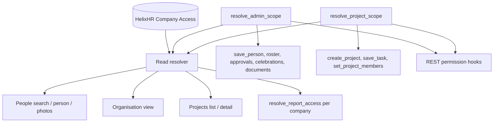
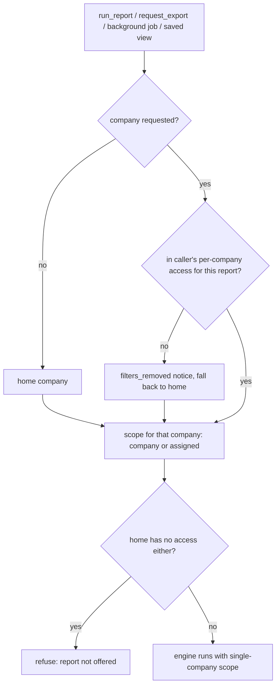
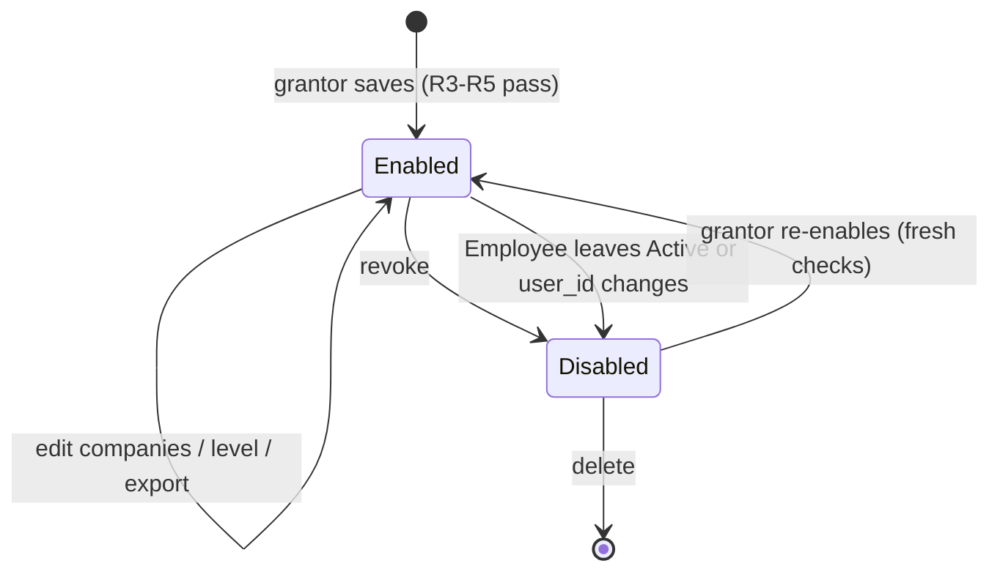

# feat: Cross-company access grants managed from Portal Admin settings

## Summary

A portal user can read data from more than one company when a Portal Admin grants it. A grant names companies and a level: **All data** opens People, Organisation, Projects and Reports for those companies; **Reports only** opens the report catalog for every employee in them. Grants are read-only, live in their own doctype, and are resolved by a new read resolver. The existing single-company resolvers keep guarding REST hooks, writes and approvals unchanged.

---

## Problem Frame

Every administrative read in the portal is scoped to exactly one company: the company of the caller's Active Employee (`resolve_admin_scope`, `_active_anchor_company`, `resolve_report_access` in `helixhr/utils.py`). Frappe Role Permissions and User Permissions on Company are never consulted, and wrapped HRMS reports run with `company` forced (`reports._scope_company`). An HR user employed by Nitco Inc therefore cannot run reports for Nitco Outsourcing Pvt Ltd, whatever Desk permissions say. This was confirmed as the root cause on 2026-10-14.

The single-company rule was deliberate (2026-09-16 multi-company defect, plan 2026-09-17-001 P6-KTD1, plan 2026-10-04-001 KTD6). The business now needs three exceptions:

- C-level users who read all data across both companies.
- Delivery Managers who read all data across both companies.
- One user who needs every-employee reports across companies and nothing else.

---

## Requirements

**Grant model and administration**

- R1. A grant belongs to one User and carries a level (All data, Reports only), a set of companies, an export flag and an enabled flag.
- R2. Portal Admin and System Manager manage grants from a new Settings section.
- R3. A System Manager or Administrator may grant any company. A Portal Admin may grant only their home company plus the companies named in their own Frappe User Permissions on Company.
- R4. No one may create, edit or revoke their own grant. A Portal Admin may edit or revoke only a grant whose every company is within their reach.
- R5. The grant target must be an Active Employee with a User, and that Employee's company must be within the grantor's reach.
- R6. Every grant change leaves an Info comment on the target User and a version row (track_changes).

**Read surfaces (All data)**

- R7. People search and the person view cover every allowed company, including leave balances, attendance and requests summaries and photos.
- R8. Organisation shows one allowed company at a time through a company picker.
- R9. Projects lists and details cover every project in the allowed companies, Delivery Managers included.
- R10. Every write, approval and configuration path keeps today's single-company or assigned-project scope. Read payloads carry `can_edit` so the UI hides controls the caller cannot use.

**Reports**

- R11. Reports gain a company filter whose options are the companies the caller may run that report for, defaulting to the home company. Each run covers one company.
- R12. Access is decided per company, so a mixed holder (for example Delivery Manager at home plus a grant on another company) gets the right scope in each.
- R13. A Reports-only grant runs every non-deny-listed catalog report with company scope for the granted companies; export follows the grant's export flag.
- R14. A company the caller may not use is removed with a `filters_removed` notice and the run falls back to the home company. It never errors and never widens.
- R15. Exports, background jobs, downloads and saved views re-check company access at the moment they act.

**Lifecycle and safety**

- R16. A grant applies only while the holder's Employee is Active. Leaving Active, or changing the Employee's `user_id`, disables the grant automatically.
- R17. Revoking or narrowing a grant takes effect on the holder's next request. The UI shows an "access changed, reload" state instead of a bare error.
- R18. Preflight lists every active grant and flags grants on non-Active or moved holders, and unknown or disabled companies.

---

## Scope Boundaries

- Cross-company writes, approvals, roster edits, celebration configuration and document publishing are out of scope.
- Desk access is unchanged. No DocPerm and no User Permission is created or widened for a grant.
- The employee-facing Directory stays home-company only.
- Payroll and other deny-listed reports stay blocked.
- No combined "All companies" report run.

### Deferred to Follow-Up Work

- Read-access log of cross-company `get_person` views and report runs (a DPDP consideration for Nitco Outsourcing Pvt Ltd); see Risks.
- Notifying the holder or the other company's admins when a grant changes.
- A combined multi-company report run with per-company subtotals.
- Pre-existing bug: background exports for unscoped callers lose the requested company (`api._queue_export` passes cleaned filters without `company`). U8's declared company filter fixes it as a side effect; no separate unit.

---

## Key Technical Decisions

- KTD1. **New read resolver; existing resolvers untouched.** `resolve_admin_scope` and `resolve_project_scope` feed the REST permission hooks (`hooks.py` permission_query_conditions / has_permission for HR Request, Document Link, Project, Task) and every write or approve gate. Widening them would leak whole documents over `/api/resource` and widen writes. A new resolver combines admin scope with the grant and is called only by read sites. The single-helper rule (P6-KTD1) still holds: one helper answers "which companies may this user read on this surface".
- KTD2. **Grant stored in its own doctype, keyed on User.** `HelixHR Company Access` has `autoname: field:user`, a child table of Companies, `track_changes: 1` and a System Manager-only DocPerm. Portal Admin writes through whitelisted endpoints with `ignore_permissions`, following `save_report_access`. DocPerm grants and Company User Permissions were rejected earlier: they exposed unmasked PII over REST, emptied results under strict mode, and hid global Document Links.
- KTD3. **Grant authority follows the grantor's own Frappe reach (user decision, 2026-10-14).**
  - System Manager and Administrator: any company.
  - Portal Admin: home company ∪ companies named in their `User Permission` rows with `allow = "Company"`. No Company rows means home only; absence is not "all", unlike Frappe's own semantics.
  - This reverses plan 2026-10-06-001 U3's "Portal Admin is config, not HR data" rationale for this one capability. `docs/architecture.md` records the reversal. Portal Admin still sees no HR data through its own role.
- KTD4. **Reads only; `can_edit` per record.** Grant-only readers get `can_edit: false` from `get_person`, `search_projects` and `get_project`. Write endpoints keep calling `employee_in_admin_scope` / `project_in_scope` on the old resolvers, so a write can never adopt the grant.
- KTD5. **Grant reads run server-side, never as the holder.** Grantees keep their self User Permission on Employee under Apply Strict User Permissions, and preflight requires it. Once the read resolver has passed, every grant-reachable read uses `frappe.get_all(..., ignore_permissions=True)`, explicit SQL, or `as_administrator`. This includes `_requests_summary` and `_attendance_month_summary`, which today go through the holder's permissions and would come back silently empty.
- KTD6. **Report access becomes per company.** `resolve_report_access` returns an access entry per allowed company (scope + `can_export`) in place of one widest scope. The engines are unchanged: the API boundary validates the picked company and hands them `{"kind": "company", "company": picked}` (or assigned scope for a Delivery Manager's home company).
- KTD7. **Company is a declared report filter spec.** Options are injected per user in `client_entry` rather than a static list, so `resolve_filters`, saved views (`_clean_view_query`), export fingerprints and the background job all carry it. A disallowed value is removed with `filters_removed` and falls back to home (R14). A static `select` would throw a ValidationError instead.
- KTD8. **Reports-only level behaves like Report Manager over the granted companies.** Every non-deny-listed catalog entry whose scopes include `company` is runnable. Export is governed by the grant's flag, not the HelixHR Report Access matrix, because a C-level holder has no matrix role. New catalog reports are included automatically.
- KTD9. **Offboarding disables the grant; re-enabling is a fresh decision.** `employee_on_update` disables the grant and comments on the User when the Employee leaves Active or `user_id` changes. The resolver also ignores grants on non-Active anchors, so the window before the hook runs is covered too.
- KTD10. **No grant cache.** Each request re-resolves the grant (one indexed read). Saving a grant calls `frappe.clear_cache(user=...)` as `set_portal_role` does. The frontend treats a 403 on a grant-gated page as "access changed, reload" rather than re-bootstrapping silently.
- KTD11. **Surface shapes.**
  - People is one list across allowed companies, with a company column and an optional company filter.
  - Organisation and Reports pick one company at a time, because headcount, queues, holidays and letter heads are per company.
  - Roster's HR mode gets its own bootstrap flag tied to `resolve_admin_scope`, so a grant never opens Roster.
- KTD12. **The export log tracks who exported as well as whose data.** `HelixHR Report Export` gains `exporter_company`, filled at insert, with existing rows backfilled from the owner's Employee. A Portal Admin sees rows where either company is in their reach.

---

## High-Level Technical Design

Which resolver each surface consults:

Report run decision (directional):

Grant lifecycle:

---

## Implementation Units

### Phase 1 — Grant model, authority and administration

### U1. Grant doctype and read resolver

- **Goal:** Store grants and answer "which companies may this user read on this surface".
- **Requirements:** R1, R16
- **Dependencies:** none
- **Files:**
  - `helixhr/helixhr/doctype/helixhr_company_access/` (`__init__.py`, `helixhr_company_access.json`, `helixhr_company_access.py`)
  - `helixhr/helixhr/doctype/helixhr_company_access_company/` (istable child, Link Company)
  - `helixhr/utils.py`
  - `helixhr/events.py`
  - `helixhr/tests/utils.py` (grant factory)
  - `helixhr/tests/test_company_access.py`
- **Approach:**
  - Doctype fields: user (unique), employee (display only), level, companies, allow_export, enabled. `validate` refuses duplicate companies, unknown companies and an empty company set.
  - The resolver reads the grant for the user and requires an Active anchor via `_active_anchor_company`. It unions the companies with the existing admin scope (home company, or unscoped) per surface.
  - Return shapes:
    - read scope: `unscoped` | `companies` (list) | `none`
    - project read scope: those kinds plus the Delivery Manager's assigned projects
  - Matching helpers (employee filters, employee-in-scope, project filters, project-in-scope) accept the new shape. Project reads that union company and assigned scope need `or_filters`.
  - `employee_on_update` disables the grant when status leaves Active or `user_id` changes, and adds an Info comment.
- **Patterns to follow:** `helixhr/helixhr/doctype/helixhr_report_access/` (System Manager DocPerm, track_changes, not a fixture); `HelixHR Celebration Recipient` child table; `resolve_project_scope` docstring style; offboarding rule in `resolve_admin_scope`.
- **Test scenarios:**
  - Happy path:
    - C-level user anchored in A with an All-data grant on B reads `companies [A, B]` for people.
    - With a Reports-only grant on B: none for people, B available to reports.
    - HR Manager anchored in A with a grant on B reads `[A, B]`.
    - An anchorless HR Manager stays unscoped and the grant is irrelevant.
  - Offboarding:
    - Holder's Employee Inactive or Suspended: the grant is ignored and the resolver returns home-only or none.
    - Use a throwaway Employee without a login for Left, because Left disables the User and survives rollback (runbook).
  - Lifecycle hook:
    - Status change to Left/Inactive/Suspended sets `enabled = 0` and adds a comment.
    - A `user_id` change disables the grant.
    - Re-activating the Employee does not re-enable it.
  - Edge:
    - Disabled grant is ignored.
    - Grant naming the home company only behaves like no grant for an HR Manager.
    - Duplicate or unknown company is refused on save.
    - Empty company set is refused.
  - Invariant: `resolve_admin_scope` and `resolve_project_scope` return identical answers before and after a grant exists, so hooks and writes are unaffected.
- **Verification:** Resolver answers match the scenarios. Existing scope tests (`test_scope_hardening.py`, `test_api_people.py`, `test_api_projects.py`) pass unchanged.

### U2. Grant authority and admin endpoints

- **Goal:** Let Portal Admin and System Manager list, save, disable and delete grants within their reach.
- **Requirements:** R2, R3, R4, R5, R6
- **Dependencies:** U1
- **Files:** `helixhr/utils.py`, `helixhr/api.py`, `helixhr/tests/test_company_access_admin.py`
- **Approach:**
  - A grantable-companies helper:
    - System Manager / Administrator → all companies.
    - Portal Admin → home ∪ `User Permission` rows with `allow = "Company"`, any `applicable_for`.
    - Anyone else → refused.
  - Endpoints:
    - list grants visible to the caller: any company in their reach
    - target search: Active Employees with a User in a reachable company, mirroring `get_portal_role_holders`
    - save with a `modified` check
    - disable
    - delete
  - Every write enforces R4/R5: no self-target, every company in the grant within reach (before and after the edit), target Active with a User, Role Profile users refused as `set_portal_role` does.
  - Every write adds an Info comment on the User and calls `clear_cache(user=target)`.
  - New rate-limit entries in `RATE_LIMIT_POLICY`.
- **Patterns to follow:** `set_portal_role` and `get_portal_role_holders` (`helixhr/api.py`); `save_report_access` savepoint and `_assert_report_access_admin`; `can_admin_portal`.
- **Test scenarios:**
  - Covers AE1. Portal Admin anchored in A with Company User Permissions on A and B grants B to an A employee: succeeds and comments.
  - Covers AE2. Portal Admin in A with no Company User Permission tries to grant B: refused. Granting A only: succeeds.
  - Covers AE3. A Portal Admin whose reach is A only tries to edit or delete a grant naming B: refused, and the grant is unchanged.
  - Self-grant refused for Portal Admin and System Manager alike.
  - Target not Active, target without a User, target outside reach, Role Profile user: each refused with the same refusal shape.
  - HR Manager (not Portal Admin) calling any endpoint: PermissionError.
  - Stale `modified` on save: refused, no partial write.
  - System Manager grants any company: succeeds.
  - Rate-limit entries exist for each new endpoint.
- **Verification:** All refusals hold when asserted as the role via `frappe.set_user`, never as Administrator.

### U3. Settings section for grants

- **Goal:** A "Company access" section in portal Settings for Portal Admin and System Manager.
- **Requirements:** R2, R6
- **Dependencies:** U2
- **Files:**
  - `frontend/src/components/settings/CompanyAccessSection.vue`
  - `frontend/src/pages/Settings.vue` (`ALL_SECTIONS`, `PORTAL_SECTIONS`)
  - `frontend/src/router.js` (`:section(...)` regex)
  - `frontend/tests/e2e/company-access.spec.ts`
- **Approach:**
  - List the grants: holder, level, companies, export, enabled.
  - Add/edit form: employee picker, level radio, company checkboxes limited to the caller's grantable companies, export toggle.
  - Grants outside the caller's reach show read-only.
  - Server refusals render inline.
- **Patterns to follow:** `frontend/src/components/settings/PortalRolesSection.vue`, `ReportAccessSection.vue`; the existing Settings section render chain. Follow the established design system; no new tokens.
- **Test scenarios:**
  - E2E: Portal Admin adds an All-data grant on the second company for a seeded employee; the row appears.
  - E2E: disable it; the row shows disabled.
  - E2E: a grant outside reach renders without edit controls.
  - E2E: HR Manager does not see the section.
- **Verification:** Section is reachable at `/settings/company-access` for Portal Admin and refused for others. `yarn lint` is clean.

### Phase 2 — Session and All-data read surfaces

### U4. Session flags, nav and access-changed state

- **Goal:** Grant holders see the right nav, and Roster stays on real admin scope.
- **Requirements:** R7, R8, R9, R13, R17
- **Dependencies:** U1
- **Files:**
  - `helixhr/api.py` (bootstrap flags)
  - `frontend/src/lib/session.js`
  - `frontend/src/components/AppShell.vue`
  - `frontend/src/pages/Dashboard.vue`
  - `frontend/src/lib/roster.js`, `frontend/src/lib/roster.test.js`
  - `helixhr/tests/test_company_access.py`
- **Approach:**
  - `can_see_people`, `can_see_organisation` and `can_see_projects` use the read resolver. `can_run_reports` already follows `resolve_report_access`, which U8 extends.
  - Add a Roster HR-mode flag from `resolve_admin_scope`; `roster.js` uses it instead of `canSeePeople`.
  - The Dashboard Reports tile uses `canRunReports`; today it uses `canSeePeople`.
  - A shared handler turns a PermissionError on People, Organisation, Projects or Reports into an "Your access changed — reload" state.
  - `get_organisation_view`'s gate and `can_see_organisation` change together so they stay equal by construction.
- **Patterns to follow:** bootstrap flag comments in `helixhr/api.py` ("the nav item and the server's gate agree by construction"); `session.js` `apply()`.
- **Test scenarios:**
  - C-level with All data: People, Organisation, Projects and Reports flags true; Roster HR flag false.
  - Reports-only holder: only `can_run_reports` true.
  - HR Manager without a grant: flags unchanged from today.
  - Vitest: `roster.js` offers HR mode only on the new flag.
  - Vitest: a session with `canSeePeople` but no Roster HR flag gets no HR mode.
  - Bootstrap after revoke: flags drop on the next bootstrap.
- **Verification:** Every flag equals its server gate for each persona.

### U5. People and photos across allowed companies

- **Goal:** People search, the person view and avatars cover allowed companies, read-only outside admin scope.
- **Requirements:** R7, R10
- **Dependencies:** U1, U4
- **Files:**
  - `helixhr/api.py` (`search_people`, `get_person` and its section readers, `_may_see_photo`, `get_person_form_options`)
  - `frontend/src/pages/People.vue` and the person view
  - `helixhr/tests/test_api_people.py`
- **Approach:**
  - Search filters on the read scope's company list and returns each row's company; the UI gains a company column and an optional company filter.
  - `get_person` gates on the read resolver.
  - Section readers that go through the holder's permissions switch to server-side reads after the gate (KTD5).
  - `can_edit` comes from `employee_in_admin_scope`.
  - `desk_url` is null outside the home admin scope.
  - Photo visibility uses the read resolver.
  - Left-employee visibility follows today's home rules.
- **Patterns to follow:** existing `search_people` pagination and `admin_scope_employee_filters` usage; P6-AE2 isolation tests in `helixhr/tests/test_api_people.py`.
- **Test scenarios:**
  - Covers AE4. C-level holder under strict mode opens a B employee: leave balances, attendance and requests summaries are populated (not zero), and `can_edit` is false.
  - Holder searches a B employee number: found. A non-holder anchored in A searches the same number: nothing (P6-AE2 unchanged).
  - `save_person` on a B employee by an A HR Manager holding a B grant: refused.
  - `get_person_form_options` for B: refused.
  - B avatar visible to the holder, not found for a non-holder.
  - Reports-only holder calls `search_people`: PermissionError.
  - Pagination and total count across two companies are stable and ordered.
- **Verification:** The two-company isolation suite passes, plus the new holder cases.

### U6. Organisation with a company picker

- **Goal:** The Organisation snapshot for any allowed company, one at a time.
- **Requirements:** R8
- **Dependencies:** U1, U4
- **Files:** `helixhr/api.py` (`get_organisation_view`, `_get_celebrations` caller), `frontend/src/pages/Organisation.vue`, `helixhr/tests/test_api_organisation.py`
- **Approach:**
  - Optional `company` parameter, validated against the read scope and defaulting to home.
  - Headcount, on-leave, queue aggregates and celebrations all use the picked company.
  - The picker appears only when more than one company is allowed.
- **Patterns to follow:** `_caller_company` and the existing single-company helpers; `_companies_in_admin_scope` for picker options.
- **Test scenarios:**
  - Holder picks B: headcount equals B's Active count and celebrations are B's.
  - Holder passes an unallowed company C: PermissionError, same shape as a missing company.
  - HR Manager without a grant passing B: refused (unchanged isolation).
  - Default with no company: home snapshot, identical to today.
- **Verification:** Existing organisation tests pass; new picker cases pass.

### U7. Projects reads across allowed companies

- **Goal:** All-data holders, Delivery Managers included, list and open every project in allowed companies; writes stay scoped.
- **Requirements:** R9, R10
- **Dependencies:** U1, U4
- **Files:**
  - `helixhr/api.py` (`search_projects`, `get_project`)
  - Projects pages under `frontend/src/pages/`
  - `helixhr/tests/test_api_projects.py`
- **Approach:**
  - Reads use the project read scope from U1 (company list unioned with assigned projects).
  - Each project carries `can_edit` from the existing `project_in_scope(resolve_project_scope)`.
  - The UI hides add-task and add-member controls when `can_edit` is false.
  - `project_permissions.py` hooks are not touched.
- **Patterns to follow:** `project_scope_filters` / `project_in_scope`; Project/Task REST hook tests.
- **Test scenarios:**
  - Delivery Manager in A, member of one A project, with an All-data grant on B: lists that A project plus every B project.
    - Can edit the A project; `can_edit` false on B.
    - `save_task` on B: refused.
  - REST `/api/resource/Project` as that holder still returns only the assigned project (hooks unchanged).
  - Holder without the Delivery Manager role, All data on B: reads B projects; `create_project` refused.
  - Non-holder: B project by name gives the same refusal as a missing one.
- **Verification:** REST hook tests and existing project tests pass unchanged.

### Phase 3 — Reports

### U8. Per-company report access and the company filter

- **Goal:** Report runs and option searches accept an allowed company, decided per company.
- **Requirements:** R11, R12, R13, R14
- **Dependencies:** U1
- **Files:**
  - `helixhr/utils.py` (`resolve_report_access`)
  - `helixhr/reports.py` (filter spec, `resolve_filters`, `client_entry`, `_scope_company`, `_entity_in_scope`, `search_options`)
  - `helixhr/api.py` (`run_report`, `get_report_catalog`, `search_report_options`, `_runnable_reports`)
  - `helixhr/tests/test_reports_access.py`, `helixhr/tests/test_api_reports.py`
- **Approach:**
  - `resolve_report_access` returns per-company entries built from the existing tiers (admin, Report Manager, HR User matrix, Delivery Manager) for the home company, plus the grant tier for granted companies. Callers pick one company's entry.
  - The catalog exposes the allowed companies per entry, and `can_export` per company.
  - A company filter type removes disallowed values into `filters_removed`. Entity filters are validated against the picked company.
  - "Open in Desk" is offered only for the home company.
- **Patterns to follow:** existing tier-gathering block in `resolve_report_access`; `_entity_in_scope`; two-company isolation tests (`test_api_reports.py` company-forced and wrapped-report isolation cases).
- **Execution note:** Start with failing tests for the per-company shape and the R14 fallback before changing `resolve_report_access`.
- **Test scenarios:**
  - Covers AE5. Delivery Manager in A with a Reports-only grant on B: project-scoped in A, company-scoped in B.
  - HR User whose matrix denies report X: X is unavailable for A but available for B via the grant.
  - Reports-only holder, no HR role, grant on B with export off:
    - runs every company-scoped catalog report for B
    - `can_export` false
    - deny-listed reports absent
  - Covers AE6. Request with company C outside access: `filters_removed` names company and the run is home data, or "not offered" when home has none. No ValidationError.
  - An employee filter naming an A employee while company is B is removed (never widens).
  - Every wrapped report: holder with B sees B rows only when B is picked; non-holder never sees B rows (extends the existing isolation loop).
  - Unscoped caller (Administrator) picking B gets B. The default company is no longer silently substituted.
- **Verification:** The full report access, catalog and isolation suites pass.

### U9. Exports, downloads, saved views and the export log

- **Goal:** Every deferred report action re-checks company access, and the log shows both companies.
- **Requirements:** R6, R15, R17
- **Dependencies:** U8
- **Files:**
  - `helixhr/api.py` (`request_export`, `_queue_export`, download endpoint, `list_report_views`, `save_report_view`, `_viewer_company`, `get_export_log`)
  - `helixhr/reports.py` (`run_background_export`)
  - `helixhr/helixhr/doctype/helixhr_report_export/helixhr_report_export.json` (`exporter_company`)
  - `helixhr/patches/v1_0/` (backfill patch) and `helixhr/patches.txt`
  - `helixhr/tests/test_reports_export.py`, `helixhr/tests/test_report_views.py`
- **Approach:**
  - The export row records the picked company (data) and `exporter_company` (owner's home).
  - The fingerprint includes company.
  - The background job and the download endpoint both re-resolve the owner's per-company access and refuse when it is gone.
  - Saved views stay shared within the viewer's home company and run through the same R14 fallback.
  - The export log filters on data company OR exporter company in the Portal Admin's reach.
  - The backfill patch sets `exporter_company` from each owner's Employee.
- **Patterns to follow:** `run_background_export` re-resolve block; existing patches with dated `patches.txt` lines; enqueue tests that name and delete their rows (`frappe.enqueue` commits).
- **Test scenarios:**
  - Covers AE7. Holder exports B in the background; the grant is revoked before the job runs: the row ends Failed with no file.
  - A Ready B file whose grant is then revoked: download refused.
  - Fingerprint: the same filters for A and for B make two rows, not one deduplicated row.
  - A saved view with company B, opened by an A-only colleague: runs A data with `filters_removed`.
  - Export log: an A Portal Admin sees an A employee's B export, and a B employee's A export. An A Portal Admin with no reach into B does not see a B employee's B export.
  - Patch backfills `exporter_company` and is idempotent.
- **Verification:** Export, view and log suites pass on a fresh site.

### U10. Reports page company picker

- **Goal:** The Reports page offers the allowed companies per report and keeps filters coherent.
- **Requirements:** R11, R14, R17
- **Dependencies:** U8
- **Files:**
  - `frontend/src/pages/Reports.vue`
  - `frontend/src/components/reports/ReportFilters.vue`
  - `frontend/src/lib/reportQuery.js`, `frontend/src/lib/reportQuery.test.js`
  - `frontend/tests/e2e/reports-company.spec.ts`
- **Approach:**
  - Render the company filter from the catalog's per-entry options; hide it when only one company is allowed.
  - Changing company clears the entity filters and passes `company` in the option-search context.
  - Show the `filters_removed` notice for company the same way as other filters.
- **Patterns to follow:** `ReportFilters.vue` select rendering; `reportQuery.js` spec validation.
- **Test scenarios:**
  - Vitest: switching company drops employee/project/department values.
  - Vitest: an unknown company value in the query string is dropped client-side.
  - E2E: holder picks the second company and runs a report; the rows show that company.
  - E2E: a non-holder sees no company filter.
- **Verification:** `yarn test`, the e2e spec and `yarn lint` pass.

### Phase 4 — Operations

### U11. Preflight check and documentation

- **Goal:** Make grants visible to operators and record the access-model change.
- **Requirements:** R18
- **Dependencies:** U1, U2, U9
- **Files:** `helixhr/preflight.py`, `helixhr/tests/test_preflight.py`, `docs/architecture.md`, `docs/runbook.md`
- **Approach:**
  - A new preflight check reports PASS with a holder count. It WARNs on:
    - a grant whose holder Employee is not Active
    - a holder whose home company has moved
    - an unknown or disabled company
  - It FAILs if the grant doctype gains any DocPerm beyond System Manager.
  - Documentation updates:
    - `docs/architecture.md`: the read resolver, the KTD3 reversal and the per-company report access.
    - `docs/runbook.md`:
      - how to give a Portal Admin reach: Company User Permissions with `Applicable For: Company`, so other doctypes are not narrowed
      - how to grant
      - the "access changed" state
- **Patterns to follow:** `CHECKS` list and `_result` helper in `helixhr/preflight.py`; `_no_grant_portal_role`; preflight tests patching `preflight.frappe`.
- **Test scenarios:**
  - No grants: PASS.
  - Grant on an Inactive holder: WARN naming it.
  - Grant naming a disabled company: WARN.
  - Extra DocPerm on the doctype: FAIL.
- **Verification:** `bench --site <site> execute helixhr.preflight.run` prints the new check.

---

## Acceptance Examples

- AE1. **Given** a Portal Admin anchored in Nitco Inc with Company User Permissions on Nitco Inc and Nitco Outsourcing, **when** they grant All data on Nitco Outsourcing to a Nitco Inc C-level employee, **then** the grant saves, the employee's User gets an Info comment, and on next load the employee sees People, Organisation, Projects and Reports with both companies.
- AE2. **Given** a Portal Admin with no Company User Permission, **when** they try to grant Nitco Outsourcing, **then** the save is refused; granting Nitco Inc alone succeeds.
- AE3. **Given** a grant naming Nitco Outsourcing created by a System Manager, **when** a Portal Admin who reaches only Nitco Inc tries to edit or delete it, **then** it is refused and shown read-only.
- AE4. **Given** a C-level holder under Apply Strict User Permissions with a self User Permission, **when** they open a Nitco Outsourcing employee, **then** leave, attendance and requests sections are populated and no edit control appears.
- AE5. **Given** a Delivery Manager in Nitco Inc with a Reports-only grant on Nitco Outsourcing, **when** they run the project timesheet report, **then** Nitco Inc gives only their assigned projects and Nitco Outsourcing gives every project.
- AE6. **Given** a user without a grant opening a shared Reports URL with `company=Nitco Outsourcing`, **when** the report runs, **then** company appears in `filters_removed` and their home company's rows are returned.
- AE7. **Given** a queued Nitco Outsourcing export, **when** the grant is revoked before the job runs, **then** the export ends Failed and no file is produced.

---

## System-Wide Impact

- **Authorization boundary:** a second read path now exists beside `resolve_admin_scope`. The architecture doc must say plainly that the self User Permission is still the boundary for permission-aware reads, and that grant reads are server-side exceptions behind the read resolver.
- **Portal Admin role:** gains authority over HR-data reach, bounded by its own Company User Permissions. This changes the threat model for the role and is recorded as a reversal.
- **REST and Desk:** unchanged by design. Hook tests guard that.
- **Performance:** one extra indexed read per gated request; People search becomes an `in` filter over two companies. No caching is added.
- **Data:** one new doctype plus child, one new field on `HelixHR Report Export`, and one backfill patch. No change to applied migrations.

---

## Risks & Dependencies

| Risk | Mitigation |
|---|---|
| A write path starts honouring the read resolver by accident | Writes keep calling the old resolvers. Each surface unit has a refusal test for a grant-only caller. Review greps the diff for `.save(`, `db_set`, `delete_doc` near new resolver calls |
| Two Portal Admins with cross-company reach grant each other | Accepted residual risk. Preflight lists every grant and version history names who saved it; deferred follow-up adds notification to the other company's admins |
| Company User Permissions given to a Portal Admin narrow their own self-service reads under strict mode | Runbook instructs `Applicable For: Company`. The resolver reads every `allow = "Company"` row regardless |
| Cross-company personal-data reads are not logged (DPDP for Nitco Outsourcing Pvt Ltd) | Deferred read-access log; grants themselves are fully audited |
| Silent empties from permission-aware sub-reads | KTD5 plus the strict-mode holder test (AE4) |
| A long-lived `test_site` masks regressions | Final run on a fresh site with `apply_strict_user_permissions = 1` (memory: fresh site is the real gate) |

---

## Documentation / Operational Notes

- **After deploy:**
  1. Run the patch.
  2. Give the granting Portal Admin Company User Permissions on both companies (`Applicable For: Company`).
  3. Create the grants in Settings → Company access.
  4. Run preflight.
- Holders must reload once after a grant change to pick up nav.
- Record the grant-authority decision as a durable memory once this lands.

---

## Open Questions

### Deferred to Implementation

- Exact names of the read resolver and its helpers, and whether the project read scope is a separate function or a surface argument.
- Whether `get_person` section readers switch to `ignore_permissions` individually or through one `as_administrator` block; choose whichever keeps HRMS helpers correct.
- Shape of the per-company access entry returned by `resolve_report_access`, provided `export_scope` semantics stay per company.
- Where the shared "access changed" handler lives in the frontend (likely beside the existing resource error handling).

---

## Sources & Research

- Root cause trace: `helixhr/utils.py` (`resolve_admin_scope`, `_active_anchor_company`, `resolve_report_access`), `helixhr/reports.py` (`_scope_company`, `_entity_in_scope`).
- Prior decisions: `docs/plans/2026-09-17-001-feat-hr-people-view-and-reports-plan.md` (P6-KTD1, P6-AE2); `docs/plans/2026-10-04-001-feat-report-system-export-and-access-plan.md` (KTD2, KTD6, isolation tests; KTD15 text is superseded by code); `docs/plans/2026-10-06-001-feat-leave-rules-and-admin-only-settings-plan.md` (U3 Portal Admin rationale).
- Constraints: `docs/architecture.md` (strict User Permissions, Document Link Company User Permission lesson, report elevated execution, Portal Admin); `docs/runbook.md` (Left disables User, fresh-site gate, enqueue commits).
- Hooks that must not widen: `helixhr/hooks.py` doc permission hooks, `helixhr/project_permissions.py`, `helixhr/helixhr/doctype/hr_request/hr_request.py`, `helixhr/helixhr/doctype/helixhr_document_link/helixhr_document_link.py`.
- External research: not run. Local Frappe scope, doctype and Settings patterns are strong and recent.
