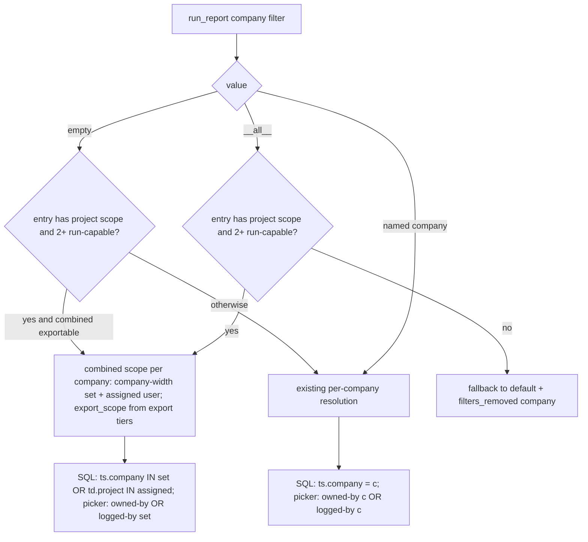
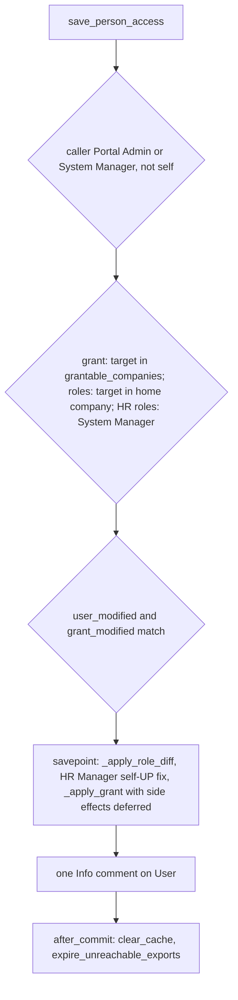

# feat: Cross-company project reports and one People & access screen

## Summary

Project reports show every hour logged on a project by people the caller may see, whichever company employs them:
- A caller allowed more than one company gets an "All my companies" run.
- Any company-scoped caller can pick projects their own company's staff log hours on.

A new Settings section, People & access, replaces the Portal roles and Company access sections. A Portal Admin sets one person's roles and cross-company access there, with quick-fill profiles, and sees a plain-language summary of what that person can see.

---

## Problem Frame

All Projects live in Nitco Inc. Nitco Outsourcing Pvt Ltd staff log time against them, and `Timesheet.company` is the logger's company. Project reports (`hours_by_project`, `project_timesheet` in `helixhr/reports.py`) cut hours by `ts.company = <one company>`. The project picker cuts projects by `Project.company` (`utils.project_scope_filters`). The result:

- Run as Nitco Inc, a project report drops every hour logged by Outsourcing staff.
- Run as Outsourcing, the picker lists no projects.

A project's Delivery Manager already sees every company's hours, because the `assigned` scope filters by project, not by company. Company-scoped callers (HR, Report Manager, grant holders) cannot. A grant holder picks one company per run (plan 2026-10-14-001, KTD11), so they never see a project's full month. Project User membership is no substitute for leadership: it also opens project administration and must be kept per project. Plan 2026-10-14-001 deferred a combined run; this plan brings it forward for project reports only.

Access is spread over five places. Frappe roles are edited in Desk, and Portal roles, Report access, Company access and Approvers each have their own Settings section. A Portal Admin has to know which screen controls which capability.

---

## Requirements

**Project reports across companies**

- R1. When a caller is allowed more than one company for a project report, the company filter lists "All my companies" first. A grant counts toward this, and so does unscoped HR.
- R2. "All my companies" is the default only when the caller may export in every included company. Otherwise the home company stays the default.
- R3. A combined run returns the hours of every allowed company, with a Company column, and its project picker lists the projects of every allowed company.
- R4. Any company-scoped caller may pick a project that has submitted or pending hours from their company's staff. Hours, tasks and employees shown stay limited to the caller's companies.
- R5. A combined run can be exported only when the caller may export in every included company, at the same width they may run it. Otherwise Export is disabled, and the reason names the blocking company.
- R6. A saved or shared view stores "All my companies" as a keyword. Each on-screen run re-resolves it to the viewer's own allowed set.
- R7. An export records the exact company set it covers. The background job, the download and the expiry check all re-check that set. If any company in it lost run or export rights, the export is refused.
- R8. These stay unchanged:
  - Delivery Manager assigned scope
  - the hours a single-company caller sees
  - every company-only report

**People & access**

- R9. A Portal Admin or System Manager opens one person and sees their access in one place:
  - managed portal roles
  - HR roles
  - the cross-company grant
  - how many people report to them
- R10. The screen offers quick-fill profiles: Employee, Delivery Manager, IT, Report Manager, Notification Manager, Leadership (All data grant) and Reports across companies (Reports only grant). HR User and HR Manager profiles appear only to a System Manager. A person whose access matches no profile shows as Custom.
- R11. Reach depends on what is being edited:

  | Edit | Who can make it | Reach |
  |---|---|---|
  | Grant | Portal Admin | `grantable_companies` |
  | Managed portal roles | Portal Admin | Home company only (unchanged) |
  | HR User and HR Manager | System Manager only | Any company |

  Roles outside these sets are never touched.
- R12. One save applies all changes for a person atomically. Its side effects (cache clear, export expiry) run only after commit. It is refused when the person changed since the screen loaded.
- R13. Changing HR Manager also fixes the person's self Employee User Permission:
  - Removing HR Manager creates the self User Permission.
  - Adding HR Manager removes it.
- R14. Self-edit is refused, and every change leaves an Info comment on the User.
- R15. A "Who has what" list shows every person in reach with their profiles and grant. It can be filtered by role or grant level on the server.
- R16. Each person shows a server-generated plain-language summary of their saved access.

---

## Scope Boundaries

- Combined runs cover only reports whose scopes include "project". Employee-centric and wrapped HRMS reports keep picking one company per run.
- Report access (the per-report matrix of HR User and Delivery Manager rights) stays its own Settings section: it is policy across roles, not per person.
- Approvers (`reports_to`) stay in Person edit and Settings → Approvers. People & access shows only the count of people reporting to the person.
- Desk Role Profiles are not supported. A target with a Role Profile still refuses the save, as today.
- A Portal Admin's role reach is not widened. Managed roles carry write capability: Delivery Manager feeds project write gates, and IT Team acts on IT requests across companies. The grant-authority rule covers read-only grants only.

### Deferred to Follow-Up Work

- Combined runs for employee-centric reports (missing timesheets, leave).
- Cross-company role reach for a Portal Admin, if the business asks for it. It needs its own decision per role.

---

## Key Technical Decisions

- KTD1. **A combined run is a declared company filter value, "All my companies", stored as a sentinel.** `resolve_report_access` resolves it into a combined scope. Today `reports.run` writes only `scope["company"]` into the result filters, which drops the sentinel. The resolver marks combined scopes, and `run()` writes the sentinel back into `clean["company"]`. Saved views, fingerprints and background jobs then carry it.
- KTD2. **The combined scope is built company by company from each company's widest run tier.** Companies at `company` width go into `companies`. A company served only by the `assigned` tier contributes `user` (assigned projects) instead. SQL becomes `ts.company in set`, or-ed with `td.project in assigned` when `user` is set. The combined `export_scope` is built the same way from export tiers. A company whose export tier is narrower than its run tier blocks combined export.
- KTD3. **The sentinel is offered only for entries with "project" in `scopes` and two or more run-capable companies.** Every other entry rejects it into `filters_removed`, the same as a disallowed company.
- KTD4. **The project picker widens in a report-local helper, never in `project_scope_filters`.** The rule is: projects owned by a scope company, plus projects with timesheet hours from a scope company. `project_scope_filters` and `project_in_scope` feed Projects pages and write gates (plan 2026-10-14-001, KTD1/KTD4). On a project owned by another company, the task and employee pickers list only tasks and employees with hours from the caller's companies.
- KTD5. **Export rows store their company set in a child table.** The child table is filterable, so `get_export_log` visibility can include rows touching an admin's companies. `HelixHR Report Export.company` keeps the home company, or the site default for an anchorless unscoped HR. The background job runs over the stored set as an explicit scope and never widens to a re-resolved set.
- KTD6. **Role and grant writes become two shared helpers:**
  - `_apply_role_diff(user_doc, add, remove)`: one User save, with the Role Profile check.
  - `_apply_grant(...)`: grant upsert or revoke.

  `set_portal_role`, `save_company_access` and the new `save_person_access(user, managed_roles, hr_roles, grant, user_modified, grant_modified)` all call them. Only the outer endpoint rate-limits and writes the Info comment.
- KTD7. **Grant side effects move to after commit inside `save_person_access`.** A flag stops `HelixHRCompanyAccess._after_change` from running cache clear and `expire_unreachable_exports` during the savepoint. One `frappe.db.after_commit` callback runs them. A rollback then never leaves deleted export files behind.
- KTD8. **Profiles are frontend templates over role and grant toggles.** The server validates the resulting toggle set, never a profile name. The "Who has what" filter sends role and grant-level criteria, not profile names.
- KTD9. **HR roles stay System Manager only, keeping the 2026-10-06-001 KTD3 boundary.** A Portal Admin never manages HR Manager, HR User, System Manager or Portal Admin.

---

## High-Level Technical Design

The company filter resolves like this:

The People & access save path:

---

## Implementation Units

### U1. Combined company scope in the report resolver

**Goal:** `resolve_report_access` accepts and defaults to the "All my companies" sentinel for project-scoped entries.

**Requirements:** R1, R2, R5, R8

**Dependencies:** none

**Files:**
- Modify: `helixhr/utils.py` (`resolve_report_access`, `can_export_report`)
- Modify: `helixhr/api.py` (`_report_access`, `run_report` filters_removed handling, `get_report_catalog` `can_export`)
- Test: `helixhr/tests/test_company_access_reports.py`

**Approach:**
- Build the combined run scope and export scope from `by_company` per company (KTD2). Mark the scope combined.
- Return `combined_option` and the blocking companies. Blocking companies are only ever named from the caller's own run set.
- The default is the sentinel only when the combined export scope covers every run company (R2).
- Unscoped HR running the sentinel gets `unscoped`, plus the concrete company list for exports.

**Patterns to follow:** `_widen_by_companies` (`helixhr/utils.py`); per-company fallback with `company_removed`.

**Test scenarios:**
- Happy path: a holder of an All data grant over both companies, with export, runs `project_timesheet` with no company. The scope is combined over both companies, the result filters show the sentinel, and Export is allowed.
- Covers R2: a holder of a Reports-only grant without export defaults to the home company, `combined_option` is still listed, and `can_export` is false with Outsourcing named.
- Delivery Manager with an Outsourcing-only grant: the combined scope is Outsourcing hours plus the DM's assigned Inc projects, and no other Inc project.
- HR User with run but no export, who is also a Delivery Manager with export: the combined export width is narrower than the run, so Export is blocked and the home company is named.
- Edge: a single-company HR passing the sentinel falls back to home, with "company" in `filters_removed`.
- Edge: the sentinel on `missing_timesheets` falls back the same way.
- Error: if the grant is revoked mid-session, a sentinel run resolves to home only.

**Verification:** only qualifying entries resolve a combined scope; the existing per-company tests still pass.

### U2. Report SQL, pickers and runner for combined and logged-by scope

**Goal:** project reports return combined hours with a Company column. Pickers list projects by ownership or by hours logged.

**Requirements:** R3, R4, R8

**Dependencies:** U1

**Files:**
- Modify: `helixhr/reports.py`:
  - `run`: writes the sentinel into the result filters
  - `_timesheet_scope_conditions`, `_hours_by_project`
  - `_option_source` for project, task and employee
  - `_entity_in_scope`
  - `_scope_company`
  - `_project_timesheet_extra`: holidays
  - per-company counts in the result meta
- Modify: `helixhr/tests/utils.py` (`ensure_company_access_fixtures`: an Outsourcing timesheet on an Inc project, shared by e2e)
- Test: `helixhr/tests/test_reports_project_timesheet.py`, `helixhr/tests/test_company_access_reports.py`

**Approach:**
- The combined branch emits `ts.company in set`, or-ed with assigned projects when `user` is set. A scope kind the conditions do not recognise raises, instead of silently returning `None`.
- Combined runs add a Company column (`ts.company`). The result meta carries the row count per company, so a row-cap notice can name the company that was cut.
- Add a report-local project filter (KTD4). On a project owned by another company, the task and employee pickers list only tasks and employees with hours from the scope companies.
- `_scope_company` returns the home company for a combined scope; it feeds only the letter head and export meta.
- Holidays:
  - Single-company run: from the run's company.
  - Combined run: from the project's company, with the row labelled with that company.

**Patterns to follow:** existing assigned-scope branch; `_hours_by_project` column allow-list (no billing or costing fields, plan 2026-09-20-001 KTD3).

**Test scenarios:**
- The Nitco case. On an Inc project, an Inc employee logs 5h and an Outsourcing employee logs 3h:
  - A grant holder's combined run totals 8h, with the Company column filled in and per-company counts of 5 and 3.
  - Inc HR without a grant sees 5h.
  - Outsourcing HR without a grant picks the Inc project, sees 3h, and the grid shades Outsourcing holidays.
- Happy path: a combined `hours_by_project` run groups both employees under the project.
- Edge: Outsourcing HR's project picker excludes an Inc project with no Outsourcing hours. Their task picker on the Inc project excludes tasks with no Outsourcing hours.
- Edge: `_pending_project_hours` obeys the same set.
- Error: Outsourcing HR passing an Inc project id with no Outsourcing hours gets the project filter in `filters_removed`.
- Integration: two-company isolation. A third company's hours never appear in a combined run.
- Integration: `search_projects` for Outsourcing HR still excludes Inc projects, because the Projects pages are not widened.

**Verification:** no engine returns an empty result for a combined scope when matching hours exist.

### U3. Exports, downloads, export log and saved views for combined runs

**Goal:** combined runs export, download, list and save correctly, with the stored company set re-checked.

**Requirements:** R5, R6, R7

**Dependencies:** U1, U2

**Files:**
- Create: `helixhr/helixhr/doctype/helixhr_report_export_company/` (child table: company)
- Modify: `helixhr/helixhr/doctype/helixhr_report_export/helixhr_report_export.json` and `.py` (child table field; `expire_unreachable_exports` loops the set)
- Modify: `helixhr/api.py` (`request_export`, `download_report_export`, `get_export_log` reach filter, `_clean_view_query`)
- Modify: `helixhr/reports.py` (`run_background_export`, `export_meta`)
- Test: `helixhr/tests/test_company_access_reports.py`, `helixhr/tests/test_report_views.py`

**Approach:**
- `request_export` refuses a combined run unless it is export-capable at full width, and stores the concrete set (unscoped HR included).
- The background job runs over the stored set as an explicit scope. It refuses when any stored company lost run or export rights, and never adds companies.
- Download and expiry check every stored company.
- `get_export_log` shows a company-scoped admin any row whose stored set touches their reach.
- A saved view keeps the sentinel verbatim. On screen it resolves per viewer, and a viewer with one company falls back with the existing notice.
- Existing export rows have an empty child table and behave as single-company. No backfill.

**Test scenarios:**
- Happy path: a holder with export in both companies makes a combined export. Both companies are stored, and the download succeeds.
- Error, export right removed in Outsourcing:
  - before the job runs: the job refuses
  - after the file exists: the download is refused and the expiry job expires it
- Error: a grant that gains a third company before the job runs does not widen the file.
- Integration: a Portal Admin whose reach is Outsourcing sees an Inc holder's combined export in the log.
- Edge: a saved combined view opened by a single-company HR runs for home with a `filters_removed` notice.
- Edge: a pre-existing single-company export row still downloads.

**Verification:** every export re-check path reads the stored set.

### U4. Reports page "All my companies" option

**Goal:** the company picker shows "All my companies" and the Company column, and explains when Export is disabled.

**Requirements:** R1, R2, R3, R5, R6

**Dependencies:** U1, U2

**Files:**
- Modify: `frontend/src/components/reports/ReportFilters.vue`, `frontend/src/lib/reportQuery.js`, `frontend/src/pages/Reports.vue`
- Test: `frontend/src/lib/reportQuery.test.js`, `frontend/tests/e2e/reports-company-access.spec.ts` (or the existing grants reports spec)

**Approach:**
- Render `combined_option` first.
- `withCompany` keeps the project and task filters when switching to or from the sentinel, and lets the server drop them via `filters_removed`. Switches between two named companies keep today's rule.
- The Export disabled reason is visible text beside the button, linked by `aria-describedby`.
- The row-cap notice names the per-company counts.

**Test scenarios:**
- Unit: `cleanCompany` keeps the sentinel. Switching from the sentinel to Outsourcing keeps the project. Switching from Inc to Outsourcing drops it, as today.
- e2e: the grant-holder fixture opens the Monthly project timesheet, sees "All my companies" selected, picks the Inc project, and sees rows from both companies with a Company column.
- e2e: a single-company HR sees no "All my companies" option.

**Verification:** `yarn lint`, `yarn test` and the touched e2e specs pass.

### U5. Shared write helpers and person access endpoints

**Goal:** read, list and save one person's access atomically, with reach split by what is edited.

**Requirements:** R9, R11, R12, R13, R14, R15, R16

**Dependencies:** none

**Files:**
- Modify: `helixhr/api.py`:
  - new: `_apply_role_diff`, `_apply_grant`, `get_person_access`, `list_people_access`, `save_person_access`
  - refactor `set_portal_role` and `save_company_access` onto the new helpers
- Modify: `helixhr/helixhr/doctype/helixhr_company_access/helixhr_company_access.py` (defer-side-effects flag)
- Modify: `helixhr/utils.py` (`RATE_LIMIT_POLICY` entries; access-summary helper)
- Test: `helixhr/tests/test_people_access.py` (new), plus the existing portal-role and company-access admin tests

**Approach:**
- **Existing reads.** `get_portal_role_holders`, `get_company_access` and `search_company_access_targets` already list people and grants. `list_people_access` replaces them in the UI and reuses their reach helpers. The old reads stay as public API.
- **Gate.**
  - The caller is a Portal Admin or System Manager, and the target is not the caller.
  - The target must be within `grantable_companies` reach.
  - Role toggles are editable only for targets in the Portal Admin's home company. Other targets show role toggles locked, with the reason "home company only".
  - An out-of-reach target gets the not-found refusal.
- **`get_person_access` returns:**
  - roles split into managed, HR and locked-other
  - the grant, with `modified`
  - the direct-report count
  - `summary`: plain sentences about saved access
  - `can_edit_roles` and `can_edit_hr_roles`
- **`save_person_access` steps:**
  - Diff against the roles held. Omitting a role the caller cannot manage never removes it.
  - Apply the self-UP fix (R13).
  - Apply the grant with side effects deferred (KTD7).
  - Write one Info comment.
- **`list_people_access`:** paged search over Active employees in reach, with `roles` and `grant_level` filters applied before paging.
- **Field allow-lists:** reads use `frappe.get_all` with an explicit field allow-list.

**Patterns to follow:** `set_portal_role` (Role Profile refusal, Info comment, `clear_cache`); `_editable_grant` (modified token); `save_report_access` (savepoint batch).

**Test scenarios:**
- Happy path: a Portal Admin whose Company User Permissions cover both companies does two saves:
  - On a home-company employee, IT plus Delivery Manager plus an All data grant are all written, with one comment.
  - On an Outsourcing employee, only the grant is written. Sending roles is refused.
- Covers R11:
  - A Portal Admin sending an HR Manager toggle is refused.
  - The target's existing HR Manager role survives a Portal Admin save.
  - A System Manager can add HR User.
- Covers R13: a System Manager removing HR Manager creates the self Employee UP. Adding HR Manager removes it. Both happen in the same savepoint.
- Covers R12: a Role Profile refusal after a grant change rolls everything back, and the target's Ready export files still exist.
- Error:
  - Self-edit is refused.
  - A stale `user_modified` or `grant_modified` is refused, with nothing written.
  - A grant company outside reach rolls back the whole save.
- Edge: a Portal Admin with no Company UP has home-only reach. An Outsourcing target reads as not found.
- Edge: `list_people_access` with `roles=[IT Team]` returns IT holders from every page.
- Integration: under strict user permissions, `list_people_access` still lists every employee in reach.
- Integration: `set_portal_role` and `save_company_access` behave as before (existing tests pass).
- Every new endpoint has a `RATE_LIMIT_POLICY` entry.

**Verification:** the new test module passes on a fresh site with strict permissions.

### U6. People & access Settings section

**Goal:** one Settings section with the "Who has what" list, a person panel, profile chips, toggles, the summary, and one Save.

**Requirements:** R9, R10, R12, R15, R16

**Dependencies:** U5

**Files:**
- Create: `frontend/src/components/settings/PeopleAccessSection.vue`
- Create: `frontend/src/components/settings/GrantEditor.vue` (company checkboxes and export toggle moved from `CompanyAccessSection.vue`)
- Create: `frontend/src/lib/accessProfiles.js`, `frontend/src/lib/accessProfiles.test.js`
- Modify: `frontend/src/pages/Settings.vue` (People & access replaces Portal roles and Company access; old section anchors redirect to it)
- Delete: `frontend/src/components/settings/PortalRolesSection.vue`, `frontend/src/components/settings/CompanyAccessSection.vue` (after the new e2e passes)
- Test: `frontend/tests/e2e/people-access.spec.ts` (new)

**Approach:**
- **Profile templates.** `accessProfiles.js` holds the profile → toggle-set templates and `matchProfiles(toggles)`, which returns the matching profiles or Custom.
- **Chip rules.**
  - Leadership and Reports across companies are mutually exclusive, because both set the single grant.
  - A role chip adds its roles. Un-toggling it removes only those roles.
  - Any manual toggle edit re-derives the chips through `matchProfiles`.
- **States.**
  - List and panel skeletons while loading.
  - Empty-list copy for no results and for a filter with no match.
  - Inline error with Retry on a failed load.
  - Controls disabled while a save is in flight.
  - The unsaved-changes bar from `ReportAccessSection.vue`.
  - Switching person while there are unsaved changes asks whether to discard them or stay.
  - A stale refusal reloads the person and says "This person changed while you were editing. Your edits were discarded."
- **Summary.** It is labelled "Current access", shows saved state only, dims while there are unsaved changes, and refreshes after save.
- **Accessibility.**
  - Chips use `aria-pressed`.
  - A locked toggle uses `aria-disabled`, with the reason as visible helper text linked by `aria-describedby`.
  - Below the tablet breakpoint, the list and the panel stack as list then detail, with a Back control and a sticky Save bar.

**Test scenarios:**
- Unit: `matchProfiles`:
  - IT plus Delivery Manager gives both chips.
  - IT plus an unknown extra role gives Custom.
  - No roles and no grant gives Employee.
  - Leadership followed by Reports across companies leaves only Reports across companies.
- e2e:
  - As Portal Admin, open the grant-holder fixture, apply Leadership with both companies, and save. The Current access summary updates.
  - As Portal Admin, the HR toggles show as locked, with the reason visible, and no HR profile chips are offered.
  - As Portal Admin, an Outsourcing employee shows role toggles locked as "home company only", while the grant stays editable.
  - As HR Manager without Portal Admin, the People & access tab is absent.

**Verification:** `yarn lint`, `yarn test`, the new e2e spec and the Settings e2e specs pass.

### U7. Preflight and docs

**Goal:** operators can see and verify the new model.

**Requirements:** R7, R11

**Dependencies:** U1–U6

**Files:**
- Modify: `helixhr/preflight.py`:
  - Extend the "Company access grants" check: WARN when a holder has run rights but not export rights in a company.
  - Check that the export child table exists.
- Modify: `docs/architecture.md`:
  - §Cross-company read grants: record the KTD6/KTD11 reversal for project reports.
  - Add a People & access section, covering the reach split and the HR Manager self-UP rule.
- Modify: `docs/runbook.md`: add "Project report missing hours from the other company" and "Who can change what".
- Test: `helixhr/tests/test_preflight.py`

**Test scenarios:**
- Preflight passes on a fresh site with the new child table.
- Preflight WARNs for a holder with run-only rights in a company.

**Verification:** `bench --site <site> execute helixhr.preflight.run` is clean on the fresh verification site.

---

## Acceptance Examples

- AE1. Inc HR without a grant opens the Monthly project timesheet for Inc project P in September. They see only Inc staff's hours, and the company filter is hidden, as today.
- AE2. A holder of an export-capable All data grant over both companies opens the same report. It defaults to "All my companies" and shows Inc and Outsourcing hours with a Company column. Switching to Outsourcing keeps P and shows only Outsourcing hours.
- AE3. Outsourcing HR without a grant picks P, because Outsourcing staff logged hours on it, and sees only Outsourcing hours, tasks and holidays.
- AE4. A Portal Admin with Company UPs for both companies opens a Delivery Manager at Outsourcing, adds Leadership over both companies, and saves. That person's next reload shows People, Organisation and Projects across both companies. Their role toggles stay locked, because the target is outside the Portal Admin's home company.

---

## System-Wide Impact

- **Auth boundary.** Combined scope is read-only and report-local. `resolve_admin_scope`, `resolve_project_scope`, REST hooks and write gates are unchanged, and role reach is unchanged.
- **Export log.** One new child table. The existing per-company re-checks gain a loop over it.
- **HR Manager toggles.** These now keep the self-UP rule in step. Desk edits still rely on the preflight check.
- **Docs.** The 2026-10-14-001 "no combined run" decision is reversed for project reports only.

---

## Risks & Dependencies

| Risk | Mitigation |
|---|---|
| A combined run comes back silently empty because a branch misses the combined kind | Unknown kinds raise; U2 tests each engine |
| Combined scope widens a Delivery Manager's home access | Per-company tier construction (KTD2); U1 DM-with-grant test |
| The project picker widening leaks into Projects pages | Report-local helper (KTD4); U2 `search_projects` test |
| A Portal Admin escalates to HR roles or cross-company roles | Server validates the toggle set and the reach split (R11); crafted-payload tests |
| A rollback leaves deleted export files | Side effects after commit (KTD7); U5 test |
| Strict user permissions empty the people list | `frappe.get_all` with allow-lists; fresh strict-site gate |

---

## Open Questions

### Deferred to Implementation

- The exact sentinel string and the child-table doctype name.
- Whether the per-company counts fit the existing `extra` payload or need a new key.

---

## Sources & Research

- Root cause: `helixhr/reports.py` `_timesheet_scope_conditions`, `_hours_by_project`, `run`; `helixhr/utils.py` `project_scope_filters`.
- Prior decisions:
  - `docs/plans/2026-10-14-001-feat-cross-company-access-grants-plan.md` (KTD1, KTD4, KTD6, KTD7, KTD11)
  - `docs/plans/2026-10-06-001-feat-leave-rules-and-admin-only-settings-plan.md` (KTD3, managed roles)
  - `docs/plans/2026-09-20-001-feat-projects-tasks-billable-reports-plan.md` (KTD3)
- Existing role and grant writes: `helixhr/api.py` `set_portal_role`, `save_company_access`, `_editable_grant`, `get_portal_role_holders`, `get_company_access`; `helixhr/utils.py` `grantable_companies`, `MANAGED_PORTAL_ROLES`, `resolve_portal_admin_scope`.
- HR Manager self-UP rule: `helixhr/preflight.py` `check_hr_manager_self_scope`, `check_employee_user_permissions`.
