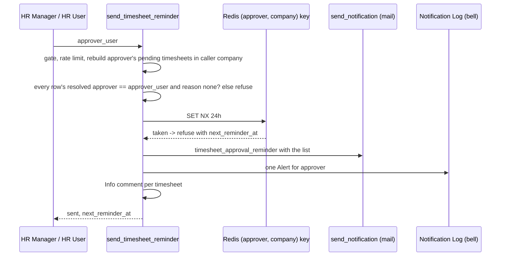

# feat: Approvals in lanes, a Timesheets tab, and HR timesheet oversight with reminders

## Summary

The Approvals page splits into three tabs:
- **Approvals:** leave, attendance, change requests and routed requests, in lanes: My team, then a collapsed Decided by me, then HR, then IT.
- **Timesheets:** every timesheet waiting on the caller. For HR, it also has an "All pending timesheets" list for the company, grouped by approver with waiting time.
- **All pending (HR Manager only):** every other pending item across all approvers, grouped by approver, with an Overdue-only toggle. It replaces the Overdue tab.

HR Manager and HR User can send an approver a manual reminder about their pending timesheets. It is batched to one mail plus one portal notification, and limited to once a day per approver. HR User gets this oversight without any approve right.

---

## Problem Frame

`get_my_approvals` returns one flat, oldest-first list. For an HR Manager who is also a line manager, that list mixes:
- their own team's leave and timesheets,
- HR-stage items,
- every routed HR Request.

Recent decisions sit in a small block of 5 from the last 7 days. Timesheets are the highest-volume kind and get lost in the mix.

HR cannot see timesheets waiting on managers until they turn overdue (`get_overdue_approvals` covers only items past the threshold). The daily digest is HR's only way to nudge a manager.

HR User has no place in Approvals today: `_is_hr` excludes it on purpose, and `resolve_admin_scope` gives it no scope.

---

## Requirements

**Approvals tab lanes**

- R1. The Approvals tab shows, in order:
  1. My team: items where the caller is the line manager, leave approver or change approver.
  2. Decided by me: a collapsed disclosure of leave, attendance, change and routed decisions from the last 14 days.
  3. HR: HR-stage items and requests routed to HR Manager, shown to HR Manager.
  4. IT: requests routed to IT Team, shown to IT Team holders and to HR Manager, who keeps today's read-only view of them.
- R2. A pending lane with no items is hidden. When every pending lane is empty, the empty state shows above the Decided disclosure. The Decided disclosure appears whenever it has items.
- R3. Timesheets are not in the Approvals tab. The tab bar shows the caller's own timesheet queue count on the Timesheets tab.

**Timesheets tab**

- R4. "Waiting on you": a line manager's team timesheets grouped by person, with the existing bulk approve.
- R5. "Waiting on HR": Pending HR timesheets, for HR Manager to act on.
- R6. "All pending timesheets", for HR Manager and HR User: every Pending Approval and Pending HR timesheet in their company, grouped by approver.
  - Each group shows the approver, the item count and the oldest wait in days.
  - Each row shows the employee, the week, and days waiting counted from `helixhr_pending_since`.
  - An Overdue-only toggle filters it.
  - The caller's own rows are marked "You".
- R7. HR User opens a timesheet read-only. A "View only" note replaces the actions.

**All pending tab**

- R8. HR Manager sees every pending non-timesheet item in their company, grouped by approver. The Overdue-only toggle reproduces today's Overdue tab for those kinds.
  - Approvers who have left, have no login, or are unmailable are flagged.
  - Unpicked role-routed requests group under the role.
  - A header line links to the Timesheets tab with its pending count.

**Manual reminders**

- R9. Send reminder appears on each approver group in "All pending timesheets", for HR Manager and HR User.
  - One reminder sends one mail plus one portal notification.
  - It lists all of that approver's pending timesheets in the caller's company.
- R10. Another reminder to the same approver about the same company is refused for 24 hours, whoever sends it. The time the next reminder is allowed shows as visible text.
- R11. A group whose approver is inactive, has no login, is unmailable, or is missing shows the reason and a link to Settings → Approvers, and no button.
- R12. Pending HR groups get no reminder button. HR is the approver.
- R13. Each reminder leaves an Info comment on every listed timesheet, so the timesheet's history shows it was chased. The template is editable in Email templates.

**Roles**

- R14. HR User with an Active Employee sees Approvals in the nav, scoped to their anchor company.
  - With only one visible tab, the tab bar is hidden.
  - The default tab is the first visible tab.

---

## Scope Boundaries

- Who may approve is unchanged. The Timesheet, Leave and Attendance approval workflows and `_assert_may_act_on` are untouched. Plan 2026-10-15-003 changes HR Request Handling transitions separately.
- No reminders for leave, attendance or requests.
- The daily digest (`send_overdue_digests`) keeps its schedule and guard.
- Company access grants do not widen oversight or reminders. Each company's HR chases its own managers.

### Deferred to Follow-Up Work

- Reminder buttons for other kinds in All pending.
- Pausing the request SLA while a request waits on the employee.

---

## Key Technical Decisions

- KTD1. **The server tags each row with `lane`: team, hr or it.** `_approval_summaries` already knows which half produced a row, so the client only groups. Counts per lane and per kind come back with the payload. HR keeps its IT-routed rows, now tagged `it`. Home's count is unchanged.
- KTD2. **Oversight comes from one HR-gated endpoint, `get_pending_by_approver(kind, overdue_only)`.**
  - It stays out of `get_my_approvals`, which every approver polls.
  - `collect_overdue` gains an optional cutoff and a company filter. The company filter is applied in SQL, before the 500-per-doctype bound.
  - `get_overdue_approvals` becomes a thin wrapper, so there is one collector, not two.
- KTD3. **A new owner resolver, separate from the digest's.** It returns `{approver_user, approver_employee, approver_name, reason}`, where reason is one of none, inactive, no_login, unmailable or no_approver. The digest's `_manager_owner` throws away the user id and the reason, so the new resolver sits beside it. Groups key on user id, then on employee, then on a no-approver bucket. Owners are resolved in batches: one Employee read and one User read per call.
- KTD4. **HR User oversight scope is the anchor company** (`_active_anchor_company`).
  - Reads use `frappe.get_all` with an explicit field allow-list, following `get_my_team_timesheets` (plan 2026-10-04-003 KTD9).
  - `get_approval_detail` gains an HR User branch, checked before `_assert_may_act_on`. It allows only kind=timesheet with the employee in the anchor company, returns the same allow-list, and gives empty actions.
  - `_is_hr` and `resolve_admin_scope` are unchanged. A new bootstrap flag, `can_oversee_timesheets`, drives the nav.
- KTD5. **The reminder target is the resolver's `approver_user`, and only when the reason is none.** The client sends `approver_user`. The server rebuilds the list and requires every listed row's resolved approver to equal it.
- KTD6. **The guard is claimed atomically, before sending.**
  - The key is per (approver, company), set with Redis `SET NX`, lasts 24h, and stores the claim time so `next_reminder_at` can be computed. It is released when nothing was queued.
  - A Redis loss allows at most one early reminder, and the per-caller `RATE_LIMIT_POLICY` entry bounds that.
  - A database-row claim was rejected: it needs a new doctype for one timestamp.
- KTD7. **Mail and bell are separate writes.**
  - The mail goes through `send_notification` with the new event `timesheet_approval_reminder`.
  - The bell is one explicit Notification Log insert for the approver, pointing at the oldest listed timesheet, as `events._notify_hr_request_status` does.
  - `send_notification` never creates a bell itself.
- KTD8. **Decided by me widens to 14 days and 25 rows, timesheets excluded.** It is still one bounded query per kind. For HR callers it remains their own decisions (`modified_by`).
- KTD9. **Grouping and lane logic move to pure helpers in `frontend/src/lib/approvalLanes.js`.** Today `Approvals.vue` holds it inline with no unit tests.

---

## High-Level Technical Design

Page layout by caller:

| Caller | Approvals tab | Timesheets tab | All pending tab |
|---|---|---|---|
| Line manager | My team, Decided | Waiting on you | — |
| HR Manager who is also a manager | My team, Decided, HR, IT | Waiting on you, Waiting on HR, All pending timesheets with reminders | Non-timesheet kinds by approver, Overdue toggle |
| HR User | Hidden unless also an approver | All pending timesheets, read-only, with reminders | — |
| IT Team | My team if a manager, Decided, IT | Waiting on you if a manager | — |

Reminder flow:

---

## Implementation Units

### U1. Lanes and decided window on the queue

**Goal:** queue rows carry `lane`, and the decided list widens.

**Requirements:** R1, R2, R3

**Dependencies:** none

**Files:**
- Modify: `helixhr/api.py` (`_approval_summaries`, `get_my_approvals`, `_recently_decided`, `_DECIDED_DAYS`, `_DECIDED_LIMIT`)
- Test: `helixhr/tests/test_approvals_lanes.py` (new)

**Approach:**
- Rows from the line-manager collectors are tagged `team`. Rows from the HR half are tagged `hr`. Routed rows are tagged by `routed_to_role`.
- `get_my_approvals` returns `counts.lanes` alongside `counts.kinds`.
- Decided excludes timesheets.

**Test scenarios:**
- Happy path: an HR Manager who manages one employee sees that employee's leave tagged `team`, a Pending HR leave tagged `hr`, and an IT-routed request tagged `it`.
- Edge: Decided includes a leave decision from 10 days ago, excludes one from 20 days ago, excludes timesheet decisions, and caps at 25.
- Edge: an HR Manager's own timesheet never appears in their `hr` lane (existing self-approval rule).
- Integration: the Home pending count for an HR Manager is unchanged.

**Verification:** every row kind carries a lane tag, and the existing approvals suite passes.

### U2. Pending-by-approver collector, resolver and endpoint

**Goal:** an HR-gated read of every pending item grouped by approver. HR User gets timesheets only.

**Requirements:** R6, R8, R11, R14

**Dependencies:** none

**Files:**
- Modify: `helixhr/reminders.py`:
  - `collect_overdue`: optional cutoff and company filter applied in SQL
  - new approver resolver (KTD3)
- Modify: `helixhr/api.py`:
  - new `get_pending_by_approver(kind=None, overdue_only=0)`
  - `get_overdue_approvals` delegates to it
- Modify: `helixhr/utils.py` (`RATE_LIMIT_POLICY`; HR User oversight scope helper beside `_active_anchor_company`)
- Test: `helixhr/tests/test_pending_by_approver.py` (new)

**Approach:**
- Who gets what:
  - HR Manager: admin scope, any kind.
  - HR User with an Active anchor: timesheets only.
  - Everyone else: refused.
- Each row has kind, name, employee, label, `pending_since`, `age_days`, `overdue` and state. A row with a null `helixhr_pending_since` is flagged "since unknown" and not counted as 0 days.
- Each group has:
  - `approver_user`, `approver_name` and `reason`
  - `count`, `oldest_days`
  - `remindable`, `next_reminder_at`
- Pending HR rows and unpicked role-routed requests group under a role pseudo-approver with `remindable=false`.
- The response sets `total_is_capped` when the 500 bound was hit.

**Patterns to follow:** `collect_overdue`, `get_my_team_timesheets` field allow-list.

**Test scenarios:**
- Happy path: two managers with 3 and 1 pending timesheets give two groups, ordered by oldest wait. Days come from `helixhr_pending_since`.
- Covers R8: `overdue_only=1` for non-timesheet kinds returns the same item set as the old `get_overdue_approvals`.
- Edge:
  - Two approvers with the same full name stay separate groups.
  - An approver who left gets reason `inactive` and `remindable=false`.
  - A missing `reports_to` gets reason `no_approver`.
  - An Outsourcing timesheet does not appear for Inc HR.
  - A large Inc backlog does not crowd Outsourcing rows out of Outsourcing HR's view, because the filter runs before the bound.
- Error:
  - HR User asking for kind=leave is refused.
  - A plain employee is refused.
  - An HR User with no Active Employee is refused.
- Integration: under strict user permissions, an HR User whose self User Permission is on still sees every pending timesheet in their company.

**Verification:** the new module passes on a fresh strict site; the digest tests still pass.

### U3. Manual timesheet reminder

**Goal:** one batched, atomically guarded reminder per approver per company.

**Requirements:** R9, R10, R11, R12, R13

**Dependencies:** U2

**Files:**
- Modify: `helixhr/api.py` (new `send_timesheet_reminder(approver_user)`)
- Modify: `helixhr/utils.py` (`NOTIFICATION_EVENTS` entry `timesheet_approval_reminder`, with tokens and default wording; `RATE_LIMIT_POLICY`)
- Modify: `helixhr/reminders.py` (guard prefix constant)
- Test: `helixhr/tests/test_timesheet_reminder.py` (new); `helixhr/tests/test_notifications.py` (its template token loop picks up the new key)

**Approach:**
- Rebuild the list inside the caller's scope. Refuse when the list is empty, when any row's resolved approver differs from `approver_user`, or when the reason is set.
- Claim the guard (KTD6), send the mail, insert the bell (KTD7), and write the per-timesheet Info comments. Release the guard if the mail queued nothing.

**Test scenarios:**
- Happy path: HR User reminds a manager with 2 pending timesheets. One mail and one Notification Log are created for the manager, the guard is set, both timesheets get the comment, and `modified` is unchanged.
- Covers R10:
  - A second call within 24h, by a different HR user, is refused with `next_reminder_at`.
  - Once the key expires, the reminder is allowed again.
- Covers R11: an inactive approver is refused with the reason, and nothing is sent.
- Edge:
  - An approver whose items are all Pending HR is refused (R12).
  - An `approver_user` that does not match the rebuilt rows is refused.
  - The digest guard and the reminder guard do not block each other.
- Error: a caller outside the approver's employees' company gets the not-found refusal.
- Rate limit: with `frappe.flags.helixhr_enforce_rate_limits` set, the policy entry applies.

**Verification:** the reminder tests pass, and the preflight rate-limit and template-token checks pass.

### U4. HR User flag, nav and read-only detail

**Goal:** HR User reaches Approvals → Timesheets and can open a timesheet read-only.

**Requirements:** R7, R14

**Dependencies:** U2

**Files:**
- Modify: `helixhr/api.py`:
  - `get_portal_bootstrap`: add `can_oversee_timesheets`
  - `get_approval_detail`: HR User timesheet branch (KTD4)
- Modify: `frontend/src/lib/session.js`
- Modify: `frontend/src/components/AppShell.vue` (OR `session.canOverseeTimesheets` into `isManager`)
- Modify: `frontend/tests/e2e/auth.setup.ts` (HR User storage state)
- Test: `helixhr/tests/test_approvals_lanes.py`

**Test scenarios:**
- Happy path: an HR User with an Active anchor gets the flag set to true, opens a pending timesheet in their company, and sees empty actions.
- Error: as that HR User:
  - `get_approval_detail` for kind=leave is refused with the not-found message.
  - The same call for kind=request is refused with the not-found message.
  - An out-of-company timesheet is refused with the not-found message.
  - `act_on_approval` is refused.
- Edge: an HR User without an Employee gets the flag set to false.

**Verification:** the bootstrap and detail tests pass, and the e2e setup creates the HR User state.

### U5. Approvals page tabs and lanes

**Goal:** tabs Approvals | Timesheets | All pending, with lanes in the Approvals tab.

**Requirements:** R1, R2, R3, R8, R14

**Dependencies:** U1, U2

**Files:**
- Create: `frontend/src/lib/approvalLanes.js`, `frontend/src/lib/approvalLanes.test.js`
- Modify: `frontend/src/pages/Approvals.vue`:
  - `VIEW_TABS`
  - `queueSections` becomes lanes
  - the Overdue tab becomes All pending with the toggle; `?view=overdue` stays as an alias
- Test: `frontend/tests/e2e/approvals.spec.ts`

**Approach:**
- `laneSections(rows)` builds lanes. Inside each lane, rows split into the existing change / flagged / normal sub-sections and then into per-person groups. `groupByPerson` and `groupByApprover` (keyed on `approver_user`) move into the same helper file.
- Decided is its own disclosure, directly after My team, or first when My team is empty. It uses `aria-expanded`.
- Kind chips stay in the Approvals tab. The Timesheet chip moves out.
- States:
  - Skeleton while loading.
  - Each tab has its own empty copy: "Nothing waiting on you", "No timesheets waiting", "Nothing pending in {company}".
  - When capped: "Showing the oldest 500. Narrow by approver."
- A single visible tab hides the tab bar.
- The Overdue-only toggle uses `aria-pressed`.
- On mobile, lanes stack and approver groups render as cards.
- Request detail rendering stays where it is. Plan 2026-10-15-003 replaces its thread with a shared component after this plan lands.

**Test scenarios:**
- Unit:
  - `laneSections` orders team, decided, hr, it; drops empty pending lanes; keeps Decided when My team is empty; keeps change rows first within a lane.
  - `groupByApprover` keys on `approver_user`.
- e2e:
  - As the manager fixture, the Approvals tab shows My team and no HR lane, and the Timesheets tab shows the team's pending timesheet.
  - As HR, All pending with Overdue-only matches the old overdue test ids, and `?view=overdue` lands there with the toggle on.

**Verification:** `yarn lint`, `yarn test` and `approvals.spec.ts` pass.

### U6. Timesheets tab with oversight and Send reminder

**Goal:** the Timesheets tab holds the manager queue, the HR stage, and the oversight list with reminders.

**Requirements:** R4, R5, R6, R7, R9, R10, R11, R12

**Dependencies:** U3, U4, U5

**Files:**
- Create: `frontend/src/components/approvals/TimesheetOversight.vue`
- Modify: `frontend/src/pages/Approvals.vue`
- Test: `frontend/tests/e2e/timesheet-oversight.spec.ts` (new)

**Approach:**
- Sections are "Waiting on you", "Waiting on HR" and "All pending timesheets", per R4–R6.
- Bulk selection is per tab and clears when the tab changes.
- Send reminder:
  - Opens a focus-trapped confirmation that names the approver and the count.
  - Shows a spinner while sending, then a success toast with the next-allowed time.
  - On refusal, shows the message inline and refreshes `next_reminder_at`.
- Next-allowed time and blocking reasons are visible text tied to the button with `aria-describedby`. The button uses `aria-disabled`.
- On mobile, buttons are at least 44px.
- The HR User detail shows "View only: you can't approve timesheets".

**Test scenarios:**
- e2e: as HR User:
  - The Timesheets tab shows All pending timesheets with the manager fixture's group.
  - Send reminder shows success, then the next-allowed time.
  - Opening a timesheet shows the View only note and no Approve button.
- e2e: as a manager, the Timesheets tab has no All pending timesheets section.

**Verification:** the new e2e spec and `timesheet-approval.spec.ts` pass on a fresh site.

### U7. Docs and runbook

**Goal:** operators understand lanes, oversight and reminders.

**Requirements:** R10, R13

**Dependencies:** U1–U6

**Files:**
- Modify: `docs/architecture.md` (Approvals lanes; HR User oversight scope; reminder guard and its Redis-loss bound)
- Modify: `docs/runbook.md` ("Reminder button disabled", "HR User can't see Approvals")

**Test expectation:** none. This unit is docs only; preflight already covers `RATE_LIMIT_POLICY` and event tokens.

**Verification:** preflight is clean on the fresh site.

---

## Acceptance Examples

- AE1. A manager with 3 pending timesheets and 1 pending leave opens Approvals. The leave shows under My team, and the tab bar shows Timesheets 3.
- AE2. An HR User opens Timesheets and sees Manager M (4 timesheets, oldest 9 days) under All pending timesheets.
  - They press Send reminder. M receives one mail and one notification listing the 4 timesheets.
  - That afternoon, a second press by another HR user is refused, with tomorrow's time shown.
- AE3. Manager M has left. Their group shows "Approver has left; set a new Reports to", with a link, and no button.

---

## System-Wide Impact

- **Mail volume.** At most one mail per approver per company per 24h, plus the per-caller rate limit.
- **HR User.** Gains a nav entry and read access to pending timesheets in their own company. No write changes.
- **Collector.** `collect_overdue` gains parameters. The digest keeps its defaults, and its tests guard that.

---

## Risks & Dependencies

| Risk | Mitigation |
|---|---|
| Strict user permissions empty HR User's reads | `frappe.get_all` with a field allow-list; the fresh strict-site run is the gate |
| Duplicate reminder mail when two HR users click at once | Atomic `SET NX` claim before sending (KTD6) |
| The timesheet approver rules disagree (`get_manager_user` vs `_approver_user` vs `_manager_owner`) | Reminders use only the new resolver (KTD3/KTD5); approval rules are untouched |
| Both this plan and plan 2026-10-15-003 edit `Approvals.vue` | This plan's U5/U6 land first; plan 003 U4 rebases onto the tabbed layout |

---

## Sources & Research

- Queue: `helixhr/api.py` `_approval_summaries`, `get_my_approvals`, `_recently_decided`, `get_overdue_approvals`, `get_my_team_timesheets`, `get_approval_detail`, `_assert_may_act_on`.
- Digest: `helixhr/reminders.py` `collect_overdue`, `send_overdue_digests`, `_summary_owners`, `_manager_owner`.
- Bell pattern: `helixhr/events.py` `_notify_hr_request_status`.
- Nav gate: `frontend/src/components/AppShell.vue` `isManager`.
- Prior decisions:
  - `docs/plans/2026-10-04-003-feat-timesheet-corrections-and-approval-queues-plan.md` (KTD6–KTD9)
  - `docs/plans/2026-10-02-001-feat-notifications-leave-rules-and-approvals-plan.md` (KTD8, KTD13)
  - `docs/plans/2026-10-08-001-fix-company-timezone-reminders-and-celebration-order-plan.md` (Redis guard limits)
