# feat: Two-way conversation on requests, with Need info from Open

## Summary

While a request is open, the employee and the handling team can both comment on it at any time. Open here means Open, In Progress or Waiting on Employee. Need info works straight from Open, and asking it also picks up the request. Comments carry the author's name and notify the other side by mail and portal notification. Conversation mail goes only to handlers in the employee's company. On bank-detail correction requests, comments and reasons that contain an account number are refused.

---

## Problem Frame

The request conversation exists but is narrow:
- The handler can write only through Need info, and Need info is allowed only from In Progress, after Pick up.
- The employee can write only while the request is Waiting on Employee (`reply_to_my_request`).
- Neither side can add a note at any other time.
- Every handler comment shows as "You" or "Worker", whoever wrote it.
- Reply mail goes to every holder of the routed role site-wide (`_enabled_users_with_role`), so Outsourcing HR receives Inc employees' replies.

HR resolves requests by talking with the employee. Because the channel is so narrow, that conversation moves to email and chat outside the record.

---

## Requirements

**Conversation**

- R1. The employee can comment on their own request while it is Open, In Progress or Waiting on Employee.
- R2. An employee comment while Waiting on Employee moves the request to In Progress, as a reply does today. In any other state, the status is unchanged.
- R3. A handler can comment while the request is Open, In Progress or Waiting on Employee. Commenting never changes status. A handler must:
  - hold the request's routed role, and
  - be in the employee's company, or be an unscoped HR Manager for an HR-routed request.
- R4. Done and Rejected requests show the thread read-only. The employee also sees a "Start a new request" link.
- R5. Every thread entry carries an author name resolved on the server. Administrator and system entries show "HR team" or "IT team", by routed role.

**Need info**

- R6. Need info is available from Open as well as In Progress, and still requires a message. On an Open request, its dialog says "This also assigns the request to you."
- R7. Need info from Open records the asker as the picker, with the pick-up time. The request then shows under that person's Mine and returns to them when the employee answers.

**Notifications**

- R8. A handler comment notifies the employee by mail and portal notification. An employee comment notifies the picker if there is one, and otherwise the routed role's holders in the employee's company.
- R9. Reply and comment mails go only to role holders in the employee's company, plus unscoped HR Managers for HR-routed requests.

**Sensitive data**

- R10. On a bank-detail correction request, the server refuses any message containing an account-number-shaped value. This covers comments, replies, and Need info and Reject reasons. Each side gets its own refusal sentence.
- R11. Mail excerpts for correction requests never include message text.

---

## Scope Boundaries

- Every comment is visible to the employee, and the handler's box says so. Internal HR-only notes are out of scope.
- Comments added from Desk already reach the employee's thread today. That stays true, and the docs say so.
- Portal comments cannot be edited or deleted.
- The request SLA clock (`collect_overdue`) is unchanged.
- The arrival mail on a new request keeps its current recipients.

### Deferred to Follow-Up Work

- Internal notes: a separate comment marker the employee projection skips.
- Company-scoped arrival mail. It is a separate privacy fix on an already-shipped path and should reuse this plan's helper.
- Mail coalescing for bursts of comments. Rate limits bound volume until then.
- Pausing the SLA clock while a request is Waiting on Employee.

---

## Key Technical Decisions

- KTD1. **Employee comments widen `reply_to_my_request` instead of adding a new endpoint.** The dotted path is public API, and it already carries the ownership check, the length cap and the rate limit. It now accepts the three open states. `expected_modified` is required only when the comment moves the status (Waiting on Employee).
- KTD2. **The handler endpoint is `comment_on_request(name, message)`.** It runs:
  1. `_assert_may_act_on`
  2. a routed-role check: `routed_to_role` in the caller's roles, with Administrator exempt
  3. a company check (R3)
  4. an open-status check
  5. `add_comment`

  It never writes `helixhr_decision_reason`, never calls `db_set`, and takes no modified token. Comments do not conflict: Frappe writes `_comments` without bumping `modified`. Add the endpoint to the `ignore_permissions` exception lists in `helixhr/api.py` and `docs/architecture.md`.
- KTD3. **Need info from Open is two new fixture transitions**, one each for HR Manager and IT Team, copying the existing In Progress conditions.
  - `events.HR_REQUEST_STATE_EDGES` and `tests/test_fixtures.py` `_HR_REQUEST_EDGES` gain Open → Waiting on Employee.
  - No data patch is needed: fixtures re-sync on migrate.
  - The state order keeps Open first.
- KTD4. **`hr_request.before_save` stamps `picked_up_by` and `picked_up_on` on Open → Waiting on Employee** when the picker is empty. The later `db_set` back to In Progress in `reply_to_my_request` then lands on a request with a picker, so `reveal_correction_value`'s picker guard keeps working.
- KTD5. **Company-scoped recipients come from one helper.** It returns the enabled holders of a role who:
  - are unscoped by `resolve_admin_scope` (an HR Manager or System Manager with no Employee), or
  - have an Active Employee in the request employee's company.

  If no holder qualifies, it falls back to HR Manager through the same helper, then logs as today. `_enabled_users_with_role` stays for other callers.
- KTD6. **Mail and bell are separate writes.**
  - Mail goes through `send_notification`, using `request_comment` (new) or `request_reply` (unchanged, used when the status moves).
  - Each recipient also gets one Notification Log (type Alert, `document_type` HR Request, never sent to the author).
  - A handler-to-employee bell uses the `HR_REPLY_SUBJECT_PREFIX` subject, so Home's Needs-you and `mark_my_request_read` pick it up, following `events.hr_request_on_update`.
- KTD7. **The bank-number guard is one server-side predicate**, applied only when `correction_field` is set. It runs in `reply_to_my_request`, in `comment_on_request`, and in `act_on_approval` reasons for HR Requests. It:
  1. normalises the text with NFKC and counts Unicode decimal digits;
  2. skips date-shaped tokens (YYYY-MM-DD, DD-MM-YYYY, DD/MM/YYYY);
  3. refuses a run of 8 or more digits joined only by single spaces, hyphens, dots or slashes;
  4. refuses an IBAN shape (two letters, two digits, then 10 to 30 alphanumerics), whether written as one token or in 4-character groups.

  The opening `details` go through the correction flow's own validation.
- KTD8. **One `RequestThread.vue` component renders the thread and comment box everywhere.** Today the thread renders in four places: Requests (employee view), Requests (To work on), and Approvals detail on desktop and on mobile. That duplication is how the author labels drifted apart.

---

## High-Level Technical Design

```mermaid
stateDiagram-v2
  [*] --> Open
  Open --> InProgress: Pick up (handler)
  Open --> Waiting: Need info (handler, NEW; stamps picker)
  Open --> Rejected: Reject
  InProgress --> Waiting: Need info
  InProgress --> Done
  InProgress --> Rejected
  Waiting --> InProgress: employee comment/reply
  note right of Open: both sides comment in Open, InProgress, Waiting; only an employee comment in Waiting changes status
```

---

## Implementation Units

### U1. Need info from Open

**Goal:** handlers can ask for information before picking up, and the asker becomes the picker.

**Requirements:** R6, R7

**Dependencies:** none

**Files:**
- Modify: `helixhr/fixtures/workflow.json` (two transitions on "HR Request Handling")
- Modify: `helixhr/events.py` (`HR_REQUEST_STATE_EDGES`)
- Modify: `helixhr/helixhr/doctype/hr_request/hr_request.py` (`before_save` picker stamp)
- Test: `helixhr/tests/test_hr_request.py`, `helixhr/tests/test_fixtures.py`

**Test scenarios:**
- Happy path: an HR Manager runs Need info with a reason on an Open, HR-routed request.
  - The status becomes Waiting on Employee.
  - `picked_up_by` and `picked_up_on` are set.
  - The reason appears in the thread.
- Happy path: the employee replies. The status becomes In Progress, the request appears under that HR Manager's Mine, and the employee's timeline shows the pick-up.
- Error: Need info from Open without a reason is refused.
- Error: an IT Team user runs Need info on an HR-routed request and is refused.
- Edge: an HR Manager runs Need info on their own request and is refused (existing self rule).
- Integration:
  - The `test_fixtures` edge set equals the workflow transitions.
  - The preflight state-order check still passes.

**Verification:** `bench migrate` imports the transitions on a fresh site, and the workflow fixture tests pass.

### U2. Comment endpoints, author names and the bank guard

**Goal:** both sides can comment in open states, and thread entries carry author names.

**Requirements:** R1, R2, R3, R4, R5, R10

**Dependencies:** none

**Files:**
- Modify: `helixhr/api.py`:
  - `reply_to_my_request`: widened to the open states
  - new `comment_on_request`
  - `_request_thread`: author field
  - `_request_detail`, `_request_decision_detail`: `can_comment`
  - `act_on_approval`: guard on reasons for correction requests
- Modify: `helixhr/utils.py`:
  - `RATE_LIMIT_POLICY` entry for `comment_on_request`, at the same 20/3600 as replies
  - bank-number predicate
  - company-scoped recipient helper (KTD5), used by U3 and by the R3 company check
- Test: `helixhr/tests/test_hr_request.py`

**Approach:**
- `_request_thread` resolves `comment_email` to full names with one batched User read. It maps Administrator and system entries to the team label.
- `can_comment` is true when the request is open and the caller is either the owner (employee view) or passes every `comment_on_request` check (handler view). It replaces `can_reply` in both payloads. U4 moves the frontend over in the same change.
- Refusal sentences:
  - **Employee:** "Don't put account numbers in comments. Use the bank detail fields on this request."
  - **Handler:** "Don't put account numbers in comments. Ask the employee to use the bank detail fields."

**Test scenarios:**
- Happy path: the employee comments while Open.
  - The status is unchanged.
  - The comment shows the employee's name.
  - `modified` is unchanged, so a handler's pending `expected_modified` still works.
- Covers R2: an employee comment while Waiting moves the status to In Progress.
- Happy path: an Outsourcing IT Team handler comments on an Outsourcing IT-routed In Progress request, and the employee's thread shows the handler's name.
- Error, refused:
  - An employee comment on a Done request.
  - A handler comment on a Rejected request.
  - An HR Manager comment on an IT-routed request.
  - An IT Team user's comment on an HR-routed request.
- Error: an IT Team user from another company commenting gets the not-found refusal.
- Covers R10, refused on a bank correction request for each side, with that side's sentence:
  - "my account is 1234 5678 9012"
  - "1234.5678.9012"
  - "GB82WEST12345698765432"
  - full-width digits
  - a Need info reason containing an IBAN
- Covers R10, passing:
  - A 4-digit reference.
  - An ISO date "2026-10-15".
  - The same digits on a non-correction request.
- Edge: a message over the length limit, or blank, is refused with the existing wording.
- Edge: an Administrator-written comment shows "HR team".

**Verification:** the request tests pass, and the rate-limit preflight finds the new entry.

### U3. Company-scoped conversation notifications

**Goal:** the right people get mail and a bell for every comment, within the company.

**Requirements:** R8, R9, R11

**Dependencies:** U2

**Files:**
- Modify: `helixhr/utils.py` (`NOTIFICATION_EVENTS`: add `request_comment`)
- Modify: `helixhr/api.py` (notify paths in `reply_to_my_request` and `comment_on_request`)
- Test: `helixhr/tests/test_hr_request.py`, `helixhr/tests/test_notifications.py`

**Test scenarios:**
- Covers R9: Inc and Outsourcing each have an HR Manager, and an Inc employee replies. Only the Inc HR Manager is mailed. The same holds for comment mails.
- Covers R9: an anchorless, unscoped HR Manager still receives reply mail for an HR-routed request.
- Covers R8:
  - A handler comment creates one mail and one Notification Log for the employee. The log's subject starts with `HR_REPLY_SUBJECT_PREFIX`, and `mark_my_request_read` clears it.
  - An employee comment, when a picker is set, notifies only the picker.
- Covers R11: on a correction request, the mail context excerpt is empty.
- Edge:
  - An employee who left (no enabled user) gets no mail and no error.
  - No IT holder exists in the employee's company: the HR Manager fallback receives the comment mail.
- Integration: the template token loop accepts `request_comment`.

**Verification:** the notification tests pass, and Email templates lists the new event.

### U4. Shared thread component on Requests and Approvals

**Goal:** the same thread and comment box everywhere a request is read.

**Requirements:** R1, R3, R4, R5, R6

**Dependencies:** U1, U2, and plan 2026-10-15-002 U5/U6. That plan restructures `Approvals.vue` and lands first. This unit mounts the thread inside its request detail pane.

**Files:**
- Create: `frontend/src/components/requests/RequestThread.vue`
- Modify: `frontend/src/pages/Requests.vue` (employee detail; "To work on" detail; Need info shown in Open)
- Modify: `frontend/src/pages/Approvals.vue` (request detail, desktop and mobile)
- Test: `frontend/tests/e2e/requests-conversation.spec.ts` (new)

**Approach:**
- Props: the entries, `can_comment`, a posting mode (employee or handler) and a closed flag. It emits `posted`, and the parent reloads the detail.
- Labels:
  - Employee box: "Reply" when the request is Waiting, otherwise "Add a comment".
  - Handler box: "Comment (visible to {employee name})".
- Need info opens the existing reason dialog. On an Open request that dialog also says it assigns the request to the caller.
- States:
  - Post shows an in-flight state, and is disabled when the box is blank or over the limit.
  - A refusal shows inline text under the box and keeps the draft.
  - Success clears the box, appends the entry, and returns focus to the box.
  - When the post moved the status, the parent updates the status badge.
- Accessibility:
  - The thread is a list with an accessible name.
  - New entries are announced with `aria-live="polite"`.
  - The comment box has a visible label.
- Closed requests show the thread read-only. The employee side adds a "Start a new request" link.
- Switch every `can_reply` check to `can_comment`.

**Test scenarios:**
- e2e:
  1. The employee files a request and comments while it is Open.
  2. HR opens it from "To work on" and sees the employee's name on the comment.
  3. HR runs Need info from Open.
  4. The employee sees "Reply" with HR's question.
- e2e: the IT fixture comments on an IT request from the Approvals detail at mobile width, and the employee sees the comment.
- e2e: on a Done request, neither side has a comment box.
- e2e: the handler box label names the employee.

**Verification:** `yarn lint`, `yarn test`, and the new and existing request e2e specs pass on a fresh site.

### U5. Docs and runbook

**Goal:** record the conversation model and its limits.

**Requirements:** R9, R10

**Dependencies:** U1–U4

**Files:**
- Modify: `docs/architecture.md`:
  - request conversation
  - the new `ignore_permissions` exception
  - company-scoped conversation mail
  - Desk comments are visible to the employee
- Modify: `docs/runbook.md` ("Employee can't comment", "Comment refused: account number")

**Test expectation:** none. This unit is docs only.

**Verification:** the docs name the new endpoint and event key.

---

## Acceptance Examples

- AE1. An Outsourcing employee files a payslip query.
  1. An Outsourcing HR Manager runs Need info from Open: "Which month?"
  2. The employee replies "August".
  3. The request is In Progress, under that HR Manager's Mine. Only Outsourcing HR was mailed about the reply.
- AE2. During In Progress, the HR Manager comments twice. The employee gets two mails and two notifications, and both comments show the HR Manager's name.
- AE3. On a bank-detail correction, the employee types a full IBAN into a comment. It is refused, and the message points them to the bank detail fields.

---

## System-Wide Impact

- **Mail recipients.** Reply and comment mails stop crossing companies. Arrival mail is unchanged for now.
- **Workflow fixture.** Two new transitions, applied on `migrate`.
- **Public API.** `reply_to_my_request` accepts more states, and existing callers in Waiting behave the same. `can_reply` is replaced by `can_comment` in the request detail payloads.

---

## Risks & Dependencies

| Risk | Mitigation |
|---|---|
| The bank-number pattern blocks legitimate text | Applies only to correction requests; dates are skipped; the refusal names the reason; U2 tests cover dates and phone-length references |
| A Desk comment exposes an internal note | Documented; internal notes are deferred work |
| No handler is mailed in a company with no in-company holder | HR Manager fallback through the same helper (KTD5) |
| Merge conflict with plan 2026-10-15-002 on `Approvals.vue` | That plan lands first; U4 depends on it |

---

## Sources & Research

- `helixhr/api.py`: `reply_to_my_request`, `_request_thread`, `_request_decision_detail`, `act_on_approval`, `_assert_may_act_on`, `_may_act_on_hr_request`, `attach_to_request_reply`, `mark_my_request_read`.
- `helixhr/events.py`: `HR_REQUEST_STATE_EDGES`, `hr_request_validate`, `hr_request_after_insert`, `hr_request_on_update`, `_notify_hr_request_status`, `HR_REPLY_SUBJECT_PREFIX`.
- `helixhr/fixtures/workflow.json`: "HR Request Handling".
- Frappe v16 `Comment.on_update` writes `_comments` without bumping `modified` (checked during review).
- Prior decisions: `docs/plans/2026-09-15-001-feat-portal-for-every-role-plan.md` (P5-KTD4, P5-KTD5, P5-KTD6).
