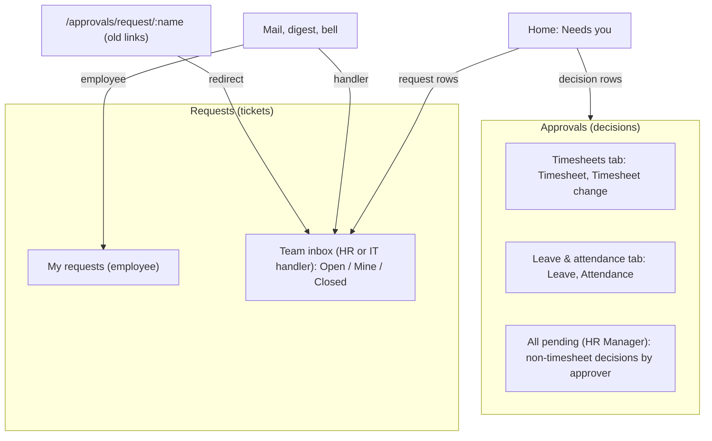

# feat: One home per kind of work: decisions in Approvals, requests in a Team inbox

## Summary

Each kind of work gets exactly one place to be worked, and the same words and tags everywhere.

- **Approvals** holds yes/no decisions only. It has two tabs: Timesheets, which also holds timesheet changes, and Leave & attendance. HR Managers keep All pending.
- **Requests** holds HR and IT requests. Employees see My requests. Handlers work from a Team inbox.
  - A request never appears in Approvals.
  - A request someone has picked up never drops out of view.
  - When a request is waiting on the employee, its row says so in words.
- **One message box** replaces the separate Comment box and Need info button. It has two clearly worded buttons: **Send** posts a note, and **Send and wait for reply** asks a question and waits. The thread shows the difference.
- Handlers can now close a request that is waiting on the employee, as Done or Declined, so an unanswered question can't leave a request stuck forever.
- **A clickable prototype is built first** and signed off before any screen code changes.

---

## Problem Frame

Plans 2026-10-15-002 and 2026-10-15-003 shipped lanes, tabs and a two-way conversation, but users still find the pages confusing. The code shows why.

- **Same request, two homes.** An HR or IT request appears both in Approvals (the HR and IT lanes) and in Requests → To work on. Both read `_hr_request_summaries`. Handlers don't know which one is "the real one".
- **Need info makes the request vanish.** Need info moves the request to Waiting on Employee. `_REQUEST_WORK_STATES` keeps that status out of the Open and Mine chips, so a request the handler owns disappears from their default view. Plan 2026-10-15-003 R7 promised it would stay under Mine, and the code broke that promise.
- **Comment and Need info look the same.** Both become a plain `Comment`. `_request_thread` returns `{author, message, on}` with no marker, so the reader can't tell a question that changed the status from a note that didn't.
- **No exit from waiting.** The "HR Request Handling" workflow has no handler transition out of Waiting on Employee. If the employee never replies, the request stays open for good.
- **Words and order drift.**
  - Kind labels are copied in at least six places: `KIND_CHIP_LABEL`, `KIND`, `LANE_TITLES`, `NEEDS_YOU_ICON`, `_QUEUE_TITLE` and `reminders._KIND_LABELS`.
  - Reason headings are worded differently on each page ("Ask a question" vs `REASON_COPY`).
  - A declined request shows as "Sent back", which the design system reserves for things the employee can fix.
  - Phone and desktop Approvals put the action buttons in opposite orders.
- **Links land in the wrong place.** Employee-reply mail and digest rows open `/approvals/request/{name}`. A handler's bell opens `/requests/{name}` in the employee view, which refuses with "That request isn't yours".

Users are mostly non-technical. Each of these costs them a search, a guess, or a message to HR.

---

## Requirements

**Where work lives**

- R1. Approvals holds decisions only: timesheets, timesheet changes, leave and attendance. HR and IT requests appear in none of its rows, lanes, counts, Decided list or All pending tab.
- R2. HR and IT requests are worked only from Requests → Team inbox. Every handler entry point opens the request there: Home, mail, bell, digest, and old Approvals links and bookmarks.
- R3. The Approvals nav entry shows only to people with a decision to make or timesheet oversight. A request handler with no decisions does not see it.
- R4. HR Managers see HR requests only. IT requests belong to IT Team.

**Nothing disappears**

- R5. The Team inbox **Open** view is the default. It lists every request that is not closed, in three groups:
  - New: nobody has it yet.
  - In progress.
  - Waiting on {employee}.

  **Mine** lists requests I picked up, including those that are waiting.
- R6. A waiting row says who it is waiting on and for how long, for example "Waiting on Ravi · 3 days".
- R7. A handler can close a waiting request with **Mark done** or **Decline**. Decline needs a reason.
- R8. The Team inbox count is the requests that need the team to act (New and In progress). It is the same number Home uses.

**Note vs question**

- R9. A handler has one message box with two buttons:
  - **Send** posts a note and leaves the status unchanged.
  - **Send and wait for reply** asks the employee and moves the request to waiting. It shows only when the server allows Need info. On a New request it also assigns the request to the sender.

  A line under the box says in plain words what each button does.
- R10. The thread shows each entry type differently:
  - A question has a "Question" label, an icon and an accent.
  - A decline reason shows as "Declined".
  - Milestones (Sent, Assigned to {name}, Closed) appear in line.
- R11. When a request is waiting, the employee sees a "Needs your reply" banner with the question highlighted. Their reply returns the request to the handler and notifies them.
- R12. A failed send keeps the typed text. If the request changed meanwhile, the buttons refresh and the handler can send the text as a note instead.

**One vocabulary**

- R13. Every screen uses the same kind tag, an icon plus a word: Timesheet, Timesheet change, Leave, Attendance, HR request, IT request. Tags are neutral, because colour belongs to status.
- R14. Each kind uses a fixed set of action words. Buttons are drawn only from the actions the server returns.

  | Kind | Words shown (server action) |
  |---|---|
  | Timesheet | Approve (Approve), Send back (Send Back), Send to HR (Send to HR) |
  | Timesheet change | Approve change (Accept), Decline (Decline) |
  | Leave | Approve (Approve), Reject (Reject), Send to HR (Send to HR) when the server offers it |
  | Attendance | Approve (Approve), Send back (Send Back), Reject (Reject), Send to HR (Send to HR) |
  | HR / IT request | Assign to me (Pick up), Send, Send and wait for reply (Need info), Mark done (Done), Decline (Reject) |

- R15. Request statuses use different words for the handler and the employee. "Declined" never shows as "Sent back".

  | Stored state | Handler sees | Employee sees |
  |---|---|---|
  | Open | New | Sent to {HR or IT} |
  | In Progress | In progress · {assignee} | In progress |
  | Waiting on Employee | Waiting on {first name} | Needs your reply |
  | Done | Done | Done |
  | Rejected | Declined | Declined |

**Approvals layout**

- R16. Approvals has two tabs:
  - **Timesheets:** timesheets and timesheet changes.
  - **Leave & attendance.**

  HR Managers also get **All pending**. Tab labels carry counts. The default tab is the first one with something waiting.
- R17. Phone and desktop show the same action buttons in the same order.
- R18. Each approval row shows the kind tag, the person, a one-line summary and how long it has waited. Timesheet evidence stays visible before Approve.

---

## Scope Boundaries

- Who may approve or handle is unchanged, including `_assert_may_act_on`, the routed-role checks and the company checks.
- The workflow changes only by the two new handler transitions out of Waiting on Employee (R7). The Timesheet, Attendance and leave flows are untouched.
- The request SLA clock (`collect_overdue`) and the overdue digest schedule are unchanged. Only the URLs in them change.
- The reminders and oversight shipped in plan 2026-10-15-002 keep their behaviour. Only request rows leave All pending.
- No new request categories, no internal HR-only notes, and no editing or deleting of comments.
- Mail template wording is not rewritten. Templates stay editable in Email templates.

### Deferred to Follow-Up Work

- Pausing the SLA clock while a request is waiting on the employee. This was already deferred twice.
- Automatically closing a request after N days with no reply. R7 lets a person close it manually instead.
- Aligning the default mail template wording with the new screen words (for example "picked up" vs "assigned").
- A bell route for `HelixHR Timesheet Change` notifications. It is missing from `ROUTE_FOR_DOCTYPE` today.
- Backfilling markers onto old Need info comments. They keep rendering as notes.

---

## Key Technical Decisions

- KTD1. **Split by endpoint, not by collector.**
  - `_approval_summaries` and `_hr_request_summaries` stay the one collector. Home, the digest and the backlog counts depend on them.
  - `get_my_approvals` stops including the `request` kind in its rows, lanes, counts, categories and Decided list. It drops `_decided_routed_requests` from its Decided collection. `?kind=request` returns an empty list and does not throw, because the dotted path is public. `counts.categories` stays as an empty key.
  - `_pending_approvals` keeps request rows for Home, with their route pointing to the Team inbox.
  - `can_approve` stops counting request rows.
  - `_OVERSIGHT_KINDS` drops `request`.
  - This supersedes P5-U6 ("requests join the approval queue"), plan 2026-10-15-002 R1.4 (HR's read-only IT lane) and screens.md's "HR work is tagged, not separated".
- KTD2. **Waiting joins only the work feed's `open` and `mine` states.**
  - The collector default, Home and the backlog counts still exclude Waiting. This keeps P5-R6's rule ("the employee's ball is not the worker's backlog") for the counts while fixing the visibility. R8's count is therefore the existing collector count, with no new definition.
  - `?state=waiting` stays as a URL alias.
  - The client groups rows by their `status`.
- KTD3. **Two new transitions per routed role: Waiting on Employee → Done, and Waiting on Employee → Rejected.**
  - They copy the In Progress conditions.
  - Each needs a fixture change, a `HR_REQUEST_STATE_EDGES` entry, a `_HR_REQUEST_EDGES` test entry and an idempotent patch. The patch mirrors `patches/v1_0/ensure_need_info_from_open`, because AGENTS.md says fixture changes ship with a patch.
  - Reject already requires a reason (`_REASON_REQUIRED`), and `closed_on` stamps through `hr_request.before_save`.
- KTD4. **The message box calls two existing endpoints. There is no new write path.**
  - **Send** calls `comment_on_request`.
  - **Send and wait for reply** calls `act_on_approval('Need info')` with the text as its reason and `expected_modified`.
  - From New, one Need info call both moves the status and stamps the picker: `before_save` sets `picked_up_by` for `PICKED_UP_STATUSES`. The UI must never chain Pick up and then Need info, because the first call bumps `modified` and the second would then fail as stale.
  - This keeps plan 2026-10-04-002 R8 ("not a second implementation").
- KTD5. **Thread entry kinds come from a stored prefix marker, stripped by one helper.**
  - For HR Request, `_decide_one` prefixes the comment it writes: a question marker for Need info and a declined marker for Reject. The precedent is `HR_HANDOVER_NOTE_PREFIX`.
  - `_request_thread` returns `kind`, one of opening, note, question or declined, and strips the marker. The same helper strips it wherever comment text leaves the server, such as mail excerpts.
  - Desk shows the marker as plain readable text ("Question: Which month?"), which is acceptable.
  - Old comments with no marker render as notes.
  - Milestones come from the stamps the detail already returns (`creation`, `picked_up_on`, `replied_on`, `closed_on`). There is no Version parsing: the Employee role can't read Version, and parsing would add N+1 queries (see the `hr_request.before_save` docstring).
- KTD6. **One kind map: `frontend/src/lib/workKinds.js`.**
  - It holds each kind's tag (word and icon) and its words, each mapped to the server action name.
  - Buttons render only for actions the server returned in `actions`.
  - The kind comes from `kind`, plus `routed_to_role` for requests (HR request vs IT request).
  - It replaces `KIND_CHIP_LABEL`, the per-page `REASON_COPY` and `REASON_HEADINGS`, and the inline button literals.
  - The server labels used in mail (`_QUEUE_TITLE`, `reminders._KIND_LABELS`) stay on the server but use the same words.
  - The new file is justified because it deletes four copies.
- KTD7. **Status words per audience live in `statusBadge.js`, and nowhere else.**
  - `resolveStatus` gains an audience (handler or employee) and an optional waiting-on name.
  - Kind tags use a neutral tone, so the only coloured badge on a row is the status. That follows the design-system rule that the word carries the meaning, and GOV.UK's guidance to use colour for one thing.
- KTD8. **Handler routing is decided on the server.**
  - One small whitelisted read returns `employee`, `handler` or `none` for a request name. It runs the same checks `get_approval_detail` uses. `Notifications.vue` calls it only when an HR Request row is opened, as it already does with `get_timesheet_week_start`.
  - Every handler URL built on the server points to `/requests/{name}?tab=work`.
  - `/approvals/request/:name` and `/approvals?kind=request` redirect to the Team inbox. Old mail carries those links, so the redirects stay permanently, with a comment saying so.
- KTD9. **One action-row component for Approvals, used by both the phone and desktop detail.**
  - The order is fixed: the primary action, then the return action (Send back), then the final no (Reject or Decline), then the quiet hand-over (Send to HR).
  - The reason surface stays where it is.
  - A component is justified because the two copies have already drifted.
- KTD10. **Request-only parts of the Approvals detail move with the requests.** These are `CorrectionReview.vue` and attach-to-reply. They go to the Team inbox detail and use the same `_request_decision_detail` payload, so `reveal_correction_value`'s picker guard behaves as it does today.

---

## High-Level Technical Design

Where each kind lives after this change:



Request lifecycle, with the new exits and each audience's words:

```mermaid
stateDiagram-v2
  [*] --> Open
  Open --> InProgress: Assign to me
  Open --> Waiting: Send and wait for reply (assigns)
  Open --> Rejected: Decline
  InProgress --> Waiting: Send and wait for reply
  InProgress --> Done: Mark done
  InProgress --> Rejected: Decline
  Waiting --> InProgress: employee replies
  Waiting --> Done: Mark done (NEW)
  Waiting --> Rejected: Decline (NEW)
  note right of Waiting: Handler sees "Waiting on Ravi"; employee sees "Needs your reply"; stays in Open and Mine
```

What each message-box button does:

| Request state | Send | Send and wait for reply | Other buttons |
|---|---|---|---|
| New (Open) | Note, stays New | Question, moves to Waiting, assigns to me | Assign to me, Decline |
| In progress | Note, stays In progress | Question, moves to Waiting | Mark done, Decline |
| Waiting on employee | Note, stays Waiting | Hidden: already waiting | Mark done, Decline |
| Done / Declined | No box; thread is read-only | — | — |

---

## Implementation Units

### U1. Clickable prototype and sign-off

**Goal:** the user clicks through the new model before any screen code changes. The wording tables in R14 and R15 are confirmed or corrected.

**Requirements:** R1, R5, R6, R9, R10, R11, R13 to R18

**Dependencies:** none

**Files:**
- None shipped. The prototype is a throwaway artifact made with `/prototype`.
- Signed-off changes to wording or layout are written back into this plan's R14, R15 and High-Level Technical Design before U5.

**Approach:**
- Screens:
  - Approvals → Timesheets, with a timesheet and a timesheet change.
  - Approvals → Leave & attendance.
  - Team inbox Open, with its three groups and a waiting row.
  - Team inbox detail, with the message box and a thread containing a note, a question and a milestone.
  - The employee's "Needs your reply" view.
  - The phone versions of the inbox and an approval detail.
- Use the design-system tokens, and the `StatusBadge` and `Icon` looks, so sign-off reflects the real feel.

**Test expectation:** none. The prototype is throwaway and nothing ships.

**Verification:** the user approves the screens and both wording tables, or the plan is updated with what they changed.

### U2. Handlers can close a waiting request

**Goal:** Mark done and Decline work from Waiting on Employee.

**Requirements:** R7

**Dependencies:** none

**Files:**
- Modify: `helixhr/fixtures/workflow.json` (four transitions on "HR Request Handling": Done and Reject from Waiting on Employee, for HR Manager and for IT Team)
- Modify: `helixhr/events.py` (`HR_REQUEST_STATE_EDGES`)
- Create: `helixhr/patches/v1_0/ensure_close_from_waiting.py`
- Modify: `helixhr/patches.txt`
- Test: `helixhr/tests/test_hr_request.py`, `helixhr/tests/test_fixtures.py`

**Approach:** copy the In Progress transitions' conditions. The patch adds the rows idempotently, the same way `ensure_need_info_from_open` does.

**Patterns to follow:** `helixhr/patches/v1_0/ensure_need_info_from_open.py`.

**Test scenarios:**
- Happy path: an HR Manager marks a waiting HR request done. The status becomes Done, `closed_on` is set, and the employee gets the status bell.
- Happy path: an IT Team user declines a waiting IT request with a reason. The status becomes Rejected and the reason is stored.
- Error, refused:
  - Decline from Waiting without a reason.
  - An IT Team user acting on a waiting HR request.
  - The employee acting on their own request.
- Edge: running the patch twice leaves exactly four new transitions.
- Integration:
  - The `test_fixtures` edge set equals the workflow transitions.
  - `hr_request_validate` accepts the new edges and still refuses Waiting → Open.

**Verification:** on a fresh site, `bench migrate` imports the transitions, and the request and fixture tests pass.

### U3. Requests leave Approvals; handler links go to the Team inbox

**Goal:** the server stops serving requests through Approvals and points every handler link to Requests.

**Requirements:** R1, R2, R3, R4, R8

**Dependencies:** none

**Files:**
- Modify: `helixhr/api.py`:
  - `get_my_approvals` and `_APPROVAL_FILTER_KINDS`
  - the Decided collection (drop `_decided_routed_requests`)
  - `_pending_approvals` and `_get_needs_you` (request route)
  - `get_portal_bootstrap` (`can_approve`)
  - `_OVERSIGHT_KINDS`
  - the URL in `reply_to_my_request`
  - a new request-view resolver (KTD8)
- Modify: `helixhr/reminders.py` (request row `url` in `collect_overdue`)
- Modify: `helixhr/utils.py` (template sample URLs)
- Test: `helixhr/tests/test_hr_request.py`, `helixhr/tests/test_approvals_lanes.py`, `helixhr/tests/test_pending_by_approver.py`, `helixhr/tests/test_reminders.py`, `helixhr/tests/test_notifications.py`

**Approach:**
- Per KTD1, the filter goes at the endpoints, not in the collector.
- The resolver answers per caller:
  - The request's own employee → `employee`.
  - A caller who passes the handler checks (routed role, company, `_assert_may_act_on`) → `handler`.
  - Anyone else → `none`. This includes a handler who has since lost the role.
- Rewrite these tests on purpose, saying what changed:
  - `test_an_it_team_holders_queue_is_populated`
  - the IT-lane and decided-routed tests in `test_approvals_lanes.py`

**Test scenarios:**
- Happy path: an HR Manager who is also a line manager calls `get_my_approvals`. The result has their team's leave and no request rows. `counts.lanes` has no `it` key, and `counts.categories` is empty.
- Happy path: Home Needs-you for an IT Team user with a queued IT request still lists it, with a route to `RequestDetail` and `tab=work`.
- Covers R3: for an IT Team user with no reports and only queued requests, `can_approve` is false and `can_work_requests` is true.
- Covers R4: an HR Manager's Home and Team inbox never list an IT-routed request.
- Edge: `get_my_approvals(kind="request")` returns an empty list without an error.
- Edge: All pending with Overdue-only returns no request rows. The overdue digest still includes overdue requests, with Team inbox URLs.
- Resolver:
  - The employee asking about their own request → `employee`.
  - The picker → `handler`.
  - An IT holder in another company → `none`.
  - An HR Manager asking about an IT request → `none`.
- Integration: the mail sent on an employee reply carries `/requests/{name}?tab=work`.

**Verification:** the Python suite passes on a fresh site with strict user permissions on.

### U4. Work feed keeps waiting requests; thread entries know their kind

**Goal:** waiting requests stay listed, and the thread can tell notes, questions, declines and milestones apart.

**Requirements:** R5, R6, R8, R10

**Dependencies:** none

**Files:**
- Modify: `helixhr/api.py`:
  - `_REQUEST_WORK_STATES`
  - `_hr_request_summaries` row fields: `status`, a waiting-on name, `waiting_since`
  - `_decide_one`: markers for HR Request only
  - `_request_thread`: `kind` and stripping
  - `_request_decision_detail` and `_request_detail`: milestone stamps
  - the mail excerpt helper
- Test: `helixhr/tests/test_hr_request.py`

**Approach:**
- `open` and `mine` gain Waiting on Employee. `waiting` stays.
- The collector's default states don't change, so the counts don't change.
- `waiting_since` comes from the latest question entry, or from `modified` when there is none. The exact source is settled during implementation.
- The waiting-on name falls back to "the employee" when the person has no first name.
- One strip helper is used by every reader of request comments.

**Test scenarios:**
- Happy path: after Need info, the picker's `get_request_work(state="mine")` and `(state="open")` both list the request with status Waiting on Employee.
- Covers R8: the Home count and the collector's default count do not include that waiting request.
- Edge: `state="waiting"` still returns only waiting requests.
- Happy path: the thread after Need info then a reply has, in order:
  - an opening entry
  - a question entry with the marker stripped
  - an employee entry
- Happy path: a Decline reason appears as `kind: declined`. A plain handler comment appears as `kind: note`.
- Edge: an old comment with no marker shows as a note.
- Edge: an account number inside a question is still refused by the bank guard.
- Integration: a mail excerpt for a question never contains the raw marker.
- Rewrite `test_the_state_filters_match_their_names` to the new `mine` and `open` definitions.

**Verification:** the request tests pass, including `TestRequestWork` and `TestRequestConversation`.

### U5. One vocabulary: kind map, status words, icons

**Goal:** one source for kind tags, action words and status words.

**Requirements:** R13, R14, R15

**Dependencies:** U1 (signed-off wording)

**Files:**
- Create: `frontend/src/lib/workKinds.js`, `frontend/src/lib/workKinds.test.js`
- Modify: `frontend/src/lib/statusBadge.js`, `frontend/src/lib/statusBadge.test.js` (audience, waiting-on; Rejected becomes "Declined")
- Modify: `frontend/src/lib/icons.js`, `frontend/src/lib/icons.test.js` (IT request and timesheet change icons; `NEEDS_YOU_ICON` keys `approval_request` and `approval_change`)
- Modify: `frontend/src/components/StatusBadge.vue` (pass the audience through)
- Create: `frontend/src/components/KindTag.vue` (icon plus word, neutral)
- Modify: `helixhr/api.py` `_QUEUE_TITLE`, `helixhr/reminders.py` `_KIND_LABELS` (same words)

**Approach:**
- The kind map exposes three things:
  - the tag for a row (kind plus `routed_to_role`)
  - the ordered buttons for a list of server actions
  - the reason sheet copy for an action
- The ordered buttons drop any word whose action the server didn't return.

**Test scenarios:**
- Happy path: a request row routed to IT Team gets the "IT request" tag, and one routed to HR Manager gets "HR request".
- Happy path: server actions `["Accept", "Decline"]` for a change produce "Approve change" then "Decline".
- Edge: an action the map doesn't know is dropped, not drawn with a raw label.
- Edge: a word whose action is missing from the server list is not drawn.
- Happy path: request Waiting on Employee resolves to:
  - handler: "Waiting on Ravi"
  - employee: "Needs your reply"
- Edge: request Rejected shows "Declined" to both audiences. The old "Sent back" assertion is replaced on purpose.
- Edge: Waiting with no name shows "Waiting on employee".

**Verification:** `yarn test` passes, including `frappeUiComponents.test.js`, which confirms no new frappe-ui import.

### U6. Requests: Team inbox, routing and redirects

**Goal:** handlers work every request from one inbox, and every link lands there.

**Requirements:** R2, R4, R5, R6, R8, R12

**Dependencies:** U3, U4, U5

**Files:**
- Modify: `frontend/src/pages/Requests.vue`:
  - tab label "Team inbox", with a header naming the team
  - chips Open, Mine and Closed
  - grouped rows with waiting badges
  - `CorrectionReview` and attach-to-reply ported from Approvals
  - buttons through the kind map
- Modify: `frontend/src/pages/Notifications.vue` (HR Request rows use the resolver)
- Modify: `frontend/src/router.js` (redirect `/approvals/request/:name` and `/approvals?kind=request|category=` to the Team inbox)
- Modify: `frontend/src/components/NeedsYou.vue` (request rows go to the Team inbox; "View all" goes to Approvals only for users who have it)
- Test: `frontend/tests/e2e/requests-conversation.spec.ts`, `frontend/tests/e2e/approvals.spec.ts` (the IT end-to-end test moves to Requests), `frontend/tests/e2e/profile-tabs.spec.ts` (correction review in the Team inbox), `frontend/tests/e2e/login-dashboard.spec.ts`

**Approach:**
- Group order: New, In progress, Waiting. Oldest first within each group.
- The tab badge uses R8's count.
- `?state=waiting` opens Open, scrolled to the Waiting group.
- All of the page's existing states stay: skeleton, empty, error.

**Patterns to follow:** the `AsyncState` five states; `role="tablist"` with arrow keys; `timesheetWeek` lazy read in `Notifications.vue`.

**Test scenarios:**
- e2e: the IT fixture opens the Team inbox and sees a new IT request under New. The request does not appear anywhere on Approvals for any fixture.
- e2e, covers AE2:
  1. The handler presses "Send and wait for reply".
  2. The row moves to Waiting, showing "Waiting on {name}".
  3. It is still visible under Open and Mine.
- e2e: opening `/approvals/request/{name}` lands on the Team inbox detail of that request.
- e2e: a handler's bell for an employee reply opens the Team inbox detail, not "That request isn't yours".
- e2e: HR reviews a bank-detail correction from the Team inbox and reveals the value as picker.
- e2e: Home Needs-you request row opens the Team inbox detail.
- e2e at 320px: the groups stack, and the controls stay at least 44px.

**Verification:** these specs pass on a fresh site with `--workers=1`, and `hardening.spec.ts` still passes.

### U7. Message box and thread rendering

**Goal:** one box with Send and Send and wait for reply, and a thread where questions stand out.

**Requirements:** R9, R10, R11, R12, R7 (close buttons beside the box)

**Dependencies:** U2, U4, U5

**Files:**
- Modify: `frontend/src/components/requests/RequestThread.vue`
- Modify: `frontend/src/pages/Requests.vue` (employee "Needs your reply" banner; the timeline list is folded into the thread milestones)
- Test: `frontend/tests/e2e/requests-conversation.spec.ts`

**Approach:**
- Handler mode:
  - Send calls `comment_on_request`.
  - Send and wait calls the parent's `act_on_approval('Need info')` path in one call (KTD4).
  - The helper text spells out each button's effect, for example "Ravi sees this. The request stays with you." and "Ravi is asked to reply. The request waits until they do."
- Employee mode: the box reads "Reply to {handler}" while waiting, and "Add a comment" otherwise.
- Entry styles:
  - A question gets a label, an icon and an accent border that is not colour alone.
  - Declined gets its own label.
  - A milestone is a single quiet line.
- On refusal, keep the draft, refetch the detail, and offer "Send as a note instead" when Need info is no longer allowed.
- Fix the `bg-signal` on paper the post button uses today (design-system rule).
- `aria-live="polite"` on new entries stays.

**Test scenarios:**
- e2e: the handler's Send leaves the status unchanged and shows a note entry. Send and wait shows a Question entry and the status "Waiting on {name}".
- e2e, covers AE2: the employee sees "Needs your reply" with the question highlighted. Their reply returns the request to In progress, and the handler sees it under Mine.
- e2e, covers AE3: on a waiting request, the handler declines with a reason. The thread shows Declined, the box disappears, and the employee sees "Declined".
- e2e: while the handler is typing, the employee replies. "Send and wait" is refused. The draft stays and "Send as a note instead" posts it.
- e2e: on a Done request, neither side has a box.

**Verification:** the conversation spec passes on a fresh site, with no axe violations on the detail.

### U8. Approvals: decisions only, two tabs, one action row

**Goal:** Approvals shows only decisions, in two clear tabs, with the same buttons on every screen size.

**Requirements:** R1, R3, R13, R14, R16, R17, R18

**Dependencies:** U3, U5

**Files:**
- Modify: `frontend/src/pages/Approvals.vue`:
  - remove the request branches: claim counts, category chips, IT lane, request detail, `RequestThread`, `CorrectionReview`, attach-reply
  - tabs Timesheets (changes move here) and Leave & attendance
  - `KindTag` on rows
  - default-tab rule
- Create: `frontend/src/components/approvals/DecisionActions.vue`
- Modify: `frontend/src/lib/approvalLanes.js`, `frontend/src/lib/approvalLanes.test.js` (no `it` lane; change rows join timesheet grouping)
- Modify: `frontend/src/components/AppShell.vue` (`isManager` drops `canWorkRequests`)
- Test: `frontend/tests/e2e/approvals.spec.ts`, `frontend/tests/e2e/timesheet-approval.spec.ts`, `frontend/tests/e2e/navigation.spec.ts`

**Approach:**
- `?view=queue` stays as the URL of Leave & attendance, and `overdue` stays as an alias.
- Bulk approve is per tab. Timesheets keeps the "Looks normal" bulk for timesheets only, because changes are never bulk. Selection clears on tab change, as it does today.
- Pending HR timesheets stay in Timesheets → Waiting on HR.

**Test scenarios:**
- Unit: lanes have no `it` lane, and change rows group with timesheets.
- e2e:
  - The manager fixture sees Timesheets with a count, and the default tab is the one with waiting items.
  - A change row carries the "Timesheet change" tag, and its buttons read "Approve change" and "Decline".
- e2e at phone and desktop width: the same timesheet shows the same buttons in the same order.
- e2e: the IT fixture with no reports has no Approvals nav item and reaches the Team inbox from the nav.
- e2e: All pending for HR has no request rows.

**Verification:** `yarn lint`, `yarn test`, and the approvals, timesheet, navigation and hardening specs pass on a fresh site.

### U9. Docs and runbook

**Goal:** the recorded design matches the shipped model.

**Requirements:** R1, R2, R7, R9, R15

**Dependencies:** U2 to U8

**Files:**
- Modify: `docs/architecture.md`:
  - routed requests worked only from `/requests`
  - the endpoint split (KTD1)
  - the new Waiting exits
  - thread markers
  - the resolver
- Modify: `docs/design-system/screens.md` (Approvals and Requests; reverse "HR work is tagged, not separated")
- Modify: `docs/design-system.md` (copy table: per-audience request words, kind tags, the action-word table)
- Modify: `docs/runbook.md` ("Request not in Approvals", "Handler bell opens the wrong view", "Stuck waiting request")

**Test expectation:** none. This unit is docs only.

**Verification:** the docs name the resolver, the new transitions and the marker helper, and preflight is clean on the fresh site.

---

## Acceptance Examples

- AE1. Ravi files "Laptop won't start".
  - Asha (IT Team) sees it in Team inbox → New, tagged IT request.
  - Ravi's manager sees nothing about it in Approvals.
  - The HR Manager sees it nowhere.
- AE2. Asha types "Is the charger light on?" and presses Send and wait for reply.
  - The row moves to "Waiting on Ravi · today" and stays under Open and Mine.
  - Ravi sees "Needs your reply" with Asha's question highlighted.
  - Ravi replies. Asha's bell opens the request in her Team inbox, and it shows In progress.
- AE3. Ravi never replies. A week later Asha presses Decline with "No reply. Open a new request if it's still broken." The request closes, and Ravi sees "Declined" with the reason.
- AE4. A manager opens Approvals.
  - The Timesheets tab shows 3 items and is selected.
  - A timesheet change row is tagged and offers Approve change and Decline.
  - The buttons appear in the same order on phone and desktop.
- AE5. An old mail link `/approvals/request/HR-REQ-0042` opens that request in the Team inbox.

---

## Alternative Approaches Considered

- **One unified "My tasks" inbox (Workday style).** Everything in one list is easy to find, but it mixes decisions on someone's data with tickets that need a conversation. Rejected: the confusion users report is exactly that mixing. No researched HR product puts help tickets in the approvals inbox.
- **Keep requests in Approvals and drop the Requests "To work on" tab.** Rejected:
  - Employees already know Requests as the place requests live.
  - The ticket flow (assign, converse, wait, close) does not fit Approvals' yes/no rows.
  - IT Team users who are not managers would keep a page named for decisions they never make.
- **A separate field or doctype to mark questions.** A Comment can't gain a custom field without touching core, and a new doctype is heavy for one flag. Parsing Version rows is unreadable for the Employee role and adds N+1 queries. A text marker has a precedent in the hand-over prefix.

---

## System-Wide Impact

- **IT Team holders who are not managers** lose the Approvals nav entry and gain nothing new. Their work was already in Requests.
- **HR Managers** lose the read-only IT lane. This was confirmed with the user.
- **Public API:**
  - `get_my_approvals` stops returning request rows. `?kind=request` is empty, and `counts.categories` is empty.
  - `get_request_work` `open` and `mine` include waiting requests.
  - The thread entries gain `kind`.
  - One new read-only endpoint.
- **Workflow fixture:** four new transitions, applied by migrate and the patch.
- **Old links:** the redirects are permanent.
- **Home:** the Needs-you contents and count are unchanged. Only the request links change.

---

## Risks & Dependencies

| Risk | Mitigation |
|---|---|
| Large edits to `Approvals.vue` (2,400 lines) and Requests e2e churn | U8 removes code more than it adds. The test rewrites are named in each unit and run on a fresh site |
| The question marker shows raw in Desk or in a mail | One strip helper for every reader; U4 has an integration test on mail excerpts |
| Someone uses Pick up and Need info as two calls and hits a stale error | KTD4 makes it one call; U7 has an e2e test for the race |
| `can_approve` and the nav disagree with Home | U3 covers the IT-only case; Home keeps its source (KTD1) |
| Old links to Approvals break | Permanent redirects plus server URL changes; U6 e2e |
| Strict user permissions empty a new read | The resolver uses the same checks as `get_approval_detail`; the strict fresh-site run is the gate |

---

## Phased Delivery

1. **Prototype (U1).** Signed off before any screen work.
2. **Server (U2, U3, U4).** Independent of each other and testable without UI.
3. **Vocabulary (U5),** then the screens (U6, U7, U8). U6 and U7 both touch `Requests.vue`, so land U6 first.
4. **Docs (U9).**

---

## Sources & Research

- **Code:**
  - `helixhr/api.py`: `_hr_request_summaries`, `_REQUEST_WORK_STATES`, `get_request_work`, `_approval_summaries`, `_pending_approvals`, `get_my_approvals`, `_decided_routed_requests`, `get_approval_detail`, `_decide_one`, `_request_thread`, `comment_on_request`, `reply_to_my_request`, `get_portal_bootstrap`
  - `helixhr/events.py` `HR_REQUEST_STATE_EDGES`; `helixhr/helixhr/doctype/hr_request/hr_request.py` `before_save`; `helixhr/fixtures/workflow.json`
  - `frontend/src/pages/Approvals.vue`, `Requests.vue`, `Notifications.vue`; `components/requests/RequestThread.vue`; `lib/statusBadge.js`, `lib/icons.js`, `lib/approvalLanes.js`
- **Prior decisions:** plan 2026-09-15-001 (P5-R6, P5-U6), 2026-10-04-002 (KTD5, R8), 2026-10-04-003 (R13, KTD7), 2026-10-15-002 (R1.4, KTD1), 2026-10-15-003 (R7, KTD4, KTD7, KTD8).
- **External research (shaped KTD1 to KTD3, KTD5 and KTD7):**
  - Workday keeps approvals in the Inbox and help cases in a separate case workspace. Its verbs are Approve, Send Back and Deny, with reasons on the last two.
  - BambooHR and Zoho put approvals in one inbox, with no tickets in it.
  - In Zendesk, a Pending ticket (waiting on the requester) stays in the agent's unsolved views, and a requester reply sets it back to Open. Reply and internal note are separate composer tabs.
  - In ServiceNow, Request Info moves a case to Awaiting Info. Community advice is to use one waiting state with a reason, not one state per waiter.
  - Freshservice uses a separate label for the agent and the requester on each status ("Waiting on customer" vs "Waiting for your response").
  - Clockify requires a note on timesheet Reject and offers bulk approve with checkboxes.
  - GOV.UK tag guidance and the Atlassian lozenge: text carries the meaning, never colour alone, with a small consistent set.
  - NN/g status trackers: plain words, history visible, the same status to staff and requester.
  - Sources:
    - https://doc.workday.com/admin-guide/en-us/human-capital-management/hcm-innovation-services/workday-help/concept--workday-help.html
    - https://support.zendesk.com/hc/en-us/articles/4408843029658-About-open-vs-pending-and-on-hold-tickets
    - https://www.servicenow.com/docs/bundle/yokohama-customer-service-management/page/product/customer-service-management/reference/r_CustomerServiceCaseStates.html
    - https://support.freshservice.com/support/solutions/articles/156452-customizing-service-desk-statuses
    - https://clockify.me/help/getting-started/approve-teams-time-entries
    - https://design-system.service.gov.uk/components/tag/
    - https://www.nngroup.com/articles/status-tracker-progress-update/
  - Gaps: Keka, Darwinbox, SuccessFactors, Oracle, Gusto, Deel and Replicon returned nothing usable.
