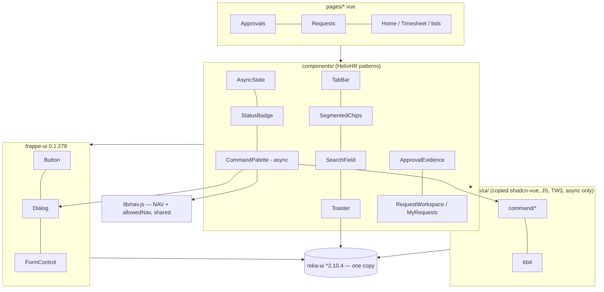
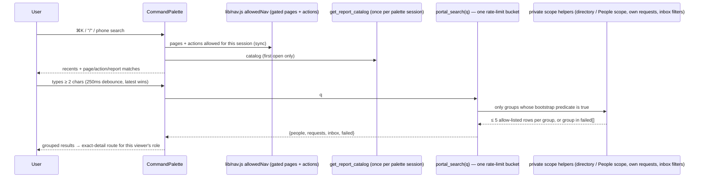
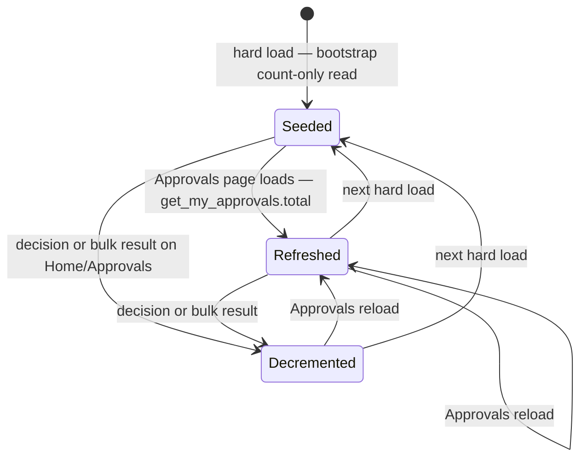
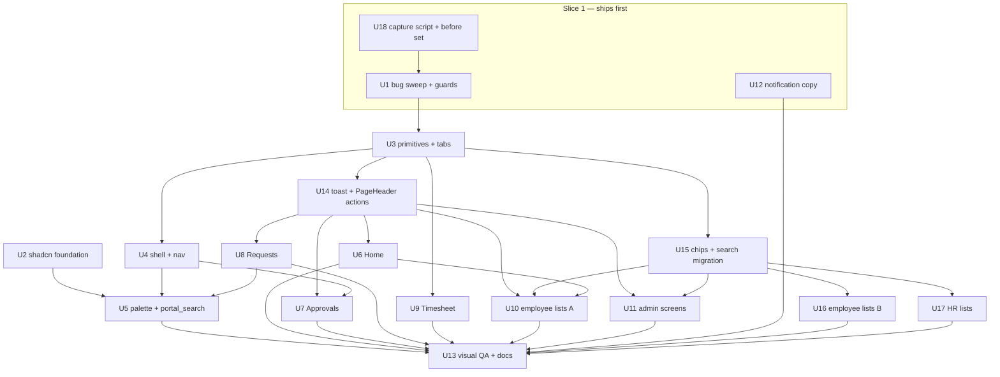

# feat: Portal ease of use — fewer taps, one way to get anywhere, consistent screens

## Summary

Make every role's frequent job shorter:

- Fix the rendering bugs a 72-screenshot audit confirmed.
- Add a ⌘K / search jump to anywhere, and order navigation by role.
- Put the obvious time-savers on Home, Approvals, the team inbox and Timesheet.

A small, pinned set of shadcn-vue components is copied in on Tailwind 3 and mapped to Signal tokens; frappe-ui stays the base. Existing routes, permissions and tests are preserved. The few deliberate behaviour changes (rail defaults, the approver tab bar) name the spec assertions they flip (U4, KTD7).

**Release slicing.** U18, U1 and U12 ship first, as their own branch merged to `main`. The confirmed runtime and contrast bugs should not wait for the rest of the round. Every other unit follows on the main feature branch.

---

## Problem Frame

The portal works and looks calm, but volume and role-stacking expose its seams. The audit (`docs/reviews/2026-10-17-ui-ease-of-use-audit.md`, 27 high / 60 medium / 40 low) shows the same pattern for every role: the real work exists, but it takes extra taps to reach, it is hard to tell apart, and it is handled one item at a time.

- **Employees** scan a "Needs you" list that does not dedupe (ED-08, EP-03). On Requests, the "Needs you" group is driven by unread state rather than owed action (ED-01, EP-04). On a phone, Timesheet puts today below the fold (EP-02).
- **Managers** need two taps to reach Approvals on a phone. There is no count and no bulk path below 640px (MH-03, MH-04).
- **HR and IT** open every inbox row to pick it up, and Home's request rows omit the subject (HR-04, HR-05, AI-03, AI-04).
- **Admins** scroll a 4,546px permissions matrix (AI-06).
- **Everyone** lacks search or jump-to (ED-26), and the HR rail overflows (HR-06).

Several defects are bugs, not taste:

- A `ReferenceError` fires on every `/projects` load (HR-01).
- Active tab indicators never render, because `border-ink-gray-9` is not a generated class (MH-01).
- Error text appears in signal yellow on white at 1.21:1 (HR-03).
- Request title and meta lines overlap when the title wraps (EP-01).

Several volume findings are tagged `fixture` in the audit (ED-04, ED-08, ED-19, EP-07, EP-19). They show how the UI copes with volume, not measured production load; see Open Questions.

Maintainability has drifted too: 11 tab implementations, 15 copies of a filter-chip class string, 7 debounced-search copies, and the detail evidence in `Approvals.vue` (2,079 lines) written twice, once for phone and once for desktop.

User decisions for this round (2026-10-17):

- Selective shadcn-vue on Tailwind 3.
- Time-savers plus polish, not a full IA redesign.
- One sidebar plus ⌘K, no role-workspace switcher.
- Refine Signal, no palette change.

---

## Requirements

**Safety (nothing that works today breaks)**
- R1. Every Python test, vitest and Playwright spec that passes on `main` at the base commit also passes on a fresh site with strict user permissions. Specs that already fail on `main` on a fresh site are listed by name in U13, proven pre-existing, and either fixed or explicitly carved out there. Where a unit deliberately changes behaviour, the unit names the spec assertion that flips and gives its replacement of equal strength. No spec is deleted to make a run green.
- R2. Routes, route names, query-parameter contracts (`?tab`, `?kind`, `?fix`, `?category&subject`) and permanent redirects keep working. New deep links (`/leave?ask=1`, `/directory?q=`) are additive.
- R3. One `get_portal_bootstrap` call per hard load (`navigation.spec.ts`). No new per-route identity call, and the bootstrap is never polled.
- R4. Built CSS stays at or below measured `main` + 10KB, under the 162,906-byte hard ceiling. Initial JS stays within P2-R24-js, and the eager-chunk delta for the whole round is at most +3KB raw. The 44px coarse-pointer floor, measured WCAG AA contrast, reduced motion, 200% text and no horizontal scroll at 320/360px all hold.
- R5. No Frappe vocabulary reaches the screen. Every read keeps its existing gate: Frappe permissions where the code uses them, and the server-derived scope plus field allow-list where it uses projections ("Projections, not permissions" in `docs/architecture.md`). No new code path widens either.

**Correctness**
- R6. Every confirmed rendering and runtime bug in the audit is fixed. Static guards stop the two recurring classes: utilities that generate no CSS, and signal yellow on paper.

**Navigation and wayfinding**
- R7. Any user can jump to a permitted page, action, person, own request, inbox request or report from anywhere: ⌘K / Ctrl-K or `/` on desktop, and a visible search entry on a phone. Results respect the same gates the rail and the router apply.
- R8. The sidebar leads with the user's own work group. The rail fits 800px without scrolling for every Playwright identity, including HR Manager plus Portal Admin.
- R9. A stable approver reaches Approvals in one tap on a phone. Every Approvals entry shows a pending count that matches the Approvals page.
- R10. Route changes move focus to the main region and set a per-route document title. A skip link precedes the navigation. Help ("Ask HR") sits in the same place on every page (WCAG 3.2.6).

**Time-savers**
- R11. Home "Needs you" shows one row per record, names the request subject, and makes the whole row the tap target. Where mobile check-in is enabled, check-in is two taps from Home.
- R12. A manager can approve every eligible "Looks normal" item in two taps on a phone. On desktop they can select a whole lane or person group, and can triage by keyboard.
- R13. A request handler can pick up a request from the inbox list, search it, and sort it by SLA, without opening the detail.
- R14. On a phone, Timesheet opens on the current week and today's entry. The existing "Copy last week" skips rows that can no longer be booked and days that are not working days.
- R15. Employee list screens drop redundant taps and height: per-row payslip PDF, notifications grouped by record with a server-side unread filter, Documents opening on a non-empty tab, one correction entry per profile section.
- R16. HR and admin screens drop redundant height and add filters where the list is the job: Report access matrix, export log on a phone, People list, and a "Recently run" reports strip (HR-16).

**Consistency**
- R17. Every page uses one tab bar, one segmented/filter chip, one search field, one page-title role and one primary-action convention.
- R18. Success feedback after a write is a polite toast. Failures are announced and persist until dismissed. Irreversible actions keep their confirm step.
- R19. "Owed by the employee" means the same thing on Home and on Requests.

**Maintainability and verification**
- R20. Copied shadcn-vue components live in `components/ui/` as plain JS on Tailwind 3. They use pinned dependencies and Signal-mapped tokens, load only through async boundaries, and a guard test keeps them that way.
- R21. The duplicated phone/desktop detail in Approvals and the two workspaces in Requests become components, with behaviour unchanged.
- R22. A role × route × viewport screenshot capture, with console-error and horizontal-scroll logging, supports human before/after review. A Playwright sweep fails on any console error, on any route, for every identity.
- R23. `docs/design-system.md`, `docs/design-system/screens.md`, `docs/architecture.md` and `docs/runbook.md` describe the new patterns and every decision this plan supersedes.

---

## Scope Boundaries

- Palette, typography and surface rules stay as shipped. Signal is unchanged, and the rejected indigo direction is not revisited.
- No unified "My tasks" inbox across work kinds (rejected in plan 2026-10-16-001). Home stays the one cross-kind view.
- No full shadcn-vue migration, no Tailwind v4, and no frappe-ui 1.0 upgrade in this round.
- No dark mode, AI assistant, chat-app approvals, PWA push, or charts in Reports.
- No change to who may see or do anything. New server code adds read paths that reuse existing scopes, and additive response keys.

### Deferred to Follow-Up Work

- Replace the three hand-built listboxes (`reports/EntityPicker.vue`, `reports/SavedViews.vue`, `reports/ExportMenu.vue`) with a shared menu primitive the next time they are touched.
- A palette "Check in" action. The Home chip ships in U6, and the palette action can reuse its flag later.
- "Remind all overdue" for HR User oversight (MH-10). It is a new bulk write path with its own partial-failure surface, and no requirement in this round names it.
- Missing working weeks in timesheet history (ED-14). This is a new server derivation that sits outside R14.
- Remembered last tab and Roster mode. U4 already routes handlers straight to the inbox (AI-02).
- Upcoming holidays and team leave beside the Leave balance band (ED-23). LeaveForm already previews working days.
- Hand-rolled SVG charts beside report tables. TanStack-backed tables if a list outgrows client-side sort at 200 staff.
- frappe-ui 1.0 upgrade (released 2026-10-01; still Tailwind `<4`).
- Unsaved-changes guard on the Leave and Request sheets, a landscape phone pass, and `scroll-padding` for sticky bars.
- AGENTS.md says "Node: pnpm" while the repo uses Yarn 1. Correct the doc separately.

---

## Open Questions

- **Notification volume in production (scopes U10):** how often does a user have more than one unread Notification Log per record? U10 checks this before building record grouping.
- **Fresh-site baseline (R1):** for each spec that fails on `main` on a fresh site, does it get fixed in this round or carved out? U13 lists them by name.

---

## Key Technical Decisions

- KTD1. **frappe-ui stays the primitive layer. shadcn-vue is copied in only where frappe-ui has a gap: Command (palette list and input) and Kbd.**
  - If the v3 registry has no `kbd` item, Kbd is a local styled `<kbd>`.
  - Table markup is not copied: People follows `ReportTable`'s plain-markup `aria-sort` pattern, so a copied table would have no second consumer.
  - Toast is a small local component on the reka-ui Toast primitives already installed. frappe-ui's `Toast` cannot meet R18: it never passes `type`, so every toast is `aria-live="assertive"`, and its provider hard-codes a viewport that covers the phone tab bar.
  - Date pickers stay frappe-ui.
  - Drawer is not adopted: vaul-vue was last published 2025-03.
  - Sidebar is not adopted: its Tailwind v4 `w-(--x)` syntax compiles to nothing on 3.4.
  - Bottom sheets stay frappe-ui `Dialog` plus CSS.
  - This supersedes the hardening plan's KTD1, KTD9 and R9 ("no other design system", "no new dependency without evidence", "no design-framework abstractions") for these named components only. The user opted in on 2026-10-17, and the measured gaps are recorded in Sources.
- KTD2. **The palette renders inside frappe-ui `Dialog`, not shadcn's `CommandDialog`.** One focus-trap, one Escape handler and one overlay z-index (the load-bearing `z-index: 50` over the tab bar), and no `tailwindcss-animate`. Hosting it there brings rules:
  - Keep Dialog's title and `body-content` slot, so `aria-labelledby` survives (`docs/design-system.md` overlays).
  - Move initial focus to the input explicitly.
  - Pin the panel to the top on a phone with a scoped class, sized against the visual viewport so results stay above the keyboard.
  - Global shortcuts do nothing while any `[role=dialog]` is open.
  - The More-sheet search row closes More before opening the palette.
  - Server-result groups bypass Command's client filter. The empty state renders only after the server settles.
- KTD3. **New runtime dependencies: `clsx` and `tailwind-merge@^2.6` (for `cn`); `class-variance-authority` only if a copied file needs it.** `tailwind-merge` 3.x supports Tailwind v4 only. `reka-ui` is declared `^2.10.4`, and the guard asserts exactly one installed copy. `@vueuse/core` is declared only if a copied file imports it. Its two majors (10 for frappe-ui, 14 for reka-ui) already coexist by design, and the APIs a copied file uses must exist in 10.11. Every addition goes through the AGENTS.md freshness and security check before install.
- KTD4. **Copied shadcn sources are adapted on copy-in.**
  - Plain JS (`"typescript": false`) from the v3 registry (`tailwind.config` set in `components.json`).
  - `lucide-vue-next` imports are rewritten to `Icon.vue` plus `lib/icons.js`.
  - shadcn colour names (`background`, `popover`, `muted-foreground`, `border`, `ring`, …) map onto existing Signal CSS variables in `tailwind.config.cjs`, never onto a second palette.
  - Opacity modifiers on mapped names (`bg-muted/50`) generate no CSS, because Signal variables are hex values, not channel triplets. Rewrite them to an existing solid Signal step on copy-in.
  - Dependency truth comes from `npx shadcn-vue@latest view`. The MCP's `view` drops dependencies and prints a wrong add command.
  - Everything under `components/ui/`, `cn` and `Toaster.vue` loads only through async components. AppShell keeps only the shortcut listener, the trigger button and the tiny `notify.js` queue (R4 JS budget).
- KTD5. **Search is one rate-limited read, `portal_search(q)`, built on private scope and projection helpers extracted from the existing endpoints. It never calls the whitelisted wrappers**, because each of those spends its own page's 60/60 bucket.
  - The wrappers are refactored to call the same private helpers, so each scope keeps exactly one implementation.
  - Each group runs only when its bootstrap predicate is true. Groups are skipped, not refused:
    - **People:** the directory projection and company scope for everyone; the People projection under `resolve_read_scope` when `can_see_people`.
    - **Own requests:** employee taken from the session, with a bounded subject filter.
    - **Inbox requests:** when `can_handle_requests`, through `_request_summaries_filters` with the caller's routed roles and self-exclusion.
  - Every row is cut to an allow-listed key set, at most 5 per group, with no totals, facets or photos.
  - Reports are matched on the client from one `get_report_catalog` fetch per palette session.
  - `q` is the only parameter. It is trimmed, 2–60 characters, and LIKE metacharacters are escaped.
  - A failing group returns in a `failed` list.
  - The endpoint gets its own `RATE_LIMIT_POLICY` entry (60 per 60s, the same bound as `search_people`) and preflight coverage. Without the entry, `rate_limit_bounds` raises `KeyError`. A refusal shows the palette's quiet failure line.
  - LIKE escaping applies only inside `portal_search`. The existing wrappers keep their current matching, so their tests stay unchanged.
- KTD6. **No deferred-commit Undo on workflow actions.** Approve, Reject and Send back are Frappe workflow transitions with no reverse path, and a client-side delay could lose an action when a tab closes. Bulk approve keeps its count-and-total confirm, and the toast confirms the outcome. Undo is offered only where a native reverse exists, such as mark-as-read.
- KTD7. **The approver tab swap uses a stable predicate:**
  - **Stable approvers** have reports, or are HR approvers. They get Approvals in Leave's tab slot. Leave becomes the first row under "My work" in More and stays reachable through Home's "Ask for leave" and search.
  - **Queue-dependent approvers** (a leave approver with no reports) keep the employee tab bar, and the pending count shows on the More tab. The bootstrap already rejects "a rail item that comes and goes" (P4-R13).
  - **Oversight-only HR Users** keep the employee tab bar and get no badge, because they decide nothing.
  - Leave gives up its slot rather than Requests: approvers still file HR tickets, handlers work the inbox from Requests, and Leave stays one tap away through Home's "Ask for leave".
  - The stable flag is a new bootstrap boolean derived from facts the bootstrap already computes.
  - The tab bar stays at five slots, so the `div > nav[aria-label="Main"]` shape and its specs stand.
- KTD8. **The pending count is seeded once by the bootstrap, then updated locally. It is never polled.**
  - **Seeding:** `_approval_summaries(employee, include_requests=False, count_only=True)`, so there is one code path. The collectors build their filters inline, and the manager leave half goes through HRMS `get_leave_applications` plus Python subtractions, so a separate count read could not match the page.
    - `count_only` keeps every collector's reads, its Python subtractions (HR-stage leave, the stalled-leave union) and its per-kind bound (150/150/50).
    - It skips the enrichment: overdraw balances, overlap index, flags, photos and senders.
    - The bootstrap returns `approvals_count` and `approvals_count_capped`, with the same semantics as `total_is_capped`. The badge renders "N+" only when capped.
    - A failure logs through `_safe` and yields 0, never a broken shell.
  - **Updates:** a `lib/approvalsCount.js` setter (mirroring `setUnread`) is fed by `get_my_approvals.total` whenever Approvals loads, and by local decrements after each decision.
  - **Staleness:** new arrivals show at the next hard load or Approvals visit. Stated, and accepted.
- KTD9. **"Copy last week" already ships (`Timesheet.vue` `copyPreviousWeek`, with a confirm before replacing a non-empty week). This plan only extends it.**
  - Rows whose project or task is missing from the already-loaded `get_my_projects` set are skipped. The action is disabled until projects load.
  - Hours that would land on a non-working day of the target week (holiday, approved leave, before joining) are skipped. The source is an additive per-day `non_working` marker on `get_my_week`. It is built from `_working_days_index` clamped to the joining..relieving span, the same way `get_my_month` already clamps it.
  - A one-line note names what was skipped. It also names target working days left empty because the source day was a non-working day ("Wed had no hours last week").
  - The overwrite confirm, the Sent Back path and the "nothing to copy" message are unchanged.
- KTD10. **Home dedupe runs on the server, per list, before sort and slice.**
  - The group key is kind family plus target record. Notification-backed rows read the record from their route params.
  - The collapsed row's id is `kind:record`, so the Vue key survives new replies.
  - Its age comes from the oldest item, and its text from the newest. The reply source is read newest-first.
  - `more` and `waiting_more` count rows after dedupe.
  - Rows sharing a record across kinds resolve by `_URGENCY_RANK`.
  - The subject comes from fields already on each row, with zero added queries.
  - The row opens the record. Opening it clears every log for that record through a record-scoped, `for_user`-scoped mark-read added in U6, because `mark_my_request_read` refuses anyone but the request's employee. There is no expand control.
- KTD11. **P4-R4 stands: final rejections never drop off by time.** EP-08's complaint is the heading, not the row. Final rejections move from "Waiting on others" to a sibling "Decided" label inside the same region, with no expiry.
- KTD12. **One rule for "owed by the employee" (R19).** A request is owed when its status is Waiting on Employee, or when it holds an unread HR message. That is today's Home rule (P2-KTD6), and `requests-documents.spec.ts:333-337` keeps passing. An unread status-only change on a Done or Declined request is an update on both surfaces: an unread dot in its existing Open or Closed group on Requests, and on Home a row under "Decided", not "Needs you".
- KTD13. **Per-viewer conveniences live in `localStorage` under keys that include `session.user`.** These are search recents, recent reports (R16) and the keyboard-triage opt-in (U7). Recents store only `{type, route, label}`. Sign-out clears every key this KTD lists. Bootstrap load purges keys belonging to a different user or to a guest/expired session. A recent whose group the bootstrap no longer grants is dropped, and a recent that now returns 403 or 404 is removed after landing on the page's existing forbidden or not-found state. Every read and write is wrapped in try/catch.
- KTD14. **Refactor before feature in the two biggest pages.** Approvals' detail evidence and Requests' two workspaces are extracted first, with characterization coverage on both phone and desktop, before any new control lands in them.
- KTD15. **Screenshot capture stays a human review tool, not a CI diff** (prior decision kept). Console errors and overflow are asserted in Playwright instead.
- KTD16. **Focus after a row leaves a list.** After any action that removes or moves a row (a decision, Approve all, Assign to me, a group mark-read), focus moves to the next row. When the lane empties, focus moves to the lane heading. This is recorded in `docs/design-system.md`.

---

## High-Level Technical Design

Component layering after this plan:

Search data flow:

Approval count lifecycle (KTD8):

Delivery order (units in each phase can run in parallel once their dependencies land):

---

## Implementation Units

### Phase 1 — Foundation

### U18. Audit capture script and the "before" set

- **Goal:** Have a repeatable role × route × viewport capture before anything changes, so every later unit has a baseline.
- **Requirements:** R22
- **Dependencies:** none
- **Files:**
  - `frontend/tests/audit-shots.mjs` (new; a sibling of `tests/screenshots.mjs` and, like it, not a Playwright project)
- **Approach:**
  - Logs in each Playwright identity over the API.
  - Captures every route its bootstrap gates allow at 1440×900 and 390×844 (touch enabled).
  - Logs final URL, page height, horizontal scroll and console errors per shot.
  - Output goes to a gitignored directory.
  - Run once on a seeded fresh site at the base commit to make the "before" set.
- **Patterns to follow:** `frontend/tests/screenshots.mjs` (API login, no assertions). The runbook note that `/impeccable` probes need `hasTouch: true`.
- **Test expectation:** none. This is a non-asserting review tool. U1's console sweep is the asserting counterpart.
- **Verification:** The script reproduces the audit's console error on `/projects` for the HR identity and the 4,546px Report access height for Portal Admin.

### U1. Bug sweep and static guards

- **Goal:** Fix every confirmed rendering or runtime bug that needs no new pattern, and add guards so the two recurring classes cannot return.
- **Requirements:** R6, R4, R1, R22
- **Dependencies:** U18
- **Files:**
  - `frontend/src/pages/Projects.vue`: watcher reads refs before they are declared (HR-01).
  - `frontend/tailwind.config.cjs`: add one named heading-ink border/background colour and replace the `border-ink-*`/`bg-ink-*` uses with it (MH-01, MH-05). Do not register the whole `ink` family under `borderColor`, or the guard's failing fixture becomes valid.
  - `frontend/src/pages/Approvals.vue`, `Team.vue`, `Requests.vue`, `Documents.vue`: tab underline tokens. In Approvals, render the phone checkbox column only when `canBulkSelect` (MH-02, HR-11).
  - `frontend/src/pages/Settings.vue`, `Reports.vue`, `Profile.vue`: `border-signal` on paper (AI-07, HR-08).
  - `frontend/src/pages/Approvals.vue`, `Requests.vue`, `components/profile/CorrectionDialog.vue`, `components/approvals/CorrectionReview.vue`: `text-signal` errors become sent-back ink; the SLA warning becomes amber ink (HR-03).
  - `frontend/src/pages/Requests.vue`: list StatusBadge gets the team (ED-02, EP-15); fix the multi-line title/meta overlap (EP-01, AI-01).
  - `frontend/src/pages/Leave.vue`: date tile `self-start` (EP-11); reason on `surface-inset` (ED-22).
  - `frontend/src/pages/MyProjects.vue`: long names wrap (ED-05, EP-05).
  - `frontend/src/components/Avatar.vue`: initials on image error (MH-25).
  - `frontend/src/pages/Team.vue`: legend tone (MH-19); forbidden state hides the chrome (ED-25).
  - `frontend/src/router.js`: `/team` without reports goes to Home (EP-24).
  - `frontend/src/components/NeedsYou.vue`: "View all" target for plain employees (EP-09).
  - `frontend/src/components/approvals/TimesheetOversight.vue`, `components/settings/ReportAccessSection.vue`: off-brand buttons become frappe-ui `Button` (MH-08, AI-22).
  - `frontend/src/pages/People.vue`: hide search when forbidden (MH-11).
  - `frontend/src/index.css`: `html` paper background (EP-26).
  - Copy: `Settings.vue` and `Organisation.vue` subtitles (HR-20, AI-24); `EmailTemplates.vue` audience labels (AI-13).
  - `frontend/tests/playwright.config.ts`: add the console sweep to every project's `testMatch`.
  - Tests:
    - `frontend/src/lib/tokenGuard.test.js` (new)
    - `frontend/tests/e2e/console-clean.spec.ts` (new)
    - `frontend/tests/e2e/requests-documents.spec.ts`
    - `frontend/tests/e2e/approvals.spec.ts`
- **Approach:**
  - One fix per finding, each the smallest local change its audit entry names.
  - EP-01 fix and rule: the `-my-2 inline-flex min-h-11` idiom is for single-line links only. Multi-line titles put the 44px target on the stretched `after:inset-0` link and drop the negative margin. Record the rule in `docs/design-system.md`.
  - The guard test resolves the full Tailwind config (`resolveConfig`, frappe-ui preset included). It checks each `border-*`, `bg-*`, `text-*`, `ring-*` and `divide-*` colour against that property's own theme key, not the family name. The `border-ink-*` bug is a family that is valid for `text` and invalid for `border`. It also fails on `text-signal`, `border-signal` or `bg-signal` outside an explicit allowlist of field-surface components.
  - The console sweep is a new read-only spec, not part of `hardening.spec.ts`, because `hardening.spec.ts` runs only for employee, manager and mobile identities. Each identity visits the routes its own bootstrap gates allow, which follows the config's rule against running another identity's flow.
- **Execution note:** Add the guard and the console sweep first. Both must fail on today's code, and the sweep must fail for the `hr` project on `/projects`.
- **Patterns to follow:** `frontend/src/lib/frappeUiComponents.test.js` (source-scanning guard); `docs/design-system.md` "Two rules that are not negotiable"; `frontend/tests/playwright.config.ts` per-identity `testMatch` comments.
- **Test scenarios:**
  - Happy path: `/projects` loads for HR with zero console errors, and the first mount resets `showCreateForm` to false.
  - Happy path: on Approvals, Team, Requests and Documents, the active tab shows a 2px indicator whose computed border colour is the heading ink.
  - Happy path: an IT-category request in the employee list reads "Sent to IT", matching its detail.
  - Edge case: at 360px, a request subject that wraps to two lines has its title box bottom at or above the top of its meta line.
  - Edge case: an 80-character project name with no spaces, at 360px, causes no horizontal scroll and no overlap with the hours figure.
  - Edge case: on a phone, "Looks normal" rows render no checkbox column, and the leave date is fully visible.
  - Error path: a send-back without a reason shows its error at ≥ 4.5:1.
  - Error path: an employee with no reports who opens `/team` lands on Home, with no 403 in the console.
  - Guard: `tokenGuard.test.js` fails when the fixture strings `border-ink-gray-9` and `text-signal` (outside the allowlist) are present, and passes on the fixed tree.
  - Integration: for every identity, every route its gates allow logs no console errors.
- **Verification:** Every listed finding is fixed in a fresh U18 capture. The guard and the sweep pass. The full suite is green.

### U2. shadcn-vue foundation on Tailwind 3

- **Goal:** Make copied shadcn-vue components buildable and on-brand without changing any existing page.
- **Requirements:** R20, R4
- **Dependencies:** none
- **Files:**
  - `frontend/components.json` (new)
  - `frontend/src/lib/utils.js` (new, `cn`)
  - `frontend/src/components/ui/command/*`, `frontend/src/components/ui/kbd/*` (new, copied and adapted)
  - `frontend/tailwind.config.cjs` (shadcn colour names mapped to Signal variables)
  - `frontend/package.json`, `frontend/yarn.lock`
  - Test: `frontend/src/lib/uiComponents.test.js` (new)
- **Approach:**
  - Initialise against the v3 registry with `style: new-york`, `typescript: false`, `tailwind.config: tailwind.config.cjs`, `css: src/index.css`, and aliases on `@/`.
  - Add the components with the CLI, then adapt them per KTD4.
  - Use the shadcn MCP from `.mcp.json` for registry search and examples. Use `npx shadcn-vue@latest view` for dependencies.
  - Pin dependencies per KTD3.
  - Record CSS and JS bytes against `main`.
- **Patterns to follow:** `frontend/src/lib/frappeUiComponents.test.js`; the "`blue` is brand" retune in `tailwind.config.cjs`.
- **Test scenarios:**
  - Guard: `uiComponents.test.js` fails if any file under `components/ui/` imports `lucide-vue-next`, uses `lang="ts"`, contains Tailwind v4-only syntax (`(--`, `@theme`, `oklch(`), or puts an opacity modifier (`/<digits>`) on a mapped shadcn colour name.
  - Guard: it fails if `tailwind-merge` resolves to major ≥ 3, or if more than one `reka-ui` is installed.
  - Guard: it fails if any module that AppShell or Dashboard imports eagerly imports from `components/ui/`, `lib/utils.js` or `Toaster.vue`.
  - Happy path: the production build succeeds. Built CSS is within `main` + 10KB, and initial JS is unchanged because no eager import exists yet.
  - Happy path: `cn('px-2', 'px-4')` returns `px-4`. Merging `text-ink-gray-8` with `text-2xs` keeps both.
- **Verification:** The build and the guard pass. Byte deltas are recorded. No existing route changes visually.

### U3. Shared primitives and tab migration

- **Goal:** One tab bar, one segmented chip, one search field and one debounced search, with every tab strip migrated.
- **Requirements:** R17, R21
- **Dependencies:** U1. The primitives are local components that use neither `cn` nor `components/ui/`, so U2 runs in parallel.
- **Files:**
  - `frontend/src/components/TabBar.vue` (new):
    - `role="tablist"` with arrow keys, Home/End and an optional count.
    - Heading-ink 2px indicator.
    - Horizontal scroll with an edge fade; the active tab is scrolled into view.
    - A `nav` mode for route-segment tabs (`aria-current`).
    - Renders nothing when there is a single tab.
  - `frontend/src/components/SegmentedChips.vue` (new): `aria-pressed`, one line, scrolls on a phone.
  - `frontend/src/components/SearchField.vue` (new): one style, 44px under a coarse pointer, visible label.
  - `frontend/src/lib/useDebouncedSearch.js` (new): 250ms; latest wins through a sequence token.
  - Tab migrations: `Documents.vue`, `Team.vue`, `Requests.vue`, `Approvals.vue`, `Timesheet.vue`, `EmailTemplates.vue`, `templates/CelebrationEditor.vue`, `Settings.vue`, `Reports.vue`, `Profile.vue`.
  - Tests: `frontend/src/lib/useDebouncedSearch.test.js` (new), `frontend/tests/e2e/visual-foundation.spec.ts`, `frontend/tests/e2e/navigation.spec.ts`, and each migrated page's spec.
- **Approach:**
  - Extract TabBar from Requests' tablist keyboard model.
  - Migrate one page per commit, with its spec green.
  - Keep every `data-testid` and class hook the specs rely on (`.label`, `h2.type-section`, `nav[aria-label]`).
  - The chip, search and Roster migrations are U15.
- **Execution note:** One page per commit, so a regression points at one page.
- **Patterns to follow:** `Requests.vue:521-535` (tablist), `Documents.vue:38-44` (`cycleTab`).
- **Test scenarios:**
  - Happy path: on every migrated page, ArrowRight/Left move between tabs and Home/End jump to the ends. `?tab` survives a reload where it did before.
  - Happy path: Settings tabs at 390px stay on one scrolling line with the active tab visible (HR-09, AI-14).
  - Edge case: a TabBar with one tab renders no bar (AI-09).
  - Debounce: typing "patel" at 100ms per character fires once. A delayed response for an older query never replaces newer results. The timer is cancelled on unmount.
  - Visual: every migrated strip passes `visual-foundation.spec.ts` (44px floor, no 2-D scroll at 320px).
- **Verification:** No `role="tablist"` remains outside `TabBar.vue`. The suite is green.

### U14. Toaster and the PageHeader actions convention

- **Goal:** One accessible feedback channel for writes, and one header-action convention for every page.
- **Requirements:** R18, R17
- **Dependencies:** U3
- **Files:**
  - `frontend/src/lib/notify.js` (new): an eager, tiny reactive queue.
  - `frontend/src/components/Toaster.vue` (new): reka-ui `ToastProvider`/`ToastViewport`. It loads as an async component with a stable chunk name, on idle after first paint, so the live region exists before the first message arrives. `notify.js` queues messages until it mounts. reka's Toast modules are about 18KB minified and must stay out of the eager chunk.
  - `frontend/src/components/PageHeader.vue`: one solid `Button` for the create action, ghost for navigation, aligned to the title baseline (EP-13, MH-26)
  - Pages using a hand-rolled header action: `Attendance.vue` (ED-15)
  - Tests: `frontend/tests/e2e/visual-foundation.spec.ts`, `frontend/tests/e2e/hardening.spec.ts`
- **Approach:**
  - Success toasts use reka's `background` type (polite) and auto-dismiss at about 4s.
  - Errors use `foreground` and have no auto-dismiss.
  - The viewport sits above the tab bar, `.action-bar` and `env(safe-area-inset-bottom)` on a phone, and bottom-right on desktop.
  - The close target is 44px under a coarse pointer.
  - Inline `aria-live` messages are removed only where the toast replaces them one-for-one.
  - Callers adopt the toast inside their own units (U6–U8, U10, U11).
- **Patterns to follow:** `docs/design-system.md` overlays (reka-ui via frappe-ui); `lib/dialogA11y.js` for naming controls.
- **Test scenarios:**
  - Accessibility: the success live region is polite, and focus stays where it was. An error toast persists until it is dismissed.
  - Layout: at 360px with a toast visible, the coarse-pointer 44px sweep passes and the toast does not overlap the tab bar or `.action-bar`.
  - Integration: a toast raised while a sheet is open is announced and can be dismissed without closing the sheet.
  - Happy path: every page's primary create action renders as the brand solid Button in PageHeader's actions slot.
  - Performance: the cold load fetches no Toaster chunk before idle. A message sent before mount is shown and announced once the Toaster mounts (`hardening.spec.ts`).
- **Verification:** The specs are green. `notify.js` adds ≤ 1KB to eager JS, and the Toaster chunk is not part of the eager JS.

### U12. Notification copy

- **Goal:** Notification titles use people dates and plain words.
- **Requirements:** R5, R6
- **Dependencies:** none
- **Files:**
  - `helixhr/fixtures/notification.json`
  - `helixhr/patches/v1_0/<new patch>.py`
  - `helixhr/patches.txt`
  - Test: `helixhr/tests/test_notifications.py`
- **Approach:**
  - The fixture is the source of truth: it re-syncs with `force=True` on every migrate.
  - Edit the subject Jinja in `notification.json`. Dates render with an explicit `"MMM d"` format, and `Pending Approval` reads "waiting for your manager" (ED-03, EP-06).
  - Add an idempotent patch only to satisfy the AGENTS.md "patch for a fixture change" rule on sites where fixture import is skipped.
  - Accepted risk, unchanged from today: migrate overwrites Desk edits to HelixHR bell notifications.
- **Patterns to follow:** `helixhr/patches/v1_0/ensure_close_from_waiting.py` (fixture-copy idempotent patch).
- **Test scenarios:**
  - Happy path: a timesheet notification for week 2027-03-08 renders "Mar 8" and "waiting for your manager".
  - Edge case: the patch runs twice and makes no second change.
  - Regression: every HelixHR Notification subject renders without a raw ISO date or a workflow-state word.
- **Verification:** `test_notifications.py` passes on a fresh site.

### Phase 2 — Navigation

### U4. Shell: shared nav module, role-ordered rail, approvals count, accessibility basics

- **Goal:** Every role lands one tap from its own work, and the shell meets the basic accessibility requirements on route change.
- **Requirements:** R8, R9, R10, R3
- **Dependencies:** U3
- **Files:**
  - `frontend/src/lib/nav.js` (new): `NAV` plus an exported `allowedNav(session)` that carries the full gate predicate (`peopleOnly`, `managerOnly`, `configureOnly`, `runReportsOnly`, `organisationOnly`, `projectsOnly`, `reportsOnly`, `deskOnly`). Both are moved out of `AppShell.vue` so the palette applies exactly the rail's gates. `router.beforeEach` enforces only some of these gates.
  - `frontend/tests/playwright.config.ts`, `frontend/tests/e2e/auth.setup.ts`, `helixhr/tests/utils.py`:
    - Add `navigation` to the `testMatch` of the it, portal-admin and employee-mobile-webkit projects.
    - Sign in the HR + Portal Admin, System Manager and desk-only HR shapes inside the spec, the same way `login-dashboard.spec.ts` signs in its desk-only identity, or seed them in `setup_playwright_fixtures`.
  - `frontend/src/components/AppShell.vue`, `frontend/src/lib/navGroups.js`, `frontend/src/lib/icons.js`, `frontend/src/router.js`, `frontend/src/lib/session.js`.
  - `frontend/src/lib/approvalsCount.js` (new).
  - `helixhr/api.py`: `get_portal_bootstrap` adds a stable-approver boolean plus `approvals_count` and `approvals_count_capped`. The collectors in `_APPROVAL_SUMMARY_COLLECTORS` and the `hr_queue` readers gain the `count_only` mode (KTD7, KTD8).
  - Tests:
    - `frontend/src/lib/nav.test.js` (new)
    - `frontend/src/lib/navGroups.test.js`
    - `frontend/tests/e2e/navigation.spec.ts`
    - `helixhr/tests/test_portal_landing.py`
    - `helixhr/tests/test_api_approvals.py`
- **Approach:**
  - **Expansion:** the user's own work group sits under the pinned items. If a user holds both HR and Admin, only HR starts expanded and Admin stays collapsed. A remembered state always wins (HR-06, MH-12, AI-15).
  - **Group pills:** group headers show only attention counts.
  - **People entry for HR:** when `canSeePeople`, Directory and People merge into one "People" entry in the HR group (HR-07). `/directory` stays routable and searchable.
  - **Glyphs:** each destination gets a distinct glyph (MH-21, AI-23, EP-25).
  - **Approvals count:** shown in the rail, the More row and, per KTD7, the tab or the More tab.
  - **Requests entry for handlers:** opens `?tab=work` (AI-02).
  - **Accessibility basics:**
    - A skip link.
    - Focus moves to `<main>` after a navigation, but not on the first load.
    - Each route sets a title through route meta.
  - **"Ask HR" entry:** in the rail footer and in More (R10). It opens the New request form through the existing `/requests?category&subject` prefill contract, the same target as the palette's "New request" action. It is hidden for sessions with no Employee.
- **Spec changes:** two assertions flip by design.
  - `navGroups.test.js:53-56`: the default collapse becomes per-identity. Replacement: a table test over the flag sets.
  - `navigation.spec.ts:443-446`: HR is now `aria-expanded=true` on first visit. Replacement: same assertion inverted, plus the 800px no-scroll check for `hr`, which holds HR plus Admin.
  - Before committing, record a rail row budget measured at 800px.
- **Patterns to follow:** `navGroups.js` `groupNav`; `lib/unread.js` `setUnread`; `meta.deskOnly`; the P4-R13 comment in `get_portal_bootstrap`.
- **Expected tab bars:**

  | Identity | Phone tab bar |
  |---|---|
  | employee | Home, Leave, Timesheet, Requests, More |
  | manager (has reports) | Home, Approvals, Timesheet, Requests, More |
  | hr (HR Manager + Admin) | Home, Approvals, Timesheet, Requests, More |
  | hr-user (oversight only) | Home, Leave, Timesheet, Requests, More (no badge) |
  | it-team | Home, Leave, Timesheet, Requests, More |
  | portal-admin | Home, Leave, Timesheet, Requests, More |
  | desk-only HR (no Employee) | Home, More |

- **Test scenarios:**
  - Happy path: each identity's tab bar matches the table. For a manager, Leave is the first row under "My work" in More.
  - Edge case: a leave approver with no reports and no pending items keeps the employee tab bar across two hard loads with different queue states.
  - Edge case: a user who collapsed HR keeps it collapsed after a reload.
  - Rail fit: `hr` and a System Manager identity fit 800px with no rail scroll.
  - Accessibility: after a click navigation, `document.activeElement` is `main` and `document.title` names the page. The first Tab from page load reaches the skip link.
  - Integration: across 7 click navigations there is one bootstrap call and zero count calls. Deciding one item decrements the badge with no extra application request. Opening Approvals sets the badge to its total.
  - Python: `approvals_count` equals `get_my_approvals().total` for the manager, HR Manager and leave-approver-only identities.
  - Python: `approvals_count_capped` equals `total_is_capped`, including a manager with 120 pending leaves, which is uncapped under the 150 bound.
  - Python: HR User oversight-only and IT get 0. A desk-only HR session gets the keys as 0. A collector exception still returns a 200 bootstrap with count 0.
  - Python: the `count_only` and full paths return identical name sets for every collector.
  - Performance (Python, `counting_sql` pattern): bootstrap query count is ≤ `main` + 6 for a manager with 50 reports. For HR Manager it is ≤ `main` + 12, because `main` runs zero approval reads for HR today and the count needs both queue halves. Each budget is recorded in the test.
- **Verification:** The specs are green. Bootstrap server p75 for the manager identity is ≤ `main` + 20ms and under 150ms over 20 calls on the fresh fixture site. Run the BASELINE_MODE lightweight protocol before and after, and keep P2-R21 (≤ 2 app requests on a cold Dashboard) green.

### U5. Command palette and portal search

- **Goal:** Jump to any permitted page, action, person, request or report from anywhere.
- **Requirements:** R7, R5, R4
- **Dependencies:** U2, U4, U8 (reuses U8's bounded subject filter)
- **Files:**
  - `frontend/src/components/CommandPalette.vue` (new; async-loaded with a stable chunk name; hosts `ui/command` inside frappe-ui `Dialog`, KTD2)
  - `frontend/src/lib/paletteSources.js` (new): pages and actions from `allowedNav(session)` in `lib/nav.js`, plus the router-only predicates (session status, the Email-templates pin).
  - `frontend/tests/playwright.config.ts`: add `command-palette` to every project's `testMatch`.
  - `frontend/src/components/AppShell.vue` (shortcut listener; desktop trigger with a `Kbd` hint; phone app-bar search and a More-sheet search row)
  - `helixhr/api.py`:
    - `portal_search`.
    - Private helpers extracted from `get_directory`, `search_people` and `_requests_summary`, and the existing wrappers refactored to call them (KTD5).
    - The bounded subject filter that U8 introduces, reused for own requests and for the inbox group.
  - `helixhr/utils.py` (`RATE_LIMIT_POLICY` entry) and `helixhr/preflight.py` (the policy check covers it)
  - New deep links: `frontend/src/pages/Leave.vue` (`?ask=1` opens the form; closing it replaces the URL, mirroring Attendance's `?fix`); `frontend/src/pages/Directory.vue` (`?q=` seeds the search)
  - Tests:
    - `frontend/src/lib/paletteSources.test.js`
    - `frontend/tests/e2e/command-palette.spec.ts` (new)
    - `frontend/tests/e2e/hardening.spec.ts`
    - `helixhr/tests/test_portal_search.py` (new)
    - `helixhr/tests/test_api_config.py`
- **Approach:**
  - Before the user types, show user-keyed recents (KTD13) and top actions derived from gated nav items: Ask for leave, Fill timesheet, New request.
  - Pages, actions and reports match synchronously. Reports come from one catalog fetch per palette session.
  - From 2 characters, after a 250ms debounce (latest wins), one `portal_search` call runs.
  - A request result opens the view for the viewer's role, resolved the same way `Notifications.vue` resolves a request (handler vs employee). A person opens `/people/<id>` when `can_see_people`, otherwise `/directory?q=<name>`.
  - `/` opens the palette unless focus is in an editable field.
  - Not-linked sessions render without the shell, so they get no palette.
- **Patterns to follow:** "Projections, not permissions" in `docs/architecture.md`; `_request_summaries_filters` (routed roles, self-exclusion); `RATE_LIMIT_POLICY` entries for per-keystroke reads (`search_people`); `get_dashboard`'s `failed_sections` shape.
- **Test scenarios:**
  - Happy path: an employee presses Ctrl-K, types "pay" and Enter, and lands on `/payslips`. Typing a colleague's name opens `/directory?q=` filtered to them.
  - Happy path: an HR Manager typing an employee name gets a People result that opens `/people/<id>`, and an inbox subject that opens the handler view. Their own request opens the employee view.
  - Gating: a desk-only HR session's palette offers only deskOnly pages, People and Reports, with no Ask for leave. A Portal Admin session is offered exactly the pages its rail shows (`allowedNav`), and Ask for leave only if it has an Employee. A plain employee is offered no People, Settings, Organisation or Reports entries (`paletteSources.test.js`).
  - Edge case: one character returns only page, action and report matches, and makes no server call.
  - Edge case: `/` typed inside a FormControl does not open the palette. ⌘K while a Leave sheet is open does nothing.
  - Edge case: with `localStorage` throwing, the palette opens with no recents and no error.
  - Error path: a failed group shows a quiet "Couldn't search people and requests" line beside the page matches, never "No results".
  - Accessibility: on open, focus is in the input on desktop Chromium and on employee-mobile-webkit. Results stay visible with the keyboard up at 390×844. Escape restores focus. The phone trigger is 44px.
  - Recents: user A searches a person and a request, then signs out. User B signs in on the same browser and sees none of A's recents.
  - Python, per identity:
    - A plain employee never gets a person from another company, or a Left/Inactive person. Person rows' keys are a subset of the directory projection: no `employee_number`, `company` or `user_id`, and no email when `company_email` is empty.
    - A Reports-only grant holder gets no people from the granted company. An All-data grant holder gets that company's people and none of its HR Requests. A lapsed grant gives home scope only.
    - An HR Manager's query matching an IT-routed subject returns nothing in the inbox group. IT Team sees only IT-routed requests in its own company. A System Manager with no routed role gets an empty inbox group.
    - A colleague's request with an identical subject is never in the own-requests group. An own request older than the newest 20 is found.
    - Inbox row keys equal the allow-list (no `hr_note`, no `correction_*`).
    - A Portal Admin with no Employee gets pages and reports, no error, and no Error Log row.
  - Python, limits: `portal_search` is in `RATE_LIMIT_POLICY`. With limits enforced, the N+1th call raises `RateLimitExceededError`. One call leaves the `get_directory`, `search_people` and `get_request_work` buckets untouched. SQL queries per call are ≤ 8 for an HR+handler identity.
  - Performance: the cold `/helixhr` load fetches no `CommandPalette-*` chunk. Exactly one is fetched on first open and none on second open (`hardening.spec.ts`).
- **Verification:**
  - New e2e and Python tests are green.
  - Eager JS delta is ≤ +2KB, and the palette chunk is ≤ 30KB raw.
  - Server p75 for `portal_search` is ≤ 150ms on the fresh fixture site. A 200-staff LIKE scan is accepted, and the docs record that it is not index-backed.

### U15. Chips, search fields and view switchers migrated

- **Goal:** Retire the 15 chip copies, 7 debounce copies and the second view-switcher style.
- **Requirements:** R17
- **Dependencies:** U3
- **Files:**
  - The 9 chip files: Holidays, Roster, Approvals, Payslips, Requests, Directory, RosterShiftSheet, AttendanceRequestSheet, TimesheetOversight.
  - The 7 debounced-search files: Directory, People, Roster, Projects, CelebrationEditor, EntityPicker, PeopleAccessSection.
  - `Roster.vue` mode switch (MH-15, HR-17).
  - Tests: each touched page's spec; `frontend/tests/e2e/visual-foundation.spec.ts`.
- **Approach:** Markup swaps onto `SegmentedChips`, `SearchField` and `useDebouncedSearch`, keeping each page's current debounce at 250ms. Chip rows become one scrolling line on a phone (EP-19).
- **Patterns to follow:** U3 primitives.
- **Test scenarios:**
  - Happy path: every chip keeps `aria-pressed` and its filter behaviour, and every search keeps its result set.
  - Layout: the People and Projects search fields are 44px under a coarse pointer (HR-10). The Requests chips at 390px stay on one line.
- **Verification:** `grep` finds no repeated chip class string and no inline `setTimeout` debounce. The suite is green.

### Phase 3 — Time-savers

### U6. Home: one row per record, legible, one tap

- **Goal:** Home shows each piece of owed work once, named so it can be told apart, and the whole row is the tap target.
- **Requirements:** R11, R17, R19
- **Dependencies:** U14
- **Files:**
  - `helixhr/api.py`:
    - The queue builder gets the KTD10 dedupe and the KTD11 "Decided" label, and applies the KTD12 owed rule.
    - `_QUEUE_TITLE` carries the subject from existing row fields.
    - Add a record-scoped mark-read for the current user (`for_user` scope) that clears every Notification Log for one reference record. U10 reuses it.
  - `frontend/src/components/NeedsYou.vue`, `frontend/src/components/QuickActions.vue`, `frontend/src/pages/Dashboard.vue`.
  - `frontend/src/components/CheckInSheet.vue` (opened from Home; no behaviour change).
  - Tests: `helixhr/tests/test_api_dashboard.py`, `helixhr/tests/test_api_checkin.py`, `frontend/tests/e2e/action-queue-notifications.spec.ts`, `frontend/tests/e2e/checkin.spec.ts`, `frontend/tests/e2e/visual-foundation.spec.ts`.
- **Approach:**
  - **Rows:** each row is one stretched link, with the verb as a chip on the title line. That roughly halves row height on a phone (EP-03).
  - **Deep links:** rows open the exact record. A manager's leave row opens `/approvals/leave/<name>` (MH-13).
  - **Collapsed rows:** read "HR replied · 4" and quote the newest reply.
  - **Typography:** sibling sections use `.type-section`, and the title uses the page-title role (ED-10, MH-14, HR-19).
  - **Quick actions** gain role rows: Approvals for stable approvers, Team inbox for handlers, Report access and Email templates for Portal Admin (AI-16).
  - **Rail attendance tile** names its figure (ED-11, MH-23).
  - **Check-in chip (EP-10).** Production has mobile check-in on (confirmed 2026-10-17). The bootstrap gains a `mobile_checkin` boolean read from HR Settings `allow_employee_checkin_from_mobile_app`, through the existing `_mobile_checkin_allowed`. Home shows a "Check in / Check out" chip that opens the existing `CheckInSheet`. The sheet fetches live state, and the location prompt, only when it opens, keeping its "opening the sheet is the tap" model.
  - The `count` field is optional, so the mocked payload in `visual-foundation.spec.ts:555-590` still renders.
- **Patterns to follow:** the stretched-link rule recorded in U1 (`-my-2` for single-line links only); `_URGENCY_RANK` ordering; the P4-R4 comment in the queue builder; `mark_my_request_read`'s scope check, as the model for the record-scoped mark-read.
- **Test scenarios:**
  - Happy path: four HR replies on one request render as one row, "HR replied · 4", with the newest text. Tapping it opens the request, clears all four logs, and removes the row.
  - Happy path: two HR requests with different subjects can be told apart by title.
  - Happy path: tapping anywhere on a row opens the record. At 390px, a one-line row is ≤ 80px.
  - Edge case: a final rejection appears under "Decided" and never under "Waiting on others". It does not expire.
  - Edge case: an unread status-only "Done" on a request appears under "Decided", not "Needs you" (KTD12).
  - Edge case: "View all (N)" counts records, not notifications, and goes to the page that owns them for that role.
  - Happy path: with mobile check-in on, an employee taps the Home chip, the check-in sheet opens, and the check-in completes in 2 taps from Home. With it off, no chip renders. A desk-only session never renders the chip.
  - Python: the bootstrap's `mobile_checkin` mirrors the HR Settings flag and is false for sessions with no Employee.
  - Visual: home `.surface-card`s keep the 8px radius and the 12/16px padding pairs.
  - Python:
    - Sorting uses the group's oldest age.
    - 60 unread replies on one request give one row with count 60 and the newest text.
    - `more` equals the overflow after dedupe.
    - The row id is unchanged after a fifth reply arrives.
    - The queue's SQL query count is unchanged against `main` (`counting_sql`).
    - The record-scoped mark-read clears only the caller's logs for that record and never touches another user's. A manager's collapsed row on a record they do not own clears without error.
- **Verification:** Python and e2e tests are green. A U18 capture shows the phone queue height for the same fixtures cut by about half.

### U7. Approvals: extract evidence, then faster decisions

- **Goal:** A manager or HR approver clears the eligible clean lane in two taps on a phone, and triages by keyboard on desktop.
- **Requirements:** R12, R21, R18
- **Dependencies:** U4, U14
- **Files:**
  - `frontend/src/pages/Approvals.vue`
  - `frontend/src/components/approvals/ApprovalEvidence.vue` (new): one evidence and reason surface, used by both the phone inline view and the desktop panel
  - `frontend/src/components/approvals/DecisionActions.vue`, `frontend/src/components/approvals/TimesheetOversight.vue`
  - Tests: `frontend/tests/e2e/approvals.spec.ts`, `timesheet-approval.spec.ts`, `timesheet-oversight.spec.ts`; `frontend/src/lib/approvalLanes.test.js`
- **Approach:**
  - **Characterize first.** Add a test that opens a timesheet and a leave from the queue at 390px (`openInQueue`). It asserts the evidence text and the decision test ids, and asserts the same text in the desktop aside. `approval-detail` stays on the aside only.
  - **Extract.** Merge the duplicated blocks (phone 1134-1440, desktop 1449-1914) into one component, with no behaviour change.
  - **Approve all.** "Approve all N that look normal" heads the lane at every width.
    - Its batch is built from the lane's eligible rows (timesheet or leave, not `needs_look`), independent of checkbox selection.
    - The confirm text comes from that batch and is re-derived if the queue reloads underneath it.
    - Above 60 eligible rows it reads "Approve the oldest 60 of 75", which matches `_BULK_MAX_ITEMS` and the 10-per-60s limit.
  - **Select all.** A tri-state select-all per lane and per person group on ≥640px (MH-06, HR-12).
  - **Keyboard triage.** Off by default. A "Keyboard shortcuts" hint button next to the lane header shows the key list in a popover and toggles a per-user flag (KTD13). When the flag is on, keys work only while focus is in the queue list: `j`/`k` move, `x` selects, Enter opens, `a` opens the existing confirm. When it is off, the keys do nothing.
  - **Labels.** The two day counts are labelled (MH-07).
  - **HR User oversight.** Hide the empty personal queue when `canApprove` is false, and lead with oversight (MH-09). "Remind all overdue" (MH-10) is deferred.
  - **Badge.** Feed decisions into `approvalsCount`.
  - **Focus.** Follows KTD16 after any decision or Approve all.
- **Execution note:** Characterization first. The extraction lands with every existing spec and the new characterization test green and unchanged.
- **Patterns to follow:** the existing bulk bar and `bulkResult` panel (plan 2026-10-15-002); server-drawn `actions` lists.
- **Test scenarios:**
  - Happy path: a manager at 390px with 2 clean timesheets and 1 attendance request sees "Approve all 2" and confirms. Both move to Decided, the attendance row stays, one polite toast reads "2 approved", and the badge drops by 2.
  - Edge case: flagged rows and change requests are never included. The button is hidden when no row is eligible.
  - Edge case: 75 eligible rows show "Approve the oldest 60 of 75", and the remaining 15 stay.
  - Edge case: rotating from 390px to 700px with the confirm open keeps the batch.
  - Error path (changed elsewhere, still pending): the row stays in the lane with its reason.
  - Error path (already decided by someone else): the row leaves the lane and a persistent summary names it ("1 was already decided"). A partial result never shows only a success toast.
  - Keyboard: with the flag off, no key acts. With it on, `j` typed outside the list types normally, and inside the list `a` opens the confirm and never approves without it. The flag survives a reload for that user only.
  - Focus: after approving the open row, focus lands on the next row. After the last row, it lands on the lane heading.
  - HR User: no personal "nothing waiting" card, and oversight leads the page.
  - Regression: phone and desktop show identical evidence text for the same item.
- **Verification:** `Approvals.vue` loses the duplicated block. All approvals specs pass unchanged after the extraction commit, and the new specs pass.

### U8. Requests: split workspaces, then inbox triage and the owed rule

- **Goal:** A handler triages the inbox from the list, and an employee sees only what they owe.
- **Requirements:** R13, R15, R19, R21
- **Dependencies:** U14
- **Files:**
  - `frontend/src/pages/Requests.vue`
  - `frontend/src/components/requests/RequestWorkspace.vue`, `frontend/src/components/requests/MyRequests.vue` (new; split from the page)
  - `frontend/src/components/requests/RequestThread.vue`
  - `helixhr/api.py`: additive changes to `get_request_work`:
    - `q`, through a new private bounded subject/requester filter inside `_request_summaries_filters`, so it also applies to `total`. U5 reuses the same filter.
    - `sort=sla`.
    - Rows gain `token_modified` and the caller's allowed `actions`.
  - Tests: `frontend/tests/e2e/requests-conversation.spec.ts`, `frontend/tests/e2e/requests-documents.spec.ts`, `helixhr/tests/test_hr_request.py`
- **Approach:**
  - Split the handler workspace and the employee workspace into components first, with no behaviour change.
  - **Inbox (handlers):**
    - Row-level "Assign to me" renders only when the row's `actions` include `Pick up`, and sends `token_modified` as `expected_modified` (AI-04, HR-05).
    - Search field plus category filter.
    - The API default (`sort=''`) stays today's oldest-first order. The inbox UI requests `sort=sla` by default.
    - `sort=sla` is two permission-aware `get_list` reads, because Frappe v16 `get_list` cannot order by a joined date expression:
      1. Overdue rows: `or_filters` of `[category=X, creation < today − sla_days(X)]` per category, ordered by creation ascending.
      2. The remaining rows, ordered by creation ascending.
    - `start`/`limit` page across the pair using the first read's count, inside the existing page bounds.
    - Any value other than `''` or `sla` is refused with a plain error.
    - Requester names resolve through a bounded Employee lookup (≤ 200 ids), added as `employee in (...)` to the same permission-aware `get_list`.
    - `action_count` stays unfiltered, because it is the badge.
    - The SLA pill shows how far past it is ("2 d over").
    - The KindTag is hidden when the inbox has one kind (AI-17). The requester name is in normal case (AI-19).
    - Below `sm`, badges go on their own line (HR-02, AI-01).
  - **Employee side:**
    - "Needs you" follows KTD12.
    - Unread status-only changes show as an unread dot in their natural group (ED-01, EP-04).
    - Subject search (ED-19).
  - Focus follows KTD16 after Assign to me.
- **Execution note:** Characterization first. `requests-conversation.spec.ts` and `requests-documents.spec.ts` stay green before and after the split.
- **Patterns to follow:** `DecisionActions` server-action vocabulary; `?tab=work`; the `act_on_approval` stale-write path.
- **Test scenarios:**
  - Happy path: an HR handler presses "Assign to me" on a New row. The row shows In progress under their name without leaving the list, and a toast confirms.
  - Race: two handlers press "Assign to me" on the same row. One succeeds. The other gets the stale-write message, and the row refreshes to "picked up by <name>".
  - Edge case: a row already picked up by me shows no button. An IT-only handler sees no button on an HR-routed row.
  - Happy path: typing part of a subject or a requester name filters the inbox through `q`. `total` equals the matching rows. Clearing the search restores the list.
  - Regression: `requests-documents.spec.ts:333-337` still passes. An HR reply puts the row under "Needs you".
  - Happy path: an unread "Done" with no HR message shows an unread dot in the existing Closed group, not under "Needs you".
  - Layout: at 390px, inbox rows show the full requester name with no badge overlap.
  - Python: non-handlers get `PermissionError` with or without `q`/`sort`. An HR Manager's `q` matching an IT-routed subject, or a colleague in another company, returns nothing. A page-2 overdue row appears on page 1 under `sort=sla`. Load More gives no duplicates or gaps. An invalid sort is refused. Query count per call is ≤ `main` + 2.
- **Verification:** All request specs are green. Triaging five New items takes five clicks with no navigation.

### U9. Timesheet: today first on a phone, one navigator, smarter copy

- **Goal:** The daily timesheet visit needs no scroll, and the existing copy no longer creates hours that will be flagged.
- **Requirements:** R14, R17
- **Dependencies:** U3
- **Files:**
  - `frontend/src/pages/Timesheet.vue`, `frontend/src/components/MonthOverview.vue`, `frontend/src/components/WeekGrid.vue`
  - `helixhr/api.py`: `get_my_week` adds a per-day `non_working` marker, clamped to joining..relieving as KTD9 describes.
  - Tests: `frontend/tests/e2e/timesheet-entry.spec.ts`, `helixhr/tests/test_api_timesheet.py`
- **Approach:**
  - **Phone order:** render the week spine and today's editor first. The month list collapses to one "October: 2 weeks missing" row that expands (EP-02).
  - **One navigator:** keep a single week navigator (ED-12), with one StatusBadge per week on `surface-card` (ED-13, EP-14).
  - **Copy changes (KTD9):** skip rows that can no longer be booked and days that are not working days, add the skipped-items note, and disable copy until projects load.
  - **Hours inputs:** `inputmode="decimal"`.
- **Patterns to follow:** the day-first phone decision (approved Phase 2 canvas); the existing `copyPreviousWeek` and `isDirty`.
- **Test scenarios:**
  - Happy path: at 390px, `/timesheet` shows today's day editor within the first viewport.
  - Regression: `timesheet-entry.spec.ts:226-234` passes unchanged. The "Replace this week?" confirm still guards overwriting.
  - Edge case: this week has a public holiday on Wednesday. Wednesday gets no copied hours, and the note says so.
  - Edge case: approved leave on Thursday and Friday means no hours on those days. An employee who joined on Wednesday gets no hours on Monday or Tuesday.
  - Edge case: a closed task on an open project is skipped and named in the note.
  - Edge case: a Sent Back week with rows shows the confirm. Pending Approval and Approved weeks show no copy action. Copying from a Sent Back previous week copies what that week holds.
  - Edge case: last week had a holiday on Wednesday and this week does not. This Wednesday stays empty, and the note says "Wed had no hours last week".
  - Integration: when a copied week is saved and submitted, the copy never puts hours on a non-working day, so it raises no `hours_off` or `missing_day` flag that way.
  - Python: `non_working` equals `_working_days_index` clamped to joining..relieving for the same week. A joiner's first week marks the pre-joining days.
- **Verification:** The timesheet specs are green. The timesheet-approval flows are unchanged.

### U10. Employee lists A: notifications, payslips, documents, profile

- **Goal:** Remove redundant taps and dead height on the four busiest employee list screens.
- **Requirements:** R15, R17
- **Dependencies:** U6 (record-scoped mark-read), U14, U15
- **Files:**
  - `frontend/src/pages/Notifications.vue`:
    - Group by record.
    - Today/Yesterday/This week/Older buckets.
    - The Unread filter becomes a server filter (`read=0`), not a client filter over the 50-row page. It bypasses the 60s cache after a mark-read (ED-04, EP-07).
  - Opening a group calls U6's record-scoped mark-read, so the whole group is marked read in one call.
  - `frontend/src/pages/Payslips.vue`: a per-row PDF button outside the stretched link, and none for Withheld (ED-06). One date-tile form (EP-21).
  - `frontend/src/pages/Documents.vue`: open on the first non-empty tab, with an empty state that names a next action (ED-07, EP-16).
  - `frontend/src/pages/Profile.vue`, `frontend/src/components/profile/ProfileFields.vue`: one "Request a correction" per section (ED-18, EP-17).
  - Tests: `frontend/tests/e2e/action-queue-notifications.spec.ts`, `payslips.spec.ts`, `requests-documents.spec.ts`, `profile-tabs.spec.ts`, `helixhr/tests/test_notifications.py`
- **Approach:** One screen per commit, using the U3, U14 and U15 primitives. Before building the record grouping, check production counts of unread Notification Logs per record per user (Open Questions). If repeats are rare, ship only the Unread filter and the day buckets.
- **Patterns to follow:** `.label` as the only grouping device; `AsyncState` for every region; U6's record-scoped mark-read.
- **Test scenarios:**
  - Happy path: six notifications for one request render as one row with "+5 earlier". Opening it marks all six read, and both the list and the badge drop by 6.
  - Happy path: with 60 unread notifications, the Unread filter shows all 60. "Mark all read" empties the Unread view.
  - Happy path: an older payslip row has a 44px "Download Aug 2026 payslip" button that downloads without opening the sheet. A Withheld row has none.
  - Happy path: Documents with 0 important and 1 general opens on General.
  - Edge case: a Profile section with only read-only fields still offers one correction entry, and editable contact fields keep inline edit.
- **Verification:** The listed specs are green. A U18 capture shows the Notifications height cut for the same fixtures.

### U16. Employee lists B: directory, holidays, attendance, my projects

- **Goal:** Same as U10, for the remaining employee screens.
- **Requirements:** R15, R17
- **Dependencies:** U15
- **Files:**
  - `frontend/src/pages/Directory.vue`: no empty footer, no "Role not published" filler (ED-17, EP-20).
  - `frontend/src/pages/Holidays.vue`: compact rows, past holidays behind "Show past", no duplicated next holiday (ED-21, EP-22).
  - `frontend/src/pages/Attendance.vue`: today ring with `aria-current="date"`; legend swatches with ink borders at ≥ 3:1 (ED-16, EP-12).
  - `frontend/src/pages/MyProjects.vue`: active projects first, the rest folded (EP-23).
  - Tests: `frontend/tests/e2e/directory.spec.ts`, `holidays.spec.ts`, `attendance.spec.ts`, `projects.spec.ts`.
- **Approach:** One screen per commit. `holidays.spec.ts` depends on the `.date-tile-*` hooks, so they stay. `attendance.spec.ts` depends on `.grid-cols-7`, so it stays too.
- **Patterns to follow:** U10.
- **Test scenarios:**
  - Happy path: a Directory card with no department, manager or email renders no footer band.
  - Edge case: Holidays with no past holidays renders no "Show past".
  - Accessibility: the Attendance today cell carries `aria-current="date"`, and its legend swatches measure ≥ 3:1 against their ground.
  - Visual: each touched screen passes `visual-foundation.spec.ts` at 320/360/768/1024/1440.
- **Verification:** The listed specs are green.

### U11. Admin screens: report access, export log, reports, email templates

- **Goal:** Portal Admin and report users stop scrolling through repetition.
- **Requirements:** R16, R17
- **Dependencies:** U14, U15
- **Files:**
  - `frontend/src/components/settings/ReportAccessSection.vue`: an em dash for not-applicable cells, with one column footnote; a column select-all per family; collapsible families on a phone (AI-05, AI-06).
  - `frontend/src/components/reports/ExportLog.vue`: two-line rows below `md`, a readable filter summary, a report/person filter (AI-08, AI-10, AI-11).
  - `frontend/src/pages/Reports.vue`, `frontend/src/components/reports/ReportCatalog.vue`: a "Recently run" strip (KTD13); the single-tab case (HR-16, AI-09).
  - `frontend/src/pages/EmailTemplates.vue`: auto-select on desktop; one badge shape (AI-12, AI-18).
  - Tests: `frontend/tests/e2e/settings.spec.ts`, `reports.spec.ts`, `email-templates.spec.ts`.
- **Approach:** Client-side changes only. `reports.spec.ts` relies on `tfoot tr[data-kind]` and the `sticky` `th`, so `ReportTable` is not changed.
- **Patterns to follow:** `ReportTable.vue` `aria-sort`.
- **Test scenarios:**
  - Happy path: Report access at 390px is under 1,600px tall for the fixture set. A column select-all persists every row on save.
  - Edge case: a Delivery Manager cell with no project scope is not focusable and is announced through the column footnote.
  - Edge case: "Recently run" with `localStorage` unavailable hides the strip.
  - Regression: totals and subtotals in `reports.spec.ts` are unchanged.
- **Verification:** The listed specs are green. A U18 capture shows the Report access and Export log heights cut.

### U17. HR lists: people, projects, organisation, team, roster

- **Goal:** HR finds and filters people, projects and team state without scrolling cards.
- **Requirements:** R16, R17
- **Dependencies:** U15
- **Files:**
  - `frontend/src/pages/People.vue`: department/status `SegmentedChips` and a count at every width. At ≥1024px a compact sortable table replaces the cards, built in plain markup with `ReportTable`'s `aria-sort` pattern (HR-14, HR-18).
  - `frontend/src/pages/Projects.vue`: a status filter, sorting, and member/task counts (HR-15).
  - `frontend/src/pages/Organisation.vue`: queue rows link to the matching Approvals lane or the inbox (HR-13).
  - `frontend/src/pages/Team.vue`, `frontend/src/pages/Roster.vue`:
    - People on leave sort first, with an "Only people off" toggle.
    - One range row per leave on a phone.
    - A single empty state.
    - One placement for day-type badges (MH-16, MH-17, MH-18, HR-21).
  - Tests: `frontend/tests/e2e/people.spec.ts`, `projects.spec.ts`, `organisation.spec.ts`, `team.spec.ts`, `roster.spec.ts`.
- **Approach:** Client-side sort and filter only, because 200 staff fit in one response.
- **Patterns to follow:** `ReportTable.vue` `aria-sort`; existing People and Projects endpoints.
- **Test scenarios:**
  - Happy path: the People table sorts by name and by joining date with `aria-sort`. The department filter narrows the count at 390px and at 1440px.
  - Happy path: Organisation's "Leave 37" opens Approvals on the leave lane.
  - Edge case: with nobody off this week, Team's toggle is disabled and reads "Nobody is off this week".
  - Regression: `team.spec.ts` and `roster.spec.ts` keep their `h2.type-section` hooks.
- **Verification:** The listed specs are green.

### Phase 4 — Verify and document

### U13. Visual QA pass, audit closure and docs

- **Goal:** Prove the round with a before/after review across every role and viewport, and record the new patterns and every superseded decision.
- **Requirements:** R22, R23, R1, R4
- **Dependencies:** U5, U6, U7, U8, U9, U10, U11, U12, U16, U17
- **Files:**
  - `docs/reviews/2026-10-17-ui-ease-of-use-audit.md`: a closure note per finding (fixed / deferred / won't fix, with a reason), plus the named list of specs that fail on `main` on a fresh site, each fixed or carved out (R1).
  - `docs/releases/2026-10-ease-of-use.md` (new): a per-role "what moved" note covering the approver tab bar, rail order and defaults, the People entry for HR, and the search entry points.
  - `docs/design-system.md`:
    - TabBar, SegmentedChips, SearchField, Toaster, CommandPalette and `components/ui/`.
    - The single-line `-my-2` rule and the KTD16 focus rule.
    - The KTD1 supersession note.
    - CSS and JS byte figures.
  - `docs/design-system/screens.md`: the "seventh pattern" conversation, recorded.
  - `docs/architecture.md`: `lib/nav.js`, `portal_search` and its scopes, the approvals-count lifecycle, the KTD11 and KTD12 rules.
  - `docs/runbook.md`: the shadcn MCP defects and the `npx shadcn-vue@latest view` workaround; the `tailwind-merge` v2 pin.
  - `README.md` screenshots, refreshed through `tests/screenshots.mjs`.
- **Approach:**
  - Capture the "after" set with U18 on the same seeded fresh site, and review it side by side with the "before" set for every high finding.
  - Run `/impeccable` audit → critique → polish on the rendered UI with `hasTouch: true`.
  - Run the AGENTS.md verification set on a fresh site with strict permissions. Prove any failure pre-existing on `main` with the same seeded site, not by comparing failure counts.
  - Run `/ponytail-review` and `/code-review` against `main`.
- **Test expectation:** none beyond the suite. This unit runs verification and records the results.
- **Verification:**
  - Every high finding is marked fixed, or deferred with a reason.
  - The fresh-site run is clean.
  - The R4 byte figures are recorded within their targets.
  - The docs match the shipped code.

---

## System-Wide Impact

- **Navigation changes shape for every role.**
  - Stable approvers get a different tab bar (KTD7).
  - The HR rail order and its default open state change.
  - For People holders, Directory and People merge in the rail.
  - Bookmarks and deep links keep working (R2). U13 writes the per-role "what moved" note.
- **Bootstrap cost.** The bootstrap gains a bounded `count_only` pass for approvers. Today the `can_approve` short-circuit skips approval work for managers and HR, so this is new work on every one of their hard loads. It is gated by the U4 query-count and p75 thresholds. A swallowed collector failure shows as a 0 badge, and the `_safe` Error Log entry is how it is noticed.
- **New read surface.** `portal_search` is public whitelisted API (dotted paths are public, per the api.py memory note). It carries its own rate-limit bucket and preflight coverage. Refactoring the existing endpoints onto shared private helpers touches `get_directory`, `search_people` and `_requests_summary`, and their existing tests must stay green unchanged.
- **Additive keys and parameters:**
  - `get_request_work`: response keys `token_modified` and `actions`; parameters `q` and `sort`.
  - `get_my_week`: `non_working`.
  - Bootstrap: the stable-approver flag, `approvals_count` and `approvals_count_capped`.
  - A record-scoped mark-read for notifications.
  - Old clients ignore all of these.
- **Notification fixture.** Changes live bell/email subjects on deploy. Migrate already overwrites Desk edits to these records, so nothing changes there.
- **Bytes.** Two small runtime packages plus two direct declarations of packages already present. CSS stays within `main` + 10KB, and lazy-loading the palette does not reduce CSS. Eager JS grows by at most 3KB.

---

## Risks & Dependencies

| Risk | Mitigation |
|---|---|
| Markup swaps break class-coupled specs (`.surface-card`, `h2.label`, `h2.type-section`, `.date-tile-*`, `.action-bar`, `.grid-cols-7`, `div > nav[aria-label="Main"]`) | Keep every listed hook. Migrate one page per commit with its spec green. U4 names its two intended assertion flips. |
| The fresh-site baseline already fails about 14 specs on `main` (as of 78b7296) | Prove each failure pre-existing on `main` with the same seeded site. Never compare failure counts. |
| Initial JS is already near the P2-R24-js gate | Load `components/ui/`, `cn` and the palette only through async boundaries. The U2 guard fails on eager imports. Record eager deltas after U2, U14 and U5. |
| Search exposes existing read scopes through a new surface, and a helper refactor could widen them | Private helpers keep each scope's single implementation. Groups are gated on bootstrap flags. Rows are allow-listed. U5 tests cover each identity and each grant state. |
| Palette or field-level rate limits starve real pages | One `portal_search` bucket, enforced in a Python test with limits on. The wrappers keep their own buckets. |
| Recents leak across accounts on a shared device | User-keyed storage, cleared on sign-out, labels only (KTD13), with an e2e test. |
| The shadcn v3 registry is legacy upstream; copied code won't get updates | Two components owned in `components/ui/` and guarded. The frappe-ui 1.0 evaluation is deferred. |
| Keyboard triage collides with screen-reader keys | Active only while focus is inside the queue list. Single-letter keys never act without the confirm. |
| The bulk path is width-coupled (`canBulkSelect` clears selection below 640px) | "Approve all" builds its own batch from lane eligibility, independent of selection. Covered by a rotation test. |

---

## Alternative Approaches Considered

- **Full shadcn-vue migration on Tailwind v4.** Rejected. frappe-ui 0.1.x and 1.0.2 both declare `tailwindcss <4`, and the migration would rewrite 157 Button tags, 65 FormControls and about 1,274 token classes.
- **frappe-ui only.** Viable: frappe-ui ships a CommandPalette and a Toast. But its palette renders Feather icons, which this repo aliases to a stub, and its Toast is assertive with a fixed viewport, so both need replacement-level work. The user chose selective shadcn.
- **Role-workspace switcher (Rippling style).** Rejected by the user because it adds a mode to understand.
- **Undo toasts via a delayed commit on approvals.** Rejected (KTD6).
- **Polling the bootstrap, or a new count endpoint on the unread poll, for the approvals badge.** Rejected (KTD8). Polling the bootstrap breaks R3. A recurring count endpoint adds steady server load for a figure that the Approvals page refreshes anyway.
- **Composing the whitelisted endpoints for search.** Rejected (KTD5). Every keystroke would spend four page buckets.
- **Palette on reka-ui `Listbox` directly, with no shadcn scaffolding.** This is the same approach Toast takes (KTD1). shadcn-vue's Command is itself built on reka-ui Listbox, and reka-ui is already installed. It drops `clsx`, `tailwind-merge`, `components.json`, `cn`, the colour mapping and the v3-registry workarounds. The cost: no shadcn MCP or CLI in the workflow, and the palette's markup and keyboard handling are written locally rather than copied. This option was put to the user on 2026-10-17, after the doc review. The user kept shadcn Command so that the MCP and CLI stay a working path for the next gap (for example, Combobox when the report pickers are rebuilt).

---

## Sources & Research

- Audit with stable IDs and `file:line` evidence: `docs/reviews/2026-10-17-ui-ease-of-use-audit.md`.
- shadcn-vue feasibility, from Context7 (`/unovue/shadcn-vue`, `/websites/shadcn-vue`) and the shadcn MCP probed over stdio:
  - The v3 registry works on Tailwind 3.4.
  - `sidebar` uses v4 `w-(--x)` syntax, which compiles to nothing on 3.4.
  - `drawer` needs `vaul-vue`.
  - `tailwind-merge` 3.x is v4-only.
  - The MCP `view` drops dependencies and prints a wrong add command.
- frappe-ui 1.0.2 (2026-10-13) declares the peer dependency `tailwindcss >=3.4.2 <4`.
- frappe-ui 0.1.278 Toast: `Toast.vue` binds `ToastRoot` without `type` (assertive). `ToastProvider.vue` hard-codes `fixed bottom-0 right-0 z-[2147483647]`.
- Repo facts that shaped the decisions:
  - `Timesheet.vue:234-265` already has copy-last-week, with an overwrite confirm.
  - `helixhr/api.py:705-717` contains the bootstrap `can_approve` short-circuit and the P4-R13 comment.
  - `helixhr/api.py:1367-1373` holds P4-R4 (no recency window on rejections).
  - `helixhr/utils.py:2387` raises `KeyError` when an action has no rate-limit policy.
  - In `frontend/tests/playwright.config.ts`, the HR identity's `testMatch` excludes `hardening.spec.ts`.
  - `helixhr/hooks.py:197` makes Notification a force-synced fixture.
- Landscape:
  - Workday Home/Sana (2026-10-13): a role-based home where work is done in place.
  - Workday "Auto-fill from Prior Week" and Clockify "Copy last week".
  - Rippling: bulk approval on the web.
  - NN/g intranet search study: search usability accounts for about 43% of the productivity gap.
  - Claims that a command palette saves time are unverified, so the plan keeps a visible search entry for occasional users.
- ui-ux-pro-max reconciliation: skip link, route focus and title, toast, a consistent help location and remembered choices were adopted. Its palette, font and motion output was rejected because it conflicts with Signal.
- Prior decisions honoured:
  - `docs/plans/2026-09-04-2319-feat-portal-experience-hardening-plan.md`, superseded as KTD1 states (its KTD1, KTD9 and R9).
  - `docs/plans/2026-09-10-2148-refactor-home-page-card-surface-plan.html`: 8px card, no SurfaceCard wrapper, no screenshot diff.
  - `docs/plans/2026-10-16-001-feat-one-home-per-work-kind-plan.md`: no unified task inbox, and its action-word vocabulary.
  - P4-R4 (KTD11), P4-R13 (KTD7) and P2-KTD6 (KTD12).
