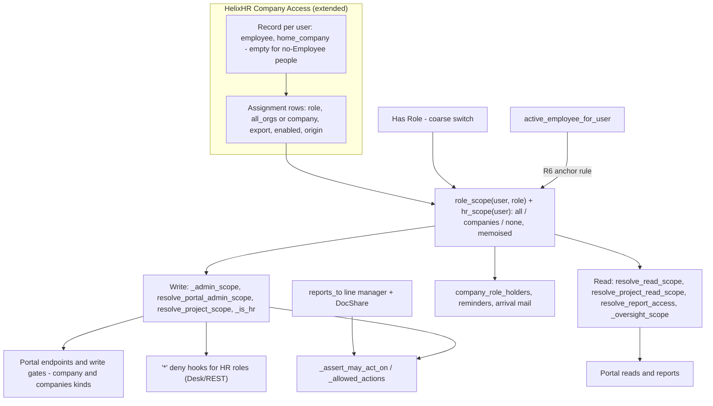
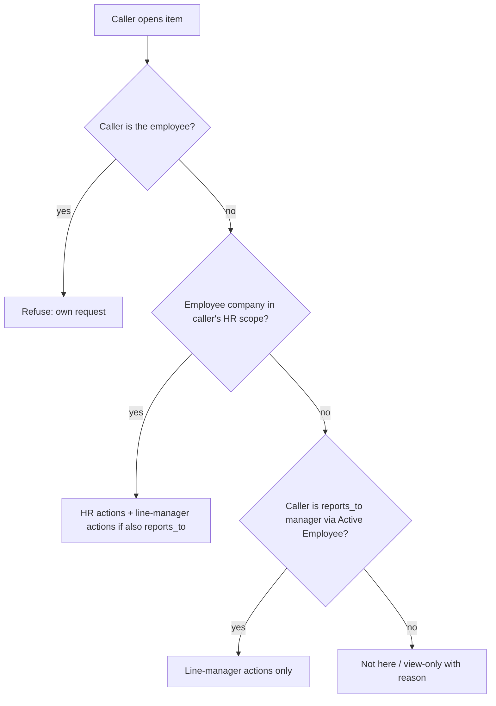
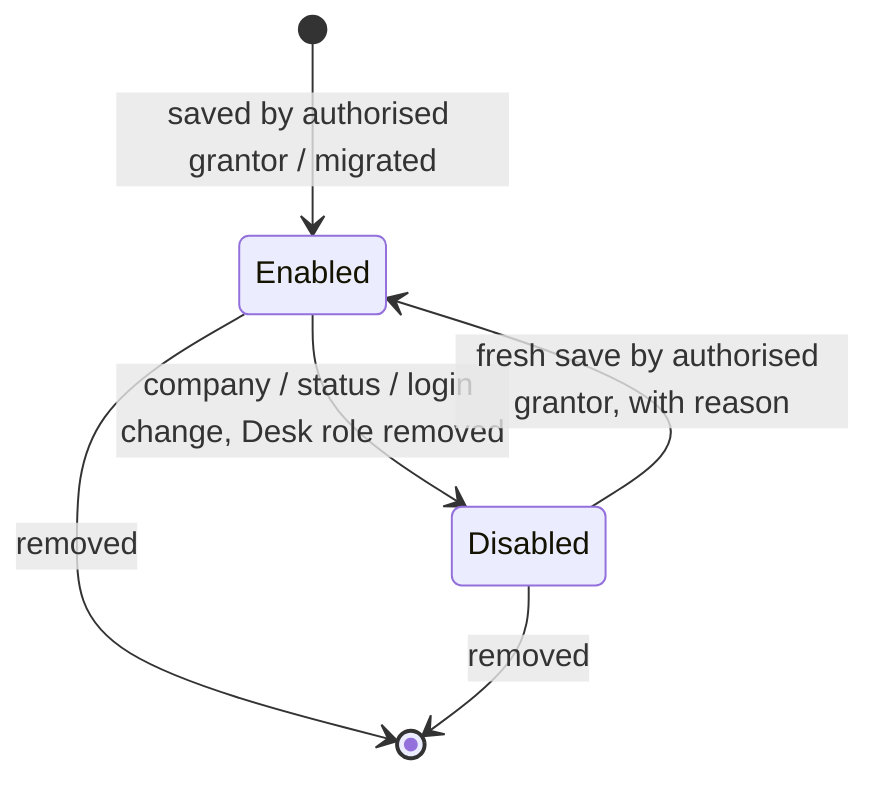
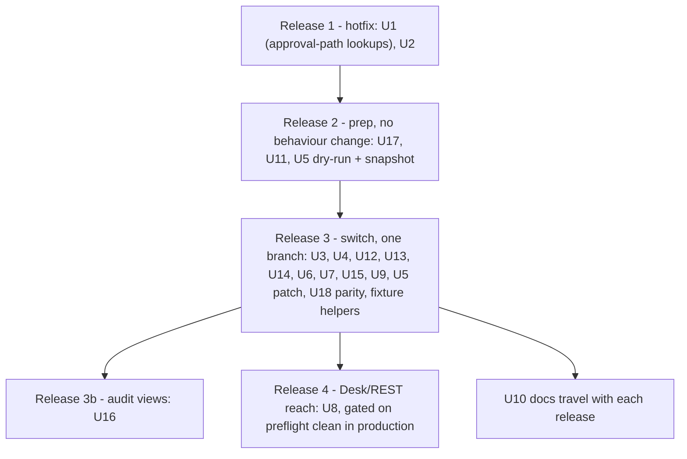

# feat: Org-scoped access assignments, Manage access, and a clearer People & access

## Summary

Each portal role assignment says which orgs it covers: named orgs, or "All orgs". One store holds these assignments, and every scope resolver reads from it. Leadership acts as HR in every org. A separate Manage access permission decides who may change access.

Migration keeps everyone's current access. Where the new model can only keep access by giving a little more, the row is enabled and the dry-run lists the widening for that person. People with no Employee record keep exactly what they reach today. The only reach removed is a short list of deliberate security fixes, each named below.

Line-manager approval follows the reporting line in any company, which fixes the "can see it, can't approve it" timesheet bug. People & access becomes a person-first screen: org chips, effective access in plain language, and a review step before save.

Delivery happens in five releases:

1. Approval hotfix
2. Prep, with no behaviour change
3. Switch to the store
4. Audit views
5. Desk/REST reach

---

## Problem Frame

Today portal access is a Frappe role plus the company of the person's Active Employee. No role records the orgs it covers, which causes these problems:

- **Multi-org Portal Admin.** A Portal Admin meant to run two orgs can only *read* the second. A cross-company grant (`HelixHR Company Access`) widens reads, never writes (plan 2026-10-14-001 KTD1/KTD4).
- **Company moves.** Moving someone to another company silently moves every role's reach. Only the grant is disabled (`helixhr/events.py` `employee_on_update`).
- **Leadership.** The "Leadership" profile is a read-only All-data grant, though Leadership was meant to have full access.
- **No access-admin role.** There is no "who may change access" permission. Portal Admin edits everyday roles at home only, and HR roles are System Manager only (plan 2026-10-15-001 KTD9).
- **Desk/REST reach.** HR Manager reaches every company in Desk/REST. The portal resolvers are the only company limit, and the submit hooks short-circuit for any HR user (`events._is_hr`).
- **Offboarded admins.** `can_admin_portal` ignores company and Employee status. A Left Portal Admin can still edit the global report matrix and every company's email templates.

The timesheet bug ("a manager in Org A sees his reports' timesheets but cannot approve") has three confirmed code paths. None reproduces on `test_site`.

1. **Wrong Employee row in the workflow condition.**
   - The Timesheet manager transitions (`helixhr/fixtures/workflow.json`: Approve / Send Back / Send to HR) look up the manager's Employee with `{"user_id": session.user}` and no `status` filter.
   - When a login also has a newer Left or Inactive row, the condition fails. The queue, `_may_act_on_timesheet` and `timesheet_before_submit` still pass, so the manager sees the row but gets no buttons.
2. **HR manager with a report in another company.**
   - `_assert_may_act_on` (`helixhr/api.py` ~8110) returns early for any `_is_hr` user after the admin-scope company check. It never falls through to the line-manager rule.
   - The line-manager queue has no company filter, so the row shows while detail and act refuse.
3. **Missing permission layer.** A missing DocShare, a missing Employee role, or a failing child-row Project user permission lets the list render, while `apply_workflow`'s write/submit check fails.

People & access splits one person's access across managed roles, HR roles, a grant editor and profile chips. Roles outside those sets never appear: `locked_roles` is returned but not rendered, so a Portal Admin target reads as "Employee access only".

---

## Requirements

**Assignment model**

- R1. Each portal role assignment records a person, a role, and a scope of "All orgs" or one or more named orgs.
  - A role with no enabled assignment grants no portal reach.
  - Once U8 ships, it also grants no Desk/REST HR reach. Until then, Desk reach still follows `Has Role`.
- R2. Roles and what an assignment gives in each org in scope:

  | Role (UI label) | Reads in scope | Acts in scope |
  |---|---|---|
  | Leadership | Everything HR Manager reads | HR Manager actions. Scope is always All orgs |
  | Manage access | Nothing beyond their own access | Change roles and scopes, per R11–R18 |
  | Portal Admin | Export log, approver drift, People & access | Portal settings, plus the everyday roles (R13) |
  | HR Manager | People, org, requests, reports | HR approvals, person edits, roster |
  | HR User | Timesheet oversight, matrix reports | None. Oversight stays read-only |
  | IT Admin | IT requests | Handle IT requests |
  | Delivery Manager | Every project the org owns, plus every hour logged on it | Project and task edits in the portal. REST stays refused |
  | Reports | Every catalog report, with its own export flag | None |
  | Org viewer | People, org chart, projects, reports, with its own export flag | None |
  | Notification Manager | Unchanged | Unchanged |

  "Everyday roles" means Delivery Manager, IT Admin, Reports, Org viewer and Notification Manager. "Privileged roles" means Portal Admin, HR Manager, HR User, Leadership and Manage access.
- R3. Reads are the union of all enabled assignments. Writes come only from assignments whose role acts.
- R4. "All orgs" includes orgs created later, and the UI says so.
- R5. System Manager and Administrator are unscoped and cannot be assigned in the portal. This widens an anchored System Manager, which is company-scoped in the portal today.
- R6. How an assignment's anchor is checked:
  - An assignment recorded against an employee counts only while that employee is the person's Active Employee, with the recorded home company.
  - An assignment recorded with no employee counts only while the person has no Employee record at all.
  - A person whose Employee records are all Left or Inactive gets no reach.

**Line-manager approvals**

- R7. A line manager can approve, send back, or send to HR the timesheets, attendance requests and leave of their direct reports, whatever company either person is in.
- R8. A caller who is both HR and line manager gets the union of both. Outside their HR scope they get only the line-manager actions, never the HR-stage actions.
- R9. Every lookup of "this login's Employee" resolves the Active row, or "none".
- R10. A queue row the caller cannot act on says why, and shows no dead buttons.

**Granting authority**

- R11. Nobody changes their own access.
- R12. Only a System Manager or an All-orgs Manage access holder can grant or remove Manage access, Leadership, or any All-orgs scope.
- R13. A Portal Admin can grant the everyday roles when both the assignment's orgs and the target's home org are within the Portal Admin's own orgs.
- R14. A Manage access holder can grant any role except Manage access and Leadership, under the same two org conditions as R13. Until U8 ships, only a System Manager or an All-orgs Manage access holder can grant HR Manager or HR User.
- R15. Every role a target holds must allow the caller to edit them, per the "Who may edit whom" table. If any held role is outside the caller's tier, the target is read-only to that caller.
- R16. Removing access refuses to leave zero effective All-orgs Manage access holders, unless a System Manager does it. Lifecycle events that would cause this notify System Managers.
- R17. High-risk rows require a written reason when granted:
  - Leadership
  - Manage access
  - any All-orgs row
  - any row with export on
  - any row whose org differs from the target's home org

  The same transaction writes an in-app Notification Log entry for every System Manager and All-orgs Manage access holder. Email follows as best effort.
- R18. The server re-checks every rule at save time. Hiding a choice on screen is never the check.

**Desk and REST reach**

- R19. Org-scoped HR Manager and HR User cannot read or act on other orgs' records, through Desk or REST. This covers any doctype linked to a company or employee, directly or through its parent document. Own records, shared records, and their direct reports' records stay reachable.
- R20. An org-scoped HR user cannot run an HRMS script report over a company outside their scope.
- R21. These all honour HR scope:
  - submit-hook HR short-circuits
  - HR-stage workflow transitions
  - `_is_hr` capability checks
- R22. Desk Employee edits cannot do either of these:
  - hand cross-company line-manager rights to someone outside the editor's HR scope
  - disable a Leadership or Manage access holder, unless the editor is a System Manager or an All-orgs Manage access holder

**Lifecycle and migration**

- R23. When an Employee's company, status or login changes, their enabled assignments are disabled with a reason. Re-enabling one is a fresh save.
- R24. Removing a role in Desk disables that role's assignments. Removing HR Manager also disables Leadership. Edits made through the save endpoint are not treated as Desk removals.
- R25. A narrowing saved through People & access expires the person's unreachable Ready exports on commit. Narrowing caused by migration is expired by the post-deploy sweep.
- R26. Migration keeps every person's current access.
  - Rows needed to preserve access are written enabled, even where the new model widens them. The dry-run lists each widening.
  - The only removals are the deliberate security fixes listed in "Previous vs new". The dry-run names each affected person.
- R27. The dry-run is a read-only command, run against production. For each person it prints what migration widens, narrows by design, or leaves unchanged. It also saves a snapshot of today's resolver outputs.
- R34. After migration, a parity command compares the new resolver outputs with the saved snapshot. It labels each difference "declared widening", "by-design narrowing" or "undeclared". Any undeclared difference blocks reopening the site.

**People & access**

- R28. Each person shows one list of role cards with org chips. Each chip carries its own export and on/off state, and a card the caller can't edit says why.
- R29. Each person shows their effective access as plain sentences, each with its reason: a role and its orgs, or "manages N people".
- R30. Before saving, the caller sees what the person gains and loses. High-risk rows carry a text badge and need a reason.
- R31. A Roles view shows who holds each role in each org within the caller's reach, and flags orgs with no HR Manager or IT Admin.
- R32. Each person shows an access history: who changed what, when, and why.
- R33. Quick-fill presets cover Employee, Leadership, Portal Admin, HR Manager, HR User, IT Admin, Delivery Manager, Reports and Org viewer. Anything else shows as Custom.

---

## Previous vs new

| Who | Today | After this plan |
|---|---|---|
| Leadership (today: All-data grant holders who should lead) | Read-only across chosen orgs. No approvals | Leadership role: acts as HR Manager in every org, including future orgs |
| Portal Admin with a second org | Full admin at home. Can only read and grant in the second org | Full admin in both orgs (widened, listed) |
| Portal Admin with no Employee | Site-wide admin | Portal Admin, All orgs (unchanged) |
| Left or Inactive Portal Admin | Still edits the matrix and every company's templates | No admin reach (security fix) |
| Single-org Portal Admin | Edits the global report matrix and every company's email templates | Edits templates for its own orgs only. The matrix needs All-orgs authority (security fix) |
| HR Manager with Employee | Portal: own company. Desk: every company | Portal: assigned orgs. Desk: assigned orgs once U8 ships (security fix) |
| HR Manager with no Employee | Every company | HR Manager, All orgs (unchanged) |
| HR User with no Employee | No portal reach. Desk: every company | HR User, All orgs. Portal oversight and matrix reports become visible (widened, listed). Desk unchanged |
| Delivery Manager | Projects they are a member of, in any org | Every project in their home org, plus every org where they are a member of a project (widened, listed) |
| Reports-only grant holder | Every catalog report in the granted orgs | Reports role in the same orgs, with the same export flag (unchanged) |
| All-data grant holder | Read-only people, org, projects and reports in the granted orgs | Org viewer in the same orgs, with the same export flag (unchanged) |
| Line manager with a report in another org | Sees the item. Approval can fail | Can approve |
| Anyone who moves company | Every role's reach moves silently | Assignments switch off until re-confirmed (security fix) |
| Who changes access | Portal Admin: everyday roles at home. System Manager: HR roles | Portal Admin: everyday roles in its orgs. Manage access: privileged roles. All-orgs Manage access: Leadership and Manage access |

---

## Key Technical Decisions

- KTD1. **Extend `HelixHR Company Access` with child rows instead of adding a new parent doctype.**
  - The existing doctype already provides:
    - one record per user, with `track_changes`
    - `employee` and `home_company`
    - System Manager-only DocPerm
    - the `employee_on_update` lifecycle hook
    - a test upsert helper and a preflight check
  - New child rows (`HelixHR Access Assignment`) carry: role, `all_orgs`, company, `allow_export`, `enabled`, `disabled_reason`, and a read-only `origin` (manual / migrated).
  - The legacy fields `level`, `companies`, `allow_export` and `enabled` become read-only and are no longer read.
  - "Acme + Beta" is stored as two rows, because Frappe cannot nest tables.
  - Company User Permissions were rejected on 2026-10-14 (KTD2).
- KTD2. **`Has Role` stays the coarse switch. The store says where it applies.**
  - HRMS DocPerms and workflow transitions keep working.
  - HR scope is the union of enabled HR Manager and Leadership rows, computed by one `hr_scope(user)` helper.
  - A role with no enabled rows resolves to `none`. A Leadership row counts as covering `Has Role` HR Manager.
- KTD3. **Leadership implies HR Manager over All orgs.**
  - Saving Leadership also ensures `Has Role` HR Manager. Removing Leadership removes HR Manager only when no explicit HR Manager row remains.
  - The HR Manager self-UP rule (`_set_self_employee_permission`) still applies.
  - Leadership is refused for Role Profile targets, because the profile would strip the implied role.
- KTD4. **Three new fixture roles: `HelixHR Leadership`, `HelixHR Org Viewer`, `HelixHR Access Admin` (UI: "Manage access").**
  - IT Team is shown as "IT Admin" and HelixHR Report Manager as "Reports".
  - All three new roles are `desk_access 0` with no DocPerm, enforced by `_no_grant_portal_role`.
- KTD5. **One resolver input. Every consumer handles multi-org scopes.**
  - `role_scope(user, role)` returns "all", a company set, or none.
  - It reads all of a user's enabled rows in one query and memoises them, together with `active_employee_for_user`, under the existing `shared_admin_scope` flag.
  - Consumers:
    - `_admin_scope` and `_is_hr` (both through `hr_scope`)
    - `resolve_portal_admin_scope` and `resolve_project_scope`
    - the read and report resolvers, including `_oversight_scope`
    - `can_admin_portal`
    - `company_role_holders`
  - The read/write split stays (plan 2026-10-14-001 KTD1).
  - About 25 write-scope consumers branch only on `kind == "company"`. They are fixed first (U11). An unknown kind raises.
- KTD6. **Line-manager rights follow the reporting line, not the store.**
  - `_assert_may_act_on` tries HR scope first, then falls through to that request type's line-manager rule.
  - HR-stage actions are dropped when the employee's company is outside HR scope. The submit and validate hooks enforce the same.
  - Workflow conditions stay plain lookups. Frappe's workflow `safe_eval` globals are fixed (`frappe/model/workflow.py` ~81-101).
- KTD7. **The Timesheet manager transition conditions gain `"status": "Active"`.**
  - Fixture sync re-imports workflows with `force` on every migrate, so the fixture is authoritative.
  - A backstop patch updates existing transitions' conditions, keyed by (state, action, next_state, allowed).
  - Attendance Request conditions already filter on Active.
- KTD8. **One `active_employee_for_user(user)` helper replaces the unfiltered lookups.** It keeps "no rows" and "only non-Active rows" distinct.
- KTD9. **Desk/REST reach uses one wildcard deny-only hook.**
  - **Registration and scope.**
    - Register `has_permission` and `permission_query_conditions` for `"*"` (v16: `frappe/permissions.py` ~492; `frappe/database/query.py`).
    - Exit early unless the user holds HR Manager or HR User without System Manager.
    - Always return a bool. In v16 `None` denies.
  - **Company resolution**, in order:
    1. the doc's `company`
    2. its `employee` link's company
    3. for child doctypes, the parent's rule through `parenttype`/`parent`
    4. for indirect links (for example Job Applicant through Job Opening), a mapped resolver

    An org-scoped HR user is denied any doc whose company cannot be resolved, unless the doctype is allowlisted with a written reason. HR configuration doctypes (Leave Period, Department, Holiday List, Leave Type, Shift Type) are allowlisted, because HR configuration stays global.
  - **List conditions** are one SQL clause, ORing:
    - Employee company in scope
    - rows shared with the user
    - rows whose employee reports to the caller's Active Employee
    - the user's own rows

    Frappe ORs shares into lists only when user permissions exist, and HR Managers have none.
  - **Single-doc checks.** DocShares already override hook denials.
  - **Coverage test.** A test fails when a doctype where HR Manager or HR User holds a DocPerm, or its child tables, is neither covered nor allowlisted.
  - **Script reports** need their own mechanism (see Open Questions).
- KTD10. **Delivery Manager means every project an org owns (`Project.company`), plus every hour logged on it.** The REST hooks keep refusing Delivery Manager.
- KTD11. **Org viewer replaces the All-data grant. Reports replaces the Report Manager home tier and the Reports-only grant.**
  - Both keep a per-row export flag.
  - Org viewer enters read resolvers only, never `_admin_scope`.
  - The report matrix stays one global policy. Only a System Manager, an All-orgs Manage access holder or an All-orgs Portal Admin may edit it.
- KTD12. **Migration preserves reach, and it is additive.**
  - A pure `plan_rows` function feeds the dry-run, the patch and the parity command. It resolves anchors through `active_employee_for_user`.
  - Every row needed to keep a person's current access is written enabled with `origin=migrated`, even when the new model widens it. The dry-run lists each widening.
  - Only the deliberate security fixes in "Previous vs new" narrow access.
  - The patch never modifies `Has Role`, the legacy grant fields or Company User Permissions.
  - Rollback has two cases:
    - If the patch fails during migrate, restore the pre-migrate backup.
    - After the site reopens, revert the code only. Then review the `Has Role` changes made through the new save endpoint, because the reverted code treats `Has Role` plus anchor as reach.
  - There is no legacy fallback in the resolvers.
- KTD13. **One save endpoint, one record, one stale token.**
  - It keeps:
    - the atomic savepoint
    - `defer_side_effects`
    - the Role Profile refusal
    - "an omitted role is never touched"
  - The last-holder check runs under a row lock across all Manage access rows.
  - The save sets a request flag, so the U6 User handler ignores its own `Has Role` sync.
  - Each save writes one structured access-change comment (before → after, reason), the only source the portal's History reads. Version rows remain the raw Desk audit.
  - Legacy endpoints are removed in U9.
- KTD14. **Assignment lifecycle is fail-closed at two layers.**
  - **Read time is the boundary.** `role_scope` applies R6, including the no-Employee case. This catches HRMS Employee Transfer and `db_set` paths that skip hooks.
  - **Write-time hooks:** `employee_on_update`, `employee_after_insert` and a User `on_update`.
    - They disable only rows that are currently enabled.
    - When a no-Employee person gets their first Employee, Manage access holders are told to re-confirm that person's access.
  - **Notifications.**
    - Disabling Leadership or Manage access notifies System Managers.
    - Before U8, so does any lifecycle disable that leaves an HR role holder with no enabled rows, because their `Has Role` still reaches Desk.

---

## High-Level Technical Design

### Where scope comes from

### Who may act on a pending item

### Assignment row lifecycle

### Grant authority

| Grantor | May grant | Orgs (assignment and target's home) |
|---|---|---|
| System Manager | Every role, any scope | Any |
| Manage access, All orgs | Every role | Any, including All orgs |
| Manage access, named orgs | Privileged roles except Leadership and Manage access (HR roles only after U8), plus everyday roles | Only their orgs, never All orgs |
| Portal Admin | Everyday roles | Only their orgs, never All orgs |

### Who may edit whom (R15)

A target is editable when **every** role they hold passes its row below.

| Target holds | Who may edit them (never themselves) |
|---|---|
| Manage access (any scope) | System Manager, All-orgs Manage access |
| Leadership | System Manager, All-orgs Manage access |
| Portal Admin, HR Manager, HR User | System Manager, All-orgs Manage access, Manage access covering the target's home org |
| Everyday roles only, or no roles | Everything above, plus a Portal Admin covering the target's home org |

### Release sequence

---

## Implementation Units

### Release 1 — Approval hotfix

### U1. Active-Employee lookup helper (approval path)

- **Goal:** Add the Active-Employee helper and use it everywhere the approval path looks up a manager or caller.
- **Requirements:** R9
- **Dependencies:** none
- **Files:**
  - Modify: `helixhr/utils.py` (`active_employee_for_user`, `get_manager_user`)
  - Modify: `helixhr/api.py` (approval-path lookups only)
  - Modify: `helixhr/events.py` (`_approver_user`, submit hooks)
  - Test: `helixhr/tests/test_active_employee_lookup.py`
- **Approach:**
  - Add the helper next to `session_company`.
  - Route through it only the lookups that the approval queue, detail, act and submit hooks use.
  - The remaining lookups move to U17.
- **Patterns to follow:** the `_admin_scope` docstring (none vs inactive), `session_company`.
- **Test scenarios:**
  - Login with an Active Org A row and a newer Left Org B row: `get_manager_user` and the approval-path caller lookup resolve A.
  - Login with only a Left row: the helper returns "inactive". Login with no rows: it returns "none".
  - Tiebreak is deterministic.
- **Verification:** Approval-path lookups all go through the helper. The other modules are untouched.

### U2. Line-manager approval across companies

- **Goal:** A line manager can act on a direct report's pending items in any company. HR+manager callers get the union of both, and the queue shows no dead rows.
- **Requirements:** R7, R8, R10
- **Dependencies:** U1
- **Files:**
  - Modify: `helixhr/api.py` (`_assert_may_act_on`, `_may_act_on_timesheet`, `_workflow_allowed_actions`, approval summaries)
  - Modify: `helixhr/events.py` (timesheet, attendance and leave submit hooks)
  - Modify: `helixhr/fixtures/workflow.json`, `helixhr/patches.txt`
  - Create: `helixhr/patches/v1_0/active_manager_workflow_conditions.py`
  - Modify: `frontend/src/pages/Approvals.vue`
  - Test: `helixhr/tests/test_approvals_cross_company.py`, the approvals e2e spec in `frontend/tests/e2e/`
- **Approach:**
  - Workflow conditions: change the fixture and add the backstop patch (KTD7).
  - HR fall-through in `_assert_may_act_on`.
  - HR-stage filtering in `_allowed_actions`.
  - Queue rows carry `can_act` and a reason. `Approvals.vue` renders view-only rows with that reason.
- **Execution note:** Start with failing tests that reproduce each of the three confirmed paths.
- **Patterns to follow:**
  - architecture.md "Who may act: one table"
  - the `has_approval_access` `doc.owner` rule
  - a transition-keyed update in the patch. Not `ensure_need_info_from_open`, which only appends.
- **Test scenarios:**
  - **Path 1:** Manager with an Active Org A row and a newer Left row. Detail lists Approve, and `act_on_approval` succeeds.
  - **Path 2:** HR Manager in A with a direct report in B gets line-manager actions only, and approve succeeds. Send to HR leaves the item pending for B's HR.
  - **Plain manager in A, report in B:** works through `act_on_approval` and through bulk `approve_clean_items`.
  - **HR Manager in A, non-report in B:** refused.
  - **Missing Employee role or missing share:** the row is view-only with a reason. A direct act gets a clear refusal, not a raw PermissionError.
  - **Self-approval:** refused.
  - **Attendance Request:** the same matrix.
  - **Backstop patch:** updates a stale condition. A re-run changes nothing.
- **Verification:**
  - Tests pass on a fresh strict site, and the existing approval suites stay green.
  - The runbook SQL checks have been run on the affected site.

### Release 2 — Prep (no behaviour change)

### U17. Route the remaining Employee lookups through the helper

- **Goal:** Every other unfiltered `{"user_id": ...}` Employee lookup resolves the Active row.
- **Requirements:** R9
- **Dependencies:** U1
- **Files:**
  - Modify: `helixhr/utils.py` (`_admin_scope`, `_active_anchor_company`, `active_company_grant`, `resolve_project_scope`)
  - Modify: `helixhr/api.py`, `helixhr/reports.py`, `helixhr/reminders.py`
  - Test: extend `helixhr/tests/test_active_employee_lookup.py`
- **Approach:** Route each site through `active_employee_for_user`. Keep `_admin_scope`'s "no rows means unscoped" behaviour for HR Managers with no Employee.
- **Test scenarios:**
  - Rehired login: `_admin_scope`, `resolve_project_scope` and `active_company_grant` use the Active row.
  - Only a Left row: admin scope is `none`.
  - No rows at all: an HR Manager stays unscoped.
- **Verification:** grep finds no unfiltered `user_id` Employee lookups outside the helper and tests.

### U11. Write-scope consumers handle multi-org scopes

- **Goal:** Every write-scope consumer handles `companies` correctly before any resolver returns it.
- **Requirements:** R3 (safety precondition)
- **Dependencies:** none
- **Files:**
  - Modify: `helixhr/api.py`
    - `_companies_in_admin_scope`
    - `get_export_log` filters
    - the celebration company picker
    - roster and Organisation scope helpers
  - Modify: `helixhr/reports.py` (`_scope_company`), `helixhr/helixhr/doctype/hr_request/hr_request.py`, `helixhr/utils.py`
  - Test: `helixhr/tests/test_scope_kinds.py`
- **Approach:**
  - Add a `companies` branch wherever code branches on `kind == "company"`. An unknown kind raises.
  - `_oversight_scope`, a read consumer, gets the same treatment.
  - Tests inject a `companies` scope directly.
- **Patterns to follow:** `employee_in_admin_scope`, `admin_scope_employee_filters`.
- **Test scenarios:**
  - With an injected `companies` [A, B] scope, company C is refused or excluded in each of:
    - export log
    - celebration companies
    - `_scope_company`
    - HR Request list conditions
    - oversight
    - roster
    - Organisation view
    - Cmd-K people search
  - An unknown kind raises.
  - Existing `company`-kind behaviour is unchanged.
- **Verification:** grep finds no `kind == "company"` branch without a `companies` counterpart, and the full suite passes.

### U5. Migration mapping, dry-run, snapshot and patch

- **Goal:** Map today's access into assignments that keep everyone's reach, with a read-only preview and a baseline snapshot that can run on production before the switch.
- **Requirements:** R26, R27
- **Dependencies:**
  - Release 2: `plan_rows`, `dry_run` and the snapshot depend on U1 and U17.
  - Release 3: the patch depends on U3.
- **Files:**
  - Create: `helixhr/access_migration.py`, `helixhr/patches/v1_0/migrate_access_assignments.py`
  - Modify: `helixhr/patches.txt` (Release 3), `helixhr/install.py`
  - Test: `helixhr/tests/test_access_migration.py`
- **Approach:**
  - **Release 2 pieces.**
    - `plan_rows(state)` is a pure mapping function.
    - `dry_run()` runs read-only, directly on production. It writes a per-person report (widened / narrowed by design / unchanged) to a restricted private file, not the console or a shared log.
    - The same run saves a snapshot of today's resolver outputs for each user: admin, read, project, report and portal-admin scope. The snapshot is the characterization baseline for U4 and U18.
  - **Release 3 patch.**
    - Runs under `[post_model_sync]`. It creates the three roles through `_ensure_role` first, and does all DDL before any data writes.
    - Re-anchors existing access records to `active_employee_for_user`, or to empty for people with no Employee.
    - Skips users whose record already has assignment rows (idempotent). Dedupes (role, company or ALL), with export and enabled combined by OR.
    - Writes with side effects off, then one `frappe.clear_cache()`.
    - Also called from `after_install` after `seed_report_access`.
  - **Mapping.**
    - Holders come from the Has Role table directly, excluding Administrator and Guest.
    - System Managers get no rows.
    - Disabled users get disabled rows.

    | Legacy state | Assignment rows (all `origin=migrated`) |
    |---|---|
    | HR Manager or HR User with Employee | That role at the anchor company, enabled |
    | HR Manager or HR User, no Employee | That role, All orgs, enabled, empty anchor. HR User's new portal visibility is listed as widened |
    | Report Manager, IT Team, Notification Manager, no Employee | None (they reach nothing today) |
    | Portal Admin with Employee | Home row, plus the orgs from its Company User Permissions (`applicable_for=Company` only, deduped, deleted companies skipped), all enabled. Write in the extra orgs is listed as widened. Global-matrix and other-company template editing are listed as security-fix narrowing |
    | Portal Admin, no Employee | Portal Admin, All orgs, enabled, empty anchor |
    | Report Manager | Reports at home, export as today |
    | Reports-only grant | Reports at the grant's companies, with the grant's export flag. Merged with any Report Manager row |
    | All-data grant | Org viewer at the grant's companies, with the grant's export flag |
    | Delivery Manager | Home row plus one row per org where they belong to a project, all enabled. The dry-run states "N projects in <org> today, M after" |
    | Delivery Manager, no Employee | One row per org where they belong to a project, enabled, empty anchor |
    | IT Team, Notification Manager | Home row, enabled |
    | Inactive anchor or disabled grant | Rows written disabled, keeping the reason (no reach today) |

    Leadership and Manage access start empty.
- **Execution note:** Write the mapping function test-first.
- **Patterns to follow:** `seed_report_access.py`, `backfill_export_exporter_company.py`, `apply_permission_deltas._ensure_role`.
- **Test scenarios:**
  - **Mapping:**
    - Each mapping row produces the expected rows, enabled state and anchor.
    - A no-Employee HR Manager, HR User and Portal Admin each get an All-orgs row with an empty anchor.
  - **Merging:** Report Manager plus a Reports-only grant naming home gives one Reports row, with export combined by OR.
  - **Idempotence:**
    - A re-run changes nothing.
    - A row an admin deleted stays deleted after a re-run.
    - A stale grant record is re-anchored.
  - **Dry-run safety:**
    - The dry-run writes nothing to the database.
    - Every non-security-fix person reports unchanged or widened, never narrowed.
  - **Installs:** a fresh install via `after_install` matches the patch.
  - **Exclusions:** apply-to-all Company User Permissions are ignored.
  - **No export is expired by the patch.**
- **Verification:** The dry-run is run on production and the owner has reviewed it before Release 3.

### Release 3 — Switch to the store (one branch, one deploy)

### U3. Assignment child table and new roles

- **Goal:** Add assignment rows to the existing access doctype, plus the three new roles.
- **Requirements:** R1, R4, R5, R6
- **Dependencies:** none (lands first in the Release 3 branch)
- **Files:**
  - Create: `helixhr/helixhr/doctype/helixhr_access_assignment/`
  - Modify: `helixhr/helixhr/doctype/helixhr_company_access/` (json, controller)
  - Modify: `helixhr/fixtures/role.json`, `helixhr/hooks.py`, `helixhr/preflight.py`
  - Test: `helixhr/tests/test_access_store.py`
- **Approach:**
  - **Doctype:**
    - child table as in KTD1
    - legacy fields not-required and read-only
    - the controller accepts an empty anchor only when the user has no Employee record at all
  - **Row validation:**
    - The role must be portal-assignable.
    - `all_orgs` and `company` are mutually exclusive.
    - Leadership requires All orgs; a named org is refused.
    - Export is allowed only on Reports and Org viewer.
    - No duplicate (role, org).
  - **Preflight:**
    - New roles pass `_no_grant_portal_role`.
    - FAIL: an HR Manager or HR User whose `hr_scope` and HR User rows are both empty. A Leadership row counts as HR Manager coverage.
    - WARN: other roles with no rows, orphan rows, zero All-orgs Manage access holders.
    - Rewrite `check_company_access_grants`, `check_hr_manager_self_scope`, `check_delivery_manager_role` and `check_it_team_role` for the store.
- **Patterns to follow:** the current `helixhr_company_access` controller, `_no_grant_portal_role`.
- **Test scenarios:**
  - A valid multi-row save succeeds. An empty anchor is accepted for a no-Employee user.
  - Refused:
    - an empty anchor for a user with any Employee row
    - Leadership with a named org
    - a duplicate (role, org)
    - export on HR Manager
    - an unknown role
  - REST read or write by anyone other than a System Manager is denied.
  - A Leadership-only holder passes the HR preflight check.
- **Verification:** Preflight is clean on a fresh install.

### U4. `role_scope`, `hr_scope` and the HR write scopes

- **Goal:** HR Manager, Leadership and HR User scopes come from the store.
- **Requirements:** R1–R3, R5, R6, R21
- **Dependencies:** U3, U11, U17
- **Files:**
  - Modify: `helixhr/utils.py` (`role_scope`, `hr_scope`, `_admin_scope`, `access_summary`)
  - Modify: `helixhr/events.py` (`_is_hr`)
  - Modify: `helixhr/api.py` (`_oversight_scope`, bootstrap flags)
  - Modify: `helixhr/helixhr/doctype/hr_request/hr_request.py`
  - Test: `helixhr/tests/test_access_resolvers.py`; update `test_api_people.py`, `test_scope_hardening.py`
- **Approach:**
  - `role_scope` and `hr_scope` per KTD2, KTD5 and KTD14.
  - `_is_hr` requires an `hr_scope` that is not `none`.
  - Wrap these entry points in `shared_admin_scope`:
    - approvals summaries and detail
    - `approve_clean_items`
    - report catalog and run
    - `get_pending_by_approver`
    - the People list
  - The save endpoint never runs inside a memo block.
- **Execution note:** Each resolver's characterization test reads its expected output from the U5 snapshot fixture.
- **Patterns to follow:** P6-KTD1, and `active_company_grant`'s anchor-match check.
- **Test scenarios:**
  - **Org-scoped HR Manager [A, B]:** scope {A, B}. Approves in B, refused in C.
  - **Leadership:** unscoped writes, and a company created later is in scope.
  - **No-Employee people:**
    - An HR Manager with an empty-anchor All-orgs row resolves to "all".
    - The same user, after a Left Employee is created for them, resolves to `none`.
  - **Transferred HR Manager, rows disabled:** `_is_hr` is false.
  - **Employee Transfer via `db_set`:** anchor mismatch, so `none`.
  - **Role with no rows:** `none`. **System Manager:** unscoped.
  - **Query count:** bootstrap and the approvals queue make no more store reads than today's anchor and grant reads.
- **Verification:** Characterization outputs match the migrated equivalents, and the HR suites pass.

### U12. Read and report resolvers

- **Goal:** People, Organisation, project reads and reports come from Org viewer, Reports and HR rows.
- **Requirements:** R2, R3, KTD11
- **Dependencies:** U4
- **Files:**
  - Modify: `helixhr/utils.py` (`resolve_read_scope`, `resolve_project_read_scope`, `resolve_report_access`, `combined_export_scope`, `stored_export_scope`)
  - Modify: `helixhr/api.py` (`_can_run_reports`, bootstrap read flags)
  - Test: update `test_company_access.py`, `test_company_access_reports.py`, `test_company_access_surfaces.py`, `test_reports_access.py`
- **Approach:**
  - Report engines receive one company, or the combined set for project reports only.
  - Org viewer never enters `_admin_scope`.
- **Patterns to follow:** `_widen_by_companies`, `combined_export_scope`, the elevated-execution gate.
- **Test scenarios:**
  - **Org viewer [B] with home A:**
    - People reads work in B.
    - No edits, no roster.
    - Permlevel-2 fields stay masked.
    - No bank-change queue.
  - **Reports [B] with export off:** reports run, export is disabled, and the combined view is honoured.
  - **Narrowing:** Reports [A, B] narrowed to [A] refuses the stored B export download.
- **Verification:** The report two-company isolation tests pass.

### U13. Delivery Manager project scope

- **Goal:** A Delivery Manager sees every project their orgs own, plus every hour logged on them.
- **Requirements:** R2, KTD10
- **Dependencies:** U4
- **Files:**
  - Modify: `helixhr/utils.py` (`resolve_project_scope`, `project_scope_filters`)
  - Modify: `helixhr/project_permissions.py`, `helixhr/reports.py`, `helixhr/preflight.py`
  - Test: `helixhr/tests/test_delivery_manager_scope.py`
- **Approach:**
  - `assigned` becomes a `companies` scope over `Project.company`.
  - The REST hooks keep refusing Delivery Manager.
  - Correct the `project_permissions.py` docstring: hooks only deny.
- **Test scenarios:**
  - **Delivery Manager [A]:**
    - Sees an unassigned Org A project, including hours from Org B staff.
    - An Org B project is invisible.
  - **REST:** `GET /api/resource/Project` is still refused.
  - **Task save:** allowed in A, refused in B.
- **Verification:** The project report suites pass.

### U14. Portal Admin authority and recipients

- **Goal:** Portal Admin powers, notification recipients and routed workers follow the store's scope.
- **Requirements:** R2, KTD11
- **Dependencies:** U4
- **Files:**
  - Modify: `helixhr/utils.py` (`can_admin_portal`, `resolve_portal_admin_scope`, `company_role_holders`)
  - Modify: `helixhr/api.py`
    - `_assert_report_access_admin`
    - `get_export_log`
    - `_assert_portal_admin`
    - `_assert_template_company`
    - `_holds_routed_role`
    - the `portal_search` inbox
  - Modify: `helixhr/events.py` (`_enabled_users_with_role`, `_hr_managers`), `helixhr/reminders.py` (`_role_holders`, `_summary_owners`)
  - Modify: `helixhr/helixhr/doctype/hr_request/hr_request.py` (routed-worker branch)
  - Test: update `test_portal_admin.py`; add `helixhr/tests/test_access_recipients.py`
- **Approach:**
  - `can_admin_portal` requires an enabled Portal Admin row, or System Manager.
  - Editing the matrix needs All-orgs authority.
  - Recipients come from one set query per (role, company).
  - Routed IT workers see requests in their IT Admin orgs.
- **Test scenarios:**
  - **Left Portal Admin:** `can_admin_portal` is false.
  - **Portal Admin [A]:**
    - Matrix edit refused.
    - Export log shows A only.
    - Approver cleanup is limited to A.
  - **No-Employee All-orgs Portal Admin:** keeps template editing for every company.
  - **IT Admin [A, B]:** receives B's IT mail and can open it.
  - **Overdue summaries:** Leadership receives every org's; an HR Manager [A] receives only A's.
- **Verification:** No test sends mail about a request its recipient cannot open.

### U6. Lifecycle: transfers, offboarding, Desk role edits, exports

- **Goal:** Assignments fail closed when the person or their roles change, and narrowing revokes downloads.
- **Requirements:** R16, R23, R24, R25
- **Dependencies:** U3, U4
- **Files:**
  - Modify: `helixhr/events.py` (`employee_on_update`, `employee_after_insert`, new User `on_update` handler)
  - Modify: `helixhr/hooks.py`
  - Modify: `helixhr/helixhr/doctype/helixhr_company_access/helixhr_company_access.py`
  - Modify: `helixhr/access_migration.py` (`expire_exports_sweep`)
  - Test: `helixhr/tests/test_access_lifecycle.py`
- **Approach:**
  - **Disabling rows:**
    - Lifecycle events disable only rows that are currently enabled.
    - A role removed in Desk disables that role's rows. Removing HR Manager also disables Leadership.
    - The User handler skips all of this when the request flag from the save endpoint is set.
  - **Notifications:**
    - Company `after_insert` → All-orgs Manage access holders.
    - A no-Employee person's first Employee → Manage access holders, to re-confirm their access.
    - Lifecycle disabling of Leadership or Manage access, or of the last All-orgs Manage access holder → System Managers.
    - Before U8, an HR role holder left with no enabled rows → System Managers.
  - **Export expiry and cache:**
    - After commit, narrowing runs `expire_unreachable_exports` and clears the user's cache.
    - `expire_exports_sweep()` (run with `bench execute`) runs that function for every user who holds a Ready export.
- **Patterns to follow:** `_disable_grant_saved_elsewhere`, `defer_side_effects`, `disable_company_access`.
- **Test scenarios:**
  - **Company transfer:** enabled rows are disabled with the reason, and a Ready export from the old scope expires.
  - **HRMS Transfer that creates a new Employee ID:** rows are disabled.
  - **Left status or login change:** rows are disabled.
  - **HR Manager removed in Desk:**
    - HR Manager and Leadership rows are disabled.
    - Re-adding the role in Desk does not re-enable them.
  - **Save endpoint removes Leadership:** no lifecycle notification fires.
  - **No-Employee person:** gets an Employee, and Manage access holders are notified.
  - **New Company:** Manage access holders are notified.
  - **Export sweep:** expires a narrowed user's Ready export.
  - **Rolled-back save:** no cache clear, no expiry.
- **Verification:** The lifecycle tests pass, and preflight has no orphan FAILs.

### U7. Grant authority and the save endpoint

- **Goal:** One write path enforcing R11–R18, with an audit trail.
- **Requirements:** R11–R18, R32, KTD13
- **Dependencies:** U4, U6
- **Files:**
  - Modify: `helixhr/api.py` (`save_person_access`)
  - Modify: `helixhr/utils.py` (`grantable(user)`: role → org sets, plus the "Who may edit whom" check)
  - Test: `helixhr/tests/test_access_authority.py`; rewrite `helixhr/tests/test_people_access.py`
- **Approach:**
  - **Payload:** the full desired assignment set, a stale token, and an optional reason. The reason is required only when the change includes a high-risk row.
  - **Checks, in order:**
    1. Diff against the stored rows.
    2. Check the diff against `grantable`, covering the assignment orgs and the target's home org.
    3. Check "Who may edit whom".
    4. Run the last-holder check under a lock.
  - **One savepoint applies:**
    - the rows
    - `Has Role` sync, with the request flag set
    - the HR Manager self-UP rule
    - one structured access-change comment
    - Notification Log rows for high-risk grants
  - **After commit:** best-effort email.
- **Patterns to follow:** the current `save_person_access` (savepoint, `_same_timestamp`, `_toggle_changes` omission rule, Role Profile refusal, `_set_self_employee_permission`).
- **Test scenarios:**
  - **"Who may edit whom" matrix:** every caller tier (System Manager, All-orgs MA, MA [A], Portal Admin [A]) against every target-role row in the table.
  - **Portal Admin [A]:**
    - Delivery Manager [A] for a home-A target: allowed.
    - The same grant for a home-B target: refused.
    - HR User [A]: refused.
  - **Manage access [A]:**
    - HR Manager [A] before U8: refused. After U8: allowed.
    - Reports, All orgs: refused.
    - Manage access [A]: refused.
  - **All-orgs Manage access granting Leadership:**
    - Without a reason: refused.
    - With a reason: allowed. The target gains HR Manager and loses the self Employee UP, and Notification Log rows exist even when email fails.
  - **Delivery Manager [A] with no reason:** succeeds, because it is not high-risk.
  - **Self-edit:** refused.
  - **Last holder:** refused for a Manage access caller, allowed for a System Manager. Of two concurrent removals, one is refused.
  - **Stale token:** refused.
  - **Role Profile target:** Leadership refused; other roles refused with a plain reason.
  - **Untouched rows:** an omitted role and rows the caller can't see stay as they were.
- **Verification:** A REST call that bypasses the UI is refused exactly as the UI would refuse it.

### U15. People & access read endpoints

- **Goal:** Serve each person's role cards and plain-language sentences, plus the paged people list.
- **Requirements:** R28, R29
- **Dependencies:** U7
- **Files:**
  - Modify: `helixhr/api.py` (`get_person_access`, `list_people_access`)
  - Modify: `helixhr/utils.py` (`access_summary`)
  - Test: `helixhr/tests/test_people_access_read.py`
- **Approach:**
  - **Person view:** rows grouped by role, with per-chip state, lock reasons from `grantable` and "Who may edit whom", and summary sentences with reasons.
  - **List:** paged, filterable by role and org. No-Employee people are included and shown as "No employee record".
  - **Reads:** `frappe.get_all` with field allow-lists.
  - **Copy:** one sentence template per role and per change type:

    | Case | Template |
    |---|---|
    | Org viewer | "Reads people, org chart, projects and reports in Org A, Org B (export off)." |
    | Leadership | "Acts as HR Manager in all orgs, including new ones." |
    | Line manager | "Manages 4 people." |
    | Disabled row | "HR Manager in Org B is off: company changed on 12 Oct." |
- **Test scenarios:**
  - A Portal Admin target shows a Portal Admin card.
  - Lock reasons match the tables for each caller tier.
  - No sentence contains raw field names.
  - A no-Employee person appears in the list.
- **Verification:** Responses never include rows outside the caller's reach.

### U9. People & access person view

- **Goal:** One screen that answers: who is this person, what can they do, in which orgs, and why.
- **Requirements:** R28–R30, R33
- **Dependencies:** U15
- **Files:**
  - Modify: `frontend/src/components/settings/PeopleAccessSection.vue`, `frontend/src/lib/accessProfiles.js`, `frontend/src/pages/Settings.vue`, `frontend/src/lib/session.js`
  - Create: `frontend/src/components/settings/AccessRoleCard.vue`, `frontend/src/components/settings/AccessReviewDialog.vue`
  - Remove: `frontend/src/components/settings/GrantEditor.vue`
  - Modify: `helixhr/api.py` (remove legacy endpoints), `frontend/tests/e2e/reports.spec.ts` (move off the legacy endpoints)
  - Test: `frontend/src/lib/accessProfiles.test.js`, `frontend/tests/e2e/people-access.spec.ts`
- **Approach:**
  - **Layout and navigation:**
    - Order: header → effective-access sentences → role cards (Everyday, then Privileged) → History disclosure.
    - Single column on phones.
    - The list → person flow is master-detail on desktop, and a pushed view with Back on phones.
    - Leaving with unsaved changes asks before discarding them.
  - **Role cards:**
    - Each card holds org chips.
    - A chip is a removable tag with a 44px remove button and a name like "Remove Org A from HR Manager".
    - "Add org" opens a labelled multi-select of grantable orgs. "All orgs" is offered only when allowed. Choosing it replaces the chips with one chip: "All orgs, including orgs added later".
    - Export and on/off live on each chip. The card's export toggle applies to every chip only when they all agree.
    - A disabled chip shows an "Off" badge, the reason in words, and an "Enable" action that goes through the review dialog.
    - Locked cards state their reason in text.
  - **Presets:**
    - Additive: they fill roles the caller can grant at the target's home org, and never remove anything.
    - "Employee" removes only roles the caller may remove, through the review dialog.
    - Presets the caller can't grant are disabled with a reason. "Custom" is a status label, not a button.
  - **Review dialog:**
    - Lists gains and losses in words, e.g. "Gains HR Manager in Org B".
    - Each high-risk line carries a text badge and an icon, not colour alone.
    - One reason field. Confirm stays disabled until it is filled, but only when a high-risk line is present.
    - On phones it renders as the existing bottom sheet. Focus returns to Save on close.
  - **States:**

    | View | Loading | Empty | Error | Refusal |
    |---|---|---|---|---|
    | People list | Skeleton rows | "No one matches these filters" | Inline retry | — |
    | Person | Skeleton | "No portal roles. Employee access only." | Inline retry | Read-only banner with the reason |
    | Effective access | Skeleton lines | "Employee access only: their own records." | Inline retry | — |
    | Save | Button spinner | — | Dialog stays open, reason shown under its heading, draft kept | Stale token: dialog closes, draft kept, "Reload and re-apply" |

  - **Design:** follow `docs/design-system.md` (Signal tokens, muted ink `#70675E`, one toast channel, no Frappe terms). Use the frappe-ui Dialog.
- **Execution note:** Run `/impeccable` on the rendered screen before merge.
- **Patterns to follow:** the current stale-reload flow; audit AI-05 and AI-06; `SegmentedChips.vue`.
- **Test scenarios:**
  - **Unit:** `matchProfiles` maps all nine presets and Custom. Reports [A] and [A, B] both match Reports.
  - **E2E, Portal Admin [A]:**
    - Adds Delivery Manager [A] with no reason. Save succeeds.
    - Privileged cards are locked with a reason.
    - Org B is not offered.
  - **E2E, All-orgs Manage access:**
    - Grants Leadership. The high-risk badge shows and a reason is required.
    - The summary reads "Acts as HR Manager in all orgs, including new ones."
  - **E2E, enable a disabled chip:** works through the dialog.
  - **E2E, self:** read-only, "You can't change your own access."
  - **E2E, refusals:**
    - Last holder: the dialog stays open with the reason.
    - Stale token: offers reload and keeps the draft.
  - **Phone:** no horizontal page scroll, and chips collapse to "N orgs", which opens the picker.
  - **Keyboard:** the dialog traps focus and closes on Escape. Chips have accessible names.
- **Verification:**
  - e2e passes on a fresh Host-routed site, and `/impeccable` reports no P1.
  - Legacy endpoint names are gone from `frontend/src`, `frontend/tests` and `helixhr/tests`.

### U18. Post-migration parity check

- **Goal:** Prove that the new resolvers grant what the dry-run promised, on real data.
- **Requirements:** R34
- **Dependencies:** U4, U12, U13, U14, U5
- **Files:**
  - Modify: `helixhr/access_migration.py` (`parity_check`)
  - Test: `helixhr/tests/test_access_migration.py`
- **Approach:**
  - Compute every user's new resolver outputs and diff them against the U5 snapshot.
  - Label each difference against the dry-run's declared widenings and security-fix narrowings.
  - Report "undeclared" otherwise.
  - Read-only. The report is written to a restricted private file.
- **Test scenarios:**
  - Seeded fixtures have zero undeclared differences.
  - An injected resolver bug, e.g. ignoring an empty anchor, is reported as undeclared.
- **Verification:** Run on the production copy before deploy and at checklist step 5. Zero undeclared differences are required.

Release 3 also:
- registers the U5 patch line and the new preflight checks
- adds an assignment-writing helper to `helixhr/tests/utils.py` and `setup_playwright_fixtures`

### Release 3b — Audit views

### U16. Roles coverage tab and history panel

- **Goal:** A role-centric audit view, and per-person history.
- **Requirements:** R31, R32
- **Dependencies:** U9
- **Files:**
  - Modify: `helixhr/api.py` (new `get_access_coverage`, `get_access_history`)
  - Create: `frontend/src/components/settings/AccessCoverage.vue`
  - Modify: `frontend/src/components/settings/PeopleAccessSection.vue`
  - Test: `helixhr/tests/test_people_access_read.py`, `frontend/tests/e2e/people-access.spec.ts`
- **Approach:**
  - **Tabs:** People and Roles, on the existing `TabBar`.
  - **Coverage:**
    - A semantic `<table>` with row and column headers and a sticky first column. It scrolls inside its own container.
    - Each cell is a button named, e.g., "IT Admin, Org B: 0 holders, gap". Gaps carry a text label.
    - It covers only orgs in the caller's reach. Callers with no reach get no Roles tab.
    - Drill-through lists holders inline (a sheet on phones). Each holder opens their person view.
    - On phones, one section per org, gaps first.
  - **History:**
    - Read from the structured access-change comments only, filtered to rows in the caller's reach.
    - A collapsed disclosure, paged.
- **Test scenarios:**
  - **Coverage:**
    - A seeded gap shows "No IT Admin in <org>".
    - Drill-through lists the holders.
    - A Portal Admin [A] sees only A.
  - **History:**
    - Shows the reason of the last save.
    - An Org A Manage access holder doesn't see Org B entries.
  - **Phone:** no horizontal page scroll.
- **Verification:** e2e passes, and `/impeccable` is clean.

### Release 4 — Desk/REST reach

### U8. Wildcard deny hooks, script reports, and Employee edit guards

- **Goal:** HR roles cannot reach other orgs' records outside the portal.
- **Requirements:** R19–R22
- **Dependencies:** Release 3 deployed; production preflight clean
- **Files:**
  - Create: `helixhr/hr_scope_permissions.py`
  - Modify: `helixhr/hooks.py`
  - Modify: `helixhr/events.py` (HR short-circuits in submit hooks; `employee_validate` guards)
  - Modify: `helixhr/utils.py` (lift the R14 interim restriction)
  - Test: `helixhr/tests/test_hr_scope_permissions.py`
- **Approach:**
  - **Hooks:** the wildcard hooks in KTD9.
  - **Submit hooks:** HR short-circuits require `employee_in_admin_scope`.
  - **`employee_validate`:**
    - Refuses a `user_id` change on an Employee whose direct reports are outside the editor's HR scope.
    - Refuses a cross-company `reports_to` the editor's scope doesn't cover.
    - Refuses company, status or `user_id` changes on a Leadership or Manage access holder, unless the editor is a System Manager or an All-orgs Manage access holder.
    - Reconciles shares when `user_id` changes.
  - **Script reports:** the mechanism chosen in Open Questions.
- **Patterns to follow:** the `project_permissions.py` and `hr_request.py` hooks, and P5-KTD13.
- **Test scenarios:**
  - **HR Manager [A] is denied B records on direct `get_doc`, and B is excluded from lists and `get_count`, for:**
    - Leave Application, Leave Allocation
    - Salary Slip, Expense Claim
    - Attendance, Job Applicant
  - **HR Manager [A], other bypasses:**
    - Timesheet Detail `get_list` with `parent_doctype` returns no B rows.
    - `frappe.client.submit` on a B timesheet is refused.
    - Salary Register for company B is refused.
  - **Line manager across orgs:** HR Manager [A] who line-manages an Org B report still sees that report's timesheet, attendance request and leave in `get_my_approvals` and in Desk lists, and can approve them.
  - **Coverage test:**
    - A new HRMS doctype with an HR DocPerm and no coverage fails the test.
    - An allowlist entry without a reason fails it too.
  - **Unresolvable company:** a doc whose company can't be resolved is denied to HR Manager [A].
  - **Unaffected users:**
    - Leadership: no denials.
    - Employee-only user: no change.
    - HR User [A]: can still read their own leave.
    - Administrator and System Manager: unaffected.
  - **Employee edits by HR Manager [A], all refused:**
    - setting `user_id` on an Org A manager who has Org B reports
    - setting a B `reports_to`
    - setting an Org A Leadership holder to Left
  - **Strict mode:** `TestStrictPermissionParity` passes.
- **Verification:**
  - The full suite passes on a fresh strict site.
  - A Desk spot-check as HR Manager [A] shows no B records.

### U10. Documentation and reversals

- **Goal:** Record the new model and the decisions it reverses.
- **Requirements:** supports all of the above
- **Dependencies:** travels with each release
- **Files:** Modify `docs/architecture.md`, `docs/runbook.md`, `README.md`
- **Approach:**
  - **architecture.md:**
    - Add an "Org-scoped access (plan 2026-10-18-001)" section with the role, authority, edit and release tables.
    - Record the reversals:
      - 2026-10-14-001 KTD1, KTD4 and R10
      - 2026-10-15-001 KTD9 and its role-reach boundary
      - 2026-10-06-001 KTD3
    - Correct "Who may act".
  - **runbook.md:**
    - Rewrite "Who can change what".
    - Add the deploy checklist below.
    - Add triage for "sees but can't approve", with the three SQL checks.
  - **README.md:** update the role list.
  - Fix the stale `patches.txt` comment about fixture sync order.
- **Test expectation:** none, documentation only.
- **Verification:** No doc still describes grants as the cross-company mechanism, or Portal Admin as home-only.

---

## Open Questions

- **Script-report enforcement (R20).** A bench spike in U8 decides between two options. Release 4 does not ship until it is chosen.
  - Wrap `frappe.desk.query_report.run` and its export through `override_whitelisted_methods`, requiring the `company` filter to be in scope.
  - Remove HR Manager and HR User from company-filtered HRMS script reports through a fixture. This also removes the reports from all-org HR.
- **Affected-site cause.** The runbook's three SQL checks on the affected site confirm which path hit. U2 fixes all three either way.

---

## Scope Boundaries

- **HR configuration stays global.** Request categories, leave types, holiday lists and shift types stay editable by any HR Manager with a non-`none` scope, Leadership included.
- **Approver rules are unchanged,** apart from the U2 fix.
- **Role Profiles stay outside the portal.** Targets with one are refused, as today.
- **No skip-level approval rights.**

### Deferred to Follow-Up Work

- Time-boxed assignments (`valid_until`) and periodic access reviews.
- Two-person approval for Leadership and Manage access. This is an accepted risk until then: two colluding All-orgs holders can grant each other Leadership, and R17's Notification Log entries make it visible.
- A break-glass account with alerting.
- Retiring Notification Manager and closing its REST write on `HelixHR Message Template`.
- A per-company report matrix.
- A data-protection review (India DPDP Rules) of US Leadership and Org viewer reach into India staff data, before the first such grant.

---

## System-Wide Impact

- **Auth boundary.**
  - Every resolver changes source (U4, U12–U14).
  - Write-scope consumers learn multi-org scopes (U11).
  - Every HR-reachable doctype gains a deny hook (U8).
- **`_is_hr` consumers** gain the scope requirement:
  - `can_configure`
  - `can_handle_requests`
  - HR Request routing
  - `_hr_managers` arrival mail
  - reminders' overdue summaries
- **Notifications.**
  - Multi-org IT Admins and HR Managers start receiving their other orgs' mail.
  - Leadership receives every org's HR mail.
- **Bootstrap flags change meaning for some users:**
  - `can_admin_portal`, `can_configure`, `can_handle_requests`
  - `can_see_people`, `can_see_organisation`
  - `can_run_reports`
  - `can_oversee_timesheets`, `can_see_all_pending`
  - `can_manage_documents`, `can_edit_email_templates`, `can_roster_everyone`

  `session.js` mirrors them.
- **Projects.** Delivery Managers gain every project their orgs own. REST stays refused.
- **Performance.**
  - One memoised store query per user per request.
  - Deny hooks add two indexed reads per uncached check, plus one SQL clause on lists.
  - Recipients use one set query per (role, company).
- **Fixtures.** Every role fixture writes assignment rows in Release 3.

---

## Risks & Dependencies

| Risk | Mitigation |
|---|---|
| A multi-org scope reaches a consumer that reads it as "all" | U11 lands first. Unknown kinds raise. Grep check |
| The new resolvers grant something the dry-run did not promise | U5 snapshot plus the U18 parity check on production. Undeclared differences block reopening |
| Someone loses access on deploy | Migration preserves reach (KTD12). Only the listed security fixes narrow access |
| No-Employee accounts lose access | Empty-anchor rows that match only while no Employee exists (R6). U4 tests |
| A patch failure leaves the store empty | One transaction with DDL first, maintenance mode, `bench backup`. Restore only before the site reopens |
| A post-deploy problem needs rollback | Code revert only, then review `Has Role` changes made by Release 3 saves (KTD12) |
| Exports mass-expire during migration | The patch has side effects off. The sweep runs after review |
| Deny hooks break an HRMS flow or hide a line manager's queue | Early exit for non-HR users. Explicit bools. The list clause ORs shares and direct reports. Strict-parity suite |
| A single-org grantor creates a Desk-wide HR user | R14 interim restriction until U8 |
| HR holders keep Desk reach after their rows are disabled, before U8 | System Manager notification (U6), plus a checklist step to remove `Has Role` manually |
| Grantors collude | "Who may edit whom" table, Notification Log on high-risk grants, reason on every high-risk grant. Two-person approval deferred as an accepted risk |
| Lower-tier staff strip a Leadership holder through Desk | U8 `employee_validate` guard; U6 notification |
| The affected site's cause differs | U2 covers all three paths. The runbook SQL runs first |

---

## Documentation / Operational Notes

**Release 3 deploy checklist:**

1. Run the dry-run read-only on production. Review the per-person report with the owner. The report file is restricted and is not shared.
2. Freeze access edits.
3. Turn on maintenance mode and run `bench backup`.
4. Run `migrate`.
5. Run the U18 parity check. Zero undeclared differences are required, or restore the backup before reopening.
6. Turn off maintenance mode.
7. A System Manager assigns Manage access and Leadership.
8. Run `bench execute helixhr.access_migration.expire_exports_sweep`.
9. Run `helixhr.preflight.run` and confirm it is clean.
10. Until Release 4, remove `Has Role` by hand for any HR holder that U6 reports as left with no enabled rows.

**Other releases:**

- Release 1 can ship at any time as a hotfix.
- Release 3b follows once Release 3 is verified.

---

## Sources & Research

- **Code:**
  - Resolver map: `helixhr/utils.py` ~1356–2203.
  - People & access backend: `helixhr/api.py` ~12450–13600.
  - Approval path:
    - `api.py`: `_assert_may_act_on` (~8110), `_workflow_allowed_actions` (~7544).
    - `events.py`: `timesheet_before_submit` (757), `_reconcile_timesheet_share` (1063).
  - Write-scope consumers:
    - `api.py`: `_companies_in_admin_scope` (~10566), `get_export_log` (~12035), `_oversight_scope` (~7040).
    - `reports.py`: `_scope_company` (~1968).
    - `hr_request.py` (~135).
- **Frappe v16 source:**
  - `frappe/permissions.py`: hooks only deny; the `"*"` wildcard (~492); share override (~209).
  - `frappe/database/query.py`: lists OR shares only when user permissions exist.
  - `frappe/model/workflow.py`: fixed safe-eval globals; `has_approval_access` keys on `doc.owner`.
  - `frappe/core/doctype/user/user.py`: Role Profile re-derives roles.
  - `frappe/migrate.py`: post-model-sync patches run before fixture sync; fixture import is forced.
- **HRMS source:** `hrms/hr/doctype/employee_transfer/employee_transfer.py` (new Employee ID, `db_set` on the old row).
- **Prior plans:**
  - `docs/plans/2026-10-14-001-feat-cross-company-access-grants-plan.md`
  - `docs/plans/2026-10-15-001-feat-cross-company-project-reports-and-people-access-plan.md`
  - `docs/plans/2026-10-06-001-feat-leave-rules-and-admin-only-settings-plan.md`
  - `docs/plans/2026-10-15-002-feat-approvals-lanes-and-timesheet-oversight-plan.md`
- **External practice:**
  - Azure RBAC scope assignments and delegation conditions: https://learn.microsoft.com/en-us/azure/role-based-access-control/delegate-role-assignments-portal
  - Workday constrained/unconstrained groups: https://doc.workday.com/workday-education/en-us/course-manuals/security-for-administrators/security-group-configuration-and-constraints.html
  - Kubernetes "cannot grant what you do not have": https://kubernetes.io/docs/concepts/security/rbac-good-practices
  - OpenFGA org-context ReBAC: https://openfga.dev/docs/modeling/organization-context-authorization
  - GCP Policy Simulator (model for the dry-run and parity check): https://docs.cloud.google.com/iam/docs/understanding-simulator
  - Rippling gain/lose review: https://www.rippling.com/products/it/platform/permissions
