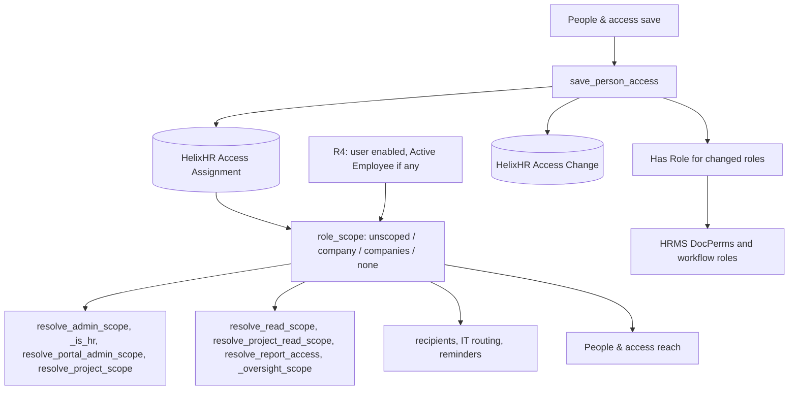
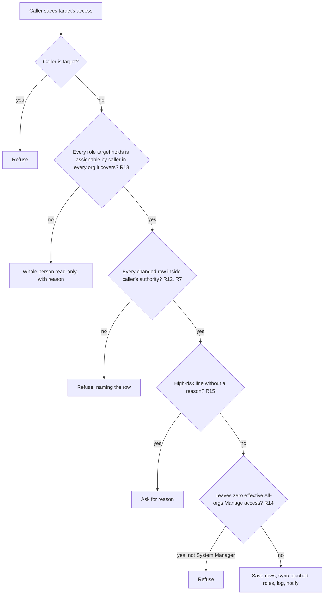
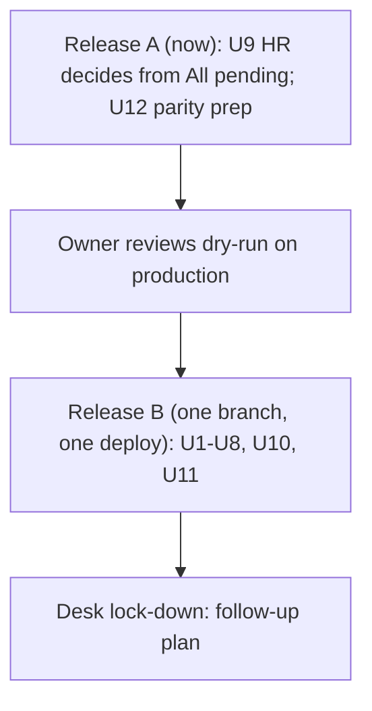

# feat: HelixHR access assignments and an elevated-first People & access

## Summary

Every elevated permission becomes one HelixHR **assignment**: a person, a role, and the orgs it covers ("All orgs" or named orgs). The orgs are explicit. They never follow the person's own employee company.

HelixHR is the only place assignments are set. It keeps the matching Frappe roles in step, and nothing needs a Desk User Permission.

People & access shows **Elevated access** first, with plain warnings, then **All employees** with search. Migration keeps everyone's current access.

Delivery is two releases:

- **Release A** ships now and changes nobody's access. It lets HR Managers decide any pending item from "All pending", and it prepares the migration safety checks.
- **Release B** is one branch and one deploy. It switches every scope to assignments and ships the new screen.

This plan replaces Releases 3, 3b and 4 of `docs/plans/2026-10-18-001-feat-org-scoped-access-and-people-access-redesign-plan.md`. Releases 1 and 2 of that plan have shipped and stay.

---

## Problem Frame

A Portal Admin in Org B was given an "All data" grant over every org. In People & access they still saw only Org B.

**Root cause.** The People & access list reaches only `grantable_companies` (`helixhr/utils.py`): the viewer's own Active Employee company, plus companies named in their **Frappe Desk User Permissions on Company**. A HelixHR grant is never counted, because grants are read-only by the 2026-10-14 design. Reaching Org A therefore needs a Desk setting, which breaks the decision that HelixHR is the only place permissions are set.

**A second filter hides people from everyone, System Managers included.** `list_people_access` shows only Active employees who have a login.

**Every resolver has the same anchor problem.**
- An HR Manager, Portal Admin, Report Manager or HR User reaches only the company on their own Active Employee record.
- No HelixHR setting can make someone HR Manager in two orgs.
- A company transfer silently moves all of a person's reach.

**HR approvals.** The server lets an HR Manager decide any pending item in their org. The portal gives them a button only for items sent to HR and for stalled leave, because "All pending" can only send reminders.

**The screen.** One list mixes ordinary employees with elevated users, with no warnings. Spotting a problem means reading every row.

---

## Requirements

**Assignment model**

- R1. An assignment is (person, role, orgs), where orgs is "All orgs" or one or more named orgs. "All orgs" includes orgs created later. An assignment that exists is in force; removing it deletes it.
- R2. Assignable roles:

  | Role | UI label | Gives | Orgs |
  |---|---|---|---|
  | HR Manager | HR Manager | HR reads, approvals, person edits, roster in each covered org; global HR configuration | named or All |
  | HR User | HR User | Timesheet oversight and matrix reports in each covered org, read-only | named or All |
  | HelixHR Portal Admin | Portal Admin | Export log, approver cleanup, People & access, everyday-role grants in each covered org | named or All |
  | IT Team | IT Admin | IT requests in each covered org | named or All |
  | HelixHR Delivery Manager | Delivery Manager | Every project each covered org owns, with its logged hours | named or All |
  | HelixHR Report Manager | Reports | Catalog reports in each covered org, export per assignment | named or All |
  | HelixHR Org Viewer (new) | Org viewer | Read people, org chart, projects and reports in each covered org, export per assignment | named or All |
  | HelixHR Notification Manager | Notification Manager | Message templates, which are global | All only |
  | HelixHR Access Admin (new) | Manage access | Change other people's access | All only |

- R3. A person's reach is the union of their assignments. A Frappe role with no assignment gives no portal reach.
- R4. Reach needs an enabled User. A person who has Employee records needs at least one Active one; a person with none is fine.
- R5. System Manager and Administrator are unscoped and not assignable.
- R6. "Leadership" is a preset: HR Manager on All orgs. It is not a role.
- R7. Global portal settings need All-orgs authority: the report matrix, the email theme and the message templates. All-orgs authority means an All-orgs Portal Admin, Manage access, or a System Manager.

**Setting access, only in HelixHR**

- R8. A save adds or removes the Frappe roles for the roles it changed, in the same transaction.
- R9. Drift in either direction shows as a warning and grants nothing extra:
  - "Role set outside HelixHR": a managed role held in Frappe with no assignment.
  - "Role missing in Frappe": an assignment whose Frappe role was removed.
- R10. A Role Profile target is refused with a plain reason.

**Who may change access**

- R11. Nobody changes their own access.
- R12. Grant authority:

  | Caller | May assign | In orgs |
  |---|---|---|
  | System Manager | Everything | Any |
  | Manage access (All orgs) | Everything | Any |
  | Portal Admin | Delivery Manager, IT Admin, Reports, Org viewer | Only its orgs |

- R13. A target is editable when every role they hold is one the caller may assign (R12) in every org it covers. Otherwise the whole person is read-only to that caller, with the reason.
- R14. Nobody but a System Manager can remove the last All-orgs Manage access holder who passes R4.
- R15. A save is high-risk when it adds any of these. It needs a written plain-text reason (500 characters at most) and sends one in-app notification to every System Manager and Manage access holder.
  - All orgs
  - Manage access
  - export
  - HR Manager or HR User, until Desk lock-down ships
- R16. The server re-checks every rule on save.

**People & access screen**

- R17. **Elevated access** comes first: one row per person in the caller's reach who holds an assignment or a managed Frappe role. System Managers show as "System Manager · unscoped".
- R18. Each elevated row shows the person, their own org, each role with its orgs ("HR Manager · Org A, Org B", or an "All orgs" badge), warnings, and the last change.
- R19. Warnings:

  | Warning | Kind |
  |---|---|
  | Employee record Left or Inactive | problem |
  | User disabled | problem |
  | No login | problem |
  | Role set outside HelixHR | problem |
  | Role missing in Frappe | problem |
  | Own org not covered by their roles | problem |
  | Desk HR reach: all orgs (until Desk lock-down) | info |
  | All orgs | info |
  | Can manage access | info |
  | Export on | info |

- R20. A banner counts people with any **problem** warning and sets the "Needs attention" filter.
- R21. **All employees** come below, with search by name or ID, an org filter, and paging. Employees without a login are listed and marked.
- R22. Opening a person shows a plain-language summary, editable role rows with org chips, and a review step listing gains and losses before save.
- R23. Each person shows their recent access changes: who, what, when, why.
- R24. A caller reaches the orgs where they hold Portal Admin. Manage access holders and System Managers reach everything.

**Migration**

- R25. Migration keeps everyone's reach. Every widening is declared in the dry-run, and the only narrowings are named security fixes.
- R26. A parity check after migration compares new resolver answers with a snapshot taken under maintenance mode. Any undeclared difference blocks reopening the site.

**HR decisions**

- R27. An HR Manager can open and decide any pending item for employees in their orgs from "All pending".

---

## Previous vs new

| Who | Today | After |
|---|---|---|
| Org B Portal Admin with an All-data grant | Admin in B, reads A. People & access shows B only unless Desk User Permissions are added | Portal Admin on B and Org viewer on A, as migrated. A Manage access holder can widen Portal Admin to A in HelixHR |
| HR Manager | Their employee company only | The orgs their assignments name |
| All-data grant ("Leadership" profile) | Read-only, granted orgs | Org viewer on the same orgs. The Leadership preset applies only on a new save |
| System Manager with an employee record | Portal HR reach limited to their company | Unscoped (declared widening) |
| Person who moves company | All reach moves with them | Reach stays as assigned; the row shows "Own org not covered" |
| Named-org Portal Admin | Edits the matrix, theme and templates for every org | Needs All-orgs authority for those (security fix) |
| HR Manager and a manager-stage item | Allowed by the server, no button | Decides from "All pending" |
| Employee without a login | Invisible in People & access | Listed, marked "No login" |
| Desk User Permission on Company | Needed for a cross-org Portal Admin | Not used |

---

## Key Technical Decisions

- KTD1. **One standalone doctype, `HelixHR Access Assignment`: one row per (user, role, org-or-All).**
  - Fields: user, role, `all_orgs`, company, `allow_export`, `origin` (manual or migrated), and a hidden `scope_key` (the company or `__all`).
  - Unique on (user, role, `scope_key`); MariaDB treats NULLs as distinct, hence the key column.
  - System Manager gets read-only DocPerm. Writes go through the save endpoint and the migration only, with `ignore_permissions`.
  - Rationale: the Elevated table is a plain query, and Desk cannot bypass the sync or the audit.
- KTD2. **No anchor and no enabled flag.**
  - Reach follows the row's orgs. R4 is the only person-level gate.
  - Rationale: this removes the empty-anchor rule, the re-confirm flow and the company-move disable logic. A transfer can't silently move access, and the table shows it.
- KTD3. **One resolver input.**
  - `role_scope(user, role)` returns a scope dict in the existing vocabulary: "unscoped", "company", "companies" or "none". It applies R4.
  - One query reads all of a user's rows and caches them on `frappe.local` for the request, under a key distinct from the existing admin-scope memo.
  - Every resolver keeps its name and output shape. So do the bootstrap flags.
- KTD4. **`Has Role` stays Frappe's switch, and HelixHR writes it for the roles a save touches.**
  - A role the save did not touch is left alone, and any drift shows as R9 warnings.
  - HRMS DocPerms and workflow roles keep working unchanged.
  - System Managers and Administrator never get drift warnings.
- KTD5. **Leadership is the preset HR Manager on All orgs.** HR Manager already runs every catalog report with export, so the preset needs nothing else.
- KTD6. **Manage access exists only on All orgs.** A named-org version would differ from Portal Admin by one role, and two overlapping "who changes access" roles would confuse admins.
- KTD7. **Org viewer replaces the "All data" grant, and Reports replaces "Reports only".**
  - Org viewer enters read resolvers only.
  - `HelixHR Company Access` is no longer read once Release B ships.
- KTD8. **Audit is one append-only `HelixHR Access Change` row per save.** The row holds the target, caller, reason, and the before and after rows as JSON. History and the migration's re-run guard read it.
- KTD9. **Parity derives the expected answers instead of matching prose.**
  - `parity_check(snapshot_path)` re-reads the legacy state, which the patch never changes. It runs `plan_rows` and computes each user's expected resolver answers from the planned rows.
  - A difference is a "declared widening" or a "security fix" only when the new answer equals that expectation and a structured note names that resolver key.
- KTD10. **Delivery Manager's broader reach stays inside the portal.** `project_permissions.py` builds its REST scope from `resolve_admin_scope` only, never from Delivery Manager rows.
- KTD11. **Line-manager rights still follow `reports_to`** (Release 1 of the 2026-10-18 plan).
- KTD12. **Desk lock-down is deferred.** Until it ships:
  - HR roles are assignable only by System Manager and Manage access (R12).
  - HR roles count as high-risk (R15).
  - HR rows carry the "Desk HR reach: all orgs" warning (R19).

---

## High-Level Technical Design

### Where reach comes from



### Who may act on whom



### Release sequence



### Screen layout

```text
People & access
[ 2 need attention ]
Elevated access                   [Filter by name] [All | Needs attention] [Role v]
 Person          Own org   Access                                   Warnings
 Anil M          Org A     HR Manager (no assignment)               Role set outside HelixHR
 Meena T         Org A     IT Admin · Org A                         Employee record Left
 Priya S         Org B     HR Manager · All orgs, Manage access     All orgs, Can manage access
 Test-P David    Org B     Reports · Org A, Org B                   Export on
 Ravi K          Org A     Portal Admin · Org A, Org B              -
 You (SM)        Org B     System Manager · unscoped                -
All employees                                [Search name or ID] [Org v]
 Name            Org       Login
 Pramod Burra    Org B     yes
 Sita R          Org A     No login
```

---

## Implementation Units

### Release A — ships now, no access change

### U12. Parity prep for the dry-run

- **Goal:** Make the dry-run the owner reviews, and the snapshot parity compares against, match this plan.
- **Requirements:** R25, R26
- **Dependencies:** none
- **Files:**
  - Modify: `helixhr/access_migration.py`
  - Test: `helixhr/tests/test_access_migration.py`
- **Approach:**
  - **Security fixes:** drop `company_move` and `hr_desk_reach` from `SECURITY_FIXES`, and add `global_settings` for the named-org Portal Admin.
  - **Structured widenings:** `plan_rows` emits `widened` as records `{key, resolver_keys, text}`, the way `narrowed` already carries keys.
  - **System Managers:** declare a widening for each System Manager with an Active Employee (admin and read keys).
  - **Grant holders:** skip disabled grants, which have no reach today. Keep rows for inactive people, so that reactivation restores reach as it does today.
  - **Snapshot:** add these keys:
    - IT worker scope
    - `_oversight_scope`
    - People & access reach
    - per-org HR and IT recipient sets
    - bootstrap flags
- **Execution note:** test-first.
- **Test scenarios:**
  - Every widening record names at least one resolver key.
  - A System Manager with an Active Employee gets a widening record and no rows.
  - A disabled grant produces no rows.
  - A Left HR Manager keeps an HR Manager row.
  - The snapshot carries the new keys for a seeded IT Admin and HR User.
  - No narrowing outside `SECURITY_FIXES`.
- **Verification:** the dry-run on test_site lists no `company_move` or `hr_desk_reach` notes.

### U9. HR decides from All pending

- **Goal:** An HR Manager can decide any pending item in their org, not only HR-stage ones.
- **Requirements:** R27
- **Dependencies:** none (uses current resolvers)
- **Files:**
  - Modify: `helixhr/api.py` (`get_pending_by_approver` rows carry kind, name and `can_decide`)
  - Modify: `frontend/src/pages/Approvals.vue`, `frontend/src/components/approvals/TimesheetOversight.vue`
  - Test: `helixhr/tests/test_approvals_lanes.py`, `frontend/tests/e2e/approvals.spec.ts`
- **Approach:**
  - Each All pending row is one stretched link to the existing decision panel. "Remind" stays a separate 44px button above the link.
  - When `can_decide` is false, the panel shows one sentence instead of buttons:
    - "You can't decide your own request."
    - "You can view this but not decide it."
  - After a decision, focus moves to the next row.
- **Test scenarios:**
  - An HR Manager opens a timesheet in their company that is still pending its manager, sees Approve and Send back, and approves it.
  - A pending leave at the manager stage can be decided from the same row.
  - Another company's item is not listed.
  - Their own item opens with the sentence and no buttons.
  - HR User rows stay view-only.
  - Remind still works on a row.
- **Verification:** the approvals suites pass, and an HR Manager approves a manager-stage item end to end in e2e.

### Release B — the switch (one branch, one deploy)

U1-U8, U10 and U11 land on one branch. No unit in this release reaches a shared environment without U8's patch.

### U1. Assignment and change-log doctypes, new roles

- **Goal:** Store assignments and access changes. Add the two new roles.
- **Requirements:** R1, R2, R5
- **Dependencies:** none
- **Files:**
  - Create: `helixhr/helixhr/doctype/helixhr_access_assignment/`, `helixhr/helixhr/doctype/helixhr_access_change/`
  - Modify: `helixhr/fixtures/role.json`, `helixhr/hooks.py`
  - Test: `helixhr/tests/test_access_assignment.py`
- **Approach:**
  - Validation:
    - The role is assignable.
    - `all_orgs` and company are mutually exclusive.
    - The company exists.
    - Notification Manager and Manage access must be All orgs.
    - Export is allowed only on Reports and Org viewer.
  - `scope_key` is set in `validate` and covered by a unique index.
  - Both doctypes give System Manager read-only DocPerm. `HelixHR Access Change` is insert-only.
  - New roles: `HelixHR Org Viewer` and `HelixHR Access Admin`, both `desk_access 0` with no DocPerm.
- **Test scenarios:**
  - Valid named-org and All-orgs rows save.
  - Refused:
    - All orgs combined with a company
    - a duplicate, including two All-orgs rows
    - export on HR Manager
    - Notification Manager on a named org
    - an unknown role
    - System Manager as a role
  - A REST or Desk write on either doctype is refused, System Manager included.
- **Verification:** both doctypes migrate on a fresh site, and the new roles pass preflight's no-grant role check.

### U2. `role_scope`, the R4 gate and test fixtures

- **Goal:** One cached answer for "which orgs does this user hold this role in", plus fixtures that build assignments.
- **Requirements:** R3, R4, R5
- **Dependencies:** U1
- **Files:**
  - Modify: `helixhr/utils.py`
  - Modify: `helixhr/tests/utils.py`
  - Test: `helixhr/tests/test_role_scope.py`
- **Approach:**
  - **`role_scope`:** reads all of a user's rows in one query and applies R4 with `active_employee_for_user`. It caches per request on `frappe.local`.
  - **`make_assignment(user, role, orgs, export=0)`:** writes the row and the Frappe role.
  - **Fixtures:** every helper that grants a managed role calls `make_assignment` with the person's company, or All orgs when there is no Employee:
    - `_make_role_user`
    - `ensure_hr_manager_user`, `make_test_hr_manager_employee`
    - `make_test_it_user`, `make_test_delivery_manager`
    - `ensure_notification_manager_user`, `ensure_email_admin_user`
    - `make_test_company_grant`, `ensure_company_access_fixtures`
    - `setup_playwright_fixtures`
- **Execution note:** test-first.
- **Test scenarios:**
  - HR Manager rows on [A, B] give `companies` [A, B]. One row gives `company`. An All-orgs row gives `unscoped`.
  - An org created later is inside an All-orgs scope.
  - A user whose only Employee row is Left gets `none`. A user with no Employee keeps their rows' scope.
  - A disabled User gets `none`.
  - A second call in the same request makes no query.
- **Verification:** the full suite still passes, because resolvers are not switched yet and fixtures now also write rows.

### U3. HR, IT and recipient scope from assignments

- **Goal:** HR Manager, HR User and IT Admin reach, and every HR/IT mail recipient, come from `role_scope`.
- **Requirements:** R3, R6
- **Dependencies:** U2
- **Files:**
  - Modify: `helixhr/utils.py` (`_admin_scope`, `company_role_holders`, `_company_role_holders`)
  - Modify: `helixhr/events.py` (`_is_hr`, `_enabled_users_with_role`, `_hr_managers`)
  - Modify: `helixhr/api.py` (`_oversight_scope`, `_handler_comment_refusal`, bootstrap flags)
  - Modify: `helixhr/helixhr/doctype/hr_request/hr_request.py` (worker scope), `helixhr/reminders.py`
  - Test: `helixhr/tests/test_access_resolvers.py`; update `helixhr/tests/test_scope_hardening.py`, `helixhr/tests/test_hr_request.py`
- **Approach:**
  - **HR:** `_admin_scope` is `role_scope(user, "HR Manager")`, with System Manager unscoped. `_is_hr` means the HR scope is not "none".
  - **HR User:** oversight is `role_scope(user, "HR User")`.
  - **IT:** IT workers see and handle requests for employees in their IT Admin orgs, replacing `session_company`.
  - **Recipients:** arrival, HR-stage and reminder mail resolve from one query per (role, org).
- **Test scenarios:**
  - **HR Manager [A, B]:** approves in B, refused in C.
  - **Frappe role without a row:** `_is_hr` is false and there is no HR queue.
  - **Leadership preset:** acts in an org created later.
  - **Line manager who is HR Manager [A]:** still decides their direct report in B with line-manager actions only.
  - **IT Admin [A, B]:**
    - handles a B request
    - never sees a C one
    - arrival mail reaches them, and not an IT holder with no rows
  - **Overdue summaries:** Leadership receives every org's; HR Manager [A] receives only A's.
- **Verification:** the approvals, HR request and reminder suites pass.

### U4. Read, report, project and portal-admin scope from assignments

- **Goal:** Every other resolver, and the People & access reach, comes from `role_scope`.
- **Requirements:** R2, R3, R7, R24
- **Dependencies:** U2
- **Files:**
  - Modify: `helixhr/utils.py` (`resolve_read_scope`, `resolve_project_scope`, `resolve_project_read_scope`, `resolve_portal_admin_scope`, `can_admin_portal`, `resolve_report_access`)
  - Modify: `helixhr/project_permissions.py`, `helixhr/reports.py`
  - Modify: `helixhr/api.py` (`_people_access_reach`, `_assert_portal_admin`, `_can_run_reports`, `_can_edit_email_templates`, the matrix gate, bootstrap `can_manage_access`)
  - Test: `helixhr/tests/test_access_resolvers.py`; update `helixhr/tests/test_company_access_reports.py`, `helixhr/tests/test_company_access_surfaces.py`, `helixhr/tests/test_reports_access.py`, `helixhr/tests/test_portal_admin.py`, `helixhr/tests/test_api_projects.py`
- **Approach:**
  - **Read scope:** HR Manager plus Org viewer.
  - **Report tiers, one company per run:**
    - Reports rows, with their export flag
    - HR User rows, through the matrix
    - Org viewer rows
    - Delivery Manager rows: a company tier at each of their orgs for project-scoped entries, through the matrix's `dm_run` and `dm_export`
  - **Projects:** Delivery Manager reads every project whose `Project.company` is in their orgs. The REST hooks keep refusing Delivery Managers (KTD10).
  - **Portal Admin:** scope comes from its rows. `can_admin_portal` needs a Portal Admin row or System Manager. The R7 global settings need All-orgs authority.
  - **People & access reach:** Portal Admin orgs, or everything for Manage access and System Manager. The Company User Permission read is deleted.
- **Test scenarios:**
  - **The reported bug:** a Portal Admin [A, B] lists Org A employees, with no User Permission on the site.
  - **Org viewer [B]:**
    - reads B people
    - no edits, no roster, no bank queue
    - permlevel-2 fields stay masked
  - **Reports [A, B], export off:** runs B reports; export is refused.
  - **Delivery Manager [A]:**
    - Sees a non-member A project and its hours in the portal and in project reports.
    - Never sees B.
    - REST GET and list of an A Project or Task are refused. So are an All-orgs Delivery Manager's.
  - **Portal Admin [A]:** refused on the matrix, the email theme and a message template edit.
  - **Left Portal Admin:** has no admin.
  - **Employee-only user:** unchanged everywhere.
- **Verification:**
  - The two-company report suites pass.
  - No scope resolver and no People & access path reads `HelixHR Company Access` or a Company User Permission.

### U5. Save endpoint, authority, role sync and audit

- **Goal:** One write path enforcing R8-R16.
- **Requirements:** R8, R10-R16, R23
- **Dependencies:** U1, U2
- **Files:**
  - Modify: `helixhr/api.py` (`save_person_access` rewritten and keyed by User; legacy grant and role endpoints removed)
  - Modify: `helixhr/utils.py` (`assignable(caller)`, `may_edit_target`)
  - Test: `helixhr/tests/test_access_authority.py`; rewrite `helixhr/tests/test_people_access.py`
- **Approach:**
  - **Payload:** the target User, their full desired row set, a stale token, and an optional reason.
  - **Stale token:** a hash of the target's sorted row set (name and modified per row) plus `User.modified`. Any insert, delete or edit changes it.
  - **Server checks, in order:**
    1. R11 (no self-edits).
    2. R13 (the target is editable).
    3. Every changed row against R12 and R7.
    4. R15: a reason is present when needed, as plain text of 500 characters or fewer.
    5. R14: lock every All-orgs Manage access row (`FOR UPDATE`), then count holders who remain after this save and pass R4.
  - **Rows the caller cannot see** are kept unchanged.
  - **One savepoint applies:**
    - the row changes
    - the `Has Role` sync for touched roles, refusing Role Profile targets
    - the HR Manager self Employee User Permission rule, only when the target has an Active Employee
    - one `HelixHR Access Change` row
    - one notification per high-risk save, with the reason escaped
  - **Rollback safety:** removing a migrated Org viewer or Reports row also disables that user's legacy `HelixHR Company Access` grant.
  - **After commit:** clear the user's cache and expire unreachable Ready exports.
- **Patterns to follow:** the current `save_person_access` (savepoint, `_apply_role_diff`, Role Profile refusal, `_set_self_employee_permission`, `defer_side_effects`).
- **Test scenarios:**
  - **Authority matrix, for every caller tier against every role and org shape:**
    - Portal Admin [A] gives Delivery Manager [A]: allowed.
    - Portal Admin [A] gives Delivery Manager [B], HR User [A], or Notification Manager: refused.
    - Manage access gives the Leadership preset with no reason: refused. With a reason: saved, the role synced, notifications sent.
  - **Target editability:** a Portal Admin [A] opening a target who holds Delivery Manager [B] sees a read-only person.
  - **Self-edit:** refused.
  - **Last holder:**
    - Manage access holders X and Y each remove the other at the same time: one is refused.
    - Removing the last holder whose User is disabled counts as zero.
    - A System Manager may remove the last holder.
  - **Stale token:** a concurrent removal of a non-newest row makes the second save stale.
  - **Role Profile target:** refused with a plain reason, and nothing is written.
  - **Role sync:**
    - Removing the last HR Manager row removes the Frappe role.
    - An untouched drifted role stays.
  - **Reason:** a reason containing markup is stored and shown as text.
  - **Rollback:** a failed save leaves no rows, roles, log or notification.
  - **Legacy grant:** removing a migrated Org viewer row disables the legacy grant.
  - **REST:** a call that skips the UI is refused exactly as the UI would be.
- **Verification:** `test_access_authority.py` covers the matrix and passes on a fresh strict site.

### U6. People & access read endpoints

- **Goal:** Serve the Elevated table, the employee search and the person view.
- **Requirements:** R17-R24
- **Dependencies:** U4, U5
- **Files:**
  - Modify: `helixhr/api.py` (`get_elevated_access`, `search_people_access`, `get_person_access` keyed by User)
  - Modify: `helixhr/utils.py` (`access_summary` rewritten for assignments)
  - Test: `helixhr/tests/test_people_access_read.py`
- **Approach:**
  - **Reach for an elevated person:** any of their rows covers an org in the caller's reach, or their Active Employee company is in it. A person with only All-orgs rows and no Employee is reachable by System Managers and Manage access holders only.
  - **`get_elevated_access`:**
    - Returns people with roles grouped with their orgs, R19 warnings, and the last change.
    - Sorts problem rows first, then All-orgs and Manage access rows, then alphabetically.
    - Returns problem counts.
    - Makes five set queries: assignments, Has Role, Employee, User, change log.
  - **`search_people_access`:** pages all Active employees in reach, with or without a login, by name or ID and org.
  - **`get_person_access`:**
    - Returns summary sentences from the copy table in U7, every row (rows outside reach marked read-only), and the lock state with its reason.
    - Returns the stale token and the last 20 changes.
- **Test scenarios:**
  - **Warnings:**
    - A Frappe HR Manager with no row: "Role set outside HelixHR".
    - A row whose Frappe role was removed: "Role missing in Frappe". A migrated grant row before its first save carries no such warning.
    - A Left employee with rows: "Employee record Left".
    - A transferred person: "Own org not covered".
    - A named-org HR Manager: "Desk HR reach: all orgs".
  - **System Managers:** shown as unscoped with no drift warning.
  - **Reach:**
    - A Portal Admin [A] does not see a B-only person.
    - An All-orgs, no-Employee HR Manager opens for a Manage access holder and not for a Portal Admin.
  - **Search:**
    - An employee without a login is listed with `has_login` false and is found by ID.
    - An org filter outside reach is refused.
  - **Person view:** an out-of-reach row is returned read-only, never dropped.
- **Verification:** responses never include people outside the caller's reach.

### U7. People & access screen

- **Goal:** Elevated first, then all employees, then a person editor that is hard to misuse.
- **Requirements:** R6, R17-R23
- **Dependencies:** U6
- **Files:**
  - Modify: `frontend/src/components/settings/PeopleAccessSection.vue`, `frontend/src/lib/accessProfiles.js`, `frontend/src/lib/session.js`, `frontend/src/pages/Settings.vue`, `frontend/src/router.js`
  - Create: `frontend/src/components/settings/ElevatedAccessTable.vue`, `frontend/src/components/settings/PersonAccessEditor.vue`, `frontend/src/components/settings/AccessReviewDialog.vue`
  - Remove: `frontend/src/components/settings/GrantEditor.vue`
  - Modify: `docs/design-system.md` (copy table entries for the new role labels)
  - Test: `frontend/src/lib/accessProfiles.test.js`, `frontend/tests/e2e/people-access.spec.ts`
- **Approach:**
  - **Page order:** attention banner, Elevated access, All employees.
  - **Banner:** a button that sets "Needs attention" and moves focus to the table. With no problems it reads "Nothing needs attention". It is hidden while the table loads or fails.
  - **Elevated table:**
    - Its own name filter, run on the loaded rows.
    - Filters: All, Needs attention, Role.
    - Each role is a chip with its orgs. "All orgs" is a filled badge.
    - Warnings are word chips. Problem warnings use the sent-back red pair; info warnings use the neutral or amber pair.
    - On phones, each row becomes a card.
  - **All employees:** the search box and org filter drive this section only, against the server.
  - **Navigation:**
    - The editor is a route, `/settings/people-access/<user>`, so Back closes it.
    - A dirty draft asks "Discard changes?" on Back, Close or opening another person.
    - Focus returns to the opening row.
  - **Editor lock states:**
    1. The target fails R13: the whole editor is read-only, with one reason sentence.
    2. The target is editable but some rows lie outside the caller's reach: those rows are locked and kept.
    3. Everything is editable.
  - **Editor interactions:**
    - "Add role" lists only roles the caller may assign. A new role starts on the target's own org, or with an org picker when there is no Employee.
    - Each role row has "Remove role". Each org chip has a 44px remove button named, e.g., "Remove Org A from HR Manager".
    - Choosing All orgs replaces the chips with one badge. Switching back restores the draft's named chips.
    - Export is a toggle on Reports and Org viewer rows.
    - "Apply Leadership" replaces only the HR Manager row and leaves the rest alone.
  - **Warning actions:**

    | Warning | Action offered |
    |---|---|
    | Role set outside HelixHR | The role shows as a row with no orgs: "Give orgs" or "Remove role" |
    | Role missing in Frappe | "Restore role" (saves the row again) or "Remove role" |
    | Left, disabled or No login | The editor allows only removing rows |
    | Own org not covered | Shown in the summary; no forced action |

  - **Review dialog:**
    - Gains and losses in words, with a "High risk" text badge per line.
    - One reason field, required only when a high-risk line is present.
    - On phones it uses the frappe-ui Dialog as a bottom sheet.
    - Confirm stays disabled until valid.
  - **History:** a collapsed list under the editor. Reasons render as text.
  - **States:** each region is an `AsyncState` and fails on its own:

    | Region | Pending | Unavailable | Forbidden | Empty |
    |---|---|---|---|---|
    | Elevated table | sized skeleton | retry panel | hidden | "No one has elevated access in your orgs." |
    | All employees | sized skeleton | retry panel | hidden | "No one matches." |
    | Person editor | skeleton | retry panel | read-only reason | "Employee access only." |
    | History | skeleton lines | retry link | hidden | "No changes yet." |

    - A stale token keeps the draft and offers "Reload and re-apply". A refusal shows in the dialog.
    - Success goes through `notify.success`.
  - **Copy table:**

    | Case | Text |
    |---|---|
    | Role with named orgs | "HR Manager in Org A and Org B." |
    | Role on All orgs | "HR Manager in all orgs, including new ones." |
    | Leadership | "Acts as HR Manager in all orgs, including new ones." |
    | Desk warning | "Desk access for HR roles is not yet limited to these orgs." |
    | Self | "You can't change your own access." |
    | R13 lock | "You can't change this person's access: they hold a role you can't assign." |
    | HR roles | "Only Manage access can give HR roles." |
    | R14 refusal | "This would leave nobody who can manage access." |
    | Role Profile | "This person's roles come from a role profile. Change it in Desk." |
    | Stale token | "Someone changed this person's access. Reload and re-apply." |

  - **Design:** follow `docs/design-system.md`: `min-h-11` controls, plain words, Signal tokens, `TabBar` rules.
- **Execution note:** run `/impeccable` on the rendered screen before merge.
- **Patterns to follow:** `SearchField.vue`, `useDebouncedSearch` (as in `frontend/src/pages/Directory.vue`), `SegmentedChips.vue`, `AsyncState.vue`, `RosterShiftSheet.vue`.
- **Test scenarios:**
  - **Unit:** applying Leadership changes only the HR Manager row. Chip removal and the All-orgs toggle keep the draft right.
  - **E2E, System Manager:** sees the banner count, filters to "Needs attention", and fixes a "Role set outside HelixHR" row with "Remove role".
  - **E2E, the reported bug:** a Portal Admin [A, B] in Org B sees Org A employees in All employees.
  - **E2E, Manage access applies Leadership:** "High risk" shows, a reason is required, and the save succeeds. The row reads "HR Manager · All orgs".
  - **E2E, Portal Admin [A]:** adds Delivery Manager [A] to an Org A employee with no reason. An HR Manager target opens fully read-only with the R13 sentence.
  - **E2E, No login:** an employee without a login shows "No login" and offers no add-role control.
  - **E2E, self:** shows "You can't change your own access."
  - **E2E, stale token:** keeps the draft and offers reload. Back with a dirty draft asks before discarding.
  - **Phone:** no horizontal page scroll; elevated rows render as cards.
  - **Keyboard:** the dialog traps focus and closes on Escape. Chips have accessible names.
- **Verification:**
  - e2e passes on a fresh Host-routed site.
  - `/impeccable` reports no P1.
  - `GrantEditor` and the legacy endpoint names are gone from `frontend/src` and `frontend/tests`.

### U8. Migration patch and parity check

- **Goal:** Write today's reach as assignments and prove the switch matches the snapshot.
- **Requirements:** R25, R26
- **Dependencies:** U1, U3, U4, U12
- **Files:**
  - Modify: `helixhr/access_migration.py` (drop the `employee` and `home_company` output; add `apply_rows`, `parity_check(snapshot_path)`)
  - Create: `helixhr/patches/v1_0/migrate_access_assignments.py`
  - Modify: `helixhr/patches.txt`
  - Test: `helixhr/tests/test_access_migration.py`
- **Approach:**
  - The migrated rows match Release 2's preview with the anchor fields dropped.
  - The patch runs under `[post_model_sync]` and calls `_ensure_role` for the new roles. It skips any user who already has rows or a `HelixHR Access Change` row, and writes with side effects off.
  - It adds `Has Role` only for `HelixHR Org Viewer`, which the old code ignores. Every other role is untouched.
  - `parity_check` works per KTD9. It writes a 0600 private report and returns the undeclared count.
- **Execution note:** test-first for parity labels.
- **Test scenarios:**
  - A re-run changes nothing. A user whose rows were all removed through the save is not recreated.
  - An All-data grant becomes Org viewer rows. A Reports-only grant merges with Report Manager by OR.
  - A no-Employee HR Manager gets an All-orgs row.
  - **Parity:**
    - On seeded fixtures, zero undeclared differences.
    - An injected resolver bug that ignores All-orgs rows is reported as undeclared.
    - A Delivery Manager's widening is labelled declared.
    - A System Manager with an Employee is labelled declared.
  - The patch expires no export.
- **Verification:** the dry-run, patch and parity run clean on a copy of production before deploy.

### U10. Lifecycle, preflight and legacy retirement

- **Goal:** Remove the anchor-era code and give operators checks.
- **Requirements:** R9, R19, R24
- **Dependencies:** U3-U6
- **Files:**
  - Modify: `helixhr/events.py`
    - Remove `disable_company_access` from `employee_on_update` and `_disable_grant_saved_elsewhere`.
    - Expire unreachable exports when a User is disabled or an Employee leaves.
  - Modify: `helixhr/preflight.py` (retire `check_company_access_grants`; add the checks below)
  - Modify: `helixhr/utils.py` (remove `active_company_grant`, `grantable_companies`, `disable_company_access`)
  - Modify: `helixhr/tests/utils.py` (remove the legacy grant fixture paths)
  - Test: `helixhr/tests/test_preflight.py`
- **Approach:**
  - **Preflight FAIL:**
    - zero All-orgs Manage access holders who pass R4
    - any create, write or delete DocPerm on either new doctype
  - **Preflight WARN:**
    - either drift direction, ignoring System Managers and Administrator
    - rows for a disabled or all-Left person
    - an org with no HR Manager or IT Admin coverage
- **Test scenarios:**
  - Each check fires on seeded data and is clean on a fresh install with fixtures.
  - A company change leaves rows unchanged, and the Elevated table shows "Own org not covered".
  - An Employee Transfer for a former grant holder raises no error.
- **Verification:**
  - Preflight is clean on a fresh site.
  - A grep finds no reader of `HelixHR Company Access` outside migration and tests.

### U11. Documentation

- **Goal:** Record the model, the reversals and the deploy steps.
- **Requirements:** supports all
- **Dependencies:** travels with U1-U10
- **Files:** Modify `docs/architecture.md`, `docs/runbook.md`, `README.md`
- **Approach:**
  - **`docs/architecture.md`:** an "Access assignments (plan 2026-10-19-001)" section with the role, authority, warning and copy tables.
  - **Reversals:**
    - 2026-10-14-001: grants are read-only, and Portal Admin reach comes from Company User Permissions.
    - 2026-10-15-001 KTD9.
    - 2026-10-18-001: Releases 3, 3b and 4, and the anchor rules R6 and KTD14.
  - **`docs/runbook.md`:** rewrite "Who can change what" and the company-access section. Add the deploy checklist, and the interim workaround below.
- **Test expectation:** none, documentation only.
- **Verification:** no doc describes grants, anchors or Company User Permissions as the cross-org mechanism.

---

## Scope Boundaries

- **No per-company report matrix.** The matrix stays one global policy.
- **No skip-level approval rights.**
- **Role Profiles stay outside the portal.**
- **HR configuration stays global.**
- **No shadow run.** The parity check, with the snapshot extended in U12, is the switch-time safety net.

### Deferred to Follow-Up Work

- **Desk/REST lock-down:** the wildcard deny hooks, the script-report company gate and the Employee edit guards (2026-10-18 plan, U8). It lifts KTD12's interim rules.
- Time-boxed assignments and periodic access reviews.
- Two-person approval for Manage access and All-orgs grants.
- A by-role coverage grid. Preflight warns until then.
- CSV export of the Elevated table.

---

## System-Wide Impact

- **Auth boundary.** Every scope resolver changes its source; output shapes stay the same. The `_is_hr` call sites keep their logic, at one cached query per request.
- **Frappe roles.** HelixHR writes `Has Role` for nine roles. A Desk edit shows as drift.
- **Notifications.**
  - HR and IT mail reaches only holders whose orgs cover the employee.
  - High-risk saves notify System Managers and Manage access holders.
- **Bootstrap flags.** These change meaning:
  - `can_admin_portal`, `can_configure`, `can_see_people`, `can_see_organisation`
  - `can_run_reports`, `can_oversee_timesheets`, `can_see_all_pending`, `can_roster_everyone`
  - a new `can_manage_access`
  
  `session.js` mirrors them.
- **Projects.** Delivery Managers gain every project their orgs own, in the portal and in project reports. REST stays refused.

---

## Risks & Dependencies

| Risk | Mitigation |
|---|---|
| The switch grants or removes something undeclared | U12's structured notes and extended snapshot. U8's parity derives the expected answers. Undeclared differences block reopening |
| Changes between the owner review and the deploy break parity | Re-run the dry-run under maintenance mode and pass that snapshot to parity |
| A named-org HR row hides global Desk reach | KTD12: HR roles are Manage access only, high-risk, and carry a Desk warning |
| Two admins overwrite each other | Hashed row-set stale token |
| Two Manage access holders remove each other | Set-wide lock, and R4-aware counting |
| A Desk edit bypasses HelixHR | Doctypes are read-only in Desk. Drift in both directions is warned |
| Rollback after reopening revives revoked access | Removing a migrated grant-backed row disables the legacy grant. HR assignments made after the switch revert to home-company reach on rollback (stated in the runbook) |
| Hidden rows lost on save | The editor loads every row. The server keeps rows the caller cannot see |
| Delivery Manager REST exposure | Project hooks use HR scope only, with REST tests in U4 |

---

## Documentation / Operational Notes

**Deploy checklist (Release B):**

1. With Release A deployed, run `bench --site <site> execute helixhr.access_migration.dry_run` on production. Review the per-person report with the owner.
2. Freeze access edits. Turn on maintenance mode and run `bench backup`.
3. Re-run the dry-run. Check its report matches the reviewed one, and note its snapshot path.
4. Run `migrate`.
5. Run `bench --site <site> execute helixhr.access_migration.parity_check --args '["<snapshot path>"]'`. Zero undeclared differences are required, or restore the backup before reopening.
6. Turn off maintenance mode. A System Manager gives the access owner Manage access.
7. Run `helixhr.preflight.run` and confirm it is clean.

**Before Release B:** an Org B Portal Admin who must manage Org A needs a Desk User Permission: Allow = Company, For Value = Org A, Applicable For = Company. Remove it after the switch.

---

## Sources & Research

- **Code:**
  - Resolvers: `helixhr/utils.py` (`_admin_scope`, `resolve_read_scope`, `grantable_companies`, `resolve_report_access`).
  - The reported list: `helixhr/api.py` `_people_access_reach`, `list_people_access`.
  - Remind-only oversight: `helixhr/api.py` `get_pending_by_approver`, `frontend/src/components/approvals/TimesheetOversight.vue`.
  - Project REST hooks: `helixhr/project_permissions.py`.
  - Recipients: `helixhr/events.py` `_enabled_users_with_role`, `_hr_managers`.
  - Release 2 reuse: `helixhr/access_migration.py`, `utils.active_employee_for_user`, `read_companies`, `scope_covers`.
- **Prior plans:**
  - `docs/plans/2026-10-18-001-feat-org-scoped-access-and-people-access-redesign-plan.md`
  - `docs/plans/2026-10-14-001-feat-cross-company-access-grants-plan.md` (Company User Permissions rejected, KTD2)
- **External practice:**
  - **Entra role assignments** (principal, role, scope; privileged labels; count warnings): https://learn.microsoft.com/en-us/entra/identity/role-based-access-control/best-practices
  - **Google Workspace admin roles** ("All organizational units"; only super admins assign): https://knowledge.workspace.google.com/admin/users/assign-specific-admin-roles
  - **BambooHR preset ladder:** https://bamboohr.screenstepslive.com/a/587374
  - **Hidden-role overwrite pitfall:** https://michev.info/blog/post/2352/bug-in-the-office-365-admin-portal-can-result-in-removal-of-admin-roles
  - **Grant-all pitfall:** https://devforum.roblox.com/t/new-role-manager-is-scary/3597637
