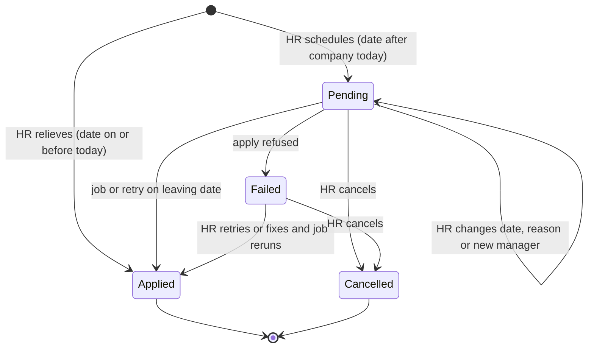
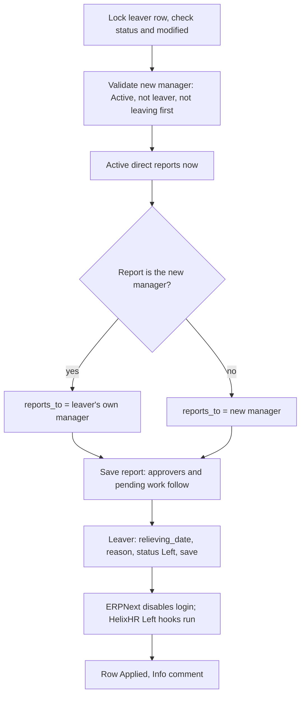
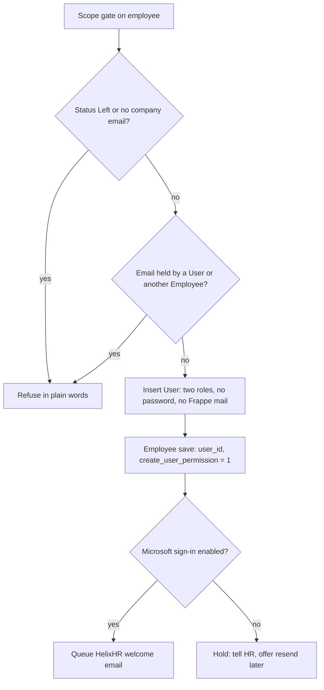

# feat: Add and relieve employees from the portal

## Summary

HR Manager adds a new employee from People, gives them a login with basic employee access only, and HelixHR sends a welcome email to their company address, held until Microsoft sign-in is enabled. HR relieves an employee from their person page, today or on a future date, choosing a new manager for anyone who reports to them; the login turns off on the leaving date and is never deleted.

---

## Problem Frame

Onboarding and leaving still happen in Desk. Creating a login needs `create` on `User`, which only System Manager holds, so HR Manager cannot finish onboarding at all. The portal can set an employee to `Left` through the joining card, but that path asks for no relieving date, does not move direct reports, and fails in ERPNext's `validate_status` with an error HR cannot act on.

`docs/plans/2026-09-15-001-feat-portal-for-every-role-plan.md` kept "creating and terminating employees" in Desk. This plan reverses that for HR Manager on purpose, the same way 2026-09-20-002 KTD3 reversed the read-only person page. Elevated access does not move: it stays in People & access, unchanged.

---

## Requirements

**Add employee**
- R1. HR Manager and System Manager add an Employee from People for a company inside their admin scope, with ERPNext's required fields (first name, gender, date of birth, date of joining, company) and optional last name, designation, department, reporting manager and company email.
- R2. The Employee is inserted with the caller's own permissions, so ERPNext and HelixHR validation (approver derivation, date rules) runs unchanged.
- R3. A likely duplicate (same name, date of birth and company, still Active) is refused with the existing person named.

**Login**
- R4. HR creates a login in the add form ("Create login now", on by default) or later from the person page, for an Employee whose status is not Left and who has a company email.
- R5. The login is the company email, holds only Employee and Employee Self Service, has no password, sends no Frappe welcome email, and carries the Employee and Company User Permissions.
- R6. An email that already belongs to a User, or to another Employee's `company_email` or `user_id`, is refused with a plain message naming who holds it. Rehire and privileged-User linking stay in Desk.
- R7. HelixHR sends a welcome email to the company email through a new message template that Notification Managers can edit or turn off. It is held, not sent, while no Microsoft sign-in (Social Login Key) is enabled, and HR can resend it from the person page.
- R8. A failed welcome send never rolls back the login.

**Relieve**
- R9. HR relieves an in-scope Active employee with a leaving date (the first day without access), a reason, and a new manager for the employee's Active direct reports.
- R10. A leaving date on or before the company's local today applies at once; a later date is scheduled and applies automatically on that date.
- R11. Applying moves every Active direct report found at apply time to the new manager, then sets the employee to Left with the relieving date and reason, in one transaction. ERPNext disables the login; HelixHR's existing Left hooks run.
- R12. HR can change or cancel a scheduled leaving until it applies. An applied leaving cannot be undone from the portal.
- R13. A scheduled leaving that fails to apply is visible on the person page with the reason and a retry, logged once in Error Log, and reported by preflight.
- R14. HR cannot relieve themselves. The new manager must be Active, in scope, not the leaver, and not leaving on or before the same date.
- R15. The joining card no longer offers or accepts `Left`; Relieve is the only path to it.

**Find and audit**
- R16. People search can include people who have left, so HR can open a relieved person.
- R17. Login created, welcome email sent, leaving scheduled, changed, cancelled and applied each leave an Info comment on the Employee naming who did it.

**Experience**
- R18. The screens follow `docs/design-system.md`: one primary action per screen, visible labels, inline field errors, outcome toasts via `notify`, a confirm step before relieving, single column on phones, plain words (no "user", "ESS", "permission").

---

## Key Technical Decisions

- KTD1. Login creation is a HelixHR endpoint, not a DocPerm grant. Scope check first, then `User.insert(ignore_permissions=True)` with the two fixed roles, then link `user_id` with `create_user_permission=1` through a normal Employee save. A `User` DocPerm for HR would let HR edit any user's roles in Desk and bypass access assignments (memory: report execution model, org-scoped access decisions).
- KTD2. One new DocType, `HelixHR Leaving`, holds the leaving: employee, company, leaving date, reason, new manager, status (Pending, Applied, Failed, Cancelled), scheduled by, applied on, error. One open row per employee. A Custom Field on Employee would mark rows HelixHR scheduled, but a DocType keeps the trail of changes and cancellations and leaves the Employee form alone.
- KTD3. Scheduling also writes `relieving_date` and `reason_for_leaving` on the still-Active Employee. Headcount (`reports.py`), leavers and `_employment_span` already read a future `relieving_date` correctly, and it is what HR would type in Desk. Cancel clears both.
- KTD4. One new manager for all direct reports. If HR picks one of the leaver's own reports, that person moves to the leaver's own manager instead of reporting to themselves. Per-report choices are made beforehand on each report's Approvers card.
- KTD5. Reports are re-resolved and moved when the leaving applies, not when it is scheduled. A person added to the team in between moves too, and ERPNext's "still has reports" refusal cannot fire on the day.
- KTD6. The apply runs on the existing `0,30 * * * *` cron with `company_today`, like `reminders._due`, so each company relieves at its own midnight. It is idempotent by filter (Pending rows with leaving date on or before company today), uses a savepoint per row, commits per row in the job only, and marks a failure once per day.
- KTD7. Report moves save each report with `ignore_permissions` after the leaver's scope gate, because a cross-company report may sit outside the caller's User Permissions. Validation still runs. This joins the bypass list in `docs/architecture.md`.
- KTD8. The welcome email is a new `NOTIFICATION_EVENTS` key with first name and company passed in the context, because a raw address that is not yet resolvable through `session_company` would get the default brand.
- KTD9. Endpoints stay in `helixhr/api.py` (memory: api.py stays one module). Each gets a `RATE_LIMIT_POLICY` entry.
- KTD10. The add form is its own route, `/people/new`, because People.vue is already 1,200 lines and the form is a full task, not an edit card. Relieve and the login actions live on the person page.

---

## High-Level Technical Design

Leaving lifecycle:

Apply, inside one transaction:

Login creation:

---

## Implementation Units

### U1. Login creation and welcome email (backend)

**Goal:** HR creates a basic login for an employee and HelixHR welcomes them.

**Requirements:** R4, R5, R6, R7, R8, R17

**Dependencies:** none

**Files:**
- `helixhr/api.py` (new `create_employee_login`, `send_employee_welcome`; `get_person` returns login state)
- `helixhr/utils.py` (`NOTIFICATION_EVENTS` entry, `RATE_LIMIT_POLICY` entries, a "Microsoft sign-in enabled" helper)
- `helixhr/helixhr/doctype/helixhr_message_template/helixhr_message_template.json` (Select option)
- `helixhr/preflight.py` (WARN when welcome emails are held because no sign-in key is enabled)
- `helixhr/tests/test_employee_login.py` (new)

**Approach:**
- Gate with `resolve_admin_scope` and `employee_in_admin_scope` before any write.
- Idempotent: an employee already linked to this same email returns the existing login as success.
- The welcome context passes first name, company, login email and `portal_url`. It goes through `utils.send_notification`, which never raises.
- `get_person` gains a small login block: none, active, disabled, plus whether a welcome was held.

**Execution note:** Test-first for the refusal rules; they are the privilege boundary.

**Patterns to follow:** `save_person` gate order; `save_person_access` for documented `ignore_permissions`; `events._correction_recipients` for mail to `company_email`; `tests/utils.make_test_user` and `leaving_employee_fixture`.

**Test scenarios:**
- Happy path: HR Manager in scope creates a login. The User exists, is enabled, has exactly Employee and Employee Self Service, has no password, `send_welcome_email` is 0, `user_id` is linked, and both User Permissions exist (`assert_has_employee_user_permission`).
- Happy path: with a Social Login Key enabled, `send_notification` is called once with the welcome key and the company email.
- Edge: no Social Login Key, so no mail is sent and the response says held. `send_employee_welcome` later sends it once a key exists.
- Edge: calling twice returns the same login, with no second User and no second mail.
- Error: email already a User, refused naming that person; no User is changed and no roles are removed.
- Error: email is another Employee's `company_email` in another company, refused.
- Error: employee is Left, or has no company email, refused.
- Error: employee outside the caller's scope, refused as `PermissionError`; Employee-only caller refused.
- Error: `send_notification` raising inside the welcome step leaves the login committed.
- Integration: the new login's bootstrap lands on the employee home, and `_can_open_desk` matches existing employee logins.
- Rate limit: `create_employee_login` enforced with `frappe.flags.helixhr_enforce_rate_limits`.

**Verification:** A login made this way is indistinguishable from one made by ERPNext's form path with "Create User Permission" on, and preflight's Employee User Permissions check passes for it.

### U2. Add employee (backend)

**Goal:** HR inserts a new Employee from the portal.

**Requirements:** R1, R2, R3, R4, R17

**Dependencies:** U1

**Files:**
- `helixhr/api.py` (new `get_new_person_options`, `create_employee`; `bootstrap` flag `can_add_people`)
- `helixhr/utils.py` (`RATE_LIMIT_POLICY` entries)
- `helixhr/tests/test_api_people.py` (new test class)

**Approach:**
- `get_new_person_options` returns the in-scope companies, genders, and per-company designation, department and manager lists, reusing `get_person_form_options` helpers.
- `create_employee` filters through an allow-list, checks the company against the caller's scope, inserts with the caller's permissions, then calls U1 when "create login" is set. One response states the employee, login and welcome outcomes separately.
- ERPNext and Frappe validation messages for dates are rewritten into plain sentences at the boundary.

**Patterns to follow:** `save_person` and `_apply_allowed_fields`; `_validate_reports_to`; `ensure_test_gender` in tests.

**Test scenarios:**
- Happy path: required fields only creates an Active Employee in the chosen company, and approvers derive from the chosen manager.
- Happy path: with "create login", the employee and login exist and the response reports both.
- Edge: login creation refused (email taken) still keeps the employee and says why the login was not made.
- Error: company outside scope is refused, as is a manager outside scope.
- Error: joining date before date of birth, or date of birth in the future, gives the plain sentence.
- Error: same first and last name, date of birth and company as an Active employee is refused naming them.
- Error: unknown fields in the payload are ignored, and permlevel fields such as `status` or `user_id` cannot be set this way.
- Integration: `can_add_people` is true for HR Manager and System Manager and false for Org viewer, IT and employees.

**Verification:** An HR Manager scoped to one org can add an employee there and nowhere else.

### U3. Relieve, schedule and apply (backend)

**Goal:** HR relieves an employee now or on a future date, with direct reports moved.

**Requirements:** R9, R10, R11, R12, R13, R14, R15, R17

**Dependencies:** none

**Files:**
- `helixhr/helixhr/doctype/helixhr_leaving/` (new DocType: json, controller, `__init__.py`)
- `helixhr/api.py` (new `relieve_employee`, `cancel_leaving`, `retry_leaving`; `save_person` refuses `status=Left`; `get_person` returns the open leaving and direct-report count)
- `helixhr/tasks.py` (apply function and the scheduled entry point)
- `helixhr/hooks.py` (`0,30 * * * *` cron entry)
- `helixhr/utils.py` (`RATE_LIMIT_POLICY` entries)
- `helixhr/preflight.py` (FAIL or WARN on Failed or overdue Pending leavings)
- `helixhr/tests/test_leaving.py` (new)

**Approach:**
- `relieve_employee` validates, writes or updates the one open `HelixHR Leaving` row, writes `relieving_date` and reason on the Employee, and applies at once when the date is on or before `employee_company_today`. `expected_modified` guards against a stale form.
- One apply function serves the endpoint, the retry and the job.
- Failures store a plain message on the row, write one Error Log per row per day, and leave the employee Active.

**Execution note:** Test-first. Tests that apply a leaving use throwaway employees, because a Left status disables the User outside test rollback (`docs/runbook.md`).

**Patterns to follow:** `reminders._due` and `company_today` for the cron; `tasks.null_stale_checkin_coordinates` for idempotency and the run-twice test; `rederive_approvers` and `_reconcile_pending_documents` for what follows a manager change.

**Test scenarios:**
- Happy path: leaving today with two reports moves both to the new manager, sets the leaver Left with date and reason, disables the login, and marks the row Applied with an Info comment.
- Happy path: a future date stays Active with `relieving_date` set and the row Pending. Running the job before the date changes nothing; on the date it applies.
- Edge: a report added after scheduling is moved on the day.
- Edge: the new manager is one of the leaver's reports, so that person moves to the leaver's own manager and the rest move to them.
- Edge: no direct reports and no new manager applies cleanly.
- Edge: a company whose local today differs from server today applies at its own midnight.
- Edge: the job runs twice on the same day; the second run touches nothing.
- Edge: cancel clears `relieving_date` and reason and marks the row Cancelled; change updates the same row.
- Error: self-relieve refused; new manager Left, leaving earlier, or out of scope refused; reports exist but no manager given refused.
- Error: the new manager left between scheduling and the date, so the row is Failed with a plain reason, the employee stays Active, a second run the same day writes no second Error Log, and retry after fixing applies.
- Error: `save_person` with `status=Left` is refused, and `Inactive` still saves.
- Error: stale `expected_modified` refused; out-of-scope employee refused.
- Integration: pending leave for a moved report follows the new manager; the leaver's check-in coordinates are scrubbed and open timesheet changes withdrawn (existing hooks).
- Integration: the cron path is registered in `scheduler_events`.

**Verification:** Relieving from the portal leaves exactly the state a careful Desk user would reach by reassigning reports, then setting Left with a date, plus the audit row.

### U4. Add employee screen (frontend)

**Goal:** A clean, single-column form for adding a person and their login.

**Requirements:** R1, R3, R4, R7, R16, R18

**Dependencies:** U2

**Files:**
- `frontend/src/pages/PersonNew.vue` (new)
- `frontend/src/router.js` (`/people/new`, deskOnly, before `/people/:employee`)
- `frontend/src/pages/People.vue` (header "Add employee" primary when `can_add_people`; "Include people who have left" filter)
- `helixhr/api.py` (`search_people` optional status filter)
- `frontend/tests/e2e/people.spec.ts`

**Approach:**
- Three short groups: Person (name, gender, date of birth), Work (company, joining date, designation, department, manager), Login (company email, "Create login now"). Company preselected when the caller has one org.
- Submit disables while in flight. On success, land on the new person page with a toast stating the login and welcome outcome separately.
- Inline errors map to their fields; anything else goes to the form-level alert.

**Patterns to follow:** People.vue edit dialog inputs and `editError` handling, `PageHeader` actions slot, `lib/notify.js`, `docs/design-system.md` form rules, `FRAPPE_UI_IN_USE` for any new frappe-ui component.

**Test scenarios:**
- E2E (hr project): add an employee with a login, land on their page, and see the "welcome held" note on a site without sign-in.
- E2E: missing required field shows the inline error and nothing is created.
- E2E: an employee-role session cannot see "Add employee" and `/people/new` refuses.
- E2E: "Include people who have left" finds a relieved fixture person.

**Verification:** Adding a person takes one screen on desktop and phone width, with no Desk visit.

### U5. Person page: login and relieve (frontend)

**Goal:** Login state, create and resend, and the relieve flow on the person page.

**Requirements:** R4, R7, R9, R10, R12, R13, R14, R15, R18

**Dependencies:** U1, U3

**Files:**
- `frontend/src/pages/People.vue` (login line in the overview; "Relieve" action; leaving banner; `STATUS_OPTIONS` without Left)
- `frontend/src/components/people/RelieveSheet.vue` (new)
- `frontend/tests/e2e/people.spec.ts`

**Approach:**
- Login line states: "No login" with Create login (disabled with a hint when there is no company email), "Signs in as …" with Resend welcome, "Login turned off" for Left.
- Relieve opens a sheet: leaving date, reason, and, when there are direct reports, how many move plus a searchable manager picker. A confirm step summarises what happens on that date before anything is saved.
- States: Active; "Leaving on {date}" banner with Change and Cancel; Failed banner with the reason and Try again; Left, read-only with date and reason.

**Patterns to follow:** existing People.vue card edit flow; `CheckInSheet.vue` or `RosterShiftSheet.vue` for sheet layout; design-system confirm rule for irreversible actions.

**Test scenarios:**
- E2E: schedule a future leaving for a fixture person; the banner shows, Change updates the date, Cancel removes it.
- E2E: relieve today a throwaway person with one report; the report now shows the new manager and the person shows Left.
- E2E: Create login on a person without one shows "Signs in as …".
- E2E: the joining card status choices do not include Left.
- E2E (employee-mobile-webkit width): the relieve sheet is usable at phone width.

**Verification:** HR can schedule, change, cancel and apply a leaving, and create a login, without leaving the person page.

### U6. Docs and operations

**Goal:** Docs and checks match the new paths.

**Requirements:** R5, R7, R13

**Dependencies:** U1, U3

**Files:**
- `docs/architecture.md` (bypass list: User insert, report moves; `HelixHR Leaving`; reversal of the 2026-09-15 Desk-only decision)
- `docs/runbook.md` (onboarding and leaving now in the portal; Microsoft sign-in note; failed leaving triage)
- `docs/deployment.md` ("Adding an employee")
- `README.md` (HR Manager role row)

**Approach:** Replace the Desk-first onboarding steps with the portal steps and keep the Desk path as the fallback for rehires and privileged accounts.

**Test expectation:** none -- documentation only; preflight additions are tested in U1 and U3.

**Verification:** A new operator can onboard and offboard from the docs alone.

---

## Scope Boundaries

- Elevated access stays in People & access; this plan grants only the two base roles.
- Logins are never deleted; Frappe's Personal Data Deletion Request remains the erasure route.

### Deferred to Follow-Up Work

- Rehire (re-enabling a former employee's login and cleaning old User Permissions).
- Linking an existing User that holds other roles.
- Per-report manager choices inside the relieve sheet.
- The leaver's own pending requests dated after leaving (left as they are today).
- Warning when the leaver is the last HR Manager covering an org.
- HRMS onboarding and separation checklists, exit interviews, full-and-final settlement, bulk import.
- Checking the company email domain against the Entra tenant.

---

## System-Wide Impact

- Auth boundary: HR Manager can now create Users with fixed base roles through one gated endpoint. No DocPerm changes.
- Scheduler: a new half-hourly entry; it reads only Pending `HelixHR Leaving` rows, so idle ticks are cheap.
- Email: one new template event; held while Microsoft sign-in is not configured.
- Data: one new DocType; Employee `relieving_date` may now be set ahead on Active rows, which existing headcount and attendance reads already handle.

---

## Risks & Dependencies

| Risk | Mitigation |
|---|---|
| Microsoft sign-in is not live on the real host, so new people cannot sign in yet | Welcome held and resendable; preflight WARN; System Manager can still reset a password in Desk |
| A Left status disables the shared test User outside rollback | Throwaway employees in Python and e2e; never relieve a Playwright fixture user |
| No scheduler in the dev bench | Tests call the apply function directly; e2e uses today-dated relieves |
| ERPNext validation wording leaks into the portal | Catch at the boundary and map to plain sentences; tests assert the wording |
| Fresh site lacks Gender records and HR fixtures | `ensure_test_gender`; final run on a fresh site per `docs/runbook.md` |

---

## Sources & Research

- `helixhr/api.py` `save_person`, `get_person`, `get_person_form_options`, `search_people`
- `helixhr/utils.py` `PERSON_EDITABLE_FIELDS`, `resolve_admin_scope`, `NOTIFICATION_EVENTS`, `RATE_LIMIT_POLICY`, `company_today`, `as_administrator`
- `helixhr/events.py` `employee_on_update`, `employee_validate`, `rederive_approvers`
- `helixhr/reminders.py` `_due` (company-local cron pattern)
- ERPNext v16 `erpnext/setup/doctype/employee/employee.py`: `create_user`, `update_user_status`, `validate_status`, `update_user_permissions`
- `docs/deployment.md` "Adding an employee"; `docs/runbook.md` Left-disables-User and no-scheduler notes; `docs/design-system.md`
