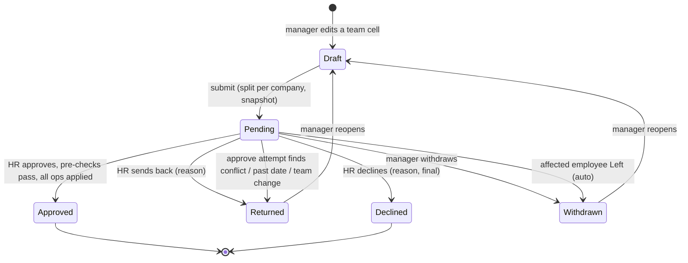
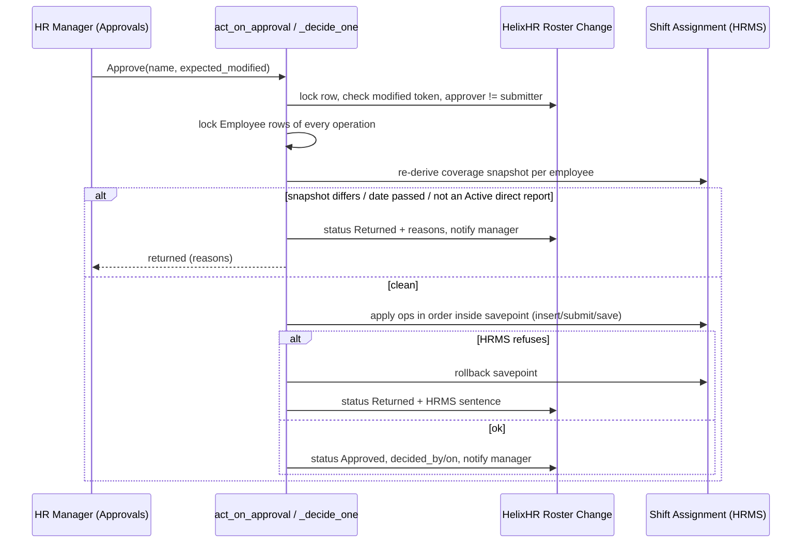

# feat: Projects workspace, bulk members, manager roster requests, leave approver visibility

## Summary

Four phases in one plan:

- **A. Projects pages.** Rebuild the list as a dense, filterable table. Split the detail page into searchable Tasks and People panes, each with "show more". Allow pasting several tasks at once.
- **B. Membership.** Add people in bulk: several at once, or a whole department. Add a project flag, "Open to everyone", that lets every active employee in the project's company book time without being a member.
- **C. Roster requests.** A manager drafts shift changes for their direct reports and submits the batch as one request. Any in-scope HR Manager decides it from Approvals. Approval is blocked, and the request goes back to the manager, if the roster changed underneath it.
- **D. Leave visibility.** HR sees which approver a pending leave is waiting on and can approve it in one step. Every decided leave records who decided it.

---

## Problem Frame

The Projects list is a single column of large cards. The detail page stacks a six-cell facts grid, a task list and a member list vertically with no search. On a project with many tasks and people, adding someone means scrolling past everything. Members are added one person per click, against a 20/hour rate limit. That makes company-wide internal projects (training, admin, bench time) painful to staff.

Rostering is HR-only today. Managers who know their team's shifts have to ask HR out of band.

Leave has a two-stage flow (manager, then HR) but persists no "decided by". HR's Approvals queue shows stalled manager-stage leave under the HR lane without naming the manager, so it reads as "waiting for HR". Employees see `leave_approver` as the approver even when HR decided.

---

## Requirements

**Projects pages**
- R1. The projects list renders as a sortable table on desktop and as cards on phone. It shows name, status, type, billable, member count (or "Everyone"), open-task count and expected end date.
- R2. The list filters by text, status, type and billable, and by company when the caller sees more than one. Filters survive a reload via the URL query.
- R3. The project detail shows its facts on one compact line. Tasks and People are separate panes, side by side on desktop and tabbed on phone. Each pane has its own search and reveals 25 rows at a time.
- R4. A project editor can paste up to 100 lines to add one task per non-blank line, in a single all-or-nothing call.

**Membership**
- R5. A project editor can pick several employees and add them in one call. It appends, never replaces.
- R6. A project editor can add every active employee in a department and its sub-departments in one call.
- R7. Bulk adds skip people who are already members and people with no portal login. The response names everyone skipped and why.
- R8. A project editor can mark a project "Open to everyone". Every Active employee whose current company matches the project's company may then book time on its open tasks while the project is Open, without a Project User row.
- R9. Booking eligibility stays one rule. The task picker, My projects, week reads, copy-last-week and save/submit validation all agree on it.

**Roster requests**
- R10. A manager can draft shift operations for their Active direct reports in the roster team view: assign a shift for a range, change the shift from a date, or end an assignment on a date. The manager's own row is not editable.
- R11. The draft persists on the server across sessions and devices. A manager has at most one draft.
- R12. Submitting turns the draft into one Pending request per company in the batch. An employee can be in at most one Pending request at a time.
- R13. Every operation date must be tomorrow or later in the employee's company time zone, both at submit and at approval.
- R14. Pending requests appear in Approvals, in the Leave & attendance tab, for every HR Manager whose admin scope covers the request's company. They count in the nav badge, pending-since and the overdue digest.
- R15. HR can Approve, Decline (reason required, final) or Send back (reason required). The manager can Withdraw while the request is Pending.
- R16. Approval re-checks the roster under lock. If any affected employee's coverage changed since submit, any operation date has passed, or any employee is no longer an Active direct report of the submitter, nothing is applied. The request moves to Returned with the reasons listed, and the manager is notified.
- R17. A Returned request reopens as the manager's draft. Resubmitting takes a fresh snapshot.
- R18. A clean approval applies every operation in order, in one transaction, through HRMS's own Shift Assignment validation.
- R19. HR's own roster view marks employees who have a Pending request.
- R20. HR is notified when a request is submitted. The manager is notified when it is approved, declined or returned.
- R21. Nobody may decide a request they submitted.

**Leave visibility**
- R22. Wherever HR sees a manager-stage leave (Approvals rows, decision detail, Home), it names the approver it is waiting on. It is never labelled as waiting for HR.
- R23. HR sees every in-scope manager-stage leave in a quieter "With managers" group in Approvals and can approve it in one step. The group does not add to HR's badge count.
- R24. Each final leave decision (Approve or Reject), whether made in the portal or in Desk, stamps the deciding user on the Leave Application.
- R25. The employee's leave view shows who decided. When HR decided a manager-stage leave, it reads "by 
 (HR)".
- R26. Home's "waiting on others" row says "waiting for HR" only for HR-stage leave. Otherwise it names the manager.
- R27. A manager's Decided list does not show leave HR decided as their own decision. HR's Decided list includes leave HR decided.

---

## Scope Boundaries

- Task assignees, dependencies, Gantt or timeline views, and closed-task browsing are out.
- Roster operations are limited to assign, change and end. Cancelling an assignment stays HR-only in the HR roster view.
- HR's direct roster editing is unchanged apart from the pending-request marker.
- `project_permissions.py` and Frappe REST access to Project and Task are unchanged. "Open to everyone" widens booking only, never document access.
- The "Missing timesheets" report's `project_members_only` filter and the access-migration counts keep reading Project User rows. Open projects are documented as excluded.
- The 20/hour `set_project_members` limit stays. Bulk adds use a new endpoint.

### Deferred to Follow-Up Work

- Notify affected employees when an approved roster request changes their shift.
- Backfill decided-by on historical leave from the "Decided by HR for" comments. Until then, historical rows show no decider name.
- `set_project_members` (replace) accepts any employee id on the site. Tighten it to the caller's project scope separately: changing it here could break existing cross-company memberships.
- Server-side paging of project tasks if a project's open tasks exceed about 500. The panes window rows client-side for now.

---

## Key Technical Decisions

- KTD1. **No table library; copy the People.vue and ReportTable pattern.** Use a plain `<table>` with `aria-sort` headers on desktop and cards below `useIsDesktop`. The repo deliberately has no table dependency, and the 2026-10-17 ease-of-use plan rejected copying in the shadcn Table.
- KTD2. **Projects list stays unpaged on the server.** A caller's project list is one company's projects or one org set's. `search_projects` gains the extra fields; filtering and sorting stay client-side in `frontend/src/lib/lists.js` helpers.
- KTD3. **The detail panes window client-side.** `get_project` already returns all open tasks and members. Search and a 25-row "show more" run in the browser. Server paging is deferred (see Scope Boundaries).
- KTD4. **Bulk adds use a new append endpoint that writes through `_write_project_users`.** That helper is the only safe way to write `Project.users`: it runs as Administrator and strips ERPNext's auto-share, which otherwise leaks the costing tab. Bulk add skips no-login employees and reports them. That differs on purpose from `set_project_members`, which refuses the whole call: one missing login should not block a 40-person department.
- KTD5. **Bulk-added employees must be Active and in a company the caller's project write scope covers** (`scope_covers(resolve_project_scope(user), employee.company)`). This closes, for the new path, the "any employee id" gap research found in `set_project_members`.
- KTD6. **"Open to everyone" is a Check custom field, `Project.helixhr_open_to_all`, read inside `_my_project_names`.** The branch adds Open projects with the flag set in the user's current Active Employee's company. Every booking caller already goes through that function, so they cannot disagree. No Project User rows are written, which also avoids the auto-share. Turning the flag off follows today's member-removal rule: a draft week that still names the project is refused on save, naming the row.
- KTD7. **Roster requests are a new DocType, `HelixHR Roster Change`, with a child table of operations, modelled on `HelixHR Timesheet Change`.** It has no Employee DocPerm, and every read and write goes through whitelisted projections. HRMS `Shift Request` was rejected for three reasons: it is one employee and one range, the employee is the requester, and its approver is the manager. That is the wrong direction for a manager batch decided by HR.
- KTD8. **Conflict token = a per-employee coverage snapshot.** At submit, store the `(shift_type, start_date, end_date)` of every submitted Shift Assignment that overlaps the request's affected window for each employee. At approval, re-derive it with the Employee rows locked and compare. Assignment `modified`, `status` and names are not used: HRMS's nightly job rewrites `status`, and HR's "change from date" creates new names.
- KTD9. **Every operation is simulated before it is stored.** One pure function applies an ordered list of operations to a copy of an employee's coverage. It rejects overlaps, a change on the assignment's own first day, and an end before the start. The same rules run in the browser for the draft preview and on the server at save, submit and approval.
- KTD10. **Approval applies operations as the HR Manager's own session, not as Administrator.** It calls shared helpers extracted from `assign_shift`, `end_shift_assignment` and `change_shift_assignment`, inside `_run_roster_write`'s savepoint. HR Managers already hold create/submit/write on Shift Assignment, HRMS validation runs, and attribution is real. Approvers are HR Manager only (Approvals' HR lane), so stock HR User's missing cancel never matters, and no operation cancels anything.
- KTD11. **A failed pre-check writes Returned; a failed apply rolls back and writes Returned.** Pre-checks (snapshot, dates, reporting line, Active) run before any shift write. If HRMS refuses mid-apply, the savepoint rolls back, the request is Returned with HRMS's plain sentence, and that status write commits on its own. A request is never left half-applied.
- KTD12. **Multi-company teams split per company at submit.** HR scope is per company, so one request per company means one coherent approver set.
- KTD13. **The roster request registers as a sixth approval kind.** It goes in every per-kind map that `test_every_kind_is_registered_in_every_per_kind_map` enforces, plus `reminders.PENDING_KINDS`, `approvalLanes.js`, `workKinds.js` and `statusBadge.js`. Decisions go through `act_on_approval` and `_decide_one`, so the `expected_modified` lock contract and the `_allowed_actions` single source of truth carry over unchanged.
- KTD14. **Leave decided-by is a permlevel-1 custom field stamped in `events.leave_application_before_submit`.** The field is `Leave Application.helixhr_decided_by` (Link User), written with `db_set` from the session user. `before_submit` covers portal and Desk Approve/Reject alike. "HR acting for the manager" is derived at read time as decided-by ≠ `leave_approver`; it is not stored.
- KTD15. **HR's "With managers" group widens `_hr_stalled_leave_summaries` under a new reason, `with_manager`.** The group is excluded from `count_only`, so the badge still counts only work waiting on HR. Existing `approver_away` and `overdue` rows keep their reasons, gain `approver_name`, and render under the manager's name instead of the HR heading.

---

## High-Level Technical Design

### Roster request lifecycle

### Approve path

---

## Implementation Units

### Phase A: Projects pages

### U1. Project list and detail data, bulk task add

- **Goal:** Give the list its table fields, and add a single-call bulk task add.
- **Requirements:** R1, R2, R4
- **Dependencies:** none
- **Files:** `helixhr/api.py` (`search_projects`, `_PROJECT_SEARCH_FIELDS`, new `add_tasks`), `helixhr/utils.py` (`RATE_LIMIT_POLICY`), `helixhr/tests/test_api_projects.py`, `helixhr/tests/test_upload_security.py`
- **Approach:**
  - `search_projects` rows add `project_type`, `priority`, `billable`, `expected_end_date`, and `open_to_all` (a placeholder until U4 adds the field).
  - `add_tasks(project, subjects)` is gated like `save_task`, refused on non-Open projects, and takes 1–100 subjects. Lines are trimmed; blanks and duplicates (case-insensitive, within the paste and against existing open tasks) are dropped; a subject over 140 characters refuses the call. All inserts go in one savepoint, so nothing is written if any fails. It returns the created task projections and the dropped duplicates.
- **Patterns to follow:** `save_task` gate and `_task_projection`; the `_project_list_counts` grouped reads.
- **Test scenarios:**
  - HR in scope gets the new fields on every row. Costing fields stay absent.
  - `add_tasks` with 3 lines, one blank and one duplicate of an existing open task creates 2 and reports 1 duplicate.
  - 101 lines are refused with a plain message, and nothing is created.
  - An out-of-scope caller gets `_PROJECT_NOT_FOUND`. So does a non-existent project.
  - On a Completed project, the call is refused.
  - A 141-character line refuses the whole call, naming the line.
  - The new method appears in the rate-limit policy and the pinned table.
- **Verification:** Python tests pass; the pinned rate-limit table is updated in the same commit.

### U2. Projects list table

- **Goal:** Replace the card list with a dense, filterable table.
- **Requirements:** R1, R2
- **Dependencies:** U1
- **Files:** `frontend/src/pages/Projects.vue` (list branch), `frontend/src/lib/projects.js` (new: filter and query-sync helpers), `frontend/src/lib/projects.test.js`, `frontend/tests/e2e/projects.spec.ts`
- **Approach:**
  - Desktop gets a table with sortable headers. Phone keeps a compact card per row.
  - A filter bar holds search, status chips (existing), type and billable selects, and company only when more than one company is present.
  - Filter state lives in the route query.
  - The create form moves into a `Dialog` so it no longer pushes the table down.
  - Long project codes use `break-words`.
- **Patterns to follow:** `People.vue` table plus phone cards and `useIsDesktop`; `components/reports/ReportTable.vue` `aria-sort`; `lib/lists.js` (`sortRows`, `filterByField`).
- **Test scenarios:**
  - Unit: the filter helper combines text, status, type and billable. Its query round-trip restores the same filter state.
  - Unit: the company filter is hidden with one company.
  - e2e: HR filters by billable and the count line updates. Reload keeps the filter.
  - e2e: at phone width, cards render with no horizontal scroll.
  - e2e: `console-clean` stays green on /projects.
- **Verification:** `yarn test`, `yarn lint` and the projects e2e pass.

### U3. Project detail panes and bulk task paste

- **Goal:** Searchable Tasks and People panes with "show more", plus paste-to-add tasks.
- **Requirements:** R3, R4
- **Dependencies:** U1
- **Files:** `frontend/src/pages/Projects.vue` (detail branch), `frontend/src/lib/projects.js`, `frontend/src/lib/projects.test.js`, `frontend/tests/e2e/projects.spec.ts`
- **Approach:**
  - The facts grid collapses to one inline line of label·value pairs.
  - Desktop shows two columns, Tasks and People. Phone uses a `TabBar`.
  - Each pane has a `SearchField` and shows 25 rows, then "Show N more".
  - The task add input becomes a textarea. On paste of multiple lines it shows "Add N tasks" before calling `add_tasks`.
  - The member "Add people" control opens the U6 picker. Until U6 lands, it keeps the existing single-add.
- **Patterns to follow:** `Directory.vue` show-more paging; `TabBar.vue`.
- **Test scenarios:**
  - Unit: the paste parser splits on newlines, trims, drops blanks, de-dupes and caps at 100.
  - e2e: a project seeded with 60 tasks shows 25. Search narrows to matches. "Show more" reveals the next 25.
  - e2e: pasting 3 lines adds 3 tasks, all visible without scrolling past the members.
  - e2e: a view-only caller sees no add controls in either pane.
- **Verification:** e2e passes on desktop and phone projects.

### Phase B: Membership

### U4. "Open to everyone" flag and booking rule

- **Goal:** Company-wide booking without Project User rows.
- **Requirements:** R8, R9
- **Dependencies:** U1
- **Files:** `helixhr/fixtures/custom_field.json` (`Project-helixhr_open_to_all`, Check, after `helixhr_is_billable`, module HelixHR), `helixhr/api.py` (`_my_project_names`, new `set_project_open_to_all`, `_PROJECT_FIELDS`, `get_project`, `_project_list_counts` consumer), `helixhr/utils.py` (rate limit), `helixhr/tests/test_project_open_to_all.py` (new), `helixhr/tests/test_upload_security.py`
- **Approach:**
  - `_my_project_names` adds Open, flagged projects in the user's current Active Employee's company, and stays a single union.
  - `set_project_open_to_all(project, value)` is gated by `resolve_project_scope` / `project_in_scope`.
  - `get_project` and the list rows return `open_to_all`.
- **Execution note:** Write the strict-user-permission Timesheet save test first, on a fresh site with `apply_strict_user_permissions=1`. Frappe link validation is the unverified risk.
- **Test scenarios:**
  - An employee in the project's company who is not a member sees the project and its open tasks in `get_my_projects`, and can save and submit a week booking it.
  - An employee in another company does not see it, and saving a row naming it is refused with "You can't book time on {0}".
  - A flagged project that is Completed is not bookable.
  - With the flag off, a draft week that still names it is refused on save, naming the row.
  - An employee with strict Project User Permissions for other projects can still save a week booking the open project. If not, the fix is decided during the work.
  - A new hire created after the flag was set can book immediately.
  - REST `GET /api/resource/Project/<name>` as a non-member employee is still refused.
  - A Delivery Manager outside scope cannot toggle the flag.
- **Verification:** The new test file passes on a fresh site with strict permissions.

### U5. Bulk member add endpoint

- **Goal:** Append several employees, or a department subtree, in one call.
- **Requirements:** R5, R6, R7
- **Dependencies:** U1
- **Files:** `helixhr/api.py` (new `add_project_members`, plus a department list in the picker payload), `helixhr/utils.py` (rate limit), `helixhr/tests/test_api_projects.py`, `helixhr/tests/test_upload_security.py`
- **Approach:**
  - `add_project_members(project, employees=None, department=None)` locks the Project row (`for_update`).
  - It resolves the candidates: the named employees, or all Active employees in the department's `lft`/`rgt` subtree, capped at 500.
  - It filters to KTD5's scope, drops existing members, and skips those with no `user_id`.
  - It appends the rest to `doc.users` and writes through `_write_project_users`.
  - It returns `{added: [...], skipped: [{employee_name, reason}]}`.
  - Departments for the picker come from the company or companies the caller's write scope covers.
- **Patterns to follow:** `set_project_members` resolution; `_write_project_users`.
- **Test scenarios:**
  - Adding 3 employees, one already a member and one with no login, adds 1 and skips 2 with reasons.
  - A department add includes a sub-department's active employee and excludes a Left employee.
  - An employee from a company outside the caller's write scope is skipped with reason "outside your projects' companies". It is not refused.
  - After a bulk add, no DocShare rows exist for the added users on that Project.
  - The session survives the write (`TestWriteProjectUsersSessionSafety` pattern).
  - Calling twice with the same list is a no-op the second time.
  - An out-of-scope project is refused with `_PROJECT_NOT_FOUND`.
- **Verification:** Python tests pass; the DocShare assertion holds.

### U6. Member picker UI and open-to-everyone toggle

- **Goal:** Multi-select and department picker, plus the flag control on the detail page.
- **Requirements:** R5, R6, R7, R8
- **Dependencies:** U3, U4, U5
- **Files:** `frontend/src/components/ProjectMemberPicker.vue` (new), `frontend/src/pages/Projects.vue`, `frontend/tests/e2e/projects.spec.ts`
- **Approach:**
  - The picker is a frappe-ui `Dialog` with two modes:
    - People: `get_directory` search with checkboxes, selected chips, and "Add N people".
    - Department: a department select showing a preview count, then "Add everyone in <dept>".
  - After an add, the skipped list renders inline.
  - The People pane header carries an "Open to everyone in <company>" switch for editors.
  - When the switch is on, the member list is replaced by a one-line explanation, with any explicit members still listed below.
  - The list table shows "Everyone" in the members column.
- **Patterns to follow:** existing member search in `Projects.vue`; `RosterShiftSheet.vue` Dialog usage.
- **Test scenarios:**
  - e2e: select 3 people and add them once; all 3 appear and only one request is sent.
  - e2e: a department add shows skipped people with reasons.
  - e2e: toggle open to everyone; the list row shows "Everyone"; a non-member employee sees the project in the timesheet task picker.
  - e2e: the dialog is keyboard reachable, focus is trapped and returned, and checkboxes are labelled.
- **Verification:** e2e passes; there are no new console errors.

### Phase C: Manager roster requests

### U7. Roster change DocType and operation simulator

- **Goal:** The request record and the pure rule engine shared by browser and server.
- **Requirements:** R10, R11, R12, R13
- **Dependencies:** none
- **Files:** `helixhr/helixhr/doctype/helixhr_roster_change/` (new: json, py), `helixhr/helixhr/doctype/helixhr_roster_change_row/` (new child: employee, employee_name, action Assign/Change/End, shift_type, from_date, to_date, assignment), `helixhr/roster_ops.py` (new: pure simulate and snapshot functions), `frontend/src/lib/rosterDraft.js` (new), `frontend/src/lib/rosterDraft.test.js`, `helixhr/tests/test_roster_ops.py` (new)
- **Approach:**
  - Parent fields:
    - naming series `HRC-.YYYY.-`; `manager` (Employee), `manager_user`, `company`
    - `status` (Draft/Pending/Approved/Declined/Returned/Withdrawn), `note`
    - `snapshot` (JSON, hidden); `decided_by`, `decided_on`, `decision_note`
    - `helixhr_pending_since`; `track_changes` on
  - DocPerms: HR Manager read/write, HR User read, System Manager full, no Employee.
  - `validate()` restates the rules for Desk inserts.
  - `roster_ops.py` holds the simulator: ordered operations applied to coverage → new coverage or a list of plain-sentence problems. It also holds the snapshot builder for an employee and window.
  - `rosterDraft.js` mirrors the simulator for the preview overlay.
- **Execution note:** Implement the simulator test-first; it is the rule both sides depend on.
- **Test scenarios:**
  - Assign on an empty range succeeds. Assign overlapping existing coverage is refused with the overlap sentence.
  - Change from a date inside an assignment splits it: the old one ends the day before, and the new one keeps the old end.
  - Change on the assignment's first day is refused.
  - End before start is refused. End on a date after the current end is refused.
  - Two operations on one employee in sequence (assign a range, then change inside it) produce the combined result.
  - An open-ended assignment followed by an end yields a bounded range.
  - The snapshot ignores `status` and `modified`: the same coverage with a different status gives an equal snapshot.
  - JS and Python produce the same results for a shared fixture table of 8 cases (duplicated literal cases in both test files).
- **Verification:** Both test suites pass; `bench migrate` creates the doctypes on a fresh site.

### U8. Draft, submit and withdraw API

- **Goal:** The manager-side lifecycle.
- **Requirements:** R10, R11, R12, R13, R17, R20, R21
- **Dependencies:** U7
- **Files:** `helixhr/api.py` (new `get_roster_draft`, `save_roster_draft`, `submit_roster_change`, `withdraw_roster_change`, `reopen_roster_change`; `get_roster_week` team-mode payload), `helixhr/events.py` (after-insert/on-change notifications, auto-withdraw on Left next to the timesheet-change one, `stamp_pending_since` wiring), `helixhr/hooks.py`, `helixhr/utils.py` (`NOTIFICATION_EVENTS` `roster_change_submitted`, `roster_change_decided`; rate limits), `helixhr/tests/test_roster_change.py` (new), `helixhr/tests/test_upload_security.py`
- **Approach:**
  - `save_roster_draft(rows)` replaces the caller's single Draft rows. It validates that each employee is an Active direct report of the caller (`_direct_report_filters`), never the caller themselves. It runs the simulator against live coverage and refuses dates before tomorrow in the employee's company time zone.
  - `submit_roster_change(note)`:
    - locks the involved Employee rows
    - refuses any employee already in a Pending request
    - splits rows per company: the draft becomes the first company's request and new docs are created for the rest
    - stores each snapshot and sets Pending
  - Team mode in `get_roster_week` returns `can_request`, the draft rows, and Pending markers.
  - Notifications:
    - On submit: bell plus mail to `_hr_managers` covering the company.
    - On decision or return: the manager.
- **Patterns to follow:** `raise_timesheet_change` / `withdraw_timesheet_change`; `events.timesheet_change_after_insert`; `_hr_mail_change`.
- **Test scenarios:**
  - A manager drafts operations for two reports. The draft survives a new session, and `get_roster_draft` returns it.
  - Drafting for a non-report, for the manager's own row, or for an Inactive report is refused.
  - A date of today is refused; tomorrow in the company time zone passes. Use `freeze_time` around IST midnight.
  - Submitting a batch spanning two companies creates two Pending requests with correct companies and snapshots.
  - Submitting with an employee already in another Pending request is refused, naming them.
  - Withdraw sets Withdrawn; reopen returns it to Draft. Withdraw by anyone but the manager is refused.
  - An employee set to Left auto-withdraws the Pending request that names them, and the manager is notified.
  - HR in scope gets a bell and mail on submit. HR outside scope gets neither.
  - The new methods are in the rate-limit policy and the pinned table.
- **Verification:** `test_roster_change.py` passes with a pinned clock.

### U9. Approvals integration and apply

- **Goal:** HR decides from Approvals. Approve re-checks and applies atomically.
- **Requirements:** R14, R15, R16, R18, R19, R21
- **Dependencies:** U8
- **Files:**
  - `helixhr/api.py`:
    - `_APPROVAL_DOCTYPES`, `_APPROVAL_KINDS`, `_QUEUE_TITLE`, `_APPROVAL_SUMMARY_COLLECTORS`, `_DECIDED_COLLECTORS`, `_OVERSIGHT_KINDS`
    - new `_roster_change_summaries`, `_roster_change_decision_detail`, `_act_on_roster_change`
    - shared helpers extracted from `assign_shift`, `end_shift_assignment` and `change_shift_assignment`
    - `get_roster_week` HR-mode pending marker
  - `helixhr/reminders.py` (`PENDING_KINDS`, `collect_overdue`)
  - `helixhr/tests/test_roster_change.py`, `helixhr/tests/test_api_approvals.py` (per-kind counts derive from `_APPROVAL_DOCTYPES`, 5 → 6), `helixhr/tests/test_approvals_lanes.py`, `helixhr/tests/test_api_roster.py`
- **Approach:**
  - The kind's allowed actions are Approve, Send Back and Reject (labelled Decline). They go to in-scope HR Manager only, and never to the submitter.
  - `_act_on_roster_change` runs the pre-checks, then applies operations in order through the extracted helpers inside `_run_roster_write`. It follows KTD11 for failures. The approve response carries `returned: true` and reasons when pre-checks fail.
  - The HR roster's direct endpoints call the same extracted helpers, so their behaviour is unchanged.
  - The detail payload lists the operations grouped by employee, each with before → after for the affected days.
- **Patterns to follow:** `_act_on_timesheet_change` (lock, re-check, single transaction); `_hr_change_request_summaries`; `_run_roster_write`.
- **Test scenarios:**
  - Covers R18: a clean approve applies 3 operations across 2 employees. Shift Assignments match the simulation, the status is Approved, and decided_by is the HR user.
  - Covers R16: HR changes one employee's shift directly after submit. Approve applies nothing, the status is Returned with that employee named, and the manager is notified.
  - The nightly inactive job flips an affected assignment's status after submit. Approve still succeeds (no false conflict).
  - An operation date passes between submit and approve (`freeze_time` +2 days). The request is Returned.
  - A report moved to another manager after submit causes Returned.
  - HRMS refuses mid-apply (forced overlap through a Desk-inserted assignment outside the snapshot window). Nothing is written, and the request is Returned with a plain sentence.
  - Two HR Managers approve with the same `expected_modified`. The second is refused by the token.
  - An HR Manager who submitted the request as a manager cannot approve it.
  - An out-of-scope HR Manager does not see the row and is refused on act.
  - The badge count, pending-since and overdue digest include the Pending request. Decided-by-me lists it after a decision.
  - The kind registry test passes with 6 kinds.
  - Existing `test_api_roster.py` HR write tests still pass unchanged.
  - HR-mode `get_roster_week` marks an employee with a Pending request.
- **Verification:** All approvals, roster and roster-change suites pass.

### U10. Roster and Approvals UI for requests

- **Goal:** A manager drafts and submits in the team view; HR reviews in Approvals.
- **Requirements:** R10, R11, R12, R15, R17, R19
- **Dependencies:** U8, U9
- **Files:** `frontend/src/pages/Roster.vue`, `frontend/src/components/RosterShiftSheet.vue`, `frontend/src/lib/roster.js`, `frontend/src/pages/Approvals.vue`, `frontend/src/lib/approvalLanes.js`, `frontend/src/lib/workKinds.js`, `frontend/src/lib/statusBadge.js`, `frontend/tests/e2e/roster.spec.ts`, `frontend/tests/e2e/approvals.spec.ts`
- **Approach:**
  - Roster team mode:
    - When `can_request` is true, report cells open `RosterShiftSheet` in "propose" mode, with the same assign/change/end options and no cancel.
    - Proposed cells render with a dashed outline and the after-value, using `rosterDraft.js`.
    - A sticky draft bar shows "N changes for M people · Submit for HR approval · Discard", with a note field.
    - Pending, Returned (with reasons) and Declined requests show as a status strip above the grid. Returned has "Reopen as draft".
  - HR mode: a "Change pending" pill on marked rows.
  - Approvals detail lists before → after per employee, with Approve, Send back and Decline. Decline and Send back require a reason. Approve has a confirm, the timesheet-change misfire lesson.
- **Test scenarios:**
  - e2e: a manager proposes 2 changes, the draft bar shows 2, the page reloads with the draft intact, and the manager submits.
  - e2e: HR approves from Approvals and the roster shows the new shifts.
  - e2e: HR edits a pending employee's shift directly, then approves. The manager sees Returned with the reason, reopens, resubmits, and HR approves.
  - e2e: a manager without reports sees no team mode (unchanged).
  - e2e: phone width — the draft bar and sheet are usable with no horizontal scroll.
- **Verification:** The roster and approvals e2e pass, including the `employee-mobile-webkit` project in the Playwright Docker image.

### Phase D: Leave approver visibility

### U11. Stamp and expose who decided a leave

- **Goal:** A persisted decider, and correct "who decided" everywhere.
- **Requirements:** R24, R25, R27
- **Dependencies:** none
- **Files:** `helixhr/fixtures/custom_field.json` (`Leave Application-helixhr_decided_by`, Link User, permlevel 1, read-only), `helixhr/events.py` (`leave_application_before_submit`), `helixhr/api.py` (`_leave_projection`, `_decided_leave`, `_leave_decision_detail`), `helixhr/tests/test_leave_flow.py`
- **Approach:**
  - `before_submit` stamps `helixhr_decided_by` from the session user when the status is Approved or Rejected. Use `db_set` if `before_submit` cannot set the field directly; decide during the work.
  - The projection adds `decided_by_name` and `decided_by_hr`, where `decided_by_hr` means decided-by is not the `leave_approver` and the decider is HR in scope.
  - `_decided_leave` keys on `helixhr_decided_by` when set and falls back to `leave_approver`.
- **Test scenarios:**
  - Covers R24: a manager approves in the portal and decided-by is the manager.
  - HR approves a manager-stage leave in one step. The leave is submitted Approved, decided-by is HR, and the projection reads `decided_by_hr: true`.
  - A Desk Reject by an HR Manager stamps decided-by.
  - A historical leave with no stamp shows no decider name and does not error.
  - Covers R27: HR-decided leave is absent from the manager's Decided list and present in HR's.
  - Send Back then resubmit then approve stamps only the final decider.
- **Verification:** `test_leave_flow.py` passes.

### U12. HR sees the waiting approver

- **Goal:** Name the approver on every manager-stage leave HR sees, and add the "With managers" group.
- **Requirements:** R22, R23, R26
- **Dependencies:** none
- **Files:** `helixhr/api.py` (`_hr_stalled_leave_summaries`, `_collect_approval_summaries` lane tagging, `_decision_head`, `_open_leave`), `helixhr/tests/test_approvals_lanes.py`, `helixhr/tests/test_approvals_cross_company.py`, `helixhr/tests/test_api_dashboard.py` (or the existing Home test file)
- **Approach:**
  - Every leave summary row carries `approver_name`, resolved in one read via `reminders.resolve_approvers`. That covers the `no_approver`, `inactive` and `no_login` reasons.
  - Manager-stage rows HR sees get `hr_reason` `with_manager` unless already `approver_away` or `overdue`.
  - `count_only` excludes `with_manager`.
  - `_open_leave` titles HR-stage leave "waiting for HR" and manager-stage leave "waiting for <approver name>".
- **Execution note:** First reproduce on a fresh site which surface shows "Waiting for HR" for a manager-stage leave, and add a failing test for it. The suspected cause is stalled manager-stage rows being lane-tagged `hr` and rendered under the HR heading. Confirm it before changing the tagging.
- **Test scenarios:**
  - Covers R23: HR in scope sees a fresh manager-stage leave with `hr_reason: with_manager` and `approver_name`. The badge count is unchanged.
  - HR outside scope does not see it.
  - An approver who is on leave gives `approver_away` (unchanged) with `approver_name` present.
  - An approver whose login is disabled gives `approver_name` with the `inactive` reason, and the row still renders.
  - The decision detail for a manager-stage leave opened by HR carries `waiting_on: <approver name>`, and Approve is allowed.
  - Home: an employee with an HR-stage leave sees "waiting for HR". With a manager-stage leave, they see the manager's name.
- **Verification:** The lanes, cross-company and Home tests pass.

### U13. Leave visibility UI

- **Goal:** Render the approver and the decider.
- **Requirements:** R22, R23, R25, R26
- **Dependencies:** U11, U12
- **Files:** `frontend/src/pages/Approvals.vue`, `frontend/src/lib/approvalLanes.js`, `frontend/src/pages/Leave.vue`, `frontend/src/components/NeedsYou.vue`, `frontend/tests/e2e/leave.spec.ts`, `frontend/tests/e2e/approvals.spec.ts`
- **Approach:**
  - Approvals Leave & attendance tab gets a collapsed-by-default "With managers" group below HR's own work. Each row reads "Waiting on <approver>" and opens the normal detail with Approve.
  - Stalled rows read "Approver on leave · <name>".
  - Leave.vue's decided detail and list read "Approved by <name>" or "Approved by <name> (HR)".
  - The legacy `waiting_for_hr` badge stays for the defect row only.
- **Test scenarios:**
  - e2e: HR opens Approvals, expands "With managers", sees the manager's name, approves, and the row leaves the group.
  - e2e: the employee then sees "Approved by 
 (HR)" on the leave.
  - e2e: a manager-approved leave shows "Approved by <manager name>".
- **Verification:** The leave and approvals e2e pass on a fresh site.

### U14. Architecture and runbook notes

- **Goal:** Record the new rules where the next engineer looks.
- **Requirements:** R9, R16, R24
- **Dependencies:** U4, U9, U11
- **Files:** `docs/architecture.md`, `docs/runbook.md`
- **Approach:**
  - `docs/architecture.md`:
    - the open-to-everyone booking rule and the reports that ignore it
    - the roster change lifecycle, the conflict token and the approval kind
    - leave decided-by and its derivation
  - `docs/runbook.md`:
    - why the conflict token is a coverage snapshot
    - the strict-UP finding from U4
- **Test expectation:** none, documentation only.
- **Verification:** The docs are updated in the same branch.

---

## System-Wide Impact

- **Approvals surface:** a sixth kind touches the badge, Home queue, overdue digest, Decided by me, All pending and every per-kind map. The registry test guards completeness.
- **Booking rule:** `_my_project_names` widening affects the timesheet week, the task picker, My projects and copy-last-week together. That is intended.
- **Email templates:** two new `NOTIFICATION_EVENTS` appear automatically on the Email templates page.
- **Schema:** two new custom fields (fixtures) and two new DocTypes. No patches to applied migrations, and no DocPerm deltas on core doctypes.
- **Rate limits:** new whitelisted methods each need a policy entry and a pinned-table row.

---

## Risks & Dependencies

| Risk | Mitigation |
|---|---|
| Strict User Permissions on Project may refuse Timesheet link validation for open projects | U4 writes this test first, on a fresh site with strict permissions |
| Roster apply half-writes on an unexpected HRMS refusal | Single savepoint; Returned status written only after rollback (KTD11) |
| Browser and server simulators drift | A shared literal case table in both test suites (U7) |
| Widening HR's leave view floods the queue | The "With managers" group is collapsed and excluded from the count |
| The kind registry test derives per-kind counts from `_APPROVAL_DOCTYPES`; `_APPROVAL_SUMMARY_COLLECTORS` must equal the doctype count minus HR Request | Register the kind in every map in U9 |
| Today-dated shift edits strand check-ins | Requests allow tomorrow or later only (R13) |

---

## Sequencing

Phases are independent apart from what the units list. Phase D has no dependencies and is the smallest. It can ship first as a fix while A to C proceed. Within Phase C, U7 → U8 → U9 → U10 is strict.

---

## Sources & Research

- Project scope and auto-share: `helixhr/api.py` `_write_project_users`, `search_projects`, `set_project_members`; `docs/plans/2026-09-20-001-feat-projects-tasks-billable-reports-plan.md` (KTD5, KTD9)
- Booking rule: `helixhr/api.py` `_my_project_names`, `_bookable_tasks_by_project`, `_validate_rows`
- Roster: `helixhr/api.py` `get_roster_week`, `_run_roster_write`, `change_shift_assignment`; `docs/runbook.md` roster section; `docs/plans/2026-09-30-001-feat-profile-photo-and-shift-roster-plan.md` (deferred Shift Request follow-up)
- Change-request precedent: `helixhr/helixhr/doctype/helixhr_timesheet_change/`, `docs/plans/2026-10-04-003-feat-timesheet-corrections-and-approval-queues-plan.md`, `docs/architecture.md` change-requests section
- Approvals and leave: `docs/architecture.md` "Who may act", leave stage and lanes sections; `helixhr/api.py` `_leave_allowed_actions`, `_decide_one`, `_record_hr_acting_for_approver`, `_hr_stalled_leave_summaries`, `_open_leave`, `_decided_leave`
- Test gates: memories on fresh-site runs and CI clock pinning; `docs/runbook.md` (no rollback between test methods)
