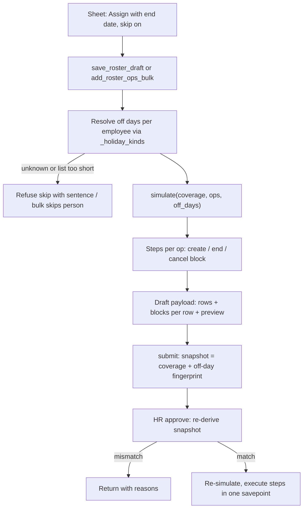
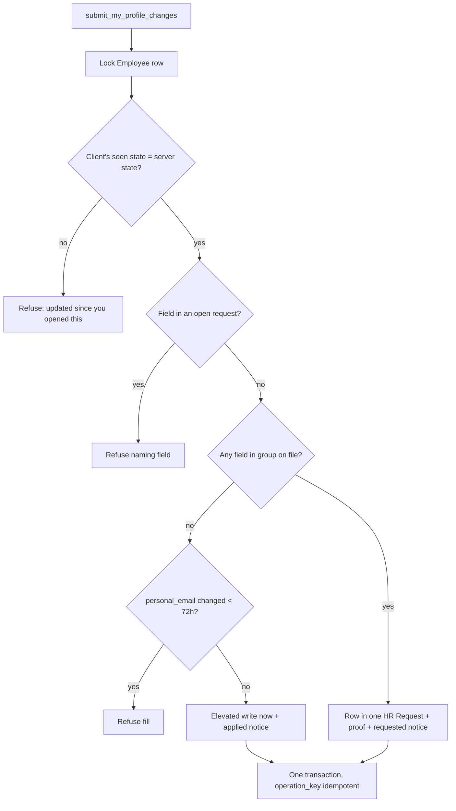

# feat: Roster draft controls (skip off days, edit, bulk) and Bank & IDs self-edit

## Summary

Two features ship from this plan. The roster units come first.

The roster changes are for managers and leads:
- A shift with an end date skips each person's weekends and holidays by default. A toggle turns the skip off.
- Change and End act "from here on" across the blocks a skip creates.
- Each proposed change can be edited from the draft bar. The draft also gets a visible Clear all.
- One change can be applied to the whole team or to a picked group.

The profile changes are for every employee:
- On the Bank & IDs tab, an employee edits their values in place and submits everything in one go.
- A field group that is blank on the Employee record fills at once, with no HR step. This gets everyone's first-time data in without HR clicking through each person.
- Changes to values already on file go to HR as one request with one proof file.
- Bank and ID values stop appearing in plain text in the Employee change history.

---

## Problem Frame

**Roster.** A lead who assigns a shift for a range gets one Shift Assignment that also covers weekends and holidays. Rostering someone for weekend work and leaving them off both look the same. The draft bar can only remove a proposed change, not fix it. The Discard action that clears the draft is easy to miss. Setting the same shift for a whole team means one sheet per person.

**Profile.** Bank details can only be changed one field at a time, through the correction dialog, each with its own proof and HR pickup. ID fields (PAN, PF, passport, insurance) can't be changed at all. Rolling the portal out means collecting these details for every employee, and putting each one through HR approval does not scale.

---

## Requirements

**Roster: skip off days**
- R1. An Assign with an end date skips the person's off days (holidays and the holiday list's weekly offs) by default. One stored row becomes one Shift Assignment per contiguous working-day run.
- R2. The lead can turn the skip off per change. Open-ended Assigns, Changes and Ends never skip.
- R3. When the off days can't be known, the skip is refused with a sentence and the lead can turn it off. This covers a person with no resolvable holiday list, or a list that does not cover the whole range.
- R4. Change and End act from their date on: the block covering the date and every later block of the same shift in the same run. Gaps that are only off days do not break the run.
- R5. HR's approval applies exactly what the lead and HR previewed. If a person's off days in the window changed after submit, the request is returned with a reason.

**Roster: draft controls**
- R6. Any proposed change in the draft bar can be edited in the shift sheet, keeping its skip setting.
- R7. The draft has a visible Clear all with a confirm step.
- R8. One change can be applied to the whole team or to selected direct reports. A person whose change would fail is skipped and named with the reason. If the batch would exceed the draft cap, it is refused whole.
- R9. Two saves from different tabs never silently drop rows.
- R10. A day left free by a skip shows as Off in the grid, not "no shift, default X". The approval view shows both the change count and the block count.

**Profile: self-edit and submit**
- R11. An employee edits every field on the Bank & IDs tab their site has, and submits all staged changes in one call. The fields are: salary mode, bank name, account no, IFSC, MICR, IBAN, PAN, PF account, the four passport fields, and the two health insurance fields.
- R12. First-time fill: routing is per field group (bank, PAN, PF, passport, insurance). A group whose fields are all blank on Employee fills at once. A group with any value on file goes to HR whole.
- R13. Changes that go to HR become one HR Request (Profile correction) with one row per field and one required proof file. A first-time fill needs no proof.
- R14. Masked identifiers require double entry on both paths. These are account no, IBAN, PAN, PF, passport no and insurance no.
- R15. Safeguards that HR's Done applies today also apply to a first-time fill. Fills are refused for 72h after a personal email change, and the bank-change notice goes to the company and personal addresses.
- R16. HR's Done applies every row in one savepoint, or nothing. A stale row blocks Done and is named. Reject applies nothing. Secrets are purged on both.
- R17. A field already in an open request can't be submitted again until that request closes. Other fields can.
- R18. The single-field correction dialog is removed. Correction requests already filed stay readable and HR can still complete them.

**Profile: history**
- R19. Employee change history records that a bank or ID field changed, and who changed it and when. The value is masked. Personal email history is left alone. Existing history rows are masked once.

---

## Scope Boundaries

- Profile tabs other than Bank & IDs are unchanged.
- HR's direct roster editing is unchanged. It inherits the "Off" label and the chain-aware Change/End rules only where it shares the simulator.
- Shift Type holiday lists are not consulted. The employee's holiday list is the source of off days.
- Partial approval (HR applying some rows and dropping others) is out of scope.

### Deferred to Follow-Up Work

- An employee Withdraw state for HR Requests. That is a workflow fixture change plus a patch. Until then the employee asks HR, by reply, to reject.
- Several proof files per request, or proof attached to a Need-info reply.
- Per-row weekend shading in the grid header for companies whose weekly off is not Sat/Sun. Cells get Off (R10), but the header stays Sat/Sun.
- Format validation for IFSC, PAN and IBAN beyond what Employee itself validates.

---

## Key Technical Decisions

- KTD1. **The stored row stays one row; the simulator expands it.** `HelixHR Roster Change Row` gains `skip_off_days` (Check, default 0). Each stored row remains one thing the lead did, so edit, remove, the 200-row cap and reopen-merge keep their meaning. Default 0 keeps already-pending requests unsplit. Only the sheet sets the flag on.
- KTD2. **The simulator emits the steps; apply runs them.**
  - `simulate(coverage, ops, off_days)` returns, per op, the ordered primitive steps (create block, end block, cancel block) along with the new coverage. Approval executes those steps through the existing savepoint-free helpers.
  - This gives skip expansion and chain semantics one implementation in Python. They are mirrored in `rosterDraft.js` under the shared literal case table.
  - It also stops the apply path drifting from the preview.
- KTD3. **A run is derived, not stored.** It is the blocks of one shift type for one person whose gaps are only off days, so no series marker is added. Change splits the covering block and swaps the shift type on every later block (cancel and recreate, since dates are tomorrow or later). End ends the covering block and cancels later ones. A date that falls in a gap acts on the next block.
- KTD4. **Off days come from `_holiday_kinds`.** The list must cover the range (`from_date`/`to_date`). `None` means "cannot tell" and the skip is refused. The browser receives off days only for the visible week, so the server preview in the draft payload is authoritative for anything wider. The payload returns the blocks for each row.
- KTD5. **The snapshot carries an off-day fingerprint.** It holds the holiday list name(s) and off dates per employee for the window (KTD8 of plan 2026-10-31-001, widened). Approval re-derives the fingerprint. A mismatch returns the request: "X's days off changed after this was sent."
- KTD6. **Caps:**
  - 200 stored rows, unchanged.
  - At most 1,000 blocks per request.
  - A skip row spans at most 92 days.
  - These are checked at save and at approval, which keeps one approval savepoint bounded.
- KTD7. **Bulk is a server endpoint.**
  - `add_roster_ops_bulk(op, employees | whole_team, expected_modified)` resolves "whole team" on the server. `get_roster_week` pages at 50, so the visible rows can't be trusted to be the whole team.
  - It skips and names anyone already waiting in another Pending request, or whose op fails the simulator or the date rule. This mirrors `add_project_members`.
  - It counts against the cap after skips, and refuses the whole batch when over the cap.
  - It runs through the frontend save chain, so it can't race a full-replace save.
- KTD8. **Draft saves carry `expected_modified`.** Both `save_roster_draft` and the bulk endpoint refuse when the draft changed underneath: "Your draft changed in another tab. Reload it."
- KTD9. **Profile changes are child rows on HR Request.**
  - The new child DocType is `HelixHR Profile Change Row`. Its fields: `field`, `label`, `current` and `proposed` (Password), and `current_masked` and `proposed_masked` (Data; the full value for unmasked fields).
  - HR Request gains `profile_changes` (Table).
  - One request carries the whole batch, so the employee uploads one proof and HR does one pickup. It also stays clear of the 10/h `create_my_request` limit.
  - Legacy single-field correction fields stay, for old requests.
- KTD10. **Rows are API-only, write-once and purged.**
  - Rows exist only when `flags.helixhr_profile_changes` is set by the new endpoint, so a Desk or REST insert with rows is refused.
  - `hr_request_validate` freezes rows after insert by comparing against `get_doc_before_save()`.
  - `_purge_correction_secrets` clears every row's Password values on Done and Rejected.
- KTD11. **Routing is per group, under the Employee row lock.**
  - Groups: bank = salary_mode, bank_name, bank_ac_no, ifsc_code, micr_code, iban. PAN, PF and insurance (provider + no) are separate groups. Passport = the 4 fields.
  - A group goes to HR when any of its fields is on file. Otherwise it fills now. This prevents a new bank name being paired with an old account no.
  - The client sends the blank/filled state it saw for each group. If the server sees a different state under the lock, it refuses with "X was updated since you opened this".
- KTD12. **A first-time fill is a guarded, elevated write.**
  - It is limited to the self-service allow-list, does not lower permlevel, and does not widen `PROFILE_EDITABLE_FIELDS`.
  - Before writing, it validates Select options, Link existence and passport date order.
  - Employee validation errors are replaced with the generic sentence, as `_apply_correction` does.
  - It is documented as an `ignore_permissions` exception in `docs/architecture.md` §6.
  - The fills and the request insert happen in one transaction. They are idempotent on `operation_key`.
- KTD13. **History masking is an Employee `on_update` step plus a one-time patch.**
  - The step rewrites the newest Version row for that Employee, masking the self-service identifier fields in `changed`. It follows the `null_stale_checkin_coordinates` precedent.
  - The patch masks existing rows.
  - It never touches `personal_email` entries, because the 72h hold reads them, and never deletes Version rows.
- KTD14. **The notice templates stay backward compatible.**
  - `bank_change_requested` and `bank_change_applied` keep `field_label` (labels joined) and `masked_new_value` (the first value), and gain a `changes` list. HR-customised templates under `StrictUndefined` keep rendering.
  - One notice goes out per submit, and one per Done.

---

## High-Level Technical Design

Roster request lifecycle with skip and run-aware steps:

Profile submit routing, per group under the Employee lock:

---

## Implementation Units

### U1. Run-aware simulator with off days

**Goal:** Add skip expansion, run-aware Change/End and step output to the shared simulator.

**Requirements:** R1, R3, R4, KTD2, KTD3, KTD6

**Dependencies:** none

**Files:**
- Modify: `helixhr/roster_ops.py`, `frontend/src/lib/rosterDraft.js`
- Test: `helixhr/tests/test_roster_ops.py`, `frontend/src/lib/rosterDraft.test.js`

**Approach:**
- `simulate` takes `off_days` as `{employee: set of dates | None}`. Expansion and run detection use it.
- New sentences:
  - `NO_WORKING_DAYS` ("No working days in that range.")
  - `OFF_DAYS_UNKNOWN`
  - `SKIP_SPAN` (over 92 days)
- Block keys become `new-{index}-{n}`. Problems keep the stored row's index.
- `affected_window` widens to the end of any run a Change or End reaches.
- No DB access. The caller supplies `off_days`.

**Execution note:** Test-first. Extend the duplicated literal `CASES` table in both suites before changing either simulator.

**Patterns to follow:** the existing `_apply`/`simulate` shape; the shared `CASES` table convention (`docs/architecture.md` "Roster change requests").

**Test scenarios:**
- Assign Mon 3 Nov – Fri 28 Nov with skip and Sat/Sun off → 4 blocks Mon–Fri. Steps list 4 creates.
- Same with a holiday on Wed 12 Nov → 5 blocks, split around the 12th.
- Range that starts and ends on off days → blocks trimmed to working days.
- All-off-day range → `NO_WORKING_DAYS`.
- `off_days[employee] = None` with skip → `OFF_DAYS_UNKNOWN`. Without skip → one block.
- Skip ignored on an open-ended Assign, a Change and an End.
- Span of 93 days with skip → `SKIP_SPAN`.
- Change Night from Tue 18 Nov over a 4-block run → block 3 ends Mon 17, a Night block runs 18–21, and block 4 is cancelled and recreated as Night.
- Change dated Sat 22 Nov (a gap) → acts on blocks from Mon 24 on.
- End on Tue 18 Nov → block 3 ends the 18th and block 4 is cancelled.
- End dated in a gap → later blocks cancelled, no `NO_SHIFT_ON_DATE`.
- Run broken by a different shift type, or by a working-day gap → Change stops at the break.
- Existing cases pass unchanged with `off_days` empty.
- The Python and JS outputs are equal for every row in the table.

**Verification:** both suites pass on the identical case table, and `ruff` is clean.

### U2. Server wiring: flag, off days, snapshot, apply, caps, token

**Goal:** Carry `skip_off_days` end to end and make approval execute the simulator's steps.

**Requirements:** R1–R5, R9, R10, KTD1, KTD4–KTD6, KTD8

**Dependencies:** U1

**Files:**
- Modify:
  - `helixhr/helixhr/doctype/helixhr_roster_change_row/helixhr_roster_change_row.json`
  - `helixhr/api.py`: `_ROSTER_OP_FIELDS`, `_roster_draft_ops`, `_review_roster_ops`, `_roster_draft_payload`, `save_roster_draft`, `_roster_snapshot`, `_approve_roster_change`, `_roster_change_summaries`, `_roster_change_decision_detail`, `get_roster_week`
- Test: `helixhr/tests/test_roster_change.py`, `helixhr/tests/test_api_roster.py`

**Approach:**
- `skip_off_days` is kept only on an Assign with a `to_date`.
- A new helper resolves `off_days` for every employee in the ops over the affected window. It uses `_holiday_kinds` with its cache, plus a check that the list covers the range.
- The draft payload adds `blocks` per row.
- Save and submit refuse over the block cap.
- The snapshot gains the off-day fingerprint. Approval compares it, re-simulates and executes the steps.
- Summaries add `block_count`.
- `get_roster_week` rows add `off_days` (holidays plus weekly offs) for the "Off" label. `holidays` is unchanged.
- `save_roster_draft` takes `expected_modified`.

**Patterns to follow:** `_holiday_kinds` cache use in `_attendance_request_preview`; the existing approve savepoint and return-with-reasons path.

**Test scenarios:**
- Save an Assign with skip → draft payload shows one row with 4 blocks.
- Pending rows created before the column exist with skip = 0 and approve as one block.
- Employee with no holiday list + skip → save refused with `OFF_DAYS_UNKNOWN`, naming the person.
- List ending 31 Dec, range into January → refused.
- Submit, then HR adds a holiday in the window → approve returns the request with the days-off reason and writes nothing.
- Approve a 4-block Assign → 4 submitted Shift Assignments. Coverage after equals the simulated coverage.
- Approve a run-aware Change → later blocks cancelled and recreated. Nothing is dated today or earlier.
- HRMS refusal mid-batch → whole batch rolled back, request returned.
- Over 1,000 blocks → save refused.
- `expected_modified` stale → refused with the reload sentence. Matching → saves.
- Empty-list save on an existing draft keeps an empty Draft. This adds a missing `TestDraft` case.
- Frozen clock on a weekday near IST midnight for the tomorrow rule (`freeze_time`, tests own their rows, `ensure_holiday_list_assignment` with weekly-off rows).

**Verification:** `bench run-tests` for both modules passes, and the `get_roster_week` payload carries `off_days`.

### U3. Bulk apply endpoint

**Goal:** Apply one op to the whole team or to picked reports, skipping and reporting failures.

**Requirements:** R8, R9, KTD7

**Dependencies:** U2

**Files:**
- Modify:
  - `helixhr/api.py`: new `add_roster_ops_bulk`
  - `helixhr/utils.py`: `RATE_LIMIT_POLICY` entry
- Test: `helixhr/tests/test_roster_change.py`, plus the pinned rate-limit table in `helixhr/tests/test_upload_security.py`

**Approach:**
- Resolve the team with `_roster_employee_scope("team")` minus the manager, or intersect the given ids with it.
- Out-of-scope ids are reported as "not available".
- Expand to one op per person, simulate against the current draft plus live coverage, and keep the clean ones.
- Skip anyone with a Pending request elsewhere.
- Refuse the whole batch over the 200-row cap with "Room for N more; M selected".
- Return the draft payload and `skipped: [{employee, name, reason}]`.

**Patterns to follow:** `add_project_members` skip-and-report (`docs/architecture.md` projects section).

**Test scenarios:**
- Whole team of 5, 1 overlapping → 4 rows added, 1 skipped with the overlap sentence.
- A person in another Pending request → skipped with the waiting-for-HR reason.
- An id not in the team → reported "not available", nothing added for it.
- Inactive report excluded. The manager's own row is never included.
- Skip on, one person has no holiday list → that person skipped with `OFF_DAYS_UNKNOWN`, others added.
- 190 rows in the draft + 15 selected → refused whole with the room sentence.
- Stale `expected_modified` → refused.
- Date today on the company clock → every person skipped with the date sentence.

**Verification:** the tests pass, and the rate-limit table test passes with the new entry.

### U4. Roster UI: toggle, edit, clear all, bulk, Off cells

**Goal:** Expose U1–U3 to leads, and show blocks to leads and HR.

**Requirements:** R2, R6–R8, R10

**Dependencies:** U2, U3

**Files:**
- Modify:
  - `frontend/src/pages/Roster.vue`
  - `frontend/src/components/RosterShiftSheet.vue`
  - `frontend/src/components/RosterDraftBar.vue`
  - `frontend/src/components/approvals/RosterChangeReview.vue`
  - `frontend/src/lib/rosterRequests.js`
- Test: `frontend/src/lib/rosterRequests.test.js`, `frontend/tests/e2e/roster.spec.ts`

**Approach:**
- **Sheet:**
  - "Skip weekends and holidays" switch: on by default for a new Assign with an end date, hidden otherwise. In edit mode it loads the row's flag.
  - "Apply to" choice: this person / whole team / pick people. Picking uses a checklist of proposable reports.
- **Draft bar:**
  - Each row gets Edit, which emits `edit(index)` and opens the sheet through the existing `proposeChange(op, index)`.
  - Discard becomes a visible "Clear all" with the existing two-step confirm.
  - A row with skip shows its blocks ("3–7 Nov, 10–14 Nov …").
- Bulk calls run in `saveChain`. The skipped list is shown in a dismissible notice.
- **Grid:** a free day in `off_days` renders "Off".
- **Approval review:** shows "N changes → M shift blocks" and a skip badge on each row.

**Patterns to follow:** existing sheet edit mode (`editedOp`), the `saveChain` sequencing in `Roster.vue`, and the project picker checklist for the pick-people list.

**Test scenarios:**
- Unit: block-label formatting for single and multi-block rows. `opIndexForCell` still resolves a skip row's blocks to its stored index.
- e2e: assign a two-week range with skip on → draft bar shows 2 blocks and the weekend cells show Off in the preview.
- e2e: edit a draft row from the bar, change the shift → the bar shows the new shift and the skip setting is kept.
- e2e: Clear all → draft empty after confirm.
- e2e: apply to whole team with one conflicting person → notice names that person and the others are in the draft.
- e2e: HR approval view shows the change and block counts.

**Verification:** `yarn test`, `yarn lint` and the roster e2e pass on Chromium.

### U5. Profile change rows: data model and guards

**Goal:** Store a multi-field change on one HR Request safely.

**Requirements:** R13, R16, R17, KTD9, KTD10

**Dependencies:** none (can start after U4 lands, per roster-first order)

**Files:**
- Create: `helixhr/helixhr/doctype/helixhr_profile_change_row/` (JSON, `__init__.py`, controller)
- Modify:
  - `helixhr/helixhr/doctype/hr_request/hr_request.json` (`profile_changes` Table, read-only)
  - `helixhr/utils.py`: `PROFILE_SELF_SERVICE_FIELDS` from `PROFILE_SECTION_FIELDS["bank"]`, `PROFILE_CHANGE_GROUPS`
  - `helixhr/events.py`: `hr_request_validate` row freeze, `_purge_correction_secrets` for rows, refuse rows without the API flag
- Test: `helixhr/tests/test_hr_request.py`

**Approach:**
- Validate the row `field` against the allow-list and the site's Employee meta, not a fixed Select. This handles regional fields that are missing.
- Each Password value is decrypted with `get_decrypted_password` on the child doctype and row name.

**Execution note:** First prove a Password field in a child table round-trips and purges with a failing test, before anything is built on it.

**Patterns to follow:** the legacy correction fields and `CORRECTION_FIELDS` write-once handling in `events.py`.

**Test scenarios:**
- Insert through the API flag with 3 rows → rows stored, values encrypted, masked copies set.
- Generic insert with rows and no flag → refused.
- HR edits a row's proposed value after insert → refused, as Administrator too.
- Done and Rejected → every row's Password values purged. Masked copies kept.
- Row naming a field outside the allow-list, or absent from meta → refused.

**Verification:** `TestProfileCorrection` and the new row tests pass. The new DocType syncs on migrate.

### U6. Submit endpoint: routing, first-time fill, filing

**Goal:** One call applies blank groups now and files the rest to HR.

**Requirements:** R11–R15, R17, KTD11, KTD12, KTD14

**Dependencies:** U5

**Files:**
- Modify:
  - `helixhr/api.py`: new `submit_my_profile_changes(changes, seen, operation_key, file)`
  - `helixhr/events.py`: shared apply helper extracted from `_apply_correction`
  - `helixhr/utils.py`: rate limit, notice `changes` variable
  - `docs/architecture.md` §6 exception entry
- Test: `helixhr/tests/test_api_profile.py`, `helixhr/tests/test_hr_request.py`, `helixhr/tests/test_notifications.py`, `helixhr/tests/test_upload_security.py`

**Approach:**
- Order of work: lock the Employee, check the seen state, check open-request fields, route each group, validate values and double entry.
- Then write the fills elevated (allow-list only, generic error sentence) and insert the request with rows and proof, all in one transaction.
- Send the applied notice and the requested notice.
- Reject a blank proposed value, because clearing is not self-service.
- An open legacy single-field correction counts as an open field.

**Patterns to follow:**
- `create_my_request`: `operation_key` idempotency, multipart proof via `validate_portal_upload`, `_attach_correction_proof`.
- `_apply_correction`: savepoint and scrubbed errors.
- `_personal_email_changed_recently`.

**Test scenarios:**
- Covers R12. Every bank field blank, the employee submits the bank group → applied now, no request, applied notice to both addresses.
- `bank_name` blank and `bank_ac_no` on file → the whole bank group goes to HR. Employee unchanged.
- Mixed: passport blank, bank on file → passport applied and one request with the bank rows. One transaction.
- Request insert fails (no proof for HR-bound rows) → the passport fill is rolled back too.
- Double entry mismatch on `pan_number` → refused, nothing written.
- `personal_email` changed 10h ago → fill refused with the hold sentence. HR-bound filing still allowed.
- Seen "blank" but HR filled it in Desk → refused with the "updated since you opened this" sentence.
- Field already in an open request (new-style or legacy) → refused naming it. Other fields go through.
- Same `operation_key` twice → second call returns the first result, with no second request and no re-fill.
- Invalid `salary_mode`, unknown insurance provider, or `valid_upto` before `date_of_issue` → refused before any write.
- A regional field missing on the site → refused as not available.
- Employee role still can't write level-2 fields through `update_my_profile` (regression).
- Response JSON never contains a full masked-identifier value.

**Verification:** profile, request and notification tests pass. A strict-permission fresh-site run passes.

### U7. HR side: Done, Reject, reveal and views for row requests

**Goal:** HR reviews and applies a row request, while legacy requests keep working.

**Requirements:** R16, R18

**Dependencies:** U6

**Files:**
- Modify:
  - `helixhr/events.py`: `_apply_correction` dispatches to rows or legacy
  - `helixhr/api.py`: `_correction_summary`, `_hr_request_summaries`, `_request_decision_detail`, `_request_detail`, `reveal_correction_value` (gains a `row` param), `_refuse_bank_number` (guard on when rows exist)
- Test: `helixhr/tests/test_hr_request.py`

**Approach:**
- Done locks the Employee and checks every row against its decrypted `current`.
- It refuses naming the stale fields, applies the 72h hold, and refuses when the Employee is not Active.
- It applies all rows in one savepoint and sends one applied notice.
- Reveal works per row and still writes the audit comment for each one.

**Test scenarios:**
- Done with 3 rows → all applied, secrets purged, one notice.
- One row stale → Done refused naming that field, nothing applied.
- Employee Left → Done refused.
- Self-approval: an HR Manager filing their own change can't Done it (explicit `user_id` check).
- Reveal row 2 by the picker → value returned and comment logged. By another HR user → refused.
- A bank number in a reply on a row request → refused.
- Legacy single-field request → Done still applies through the old path.

**Verification:** `TestProfileCorrection`, `TestBankNumberGuard` and the new HR tests pass.

### U8. Mask bank and ID values in Employee history

**Goal:** Change history never holds full bank or ID values.

**Requirements:** R19, KTD13

**Dependencies:** U5 (allow-list constant)

**Files:**
- Modify: `helixhr/events.py` (`employee_on_update` step), `helixhr/patches.txt`
- Create: `helixhr/patches/v1_0/mask_employee_identifier_history.py`
- Test: `helixhr/tests/test_employee_permlevel.py` or a new `helixhr/tests/test_employee_history_mask.py`

**Approach:**
- After an Employee save that changed a masked identifier, rewrite the newest Version row's `changed` entries for those fields to masked values.
- The patch walks existing Employee Version rows the same way. It is idempotent because already-masked values are left as they are.

**Execution note:** Confirm at implementation that the Version row exists when `on_update` runs. If not, hook the point after it is written.

**Test scenarios:**
- HR changes `bank_ac_no` in Desk → the Version row shows the masked old and new values, with the field name, author and time kept.
- A first-time fill and a Done both produce masked Version rows.
- `personal_email` change in the same save → that entry is untouched, and the 72h hold still triggers.
- Patch on rows with full values → masked. Running it a second time changes nothing.

**Verification:** the tests pass. The patch runs clean on a fresh site and on `test_site`.

### U9. Profile UI: edit mode and submit; retire correction dialog

**Goal:** Employees edit Bank & IDs inline and submit once. Requests views render row requests.

**Requirements:** R11–R14, R17, R18

**Dependencies:** U6, U7

**Files:**
- Modify:
  - `frontend/src/pages/Profile.vue`
  - `frontend/src/components/profile/ProfileFields.vue`
  - `frontend/src/components/approvals/CorrectionReview.vue`
  - `frontend/src/components/requests/MyRequests.vue`
  - `frontend/src/components/requests/RequestWorkspace.vue`
  - `frontend/src/lib/api.js`
- Create: `frontend/src/lib/profileChanges.js` (staging, group routing preview, double-entry check)
- Delete: `frontend/src/components/profile/CorrectionDialog.vue`, and `frontend/src/lib/profileCorrection.js` if nothing else uses it
- Test: `frontend/src/lib/profileChanges.test.js`, `frontend/tests/e2e/profile-tabs.spec.ts` or a new `frontend/tests/e2e/profile-bank-edit.spec.ts`

**Approach:**
- Edit opens inputs for every field on the tab.
- The staged list shows each change as "fills now" or "goes to HR", using the server's blank/filled state per group.
- The submit dialog asks for the double entries and, only when something goes to HR, the proof.
- The result screen lists what applied and the request link.
- Fields in an open request show "Waiting for HR" and are locked.

**Test scenarios:**
- Unit: grouping preview marks the bank group "goes to HR" when any bank field is on file. Double-entry mismatch is flagged before submit. An unchanged field is not staged.
- e2e: a new employee with blank bank fields fills all six and submits with no proof → values show masked and no request is created.
- e2e: an employee with bank on file changes the account no → proof required, request created, field shows Waiting for HR.
- e2e: HR opens the request, reveals a row and marks Done → the employee sees the new masked value.
- e2e: no "Request a correction" button remains on the Bank & IDs tab. A legacy request still opens in My Requests.

**Verification:** `yarn test`, `yarn lint`, the profile e2e (Chromium + `employee-mobile-webkit` in the Playwright image) and `yarn build` pass.

### U10. Docs and runbook

**Goal:** Record the new behaviour and the decisions behind it.

**Requirements:** all

**Dependencies:** U4, U9

**Files:** `docs/architecture.md` (roster section, profile corrections section with the Version log open decision now resolved, §6 exception), `docs/runbook.md` (roster off-day gaps fall back to `default_shift` for punches; history masking patch)

**Test expectation:** none, documentation only.

**Verification:** each section names the KTDs and the files above.

---

## System-Wide Impact

- **Payroll safety.** A first-time fill removes HR from the loop for blank bank fields, which is a known account-takeover vector. The user accepted this to make rollout practical. The mitigations kept are the 72h hold, the two-address notice, double entry and the group rule.
- **Attendance.** On a skipped off day there is no assignment, so HRMS uses `default_shift` for any punch. Check-in on an off day attaches to the default shift. Record this in the runbook.
- **Data volume.** Expect more Shift Assignment rows per person. `mark_expired_shift_assignments_as_inactive` and the roster read already handle many rows.
- **Approvals.** HR approval of large skip requests runs more HRMS submits per savepoint. This is bounded by the block cap.

---

## Risks & Dependencies

| Risk | Mitigation |
|---|---|
| Password fields in a child table behave differently from parent fields | U5 test-first proof before building on it |
| Version row not yet written at `on_update` | U8 execution note: verify the hook point |
| Run-aware Change/End surprises HR editing in Desk (Desk edits one Shift Assignment) | Portal is the supported path; runbook notes it |
| CI pulls HRMS version-16 HEAD; Shift Assignment validation may move | Check the upstream diff on CI-only failures (memory: CI pulls unpinned upstream) |
| `test_site` drift hides regressions | Final run on a fresh site with strict permissions |

---

## Sources

- `docs/architecture.md` "Roster change requests" and "Profile corrections for bank details"
- `docs/runbook.md` roster section (punches, snapshot, `mark_expired_shift_assignments_as_inactive`); holiday list on fresh sites
- `helixhr/roster_ops.py`; `helixhr/api.py` `_holiday_kinds`, `_attendance_request_preview`, `add_project_members`
- `helixhr/events.py` `_validate_new_correction`, `_apply_correction`, `_personal_email_changed_recently`; `helixhr/tasks.py` `null_stale_checkin_coordinates`
- Plans 2026-10-31-001 (KTD8, KTD9, U7–U10) and 2026-10-02-001 (KTD14–16, U13)
