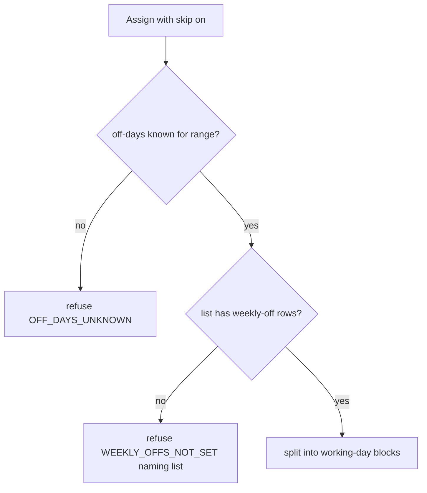

# fix: Roster skip keeps weekends when weekly offs aren't set; add one-day shift, swap and clear

## Summary

When testing on Dev (running `ba00603`), the "Skip weekly offs and holidays" switch was on but the shifts still covered Saturdays and Sundays. The code skips only days that exist as rows on the person's holiday list. A list that has public holidays but no weekly-off rows looks valid, so weekends are treated as working days and nothing warns. This plan makes that case visible: the skip refuses with a clear message, runs stop with a note instead of guessing, and preflight flags the list. The same Dev test also showed that a lead can't make a one-day change for someone who already has a shift, and that a one-day shift on an empty day isn't obvious. This plan adds three one-day options in the draft: a one-day shift for someone with no shift, a different shift for one day, and no shift for one day. Both of the last two go back to the usual shift the next day.

---

## Problem Frame

- **Skip root cause.** `roster_ops._apply` (Assign with `skip_off_days`) splits the range at days in `off["dates"]`. That set comes from `api._known_off_days` → `_holiday_dates_by_span`, which reads `Holiday` rows only. HRMS adds weekly-off rows only when HR presses "Add to Holidays" for a weekday on the Holiday List. A list that holds only public holidays is common, so with skip on the person still gets one block over every weekend in the range, with no refusal or note. `test_site` shows the same shape: `_Test Holiday List` has 6 holidays and 0 weekly-off rows. The same blind spot affects run-aware Change/End: a weekend gap counts as a known working day, so the run breaks silently at the first weekend. That is wrong, not "unknown".
- **No single-day option.** In `RosterShiftSheet.vue` the From/To fields show only when the person has no current shift. A person on a shift gets "Change shift" (from that date onward) or "End it". There is no way to cover one Tuesday with a different shift, or to leave one day empty and continue the next day. For someone with no shift, a one-day shift is possible (To = From) but not obvious.

---

## Requirements

- R1. With skip on, a person whose holiday list has no weekly-off rows is refused with a message that names the list and gives the fix (ask HR to add weekly offs, or turn skipping off). Weekends are never silently kept.
- R2. For run-aware Change/End, a list with no weekly-off rows makes non-holiday gap days "unknown" rather than "working", so the existing run-stopped note fires instead of a silent break.
- R3. Preflight warns about each holiday list in use that has no weekly-off rows.
- R4. A lead can add a one-day shift for a person with no shift that day.
- R5. A lead can give a person a different shift for one date; the usual shift continues the next day.
- R6. A lead can clear one date (no shift that day); the usual shift continues the next day.
- R7. One-day swap and clear go through the same draft → submit → HR approval flow, are validated by the shared simulator, and are mirrored in the browser and the shared `CASES` table.
- R8. The draft bar, the shift sheet and the HR approval view describe one-day changes in plain words.
- R9. Docs and runbook explain the weekly-off requirement and the new one-day options; the runbook gives a Dev check for the holiday list.

---

## Scope Boundaries

- No per-weekday patterns ("Mon/Wed/Fri") and no multi-day per-day plans in one step.
- No fallback to the Holiday List's own "Weekly Off" day field (decision KTD1).
- HR's direct-edit sheet (non-draft mode) gets no new actions; HR can do one-day edits in Desk today.
- Requests submitted before this ships keep their stored steps; approval re-checks them as today (System-Wide Impact).

### Deferred to Follow-Up Work

- One-day swap and clear in HR's direct-edit mode (new immediate endpoints).
- A multi-day "clear these dates" action (several one-day clears cover it for now).

---

## Key Technical Decisions

- **KTD1. Refuse, don't guess, when weekly offs are missing.** The user confirmed the scope. I chose refusing over falling back to the Holiday List's `weekly_off` field, because that field is only an input for HR's "Add to Holidays" button and isn't kept in step with the rows. Guessing from it could skip the wrong days with no warning.
- **KTD2. "Weekly offs missing" is a property of the list, not the range.** A list counts as missing weekly offs when it has zero `Holiday` rows with `weekly_off = 1` anywhere. Checking only the request range would misfire on short ranges that fall entirely on working days. A 7-day-working organisation is refused too; turning skipping off is the documented answer.
- **KTD3. Carried as a flag in the off-days value.** `_known_off_days` adds a flag such as `weekly_offs_missing` (plus the list name for the message) to `{from, to, dates}`. The simulator refuses a skip when it is set (new message constant next to `OFF_DAYS_UNKNOWN`). For runs, `_is_off` answers "unknown" for a non-holiday day when the flag is set. Same shape in `frontend/src/lib/rosterDraft.js`.
- **KTD4. One-day swap and clear are two new operations built from the existing steps.** New actions (working names `Swap Day`, `Clear Day`; on-screen "Different shift for one day" / "No shift that day") take `from_date` plus `assignment`; Swap also takes `shift_type`. They act on the block covering the date only; they never walk a run. Their steps are the existing primitives, so approval's step executor and the step comparison at approval need no change:
  - day after start: end the block on the day before;
  - day equal to start: cancel the block;
  - Swap: create a one-day block with the new shift;
  - if the block continues past the day: create the old shift from the next day to the old end (open-ended stays open-ended).
- **KTD5. One-day shift for someone with no shift is an Assign with To = From.** The sheet gets a "Just this day" switch that sets To to From and hides the skip switch (`skip_off_days` 0). The lead picked that day on purpose, even if it is a day off.
- **KTD6. Row doctype gains the two Select options.** `HelixHR Roster Change Row.action` options become `Assign / Change / End / Swap Day / Clear Day`. This is the app's own DocType JSON, synced on migrate; no data patch is needed because existing rows keep their values.
- **KTD7. Bulk works for the new actions.** "Apply to: whole team / pick people" with Clear Day or Swap Day uses the existing bulk path. People with no shift that day are skipped and named, as today.

---

## High-Level Technical Design

One-day operations on a block `[S .. E]` (E may be open) for date `D`, as simulator steps. Directional; the prose above is authoritative.

| Case | Swap Day (shift X) | Clear Day |
|---|---|---|
| S < D < E (or E open) | end at D-1 · create X [D..D] · create old [D+1..E] | end at D-1 · create old [D+1..E] |
| D = S < E | cancel · create X [D..D] · create old [D+1..E] | cancel · create old [D+1..E] |
| S < D = E | end at D-1 · create X [D..D] | end at D-1 |
| D = S = E | cancel · create X [D..D] | cancel |
| No block covers D | refused: no shift on that date | refused: no shift on that date |
| Swap to the same shift type | refused: already that shift | — |

---

## Implementation Units

### U1. Detect holiday lists with no weekly offs and refuse the skip

**Goal:** Fix the Dev bug at its root: never keep weekends silently.

**Requirements:** R1, R2

**Dependencies:** none

**Files:**
- Modify: `helixhr/api.py` (`_known_off_days`, or a helper next to `_holiday_dates_by_span`; cached per list)
- Modify: `helixhr/roster_ops.py` (`_off_days`, `_is_off`, Assign skip branch, new message constant)
- Modify: `frontend/src/lib/rosterDraft.js` (mirror)
- Test: `helixhr/tests/test_roster_ops.py`, `frontend/src/lib/rosterDraft.test.js` (shared `CASES`), `helixhr/tests/test_roster_change.py`

**Approach:**
- Per holiday list in the spans, one cached query: does any `Holiday` row with `weekly_off = 1` exist? Put the flag and the list name in the returned off-days value.
- Simulator: skip on + flag → refuse with a message naming the list. `_is_off` with the flag → None for days not in `dates`, so run notes fire (R2).
- Two spans where only one list lacks weekly offs: flag it if any span's list lacks them (conservative).

**Execution note:** Before any code, run the Dev check (Operational Notes) and confirm Dev's resolved lists have zero weekly-off rows; stop and re-diagnose if not. Then add the `CASES` rows first in both suites and watch them fail. Then write a failing `test_roster_change` test that reproduces Dev: a holiday list with holidays only, skip on, Mon–Sun range.

**Patterns to follow:** the `OFF_DAYS_UNKNOWN` path; the cache dict in `_known_off_days`; the shared `CASES` table.

**Test scenarios:**
- Happy path (integration): a list with weekly-off rows, skip on, Mon 2 Nov – Sun 15 Nov 2026 → two Mon–Fri blocks (regression guard).
- Bug repro (integration): a list with holidays but no weekly-off rows, skip on, same range → refused; the message names the list; no blocks saved.
- Edge (CASES): flag set, skip off → one block over the range, no refusal.
- Edge (CASES): flag set, run-aware Change on block 1 of a run split by a weekend gap → acts on block 1, note `RUN_STOPPED_UNKNOWN`.
- Edge: two spans, second list missing weekly offs → refused.
- Edge: legacy mode (`off_days=None`) → unchanged.
- Integration: a pending v2 request saved before the fix with a single weekend-spanning block → approval re-check refuses with the person named (skip refusal), so nothing is applied wrong.

**Verification:** the Dev repro test passes; both `CASES` suites pass identically.

---

### U2. Preflight warning for holiday lists with no weekly offs

**Goal:** Let HR find and fix the data before leads hit the refusal.

**Requirements:** R3

**Dependencies:** none

**Files:**
- Modify: `helixhr/preflight.py` (new check next to `check_holiday_list_coverage`, registered in `CHECKS`)
- Test: `helixhr/tests/test_preflight.py`

**Approach:** collect the lists in use: company default holiday lists plus Holiday List Assignments for active employees, as the existing check resolves them. WARN listing the lists that have no weekly-off rows, with the fix ("Add to Holidays" for the weekly off day) or, for a 7-day-working company, turning off "Skip weekly offs and holidays". PASS otherwise.

**Patterns to follow:** `check_holiday_list_coverage`, `_result`, and the capped "and N more" listing.

**Test scenarios:**
- PASS when every list in use has weekly-off rows.
- WARN naming the list with only public holidays.
- Lists not in use (no company or employee resolves them) are ignored.
- A resolver that throws doesn't break the run (same guard as the existing check).

**Verification:** `bench --site test_site execute helixhr.preflight.run` shows the new line.

---

### U3. Simulator: Swap Day and Clear Day

**Goal:** The rules engine for one-day swap and clear, identical in Python and the browser.

**Requirements:** R5, R6, R7

**Dependencies:** none (U1 touches the same files; run serially)

**Files:**
- Modify: `helixhr/roster_ops.py` (`ACTIONS`, `op_date`, `_apply`, `affected_window`, message constants, module docstring)
- Modify: `frontend/src/lib/rosterDraft.js`
- Test: `helixhr/tests/test_roster_ops.py`, `frontend/src/lib/rosterDraft.test.js`

**Approach:** follow the KTD4 table. The target is the named assignment if it covers the day, else the covering block (`_target`); never run-aware. `affected_window`: start = D, end = the tail's end (open → None), widened by the steps as today. Swap to the same shift type is refused with a new message. `BAD_ACTION` text lists the new actions. Widen the `NO_SHIFT_TYPE` guard so Clear Day, like End, needs no shift type.

**Execution note:** Write the `CASES` rows for every table cell first in both suites.

**Test scenarios:**
- Rows 1–5 of the table for both actions, and row 6 (same shift type) for Swap Day only, as `CASES` rows (expected steps and coverage).
- Open-ended block, Clear on Wed → end Tue, create old from Thu, open-ended.
- Two ops in one draft: Swap Tue then Clear Thu on the same block → the second acts on the tail the first created.
- Swap on a day already swapped in the draft → acts on the one-day block (D = S = E row).
- Refusals change nothing and the other ops still run.
- Legacy mode runs the same steps (the new actions don't depend on off days).

**Verification:** both suites pass the same `CASES`; `simulate` steps for each case match the table.

---

### U4. API and doctype: accept, store, approve the new operations

**Goal:** One-day operations flow through draft save, bulk, submit and approval.

**Requirements:** R7

**Dependencies:** U3

**Files:**
- Modify: `helixhr/helixhr/doctype/helixhr_roster_change_row/helixhr_roster_change_row.json` (Select options)
- Modify: `helixhr/api.py` (`_ROSTER_OP_FIELDS`, bulk op handling, and any action-to-label text in the request detail or HR notification)
- Test: `helixhr/tests/test_roster_change.py`

**Approach:** register the field sets (Swap Day: `shift_type`, `from_date`, `assignment`; Clear Day: `from_date`, `assignment`). Approval needs no new code: it re-simulates the request, returns it when the re-simulated steps differ from the stored ones, and executes the re-simulated steps. Confirm this, and confirm the "cancels before creates" order holds for a D = S cancel followed by creates. Bulk: an op with no employee resolves per person as today.

**Test scenarios:**
- Integration: lead saves a Swap Day → payload preview shows three blocks; submit; HR approves → Shift Assignments: old ended D-1, X on D, old from D+1.
- Integration: Clear Day on the start date of an open-ended assignment → old cancelled, new open-ended from D+1.
- Integration: Clear Day for the whole team on one date → covered people get the change; uncovered people are named as skipped.
- Error: Clear Day on a date with no shift → problem names the person; submit is blocked as for other refusals.
- Error: today or past date → the existing "tomorrow at the earliest" refusal.
- Integration: HR edits the assignment after submit → approval returns the request as changed (existing conflict path).

**Verification:** the approve path creates the expected Shift Assignments in a real HRMS write; `bench migrate` on test_site shows the new options.

---

### U5. Shift sheet, draft bar and approval view

**Goal:** Leads can pick the one-day options; everyone reads them in plain words.

**Requirements:** R4, R5, R6, R8

**Dependencies:** U4

**Files:**
- Modify: `frontend/src/components/RosterShiftSheet.vue`, `frontend/src/lib/rosterRequests.js` (`opLabel`, `blocksLabel`, `isSkip`), `frontend/src/components/RosterDraftBar.vue`, `frontend/src/components/approvals/RosterChangeReview.vue`
- Test: `frontend/src/lib/rosterRequests.test.js`, `frontend/tests/e2e/roster.spec.ts`

**Approach:**
- Assigned cell in propose mode: actions become "Change shift", "Different shift for one day", "No shift that day", "End it". The one-day actions use the cell's date (the "on" date field), plus a shift picker for the swap. The helper text says the usual shift continues the next day.
- Empty cell: a "Just this day" switch sets To = From and hides the skip switch (KTD5).
- The sheet shows the server's weekly-offs refusal inline with Save disabled (the existing Save-stays-off-after-refusal behaviour already exists; make sure the new message reaches it).
- Labels: "Night shift on Tue 10 Nov only", "No shift on Tue 10 Nov".

**Test scenarios:**
- vitest: `opLabel` for Swap Day / Clear Day; `isSkip` false for both.
- e2e: lead opens an assigned cell, picks "No shift that day", saves → draft row reads "No shift on <date>"; submit succeeds.
- e2e: lead picks "Different shift for one day" with another shift → draft row label and block preview.
- e2e: empty cell with "Just this day" on → skip switch hidden; the row saves as a one-day shift.
- e2e (stubbed with `page.route`): save refused with the weekly-offs message → message shown inline, Save disabled.
- Accessibility: new actions reachable by keyboard; labels name the person and date.

**Verification:** a lead can do all three one-day changes from the grid without opening Desk.

---

### U6. Docs, runbook and Dev check

**Goal:** Record the weekly-off requirement and the one-day options; give ops a check for Dev.

**Requirements:** R9

**Dependencies:** U1–U5

**Files:**
- Modify: `docs/architecture.md` (Roster draft controls), `docs/runbook.md` (Roster section)

**Approach:** in the runbook, give the Dev check: a query that finds each holiday list in use and counts its weekly-off rows, plus the fix in Desk (Holiday List → Weekly Off → "Add to Holidays"). In architecture, describe KTD1–KTD4 behaviour. No review tables.

**Test expectation:** none -- docs only.

**Verification:** docs match the shipped behaviour.

---

## System-Wide Impact

- **Leads on sites whose holiday lists lack weekly offs** now get a refusal where they used to get weekend-spanning shifts silently. HR fixes the list, or the lead turns skipping off.
- **Pending requests** built under the old behaviour: approval recomputes the steps. With the new refusal it returns them to the lead, naming the person. Nothing is applied wrongly.
- **Run-aware Change/End** on those sites now notes "can't be worked out" where it used to break silently.
- **HR approval view and notifications** show the two new actions.
- **Preflight** gains one WARN check.

---

## Risks & Dependencies

| Risk | Mitigation |
|---|---|
| Dev's real cause differs (e.g., weekly offs exist but the employee resolves another list) | Run the Operational Notes Dev check before starting U1; the U1 repro test pins the assumed cause. If Dev's lists do have weekly offs, stop and re-diagnose before U1. |
| HRMS overlap validation rejects a create when steps run out of order | Same-day cancel/end runs before creates (the same-day cancel-before-create order); the U4 integration test exercises the real HRMS writes. |
| A list-level flag is too coarse for a 7-day-working company | Documented: turn skipping off. Preflight WARN explains. |
| JS/Python drift on the new actions | Shared `CASES` rows written first in both suites. |

---

## Operational Notes

- Before starting U1, run on Dev: find each holiday list Dev's employees resolve, and count its `weekly_off` rows. Zero confirms the root cause. The query and the Desk fix go in the runbook (U6).
- After deploy: run `bench migrate` (new Select options), build, clear-cache, then preflight.

---

## Sources

- Dev test report (user, 2026-11-05): skip on, weekends kept; no single-day option.
- `helixhr/roster_ops.py` (`_apply`, `_working_spans`, `_is_off`), `helixhr/api.py` (`_known_off_days`, `_holiday_dates_by_span`, `_roster_draft_ops`, `_ROSTER_OP_FIELDS`), `frontend/src/components/RosterShiftSheet.vue` (`showsSkip`, `v-if="!assigned"` date fields), `helixhr/preflight.py` (`check_holiday_list_coverage`).
- `test_site` data: `_Test Holiday List` has 6 holidays and 0 weekly-off rows.
