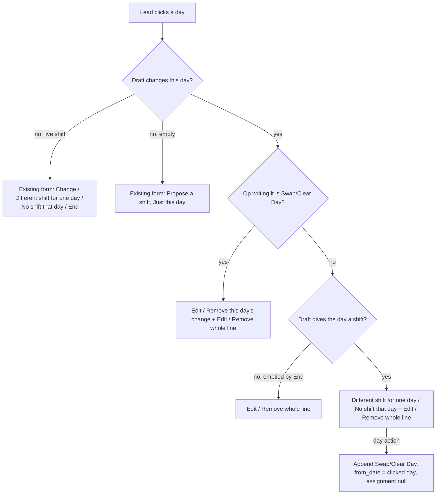

# fix: Roster — separate Skip weekends / Skip holidays, and one-day edits on draft days

## Summary

Third attempt at two lead-facing roster problems on Dev. Both root causes are traced in code; a Dev check (U0) confirms the data shape before building.

1. **"Skip weekly offs and holidays" keeps weekends.** The skip only knows dates written in the person's holiday list. HRMS writes weekend rows only when HR presses "Add to Holidays"; Dev's lists are believed to hold public holidays only. Plan 2026-11-05-001 A1 then made that case *keep weekends with a note* by design, and the grid's "Off" marker reads the same rows. Before A1 the same list also kept weekends, so deployment state does not change the symptom.
2. **Editing the 15th of a drafted month edits the whole month.** A day covered by a draft line opens that line's summary with only Edit (whole line) and Remove (whole line). The one-day actions from 2026-11-05-001 appear only on days with a *live* assignment.

Fix: two independent ticks, **Skip weekends** and **Skip holidays** (both on by default), where a weekend is the list's weekly-off rows, else Saturday + Sunday; the grid marks those days "Off" by the same rule; and day-level actions on draft days, with whole-line Edit / Remove that carry their day changes along.

---

## Problem Frame

### Root cause 1 — skip has no weekend concept

- `api._known_off_days` builds `{from, to, dates}` from Holiday rows of the lists in force (`_holiday_list_spans`, `_holiday_dates_by_span`, which already tags each date `holiday` / `weekly_off`).
- HRMS/ERPNext has no weekend setting: `Holiday List.weekly_off` is a single-day, `no_copy` helper for the "Add to Holidays" button; the durable record is Holiday rows with `weekly_off = 1`.
- `roster_ops._apply` (Assign) skips exactly those dates. With no weekly-off rows A1 sets `weekly_offs_missing`, keeps weekends and adds `WEEKLY_OFFS_NOT_SET` — what the user sees.
- `get_roster_week` row `off_days` (the grid's "Off") comes from the same Holiday rows, so even a correct skip would show those weekends as plain empty days.

### Root cause 2 — draft days have no day-level actions

- `pages/Roster.vue openCell` passes `cellProposal(...)` when the draft changes the cell; `RosterShiftSheet.vue` `showsProposal` renders only Edit / Remove of `proposal.op` (the whole line).
- The Swap Day / Clear Day form needs `assigned`, i.e. a live `cell.assignment`.
- Server side already works: Swap/Clear target the block covering the day in the *simulated* rows (including `new-…` blocks), and `api._apply_roster_step` maps `new-…` keys to the Shift Assignment an earlier step created.
- A Clear Day on a draft-only day leaves no covering block and no live assignment, so `rosterRequests.cellProposal` returns null: the day reads untouched and opens "Propose a shift".
- Rows with a pending request are not clickable; edits after sending need the existing Reopen, which merges the request back into the draft. The user's case is the draft before submit.

---

## Requirements

**Skips**

- R1. "Skip weekends" skips: Holiday rows with `weekly_off = 1` where the range is covered by a list that has such rows; Saturday and Sunday where covered by a list with none, by no list, or past the end of a list with none.
- R2. "Skip holidays" skips Holiday rows with `weekly_off = 0` of the list(s) in force.
- R3. For a new Assign with an end date, both ticks are shown and default to on; each toggles alone; editing a saved line keeps its values.
- R4. Skip weekends works without a holiday list. Skip holidays with no list, or past a list's end, refuses with a sentence that says to untick Skip holidays or ask HR. Skip weekends past the end of a list *with* weekly-off rows refuses the same way.
- R8. Lines saved before this change (`skip_off_days = 1`) read as both ticks on. A pending request whose steps differ under the new rule is returned at approval with the existing "days off or shifts changed" sentence, never applied silently differently.
- R9. The browser simulator mirrors the server (shared CASES green in both).
- R11. The grid shows "Off" on every day R1 treats as a weekend and on holidays, for the visible week.

**Draft-day actions**

- R5. A draft day that the draft gives a shift, and that carries no one-day change yet, offers "Different shift for one day" and "No shift that day" for that date, plus "Edit whole line" and "Remove whole line".
- R6. One-day changes on a draft-only day pass HR approval exactly as previewed.
- R7. A day carrying a draft one-day change reads as proposed; clicking it offers Edit / Remove of that change, plus Edit / Remove whole line.
- R12. "Remove whole line" also removes that person's one-day changes on dates the line covered, in the same save, and the summary names them. "Edit whole line" that would leave a one-day change uncovered refuses with a sentence naming that date.

**Unchanged**

- R10. HR's own roster sheet and approval behaviour are unchanged apart from labels.

---

## Key Technical Decisions

- **KTD1. Weekend = list weekly-off rows, else Sat+Sun, per span** (user decision 2026-11-06). Per span because one range can cross two lists (`_holiday_list_spans` returns ≤ 2). A list "has weekly offs" when any Holiday row of the *whole list* has `weekly_off = 1` (`api.has_weekly_offs`). Past a list's `to_date`: Sat+Sun if that list has no weekly-off rows, unknown if it has (its pattern can't be extended safely). One shared helper serves the simulator payload and the grid (R11).
- **KTD2. Off days become two known sets.** Per employee `{weekends: {from, to, dates} | null, holidays: {from, to, dates} | null}`. Keeping them apart lets weekends work without a list while holidays refuse.
- **KTD3. `_is_off` for run-aware Change / End = union.** True if in either known set; False only where both are known and the day is in neither; else None (run stops with the existing `RUN_*` notes). Weekends become known on Dev, so runs walk them.
- **KTD4. Retire `WEEKLY_OFFS_NOT_SET`.** The sheet states the rule instead (per-tick helper text, U4).
- **KTD5. Two new Check fields, legacy kept.** `skip_weekends`, `skip_holidays` on HelixHR Roster Change Row; `skip_off_days` stays (hidden, read-only). Patch copies `1` into both. `_roster_draft_ops` maps an incoming truthy `skip_off_days` to both *when neither new key is present*. Payload rows keep emitting `skip_off_days = 1` when both new flags are 1, so an old-build tab round-trips a draft without clearing them.
- **KTD6. No legacy simulator path.** Approval already re-simulates and compares steps; a changed result returns the request. The lead resends.
- **KTD7. Day actions append a one-day op with `assignment: null`.** The server targets the block covering that date in the simulated rows, so the op follows the draft when line indexes shift.
- **KTD8. Whole-line actions carry their day changes.** Remove whole line drops the person's Swap/Clear Day ops whose date lies in the line's From..To (inclusive) in the same `save_roster_draft` call; Edit whole line checks the same set before saving and refuses in the browser, naming the date ("Remove the one-day change on 15 Mar first"). This avoids the full-draft re-simulation refusing the save with `NO_SHIFT_ON_DATE`.
- **KTD9. No day actions on an emptied day or a day that already has a one-day change.** An End-emptied day has nothing to swap or clear; a day with a Swap/Clear is changed through that op's Edit (shift only — moving the date is Remove then re-add).

---

## High-Level Technical Design

Weekend and holiday sets per part of the range (R1, R2, R4, R11):

| Range part covered by | Weekend set | Holiday set |
|---|---|---|
| List with weekly-off rows | its `weekly_off=1` rows | its `weekly_off=0` rows |
| List with no weekly-off rows (Dev) | Sat + Sun | its rows |
| No list | Sat + Sun | unknown → Skip holidays refuses |
| Past end of a list **without** weekly-off rows | Sat + Sun | unknown → Skip holidays refuses |
| Past end of a list **with** weekly-off rows | unknown → Skip weekends refuses | unknown → Skip holidays refuses |

Draft-day click routing (R5, R7, KTD9):

---

## Implementation Units

### U0. Confirm the Dev data shape (no code)

**Goal:** prove root cause 1 on Dev before building, so a third miss is caught now.

**Requirements:** R1

**Dependencies:** none

**Files:** none (scratch console snippet; the user runs it on Dev)

**Approach:** for the lead's reports on Dev, record per resolved holiday list: weekly-off row count, `from_date` / `to_date`, and whether the month the lead drafts lies inside it; plus the deployed commit and the Patch Log entry for the 2026-11-05 fields. If a report's list has weekly-off rows covering that month, stop and re-diagnose before U1.

**Test expectation:** none -- diagnostic only.

**Verification:** output pasted back and matches "no weekly-off rows" (or a list ending before month end, also handled by KTD1).

### U1. Two skip flags on the row and in the draft API

**Goal:** store and carry `skip_weekends` / `skip_holidays` everywhere `skip_off_days` travels today.

**Requirements:** R3, R8

**Dependencies:** none

**Files:**
- Modify: `helixhr/helixhr/doctype/helixhr_roster_change_row/helixhr_roster_change_row.json`
- Create: `helixhr/patches/v1_0/split_roster_skip_flags.py`
- Modify: `helixhr/patches.txt`
- Modify: `helixhr/api.py` (`_roster_draft_ops`, `_request_ops`, draft/detail payloads that echo ops)
- Test: `helixhr/tests/test_roster_change.py`

**Approach:**
- Two Check fields after `skip_off_days`, default 0; `skip_off_days` → hidden + read_only, description "Before plan 2026-11-06-002: both skips together."
- `_roster_draft_ops`: each flag kept only on an Assign with an end date; legacy mapping per KTD5.
- `_request_ops` / payload rows: the two flags, plus `skip_off_days` = 1 iff both are 1 (KTD5).
- Patch: rows with `skip_off_days = 1` and both new flags 0 → both 1; idempotent; commented in `patches.txt` like its neighbours.

**Patterns to follow:** `_flag` and the KTD1 comment in `_roster_draft_ops`; `patches/v1_0/mask_employee_identifier_history.py`.

**Test scenarios:**
- Assign with an end date, `skip_weekends=1, skip_holidays=0` → stored exactly.
- Flags on an Assign without an end date, or on Change/End/Swap/Clear → stored 0.
- Legacy payload `skip_off_days=1` only → both 1; `skip_off_days=1` with `skip_weekends=0` present → weekends 0, holidays 0 (new keys win).
- Old-tab round trip: draft payload row echoed back with only `skip_off_days` (as returned) → flags unchanged.
- Garbage flag values → treated as `_flag` does today.
- Patch: `skip_off_days=1` row → both 1; rerun unchanged; `skip_off_days=0` untouched.

**Verification:** migrate on test_site adds the fields; tests green.

### U2. Weekend / holiday sets for the simulator and the grid

**Goal:** one helper returns `{weekends, holidays}` per KTD1/KTD2; `_roster_off_days` and `get_roster_week` both use it.

**Requirements:** R1, R2, R4, R11

**Dependencies:** none

**Files:**
- Modify: `helixhr/api.py` (`_known_off_days`, `_roster_off_days`, `get_roster_week` row `off_days` / `_holiday_kinds`)
- Test: `helixhr/tests/test_roster_change.py`, `helixhr/tests/test_api_roster.py`

**Approach:**
- Holidays: today's known range and clipping, `holiday` kinds only; null with no list.
- Weekends per span per the KTD1 table, including the past-end rule; no list → Sat+Sun over the range.
- Grid: weekend dates join the row's `off_days` with kind `weekly_off`, so the cell renders "Off" as for list rows today.
- Remove `weekly_offs_missing`. Cache keys as today.

**Patterns to follow:** existing `_known_off_days` clipping; `HOLIDAYS_ONLY_LIST` / `ensure_skip_list` fixtures (2031 dates); tests create their own lists and assignments (CI order memory).

**Test scenarios:**
- List with Sat/Sun weekly-off rows + one holiday → weekends = rows, holidays = the holiday.
- Sunday-only weekly-off list → Saturdays are working.
- Holidays-only list → every Sat+Sun is a weekend; holidays = list rows.
- No list → weekends Sat+Sun, holidays null.
- Range crossing from a holidays-only list to a weekly-off list → Sat+Sun before the split, rows after.
- Range past the end of a holidays-only list → weekends Sat+Sun to range end, holidays end at `to_date`.
- Range past the end of a weekly-off list → both sets end at `to_date`.
- Grid: `get_roster_week` for a report on a holidays-only list marks Sat and Sun `off_days` as weekly offs.

**Verification:** payload and grid tests green; no caller reads `dates` / `weekly_offs_missing`.

### U3. Simulator: two skips, union off-day rule (Python + browser mirror)

**Goal:** `roster_ops` and `rosterDraft.js` skip what each tick asks and walk runs over known weekends.

**Requirements:** R1, R2, R4, R9

**Dependencies:** U1, U2

**Files:**
- Modify: `helixhr/roster_ops.py`
- Modify: `frontend/src/lib/rosterDraft.js`
- Test: `helixhr/tests/test_roster_ops.py`, `frontend/src/lib/rosterDraft.test.js` (shared CASES)

**Approach:**
- `_off_days` parses the new shape; `_is_off` per KTD3.
- Assign: skipped set = weekends if `skip_weekends` ∪ holidays if `skip_holidays`; a ticked set unknown for any day of the range refuses: `WEEKENDS_UNKNOWN` ("Their weekends can't be worked out for those dates. Untick Skip weekends, or ask HR to set up their holiday list.") and `HOLIDAYS_UNKNOWN` ("Their holidays can't be worked out for those dates. Untick Skip holidays, or ask HR to set up their holiday list."). `SKIP_MAX_DAYS`, `NO_WORKING_DAYS` unchanged.
- Delete `WEEKLY_OFFS_NOT_SET`; keep `RUN_*`, `RUN_SPLIT`; Swap/Clear untouched.

**Execution note:** add the new CASES rows first and watch them fail in both runners.

**Patterns to follow:** shared CASES table; 2026-11-05-001 mirror discipline.

**Test scenarios** (Mon 3 – Fri 28 Mar 2031, holiday Wed 19 Mar, unless stated):
- Holidays-only list, both ticks → blocks Mon–Fri each week, 19 Mar excluded. Covers root cause 1.
- Weekends only → 19 Mar kept, every Sat/Sun dropped.
- Holidays only → weekends kept, 19 Mar dropped, no note.
- Neither tick → one block 3–28 Mar.
- Sunday-only list, weekends ticked → Saturdays kept.
- No list: weekends ticked → Sat/Sun dropped; holidays ticked → `HOLIDAYS_UNKNOWN`.
- Range past the end of a weekly-off list, weekends ticked → `WEEKENDS_UNKNOWN`.
- Only Sat 8 – Sun 9 Mar, weekends ticked → `NO_WORKING_DAYS`.
- 93-day range → `SKIP_SPAN`.
- Run-aware End on a Mon–Fri run with weekend gaps (holidays-only list) → whole run ends (A1 stopped with a note).
- Existing `RUN_SPLIT` case after a weekend stays green.

**Verification:** both runners green on the same CASES; ruff and eslint clean.

### U4. Sheet, draft bar and HR review: two ticks and their labels

**Goal:** the lead picks each skip and can tell what each does; every surface names the right skip.

**Requirements:** R3, R4, R10

**Dependencies:** U1

**Files:**
- Modify: `frontend/src/components/RosterShiftSheet.vue`
- Modify: `frontend/src/lib/rosterRequests.js` (normaliser, per-flag helpers replacing `skipsOffDays`, `opLabel`)
- Modify: `frontend/src/components/RosterDraftBar.vue`
- Modify: `frontend/src/components/approvals/RosterChangeReview.vue`
- Test: `frontend/src/lib/rosterRequests.test.js`, `frontend/tests/e2e/roster.spec.ts` (existing `roster-skip-off-days` tests: testids, label, saved flags)

**Approach:**
- Two switches in place of one, both shown when `showsSkip`; `fill()` sets each from the op (legacy → both) or on for a new Assign.
- Helper text per switch, tied with `aria-describedby`: weekends "Saturday and Sunday, unless their holiday list sets weekly offs"; holidays "Public holidays on their holiday list".
- `proposedOp` sends both flags; bulk Apply-to copies them; a refused person is named in the existing bulk skipped list.
- Labels: "skips weekends and holidays" / "skips weekends" / "skips holidays"; neither → no skip label (as today when off).
- Refusals show inline in the sheet as today.

**Test scenarios:**
- Normaliser: `{skip_off_days: 1}` → both; `{skip_weekends: 1}` → weekends only; non-Assign → both 0.
- Label per combination, none when neither.
- E2E: new ranged Assign shows two switches, both on; unticking weekends saves `skip_weekends: 0, skip_holidays: 1`.

**Verification:** vitest and e2e green; build OK.

### U5. Day actions on draft days

**Goal:** the 15th of a drafted month can get a different shift or no shift without touching other days, and whole-line actions keep working after.

**Requirements:** R5, R6, R7, R12

**Dependencies:** U1, U3, U4 (U4 shares the sheet)

**Files:**
- Modify: `frontend/src/components/RosterShiftSheet.vue`
- Modify: `frontend/src/lib/rosterRequests.js` (`cellProposal`, `opIndexForCell`, a helper listing a line's dependent day ops)
- Modify: `frontend/src/pages/Roster.vue` (selected payload: op action, dependent day ops; remove of several indexes in one save)
- Test: `frontend/src/lib/rosterRequests.test.js`, `helixhr/tests/test_roster_change.py`, `frontend/tests/e2e/roster.spec.ts`

**Approach:**
- Summary branch routed per the flowchart (KTD9). Whole-line buttons read "Edit whole line" / "Remove whole line"; when the line has day changes the summary lists them ("Also removes: no shift on 15 Mar").
- Day form: date = the clicked day, read-only; swap picker starts on a shift other than `proposal.shift_type`; "No shift that day" saves on one press (it is a draft and removable); Back returns to the summary; no "Apply to". Save appends via `proposeChange(op, null)` with `assignment: null` (KTD7).
- Remove whole line: one save without the line and its dependent day ops (KTD8). Edit whole line: before saving, refuse naming any dependent day the edited line no longer covers.
- `cellProposal`: a person's Swap/Clear Day op on this date returns a proposal with that op's index — `shift_type` the swap's shift or null — even with no live assignment (R7).
- Labels reuse "Different shift for one day" / "No shift that day" from the live form.
- Focus moves to the day form's first control and back to the cell on close (existing `returnKey`).

**Patterns to follow:** `PROPOSE_ACTIONS`, `SHEET_ACTION`, `oneDayAction`, the refused-key guard (`refusedKey`).

**Test scenarios:**
- `cellProposal`: Assign 3–28 Mar + Clear Day 14 Mar, no live shift → 14 Mar `{index: 1, shift_type: null}`; 13 Mar the Assign's index.
- `cellProposal`: Swap Day 14 Mar to Night in a draft Morning line → 14 Mar Night with the Swap's index; 17 Mar Morning with the Assign's.
- Routing: a day after a draft End offers whole-line actions only; a Swap day offers its Edit/Remove plus whole-line.
- Dependent-ops helper: Assign 3–28 Mar with Clear 14 and Swap 21 → both listed; a Clear on 31 Mar (another line) not listed.
- Server: Assign 3–28 Mar (both skips) + Clear Day 14 → preview excludes 14; submit; HR approves → Shift Assignments match the preview exactly (R6).
- Server: same with Swap Day 14 → one-day Night block; Morning resumes the next working day.
- Server: Clear Day on a line's first day → that block cancelled, tail created (2026-11-05-001 KTD4 path on a `new-…` block).
- E2E: draft March for one report with both ticks; click 14 Mar → day actions + whole-line actions; "No shift that day" → 14 Mar "Proposed: no shift", 13 and 17 Mar unchanged; click 14 Mar → its Edit/Remove; Remove restores the day; add it again, then "Remove whole line" → draft empty in one step.
- E2E: Edit whole line to end 10 Mar with a change on 14 Mar → refusal names 14 Mar; nothing saved.

**Verification:** unit, integration and e2e green.

### U6. Preflight, docs, runbook, memory

**Goal:** the operator story matches the new rule.

**Requirements:** R1, R8

**Dependencies:** U2, U3

**Files:**
- Modify: `helixhr/preflight.py` (`check_holiday_list_weekly_offs`)
- Modify: `helixhr/tests/test_preflight.py`
- Modify: `docs/architecture.md` (roster skip section from 2026-11-05-001)
- Modify: `docs/runbook.md` ("Skip … kept the weekends" paragraph)

**Approach:**
- Preflight stays WARN (leave and attendance still count those weekends as working days). It names lists with no weekly-off rows ("roster treats Saturday and Sunday as the weekend") and lists whose weekly-off rows stop more than 7 days before `to_date` (partial coverage, where KTD1's whole-list rule keeps weekends).
- Architecture: replace the A1 paragraph with KTD1–KTD3 and KTD7–KTD9.
- Runbook: "Weekends skipped on a 6-day or weekend-working site" → untick Skip weekends, or HR adds the right weekly-off rows.
- Memory: mark `roster-weekly-offs-note-not-refuse` superseded by this plan's KTD1.

**Test scenarios:**
- Holidays-only list → WARN names it and mentions Saturday and Sunday.
- Weekly-off rows ending in June on a list to December → WARN names it as partial.
- Full coverage → PASS.

**Verification:** test_preflight green apart from the known pre-existing drift failure.

---

## Scope Boundaries

- HR's own roster sheet (`mode="hr"`) gains no ticks and no new actions.
- No company-level weekend setting (user chose list-else-Sat+Sun).
- No change to approval execution or snapshot versioning (KTD6).
- No HRMS / ERPNext / Frappe core change; no edits to Holiday Lists.
- Edits after submit stay on the existing Reopen path.

### Deferred to Follow-Up Work

- A live "will skip N days" count in the sheet (needs off days in the browser before save; the draft bar shows the resulting blocks after save today).
- Folding a one-day change into the line's own creates at approval, so a cleared first day does not leave a cancelled Shift Assignment in Desk.

---

## Risks & Dependencies

| Risk | Mitigation |
|---|---|
| Dev data differs from the assumed shape | U0 before building; acceptance replay after deploy. |
| Pending requests sent with skip on a holidays-only list re-simulate differently | Returned at approval with the existing sentence (KTD6); release note asks leads to resend. |
| Weekend-working or 6-day teams on holidays-only lists lose weekend shifts by default | Lead unticks Skip weekends and checks the draft bar's blocks; preflight + runbook tell HR to add the right weekly-off rows. |
| A list's weekly-off rows cover only part of its period | Preflight partial-coverage WARN (U6). |
| Old-build tab during deploy | KTD5 mapping both ways. |
| Python/JS simulator drift | Shared CASES, red first. |
| CI class-order exposure | New tests own their lists, assignments and email account. |

---

## Operational Notes

- After deploy on each site: `bench migrate` (fields + patch), frontend build, clear-cache, preflight.
- **Acceptance on Dev (the user's exact flow):** draft March for one report to month end with both ticks → weekends and holidays absent from the draft and shown "Off"; click the 15th → "No shift that day" → only the 15th changes; submit; HR approves → Shift Assignments match the draft.
- Leads with a pending roster request may see it returned once; resend from the draft.

---

## Sources

- `helixhr/roster_ops.py` (`_off_days`, `_is_off`, Assign skip, Swap/Clear), `frontend/src/lib/rosterDraft.js`.
- `helixhr/api.py` `_known_off_days`, `_roster_off_days`, `_holiday_dates_by_span`, `get_roster_week` row `off_days`, `_roster_draft_ops`, `_request_ops`, `save_roster_draft` → `_refuse_roster_problems`, `_roster_request_review`, `_apply_roster_step`, `add_roster_ops_bulk`.
- `frontend/src/components/RosterShiftSheet.vue` (`showsProposal`, `assigned`, `PROPOSE_ACTIONS`), `frontend/src/pages/Roster.vue` (`openCell`, `proposable`), `frontend/src/lib/rosterRequests.js` (`cellProposal`, `opIndexForCell`).
- `erpnext/setup/doctype/holiday_list/holiday_list.json` (`weekly_off` is a no_copy single-day helper).
- Plans 2026-11-03-001 (skip KTD1–KTD4), 2026-11-05-001 (A1 superseded here; one-day ops).
- Doc review 2026-11-06: coherence, feasibility, design-lens, adversarial — findings folded in above.
